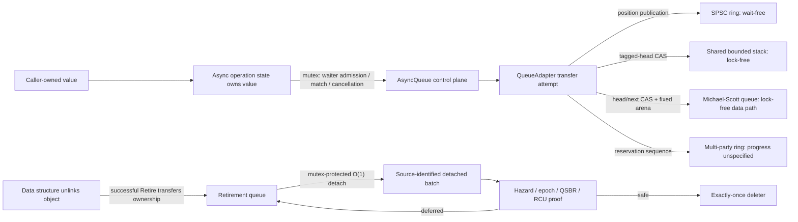

# Sora Concurrency migration baseline

This document records the functional, performance, ownership, and progress-guarantee baseline for the migration from
Mashiro concurrency facilities to Sora. It is an evidence boundary, not a claim that every operation is lock-free or
that one workstation proves performance on every target.

## Decision

The migration gate is a one-sided 3% non-inferiority test: every case must have a 95% bootstrap confidence-interval
lower bound of at least `0.97` for `Sora throughput / Mashiro throughput`. A control run cannot substitute for a failed
migration comparison, and failed samples may not be discarded or selectively rerun.

This is not a two-sided TOST equivalence proof. A point estimate above one is not evidence of a universal speedup, and
the result applies only to the recorded compiler, machine, placement, build, and workload.

## Recorded environment

| Property | Value |
| --- | --- |
| Date | 2026-08-17 |
| Source revision | `02018d7` plus the reviewed Concurrency and benchmark changes recorded with this baseline |
| OS | Windows 11 Pro, build 26200 |
| CPU | Intel Core i7-12700H, 14 cores / 20 logical processors |
| Toolchain | COCA clang-p2996, Clang 21.0.0git (`6e677e01...`), libc++ |
| Language | `-std=gnu++26 -freflection-latest` |
| Benchmark build | `x64-release`, RelWithDebInfo with the target's `-O3` policy |
| Placement | high-priority process; workers pinned to distinct preferred Windows CPU sets |

Authoritative sample-level evidence is versioned in:

- `Sora/benchmarks/baselines/ConcurrencyMigration/concurrent-map-final-crossover-49-250ms.csv`
- `Sora/benchmarks/baselines/ConcurrencyMigration/async-queue-final-49-500ms.csv`

Their SHA-256 digests are byte-level digests of the final artifacts; the benchmark's CRLF output is intentionally
preserved. Benchmark executables write fresh artifacts under `build/x64-release/migration-evidence/`.

| Artifact | SHA-256 |
| --- | --- |
| `concurrent-map-final-crossover-49-250ms.csv` | `6251D939C8DFD9000B234BAE68F77841DBFBA1EE3C2C44A2BC95CEC87521446D` |
| `async-queue-final-49-500ms.csv` | `8EDC845729FB3807596B0C386F2B4C8D17F0E662FC39C79650E08A04ABC1F924` |

## Measurement protocol

Each case uses 49 same-process paired samples and two warm-ups. Map runs are calibrated to at least 250 ms and queue
runs to at least 500 ms. Every map sample executes all four crossover blocks in a sample-rotated order:

```text
ABBA, BAAB, CDDC, DCCD
```

`A/B` are Mashiro/Sora in the forward runner; `C/D` are Sora/Mashiro in the reverse runner. Thus each implementation
occupies both template positions and both positions inside each paired block. Insert repeats the complete four-block
crossover four times per sample. Fixed lookup retains capacity `2^20`; fixed insert uses a benchmark-only `2^23`
capacity so the calibrated run is not truncated by exhaustion. These choices do not change production `ConcurrentMap`.

Each worker is pinned and promoted; each sample validates result count and content. The reported estimate is the median
of paired throughput ratios. The 95% percentile interval uses 20,000 deterministic bootstrap resamples of those ratios.
The overall value is the geometric mean of case medians.

Run from `build/x64-release/bin` after activating the COCA environment:

```powershell
Benchmark.Sora.Migration.ConcurrentMapPaired.exe --samples=49 --warmups=2 --minimum-ms=250
Benchmark.Sora.Migration.AsyncQueuePaired.exe --samples=49 --warmups=2 --minimum-ms=500
```

Benchmark timing excludes setup, but includes the complete tested transfer operation. Calibration, warm-up, alternating
order, fixed placement, integrity checks, and raw samples are part of the baseline and must not be removed in a later
comparison.

The production `ConcurrentMap` assembly probes for Mashiro and Sora have byte-identical `.text` sections. Both extracted
images have SHA-256 `9A53A88CA0157F3E53771EF351FE33721C57AA07EA2C061CAE8508D0F8FD5FB3`; `fc /b` reports no
differences. The dynamic Local lookup `Transfer` instances are likewise byte-identical except for relocations to their
namespace-specific `Find` symbols. Earlier paired outliers were therefore treated as benchmark-layout and scheduling
evidence, not attributed to a production algorithm without proof. The complete crossover and noinline 64-byte-aligned
transfer kernels cancel that code-position drift. Control comparisons diagnose the harness but cannot pass migration.

## ConcurrentMap results

Ratios greater than one favor Sora.

| Storage | Topology | Operation | Threads | Median | 95% CI |
| --- | --- | --- | ---: | ---: | ---: |
| fixed | Local | find hit | 1 | 0.992835912 | [0.986718559, 1.000237788] |
| fixed | MPMC | find hit | 4 | 0.998385562 | [0.980430917, 1.012949389] |
| fixed | MPMC | find miss | 4 | 1.000625936 | [0.988672107, 1.008150821] |
| fixed | MPMC | insert | 4 | 1.000770576 | [0.991926788, 1.008936066] |
| dynamic | Local | find hit | 1 | 1.004397791 | [0.993706001, 1.010418650] |
| dynamic | MPMC | find hit | 4 | 1.002064190 | [0.986053008, 1.012890192] |
| dynamic | Local | insert | 1 | 1.005034589 | [0.996885875, 1.010916240] |
| dynamic | MPMC | insert | 4 | 0.999842209 | [0.994349218, 1.008108888] |

The eight-case geometric mean is `1.000488215`. Every lower bound passes `0.97`; the conclusion is non-inferiority,
not a universal speedup claim.

## AsyncQueue results

| Topology | Payload | Producers | Consumers | Median | 95% CI |
| --- | ---: | ---: | ---: | ---: | ---: |
| SPSC | 8 B | 1 | 1 | 0.992339428 | [0.982679173, 0.998469080] |
| MPSC | 8 B | 4 | 1 | 1.014044546 | [0.998780968, 1.027076310] |
| MPMC | 8 B | 4 | 4 | 1.013351078 | [1.006074440, 1.021013689] |
| SPSC | 64 B | 1 | 1 | 1.041099381 | [1.024805049, 1.053501599] |
| MPSC | 64 B | 4 | 1 | 0.999119444 | [0.984772831, 1.029870991] |
| MPMC | 64 B | 4 | 4 | 1.000813856 | [0.992033940, 1.009296307] |

The six-case geometric mean is `1.010004605`. All six lower bounds pass `0.97`.

## Ownership and linearization



The facade mutex and reclamation queues are explicit parts of the architecture. Replacing them merely to obtain a
marketing-level lock-free label would move complexity into cancellation and lifetime races without improving the
measured data path.

## Progress guarantees

| Facility/path | Strongest claim | Boundary |
| --- | --- | --- |
| Local/SPSC `RingBuffer` transfer | wait-free | fixed-capacity transfer; user value operations excluded |
| Local/SPSC `RecordRingBuffer` transfer | wait-free | valid bounded record; fixed byte arena |
| Local/SPSC `BoundedStack` transfer | wait-free | fixed-capacity transfer; user value operations excluded |
| MPSC/SPMC/MPMC `BoundedStack` tagged head | lock-free | individual operations may starve |
| Multi-party sequence-cell `RingBuffer` | unspecified | a descheduled reservation owner can block the FIFO prefix |
| Multi-party `RecordRingBuffer` | unspecified | publication/reclamation holes can block useful prefix progress |
| `MichaelScottQueue` data path | lock-free | fixed capacity and `maxConcurrentOperations`; individual starvation possible |
| `AsyncQueue` operation facade | unspecified | waiter/lifecycle/cancellation control uses a mutex |
| `ConcurrentMap` lookups | unspecified | a reader may wait for a writer-owned `Busy` slot; dynamic versions live until quiescence |
| `ConcurrentMap` writers | unspecified | spin serialization; dynamic growth allocates and copies |
| `ConcurrentObjectPool` free-list protocol | lock-free | constructors/destructors excluded; finite ABA and handle-generation windows |
| `ConcurrentSlabArena` warm current-slab reservation | lock-free protocol | constructor excluded; growth allocation/publication is not lock-free |
| Hazard/Epoch/QSBR/RCU read-side atomic protocol | no aggregate progress claim | entry/protection may retry; registration, retirement, and grace waits are not lock-free |
| `ConcurrentBatchQueue` detached batch processing | lock-free local work | ownership transitions use a mutex |
| `Generator` iteration | no concurrent progress claim | synchronous affine input range; frame allocation and user code may block |

A prompt `try_*` result describes one API call, not system-wide progress. In particular, returning backpressure promptly
does not make a reservation-based FIFO lock-free if an incomplete earlier reservation blocks all useful transfers.

## Functional and sanitizer baseline

The Concurrency validation set consists of AsyncQueue capability/coroutine/stress tests plus bounded stack, map, object
pool, slab arena, false-sharing audit, generator, Michael-Scott queue, reclamation, record ring, sequence lock, and SPSC
ring tests. The checked configurations are:

| Preset | Instrumentation | Result |
| --- | --- | --- |
| `x64-debug` | assertions, debug iterators/runtime | 15 executables / 215 test cases passed |
| `x64-release` | optimized RelWithDebInfo | 15 executables / 215 test cases passed |
| `x64-asan` | ASan + UBSan, non-recovering | 15 executables / 214 test cases passed |
| `x64-ubsan` | UBSan, non-recovering | 15 executables / 215 test cases passed |

All 31 headers under `Sora/Core/Concurrency`, including the internal reclamation header, also pass a direct-include
`-fsyntax-only` translation-unit check with the recorded C++26/reflection toolchain. Assertion totals are deliberately
not recorded because stress-test assertion counts vary with valid scheduling outcomes; executable and test-case counts
are stable.

TSan is intentionally excluded from this project. Race-safety claims require explicit happens-before and lifetime
arguments plus targeted stress; sanitizer success is never substituted for that proof. Intel's Inspector transition
notice records Inspector 2024.2 as the final release and states that it is no longer available for download; the
oneAPI 2026 installation therefore has no `inspxe-cl` replacement. The installed tree does contain VTune Profiler
2026.2, but VTune is a performance and threading-behavior profiler, not a replacement for Inspector's dynamic race
and memory correctness analysis. Inspector and VTune, when available, are diagnostic instruments only: instrumented
results must never be inserted into the final throughput CSV.

ASan exception unwinding across the current `stdexec::task` coroutine implementation is broken in the toolchain; the
affected coroutine error-propagation case is conditionally excluded under ASan. This is a toolchain limitation, not
application-level evidence, and the non-ASan configurations must continue to exercise that case. It is the sole reason
the ASan matrix contains 214 rather than 215 test cases.

## Baseline policy

Future migration-sensitive changes fail the performance gate when a comparable paired run has a 95% lower bound below
`0.97`. A point estimate below one is not sufficient to declare a regression, and a point estimate above one is not
sufficient to declare an improvement. Changes to compiler, CPU placement, power policy, topology, payload, sample count,
or integrity checks create a new baseline rather than silently replacing this one.
