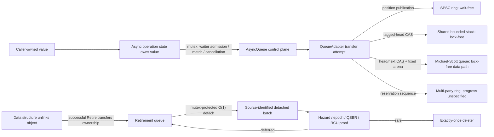

# Sora Concurrency migration baseline

This document records the functional, performance, ownership, and progress-guarantee baseline for the migration from
Mashiro concurrency facilities to Sora. It is an evidence boundary, not a claim that every operation is lock-free or
that one workstation proves performance on every target.

## Decision

The paired evidence found no migration regression larger than 10% at the selected 95% bootstrap confidence level:
every per-case lower confidence bound for `Sora throughput / Mashiro throughput` is greater than `0.90`.
`ConcurrentMap` has an overall geometric-mean ratio of `1.004459695`; `AsyncQueue` has `1.000307056`.

This is a one-sided non-inferiority guard. It is not a two-sided TOST equivalence proof: some upper confidence bounds
exceed `1.10`, so the result must not be restated as strict ±10% statistical equivalence.

## Recorded environment

| Property | Value |
| --- | --- |
| Date | 2026-08-16 |
| Source revision | `c0372296296de2f2bd6ff9ae73a2af959a7ec2a5` plus the working-tree migration changes |
| OS | Windows 11 Pro, build 26200 |
| CPU | Intel Core i7-12700H, 14 cores / 20 logical processors |
| Toolchain | COCA clang-p2996, Clang 21.0.0git (`6e677e01...`), libc++ |
| Language | `-std=gnu++26 -freflection-latest` |
| Benchmark build | `x64-release`, RelWithDebInfo with the target's `-O3` policy |
| Placement | high-priority process; workers pinned to distinct preferred Windows CPU sets |

Authoritative sample-level evidence is versioned in:

- `Sora/benchmarks/baselines/ConcurrencyMigration/concurrent-map-paired-25.csv`
- `Sora/benchmarks/baselines/ConcurrencyMigration/async-queue-paired-25.csv`

Their SHA-256 digests after normalization to UTF-8 with LF line endings are:

```text
concurrent-map-paired-25.csv  60A0A36473F27550C7C21957716E8BDC477D5219F33324180E8C566C8EEE1CEB
async-queue-paired-25.csv     0DD42B5D721445CD52B6283478E7E5799CC444B900C93EC6026BCC64CA309C6F
```

Benchmark executables write fresh artifacts under `build/x64-release/migration-evidence/`. The recorded map artifact
used UTF-8/CRLF and the queue artifact used UTF-16LE/CRLF; the versioned files contain identical decoded CSV records,
normalized for review. In particular, `queue-migration-final.csv` covers only the 8-byte payload and must not be used
as evidence for the 64-byte cases.

## Measurement protocol

Each case uses 25 same-process paired samples, two warm-up pairs, calibrated runs of at least 120 ms, and alternating
Mashiro/Sora then Sora/Mashiro order. Each worker is pinned and promoted; each sample validates result count and content.
The reported estimate is the median of paired throughput ratios. The 95% percentile interval uses 20,000 deterministic
bootstrap resamples of those ratios. The overall value is the geometric mean of case medians.

Run from `build/x64-release/bin` after activating the COCA environment:

```powershell
Benchmark.Sora.Migration.ConcurrentMapPaired.exe --samples=25 --warmups=2 --minimum-ms=120
Benchmark.Sora.Migration.AsyncQueuePaired.exe --samples=25 --warmups=2 --minimum-ms=120
```

Benchmark timing excludes setup, but includes the complete tested transfer operation. Calibration, warm-up, alternating
order, fixed placement, integrity checks, and raw samples are part of the baseline and must not be removed in a later
comparison.

## ConcurrentMap results

Ratios greater than one favor Sora.

| Storage | Topology | Operation | Threads | Median | 95% CI |
| --- | --- | --- | ---: | ---: | ---: |
| fixed | Local | find hit | 1 | 1.011415888 | [0.985868697, 1.024110286] |
| fixed | MPMC | find hit | 4 | 1.003805196 | [0.988772949, 1.066866851] |
| fixed | MPMC | find miss | 4 | 0.998146649 | [0.935293536, 1.056658399] |
| fixed | MPMC | insert | 4 | 1.017507050 | [0.978445454, 1.585894739] |
| dynamic | Local | find hit | 1 | 0.996872880 | [0.924335450, 1.007288450] |
| dynamic | MPMC | find hit | 4 | 1.004179150 | [0.978164273, 1.070044088] |
| dynamic | Local | insert | 1 | 0.998674091 | [0.980161304, 1.014329721] |
| dynamic | MPMC | insert | 4 | 1.005250658 | [0.973135647, 1.055224235] |

The wide upper interval for fixed MPMC insert reflects scheduler variance and is not evidence of a 58% speedup. The
non-inferiority conclusion rests on its lower bound; future optimization claims require a quieter, higher-power run.

## AsyncQueue results

| Topology | Payload | Producers | Consumers | Median | 95% CI |
| --- | ---: | ---: | ---: | ---: | ---: |
| SPSC | 8 B | 1 | 1 | 1.001325819 | [0.958325470, 1.044864852] |
| MPSC | 8 B | 4 | 1 | 1.001452368 | [0.958306460, 1.100144141] |
| MPMC | 8 B | 4 | 4 | 1.009625894 | [0.990344216, 1.046657202] |
| SPSC | 64 B | 1 | 1 | 1.004488031 | [0.938480786, 1.054561493] |
| MPSC | 64 B | 4 | 1 | 0.989530266 | [0.900948033, 1.047489038] |
| MPMC | 64 B | 4 | 4 | 0.995542837 | [0.955375328, 1.040879889] |

MPSC with a 64-byte payload is the limiting regression guard. Its lower bound is only `0.000948033` above the threshold,
so it should be the first case rerun after changes to waiter matching, operation-state size, or queue transfer layout.

## Ownership and linearization



The facade mutex and reclamation queues are explicit parts of the architecture. Replacing them merely to obtain a
marketing-level lock-free label would move complexity into cancellation and lifetime races without improving the
measured data path.

## Progress guarantees

| Facility/path | Strongest claim | Boundary |
| --- | --- | --- |
| Local/SPSC `RingBuffer` transfer | wait-free | fixed-capacity transfer; user value operations excluded |
| Local/SPSC `RecordRingBuffer` transfer | wait-free | valid bounded record; fixed byte arena |
| Local/SPSC `BoundedStack` transfer | wait-free | fixed-capacity transfer; user value operations excluded |
| MPSC/SPMC/MPMC `BoundedStack` tagged head | lock-free | individual operations may starve |
| Multi-party sequence-cell `RingBuffer` | unspecified | a descheduled reservation owner can block the FIFO prefix |
| Multi-party `RecordRingBuffer` | unspecified | publication/reclamation holes can block useful prefix progress |
| `MichaelScottQueue` data path | lock-free | fixed capacity and `maxConcurrentOperations`; individual starvation possible |
| `AsyncQueue` operation facade | unspecified | waiter/lifecycle/cancellation control uses a mutex |
| `ConcurrentMap` lookups | unspecified | a reader may wait for a writer-owned `Busy` slot; dynamic versions live until quiescence |
| `ConcurrentMap` writers | unspecified | spin serialization; dynamic growth allocates and copies |
| `ConcurrentObjectPool` free-list protocol | lock-free | constructors/destructors excluded; finite ABA and handle-generation windows |
| `ConcurrentSlabArena` warm current-slab reservation | lock-free protocol | constructor excluded; growth allocation/publication is not lock-free |
| Hazard/Epoch/QSBR/RCU read-side atomic protocol | no aggregate progress claim | entry/protection may retry; registration, retirement, and grace waits are not lock-free |
| `ConcurrentBatchQueue` detached batch processing | lock-free local work | ownership transitions use a mutex |
| `Generator` iteration | no concurrent progress claim | synchronous affine input range; frame allocation and user code may block |

A prompt `try_*` result describes one API call, not system-wide progress. In particular, returning backpressure promptly
does not make a reservation-based FIFO lock-free if an incomplete earlier reservation blocks all useful transfers.

## Functional and sanitizer baseline

The Concurrency validation set consists of AsyncQueue capability/coroutine/stress tests plus bounded stack, map, object
pool, slab arena, false-sharing audit, generator, Michael-Scott queue, reclamation, record ring, sequence lock, and SPSC
ring tests. The checked configurations are:

| Preset | Instrumentation | Result |
| --- | --- | --- |
| `x64-debug` | assertions, debug iterators/runtime | 15 executables / 215 test cases passed |
| `x64-release` | optimized RelWithDebInfo | 15 executables / 215 test cases passed |
| `x64-asan` | ASan + UBSan, non-recovering | 15 executables / 214 test cases passed |
| `x64-ubsan` | UBSan, non-recovering | 15 executables / 215 test cases passed |

All 31 headers under `Sora/Core/Concurrency`, including the internal reclamation header, also pass a direct-include
`-fsyntax-only` translation-unit check with the recorded C++26/reflection toolchain. Assertion totals are deliberately
not recorded because stress-test assertion counts vary with valid scheduling outcomes; executable and test-case counts
are stable.

The Windows COCA toolchain currently has no working TSan configuration, so sanitizer success is not a data-race proof.
In addition, ASan exception unwinding across the current `stdexec::task` coroutine implementation is broken in the
toolchain; the affected coroutine error-propagation case is conditionally excluded under ASan. This is a toolchain
limitation, not application-level evidence, and the non-ASan configurations must continue to exercise that case.
It is the sole reason the ASan matrix contains 214 rather than 215 test cases.

## Baseline policy

Future migration-sensitive changes fail the performance gate when a comparable paired run has a 95% lower bound below
`0.90`. A point estimate below one is not sufficient to declare a regression, and a point estimate above one is not
sufficient to declare an improvement. Changes to compiler, CPU placement, power policy, topology, payload, sample count,
or integrity checks create a new baseline rather than silently replacing this one.
