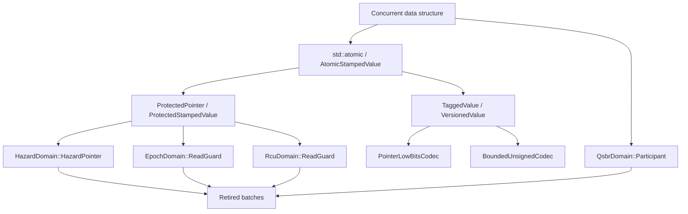

# Sora stamped publication and safe reclamation

ABA identity and object lifetime are related but distinct. `PointerStamp.h` assigns a bounded publication identity to
one atomic word. The safe-reclamation headers determine when an unlinked object may be destroyed. Neither layer makes
an arbitrary data structure linearizable; the data structure still owns its linearization point and ownership transfer.

## Abstraction model

The layers deliberately do not inherit semantic meaning from their representation:

1. A **codec** maps a payload and stamp to disjoint fields in one canonical unsigned word. A pointer and a bounded
   unsigned value are peer codecs; a pointer is not modeled as an unsigned-integer subtype.
2. `TaggedValue` gives the application control of a tag. `VersionedValue` alone defines modulo successor semantics.
3. `AtomicStampedValue` publishes either semantic value through one always-lock-free atomic word.
4. A protection object owns the time interval in which dereference is valid.
5. A reclamation domain owns objects after `Retire` and invokes their deleters after its protocol proves safety.

The stamp is finite. After `2^N` changes an `N`-bit version wraps, so a versioned word prevents ABA only within that
reuse window. Allocation discipline or safe reclamation must make the window large enough for the data structure.
`PointerLowBitsCodec` additionally assumes the target ABI preserves a pointer converted through `uintptr_t` after its
stamp bits are cleared. This is a target-level representation contract, not a portable pointer-provenance theorem.

Epoch and QSBR generation comparisons use serial-number half-range ordering. If a participant or retired object lags
by at least half of the 64-bit range, collection conservatively retains ownership instead of guessing across wraparound.

## Protocol contracts

| Facility | Read-side semantic action | Reclaimer proof | Principal liveness cost |
| --- | --- | --- | --- |
| `HazardDomain` | holder publishes and validates one exact address | detached retire batch is absent from all scanned records | scan is linear in published records |
| `EpochDomain` | affine participant enters a nestable epoch region | object is two completed epoch transitions behind | a stalled reader delays advancement |
| `QsbrDomain` | affine participant reports that no older reference remains | every registered participant acknowledges a later generation | a participant that never reports blocks progress |
| `RcuDomain` | affine participant enters a read-side phase | flip phase and wait only for readers counted in the old phase | an old-phase reader delays its grace period |

An affine participant may move between threads, but operations through it and its derived guards must not overlap
between threads. Hazard holders are independent move-only capabilities. Epoch and RCU read guards keep their stable
participant record alive after the registration handle is destroyed; release/acquire registration handoff and a counter
recheck prevent premature reuse.

Hazard, epoch, and RCU protection directly accept `std::atomic<T*>`. They also accept `AtomicStampedValue` whose payload
is a pointer and return `ProtectedStampedValue`, preserving both pointee lifetime and the exact identity required by a
later CAS. QSBR deliberately has no scoped protection wrapper: its references remain valid only until that participant's
next quiescent-state report.

## Ordering and ownership

Hazard protection and unlink use sequentially consistent operations. The collector detaches its candidate batch before
scanning records; therefore an object retired during the scan cannot be reclaimed by that scan. The SC order ensures
that either validation observes the unlink or the scan observes the protection publication.

Epoch and RCU entry first announce the candidate generation or phase, publish active state in the SC order, and then
validate the global state. A failed validation withdraws the announcement before any protected load. Exit uses release,
and reclaim-side acquire observes completion. QSBR membership and generation advance share the SC order so a collector
cannot miss a pre-advance participant; acknowledgements remain release/acquire boundaries around quiescence.

`Retire` transfers ownership to the domain. The default deleter is `std::default_delete<T>`; a custom deleter must be
`noexcept`, be nothrow-constructible in domain storage, and fit `InlineFunction<void() noexcept, 32>`. A non-null
pointer
is consumed even if retirement allocation fails: its deleter runs outside the lock before the allocation exception is
re-thrown. Deleters may re-enter the domain. Deferred batches are reattached without allocation, so a collection failure
cannot lose ownership. Domain destruction requires all participation and protection objects to have ended, then drains
retained ownership.

## Performance and evidence boundary

Participant records are stable, reusable, and cache-line isolated. Registry scans are allocation-free. Retire uses a
mutex-protected batch and can allocate; it is a cold-path ownership operation, not a lock-free claim. Hazard collection
allocates its sorted address set. A production data structure should batch retire calls and reuse read-side
capabilities.

`Benchmark.Sora.Core.Reclamation` measures reusable-holder read cost, pointer versus versioned CAS, hazard reader
scaling, and batched retire/collect cost. Results apply only to the recorded compiler, CPU, optimization level,
workload,
and allocator. Competitor comparisons require identical memory ordering, ownership protocol, pinning, warm-up, and
correctness checks. Debug, Release, ASan, and UBSan test runs do not replace a TSan run; the current Windows COCA matrix
does not provide a working TSan configuration for this target.

The 2026-08-14 Windows x64 Release run with COCA clang-p2996 measured the following medians on the current workstation:

| Boundary | Median |
| --- | ---: |
| raw acquire load | 3.15 ns |
| reusable hazard protection | 12.13 ns |
| epoch protected observation | 25.17 ns |
| RCU protected observation | 18.93 ns |
| plain pointer CAS | 13.53 ns |
| manually packed pointer/version CAS | 14.78 ns |
| `AtomicVersionedPointer` CAS | 13.84 ns |
| hazard retire, batch of 16,384 | 173.34 ns/object |
| hazard collect, batch of 16,384 | 185.10 ns/object |

The versioned wrapper did not measure slower than the same-semantics manually packed CAS in this run. That and its
single-word layout support a zero-overhead representation claim on this target, but timing noise prevents interpreting
the 6.4% difference as a speedup. The portable hazard read path uses standard SC ordering and measured 12.13 ns. Folly
uses platform-specific asymmetric fences to shift the expensive barrier to reclaimers, so this baseline does not claim
to match Folly's documented sub-nanosecond reused-holder path.

## Primary references

- [P2530R3 - Hazard Pointers for C++26](https://wg21.link/P2530R3)
- [P2545R4 - Read-Copy-Update for C++26](https://wg21.link/P2545R4)
- [Folly Hazard Pointers](https://github.com/facebook/folly/blob/main/folly/synchronization/Hazptr.h)
- [Folly RCU](https://github.com/facebook/folly/blob/main/folly/synchronization/Rcu.h)
