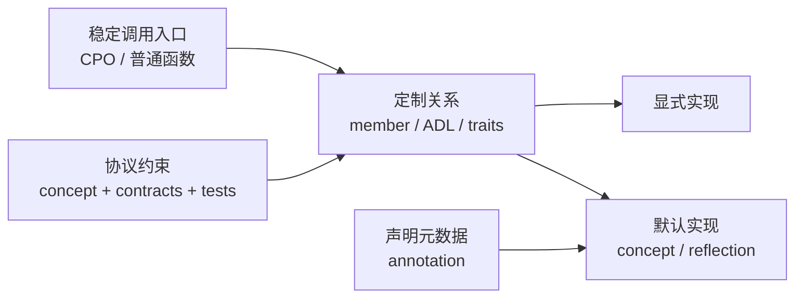
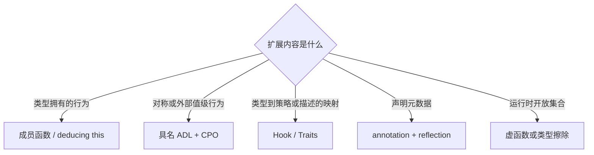
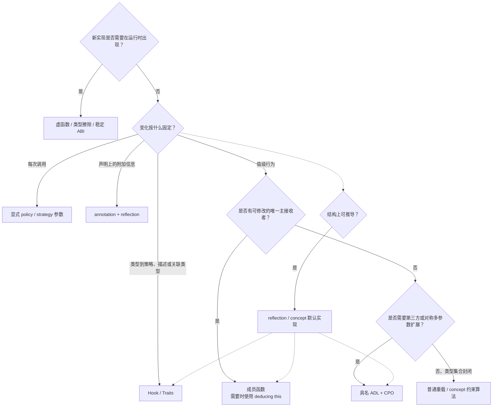

# C++26 扩展机制方法论：从 CPO、成员函数与 ADL 到 Traits、Reflection 和运行时多态

## 摘要

C++ 中所谓的“扩展点”并不是一种单一语言机制。成员函数、具名 ADL、class template specialization、
Customization Point Object（CPO）、显式策略对象、C++26 annotation、静态反射、虚函数和类型擦除，分别解决
不同维度的开放性问题。若只问“CPO 应该怎么写”，便已经把问题压缩得过早：真正需要先回答的是，变化发生在
值、类型、声明还是运行时对象集合上；实现是否拥有被扩展类型；语义按类型固定还是按调用变化；操作是否存在
唯一的主接收者。

本文建立一套自顶而下的扩展机制选择方法。文章先区分调用入口、定制通道、默认实现和协议约束，再以五个轴刻画
扩展问题，最后结合 C++26 `std::execution`、Ranges、reflection/annotations 以及 Sora 项目中的 `Hash`、
`ToString`、`ToJson`、`EventPort`、Math Backend、ResourceDomain 和 Experimental Composition，给出可执行的
架构判断。

核心结论如下：

1. CPO 是稳定调用入口，不等于其内部采用的定制机制。
2. 自有类型上的接收者中心行为优先使用成员函数；需要统一 cv-ref 重载时使用 deducing this。
3. 对称、多对象或第三方值级行为使用具名 ADL，并由 CPO 隔离查找、检查结果和提供默认实现。
4. 类型到策略、描述或关联类型的静态映射使用 `Hook<T>` / `Traits<T>`。
5. 按调用变化的语义必须显式传入 policy/strategy，不能固化到类型 traits 中。
6. 声明元数据使用 annotation + reflection，结构上可推导的默认行为使用静态反射。
7. 运行时开放集合使用虚函数、类型擦除或稳定 ABI，不应伪装成编译期 CPO。
8. `tag_invoke` 不应进入新代码；C++26 `std::execution` 已从该机制迁移到成员定制。

---

## 1. 扩展点解决的不是“调用函数”，而是“谁有权决定语义”

考虑一个看似简单的问题：框架需要把任意值转换为 JSON。调用端希望统一写成：

```cpp
Json output = ToJson(value);
```

这一行只规定了调用表面，没有回答以下问题：

- 若 `value` 的作者可以修改类型，是否应该定义 `value.ToJson()`？
- 若 `value` 来自第三方库，谁可以在不修改类型的前提下接入协议？
- 若一个模板族 `RefPtr<T>` 共享同一种表示，是否应逐个定义函数？
- 若没有显式定制，公开成员能否通过 C++26 reflection 自动序列化？
- 若字段需要重命名、忽略或调整顺序，这些信息属于行为还是声明元数据？
- 若运行时加载的新模块携带未知类型，编译期分派是否仍然适用？

因此，一个扩展协议至少包含四部分。可以形式化为：

\[
\mathcal{P} = (I, C, D, L)
\]

其中：

- \(I\)（Invocation）是稳定调用入口，例如 `ToJson(value)`。
- \(C\)（Customization）是实现选择关系，例如成员查找、ADL 或 trait specialization。
- \(D\)（Default）是没有显式定制时的默认实现，例如反射遍历数据成员。
- \(L\)（Laws）是协议必须满足的语义与类型约束，例如返回 `Json`、往返序列化保持值等价。

CPO 主要承载 \(I\)，并可组织 \(C\) 与局部类型检查；concept 主要表达可机械验证的 \(L\)；自然语言、测试和契约
补足无法仅靠表达式合法性证明的语义规律。把四者压成一个函数对象，会造成接口存在但协议不可理解、可调用但语义
不完整的情况。



图中 CPO、ADL、traits 和 annotation 不处于同一抽象层。CPO 是入口；ADL 和 traits 是实现选择关系；annotation
是输入给实现选择或默认算法的声明数据。

---

## 2. 原始决策图的方法论正确，但缺少三个维度

原始图如下：



这张图的主分类是正确的。它按“变化承载于何处”区分了行为、类型映射、声明元数据和运行时对象集合，避免把所有
开放性问题都塞入 ADL。然而它仍缺少三个关键判断。

### 2.1 “类型拥有行为”混合了语义归属和修改权限

一个操作具有明确主接收者，不代表框架能够修改该接收者类型。`sender.connect(receiver)` 在语义上由 sender 接收，
且 sender 作者通常拥有该类型，成员函数自然成立；第三方几何类型的 `Area(shape)` 即使有主操作数，适配者也可能
无法添加成员。

因此需要分别询问：

1. 操作是否存在唯一主接收者？
2. 协议实现者是否能够修改该接收者类型？

只有两个条件同时满足时，成员函数才是默认答案。

### 2.2 原图缺少“按调用变化”的语义

`Hash(value, Fnv1a64{})` 的算法选择属于本次调用，而不是 `value` 类型的永久属性。若把算法放进
`HashTraits<T>`，同一类型便无法在不同调用中选择不同算法，还会把调用策略错误提升为类型身份。

凡语义随调用、上下文、设备、精度或错误策略变化，都应显式传入 policy/strategy。策略对象可以为空并被完全内联，
显式性不产生运行时成本。

### 2.3 默认实现与显式定制不是互斥分支

Reflection fallback 可以位于成员、ADL 或 Hook 之后。Annotation 也不直接“实现 ToJson”，而是为反射默认实现提供
字段级规则。因此默认实现和元数据是正交层，不应与 member/ADL/traits 画成同一组互斥叶子。

---

## 3. 五个轴定义扩展问题

在选择语法前，先沿五个轴描述问题。该描述比“要不要 CPO”更稳定，因为它直接刻画客观变化来源。

| 轴 | 问题 | 典型取值 | 影响 |
|---|---|---|---|
| 语义承载轴 | 变化依附于什么？ | 值行为、类型映射、声明元数据、运行时对象 | 决定 member、ADL、traits、annotation 或动态多态 |
| 开放时间轴 | 新实现何时出现？ | 库编写期、用户编译期、程序运行期 | 决定静态分派还是虚函数/类型擦除/ABI |
| 变化频率轴 | 语义按什么变化？ | 每类型、每模板族、每调用、每运行时实例 | 决定 traits、policy 参数或对象状态 |
| 操作元数轴 | 是否有唯一主接收者？ | 一元接收者、对称二元、多对象关系 | 决定成员函数还是非成员协议 |
| 协议聚合轴 | 能力是单操作还是一组原子操作？ | 单函数、关联类型 + 多函数 + laws | 决定独立 CPO、traits descriptor 或完整 protocol concept |

这些轴构成一个偏序：在满足需求的机制中，应选择开放能力最弱、语义最直接的一种。成员函数比 ADL 暴露更小的
查找空间；编译期 traits 比运行时类型擦除拥有更强的静态信息；显式 policy 比隐式全局策略更容易局部推理。增加
开放性会增加查找范围、诊断复杂度、ODR 风险或运行时成本，因而不应无条件追求“最可扩展”。

---

## 4. 完整决策树

下面的决策树把调用级策略、结构默认实现和封闭重载补入原模型。



决策树不是优先级列表。例如一个 JSON 协议可以同时具有成员定制、Hook 特化、ADL 兼容层和 reflection fallback。
真正需要固定的是每条通道的职责和优先级，并保证只有一个最终实现被选择。

---

## 5. 成员定制：2026 年接收者中心协议的首选

若操作具有唯一主接收者，且类型作者能够修改该类型，成员函数具有最小查找域、最直接封装和最清晰诊断。
C++23 deducing this 消除了过去为 `const`、非 `const`、左值和右值复制重载的主要理由。

```cpp
struct Sender {
    template<typename Self, typename Receiver>
    [[nodiscard]] auto connect(this Self&& self, Receiver&& receiver) {
        return ConnectOperation{
            std::forward<Self>(self),
            std::forward<Receiver>(receiver),
        };
    }
};
```

外层仍可提供稳定 CPO：

```cpp
struct ConnectFn {
    template<typename Sender, typename Receiver>
        requires requires(Sender&& sender, Receiver&& receiver) {
            std::forward<Sender>(sender).connect(std::forward<Receiver>(receiver));
        }
    [[nodiscard]] constexpr decltype(auto) operator()(Sender&& sender, Receiver&& receiver) const
        noexcept(noexcept(std::forward<Sender>(sender).connect(std::forward<Receiver>(receiver)))) {
        return std::forward<Sender>(sender).connect(std::forward<Receiver>(receiver));
    }
};

inline constexpr ConnectFn Connect{};
```

这里 CPO 提供统一拼写、约束和 `noexcept` 传播，成员函数才是定制机制。

C++26 `std::execution` 是最重要的方向性证据。P2300 早期版本使用 `tag_invoke`；P2855R1 提议将非 query
定制改为成员函数，将 query 定制改为接收 query tag 的成员函数，并用 deducing this 统一值类别。P2300R10 的
revision history 明确记录了该迁移。

成员定制的边界同样明确：不能适配无法修改的第三方类型；对称二元操作把某一方强行设为接收者会引入人为偏序；
运行时未知实现仍需要动态多态。

---

## 6. 具名 ADL + CPO：外部值级行为与对称操作

当实现依赖实际参数，且操作不适合成为某个对象的成员时，具名 ADL 仍是有效工具。Sora `Hash` 的语义属于这一类：
哈希依赖算法对象和值，用户类型可以在自己的关联命名空间中定义 `HashValue(algo, value)`。

```cpp
namespace MyProject {

    struct EntityId {
        std::uint64_t value;
    };

    [[nodiscard]] constexpr std::uint64_t HashValue(
        const Sora::Hashing::Fnv1a64& algorithm,
        const EntityId& id) noexcept {
        return algorithm(std::as_bytes(std::span{&id.value, 1}));
    }

} // namespace MyProject
```

CPO 内部应隔离 ordinary lookup，并检查返回类型：

```cpp
namespace Detail::ADL {

    void HashValue() = delete;

    template<typename Algorithm, typename T>
    concept HashValueAvailable = requires(const Algorithm& algorithm, const T& value) {
        { HashValue(algorithm, value) } -> std::same_as<typename Algorithm::ResultType>;
    };

} // namespace Detail::ADL
```

具名 ADL 相比 `tag_invoke` 的优势是定制函数直接表达领域语义，错误信息中出现 `HashValue` 而不是统一的协议入口。
其代价是 ADL 标识符进入关联命名空间的全局查找生态，不同库使用相同函数名和相同参数形状时可能冲突。P2279R0
指出了这一结构性限制。

Ranges 展示了成熟的 member-first + ADL-fallback 模型。当前标准草案规定 `ranges::begin(E)` 依次处理数组、
`t.begin()` 和仅通过 ADL 建立含义的 `begin(t)`。这是一种兼容广泛既有类型的设计，不是所有新协议都必须复制的
默认模板。

---

## 7. `Hook<T>` / `Traits<T>`：类型级映射，而非值级行为

若结果只取决于类型，传入 `std::type_identity<T>` 或构造一个空 `T{}` 仅为触发 ADL，都会把类型关系伪装成
值调用。此时 class template specialization 更直接。

Sora Math Backend 已采用这一结构：

```cpp
namespace Sora::Math::Hook {

    template<typename Carrier>
    struct Backend;

} // namespace Sora::Math::Hook

template<>
struct Sora::Math::Hook::Backend<MyProject::Number> {
    using Type = MyProject::NumberBackend;
};
```

该模式适合：

- 类型到 backend、allocator、wire format 或 descriptor 的映射；
- 一整个模板族的统一适配；
- 关联类型与多个静态属性的原子声明；
- 无法修改原类型但可以在框架扩展命名空间中提供 specialization 的场景。

它的风险是 specialization 必须在实例化前可见，并在整个程序中保持 ODR 一致；错误特化通常在使用点才被发现；
过多独立 trait 会把一个协议拆成多个可能不一致的事实。因此相关属性应聚合为一个 descriptor。

ResourceDomain 的类型本身就是为资源系统创建的名义声明，不需要再从该类型映射回描述。目标模型应为：

```cpp
struct ResourceDomainDescriptor {
    FixedString<32> scheme;
    ResourceType resourceType;
    RuntimeEntryPolicy entryPolicy = RuntimeEntryPolicy::DeclaredOnly;

    constexpr bool operator==(const ResourceDomainDescriptor&) const = default;
};

struct TelemetryDomain final {
    inline static constexpr ResourceDomainDescriptor kDescriptor =
        MakeResourceDomainDescriptor("telemetry", ResourceType::Data, RuntimeEntryPolicy::AllowUndeclared);
};
```

名称、资源类型和注入策略属于同一个描述对象。三个 `ResourceDomain*Of` ADL 函数会引入可部分定制的非法状态，
也会迫使用户重复书写相同的类型标签。这里不需要三个 CPO，也不需要给专门创建的 Domain 增加 Traits
间接层；经过 consteval 校验的自描述名义类型和 concept 即可构成查询层。只有无法修改的外部类型才需要
`DomainTraits<T>` 一类适配器。

---

## 8. 显式 policy/strategy：语义按调用变化时必须进入参数表

Traits 表达“类型是什么”，policy 表达“这次调用选择什么”。两者不能互换。

```cpp
const auto stableId = Hash(entity, Fnv1a64{});
const auto compactId = Hash(entity, Fnv1a32{});
```

若 policy 是空类型，编译器通过 empty-base optimization、`[[no_unique_address]]` 和内联消除其存储与调用成本。
显式参数还允许 concept 精确约束本次组合：

```cpp
template<typename Algorithm, typename T>
concept HashableWith = requires(const Algorithm& algorithm, const T& value) {
    { Sora::Hashing::Hash(value, algorithm) } -> std::same_as<Sora::Hashing::ResultOf<Algorithm>>;
};
```

图形 API backend、数值精度、错误策略、分配策略和执行 scheduler 都可能按调用或上下文变化。若把这些选择固化到
`Traits<T>`，会导致类型数量膨胀、隐式全局决策和不可局部推理的行为。

---

## 9. Annotation + reflection：声明信息与结构默认实现

C++26 annotations 允许把强类型编译期值附着到声明上，再由静态反射读取。它适合回答“这个声明具有什么附加属性”，
例如 JSON 字段重命名、忽略哈希、CLI 参数名、图形 API capability mapping。

```cpp
using namespace Sora::Literals;

struct RenderSettings {
    [[=Sora::$::Serialization::Rename<"width_px"_FS>{}]] int width;
    [[=Sora::$::Serialization::Required{}]] bool vsync;
};
```

Annotation 不应承担主要行为分派。`ToJson` 的行为仍由成员、ADL、Hook 或默认算法提供；annotation 只改变默认算法
如何解释某个声明。P3394R4 的动机与示例也集中在这种反射驱动元数据上。

Reflection fallback 则处理结构上可机械推导的行为：

```cpp
template<typename T>
Json ReflectiveToJson(const T& value) {
    Json result = Json::object();
    template for (constexpr auto member : Sora::Traits::DataMembers<T>) {
        if constexpr (!$::Has<$::Serialization::Ignore>(member)) {
            result[SerializationFieldNameOf<member>()] = ToJson(value.[:member:]);
        }
    }
    return result;
}
```

这一层消除重复样板，但不能自动证明领域语义。文件句柄、数据库连接和 GPU 资源即使具有可反射成员，也不应默认按
对象布局序列化。结构可见性与语义可序列化性是两个不同命题，仍需 concept、显式 opt-in 或排除规则划定边界。

---

## 10. 运行时开放集合：虚函数、类型擦除与稳定 ABI

编译期机制要求所有候选实现参与当前程序的编译或模板实例化。若插件在程序启动后加载，或 ABI 边界不能暴露模板，
问题已经进入运行时开放世界。

| 机制 | 适用条件 | 成本与性质 |
|---|---|---|
| 虚函数 | 类型共享明确继承接口 | 一次间接调用；对象内含 vptr；接口具名且诊断清晰 |
| 类型擦除 | 不希望业务类型继承接口 | 间接调用与可能的分配；值语义和所有权可由 wrapper 统一 |
| 函数表 + handle | C ABI、插件、跨编译器边界 | ABI 最可控；需要显式版本与生命周期协议 |
| `std::function_ref` | 短生命周期、非拥有回调 | 无分配；不能跨越被引用 callable 生命周期 |

用模板注册表模拟运行时开放集合，最终仍需类型擦除；用虚函数处理封闭的数值 backend，则会丢失内联和静态组合。
开放时间轴必须在架构初期确定。

---

## 11. `tag_invoke`：历史动机成立，工程结论已经变化

P1895R0 提出 `tag_invoke`，试图解决传统 ADL CPO 的两个问题：每个 CPO 都占用一个 ADL 名称，以及包装器难以转发
未知定制。其典型形式为：

```cpp
friend Result tag_invoke(OperationTag, MyType&, Arguments...);
```

该机制把所有定制压到同一个全局名字，再通过第一个 tag 参数区分协议。它减少了领域名称冲突，却产生了新的成本：

- 用户实现中看不到直接领域谓词，必须同时理解 tag 类型和 `tag_invoke`；
- 错误诊断穿过 `invoke_result`、concept 和 hidden friend；
- 每个操作都重复 tag、CPO、`tag_invocable` 和 `noexcept` 转发样板；
- 协议仍无法由语言验证，错误签名与缺失定制难以区分；
- ADL 仍然存在，只是全局保留名称从多个变成一个。

P2279R0 认可 `tag_invoke` 相对传统 CPO 解决了部分问题，同时指出它仍无法提供语言级接口诊断。P1292R0 曾提出
Customization Point Functions，但截至 C++26 并未成为标准语言机制。最终，`std::execution` 选择了更保守且可用的
方向：P2855R1 使用成员函数替换 sender/receiver 中的 `tag_invoke`，P2300R10 接纳了这一变化。

因此，`tag_invoke` 可以作为阅读历史实现时需要理解的范式，但不应成为 2026 年新项目的默认扩展协议。

---

## 12. Sora 当前模式评审

### 12.1 `Hash`：具名 ADL 与显式算法策略的正确组合

`Hash(value, algorithm)` 的调用由 CPO 稳定，`HashValue(algorithm, value)` 允许值类型参与 ADL，algorithm 参数表达
按调用变化的策略，reflection 为普通 class 提供结构默认实现，annotations 控制成员级策略。四层职责相互独立，
这是当前项目中最完整的扩展协议。

需要继续保持的约束是：ADL hook 使用区别于 CPO 的 `HashValue` 名称，并验证精确返回类型；annotation 只控制成员
选择与顺序，不代替哈希行为本身。

### 12.2 `ToString`、`ToJson`、`ToStyledString`：能力完整，但优先级需要成为正式契约

当前分派大致为：

```text
Hook<T> specialization
    -> named ADL
    -> member function
    -> built-in/category-specific implementation
    -> reflection fallback
```

该设计支持第三方类型、模板族、自有类型和结构默认值，功能覆盖完整。风险在于 `Hook<T>` 优先于成员，意味着外部适配
可以覆盖类型作者定义的语义。若这是框架级 adapter 的有意权力，应在公共文档中明确；若类型作者拥有最终解释权，
成员应排在 Hook 前。无论选择哪一种，优先级都是协议的一部分，不能仅存在于 `if constexpr` 顺序中。

`FromJson(std::in_place_type<T>, input)` 中的 `std::in_place_type` 只是在调用端显式提供目标类型，不是定制通道，不能
与 ResourceDomain 曾使用的 type-tag ADL 混为一谈。

### 12.3 `EventPort`：成员优先更符合接收者语义

`EventPortOf(object)`、`EventLifetimeOf(object)` 和 `EventRefOf(object)` 都有明确主接收者。对 Sora 自有类型，成员函数
应是首选；具名 ADL 只承担 `BaseUnknown` 等外部适配。当前实现将 ADL 放在成员之前，并依赖 CPO 对象声明顺序避免
递归查找，机制可工作但不如独立 hook 名称或明确 ADL 隔离层可读。

### 12.4 Math Backend：类型映射与行为执行分层正确

`Hook::Backend<Carrier>::Type` 决定类型到 backend 的映射；`Add`、`Mul` 等 CPO 只连接各操作数 backend 并调用静态
backend 操作。映射发生于类型层，执行发生于值层，固定宽度 SIMD 和 staged expression 均可完全内联。该结构适合
继续作为类型级映射 Traits 的参考，而不是把 backend 选择改为 ADL。

### 12.5 ResourceDomain：应从三个行为 CPO 收缩为自描述 descriptor

ResourceDomain 名称、资源类型和注入策略按 Domain 类型固定，不依赖 Domain 对象状态，也不随调用变化。名义 Domain
类型直接持有经过 `consteval` 工厂验证的 `kDescriptor`。三个 `ResourceDomain*Of` 函数会重复类型标记、允许部分
定义并制造无意义的对象调用，因此应删除。若需要适配无法修改的既存类型，再引入 Traits。

### 12.6 Experimental Composition：`tag_invoke` 应迁移为 storage 成员

`LookupNode`、`ObjectOf`、`ParentOf`、`FirstChildOf` 等操作都以 storage 为唯一主接收者，storage 类型也由项目拥有。
这与 P2855R1 的成员定制条件完全一致。将 hidden-friend `tag_invoke` 改为成员可缩小查找空间、简化 diagnostics，
并删除通用 `CpoBase` / `TagInvocable` 基础设施。

---

## 13. 一套可执行的项目规范

### 13.1 先写语义句，再选择机制

设计扩展点前先写一句不含 C++ 术语的定义：

> ResourceDomain 类型在编译期唯一决定其 URI scheme、资源语义类型和运行时注入策略。

该类型专为 ResourceDomain 概念创建，因此“类型唯一决定”首先导向类型自持的原子 descriptor；只有描述必须附着到
无法修改的既存类型时才导向 Traits。若定义是“调用者为本次哈希选择算法”，则导向显式 policy；若定义是“sender
接收 receiver 并产生 operation state”，则导向成员函数。

### 13.2 采用以下优先规则

1. 封闭类型集合使用普通重载或 concept 约束算法。
2. 自有类型的接收者中心行为使用成员函数。
3. 第三方、对称或多参数值级行为使用具名 ADL + CPO。
4. 类型级映射使用单一 `Hook<T>` / `Traits<T>` specialization。
5. 每调用策略使用显式 policy 参数。
6. 声明元数据使用 annotation，结构默认实现使用 reflection。
7. 运行时开放集合使用动态多态或 ABI 函数表。
8. 不新增 `tag_invoke`，不为类型级查询制造 `std::type_identity` ADL。

### 13.3 每个协议必须回答七个审查问题

| 问题 | 失败时的典型后果 |
|---|---|
| 稳定调用入口是什么？ | 用户依赖内部 hook 名称，后续无法演化 |
| 谁拥有最终语义解释权？ | Hook、成员和 ADL 优先级冲突 |
| 新实现最晚何时出现？ | 编译期机制错误承担插件需求 |
| 变化按类型还是按调用发生？ | traits 固化调用策略，类型数量膨胀 |
| 是否有唯一主接收者？ | 对称操作被人为偏置为成员 |
| 默认实现依据什么信息？ | reflection 对领域对象作出不安全推断 |
| 哪些 laws 不能由 concept 验证？ | 表达式可调用被误认为语义正确 |

---

## 14. 最终判断

原始图提供了正确的第一层分类，但完整方法论必须把 CPO 从“扩展机制”提升为“调用入口”，再加入调用级 policy、
封闭重载和结构默认实现。2026 年的主线不是寻找一个新的万能 CPO 技巧，而是让机制服从语义承载位置：成员函数处理
自有接收者行为，ADL 处理外部或对称值行为，traits 处理类型关系，annotation 处理声明元数据，reflection 处理结构
默认值，动态多态处理运行时开放集合。

对 Sora 而言，这一方法直接导出两项近期决策：ResourceDomain 收缩为自描述名义类型持有的单一 descriptor；
Experimental Composition 从 `tag_invoke` 迁移到 storage 成员。`Hash` 与 Math Backend 则分别代表值级 ADL +
policy 和类型级 backend mapping 的正确范式，应作为后续接口设计的对照基线。

---

## 参考资料

1. ISO C++ Working Draft, [Customization Point Object types](https://eel.is/c++draft/customization.point.object).
2. ISO C++ Working Draft, [`ranges::begin`](https://eel.is/c++draft/range.access.begin).
3. Lewis Baker et al., [P1895R0: `tag_invoke`: A general pattern for supporting customisable functions](https://wg21.link/P1895R0).
4. Barry Revzin, [P2279R0: We need a language mechanism for customization points](https://wg21.link/P2279R0).
5. Matt Calabrese, [P1292R0: Customization Point Functions](https://wg21.link/P1292R0).
6. Ville Voutilainen, [P2855R1: Member customization points for Senders and Receivers](https://wg21.link/P2855R1).
7. Michał Dominiak et al., [P2300R10: `std::execution`](https://wg21.link/P2300R10).
8. Barry Revzin et al., [P2996R13: Reflection for C++26](https://wg21.link/P2996R13).
9. Wyatt Childers et al., [P3394R4: Annotations for Reflection](https://wg21.link/P3394R4).
