# Sora 通用异构计算目标架构

> 2026-07-30 partitioned logical transition 状态更新：`CommitPartitionedDispatchResidencySelection` 已把一个
> logical dispatch 的多个 shard 收敛为一次 graph-local residency 事务。接口显式接收未切分的 logical
> bindings；每个 shard 必须保持 argument、access、buffer identity、alignment 与 publication schema，允许
> region 和 affine footprint 随切片变化。每个 writable argument 的 shard coverages 必须两两不交，且其
> exact union 等于原始 binding coverage。该目标可以是 buffer 的严格子域，因而 partial-view DAG 节点不必
> 退化为 whole-buffer write。

事务构造先验证 destination、route、binding 与 exact coverage，再组装全部 replica additions 和
`ProducedResidencyWrite`。所有 shard 写入同一个 `baseVersion + 1`，producer 与 materializer 均保留原 logical
`GraphNodeId`；最后只调用一次 `GraphResidencyState::Apply`。重叠检查发生在任何去重或相邻区间归并之前，因此重复
shard、重复 writable binding 与跨 argument alias 不会经 canonicalization 变成合法状态。失败时 graph-local
residency 保持不变。

这一状态变换可视为同一版本下有限个不交 partial map 的并：结合性只对已经证明不交且共享 logical target 的
shard 成立，不能据此推导 halo、reduction 或 scan 的合并语义。一般 DAG 的 physical rewrite 尚未完成；下一层必须把
`DispatchGraphSelection` 提升为 whole/partitioned 和类型，使一个 logical node 对应多个 physical completion，后继节点
等待全部 shard，并由同一 lowering replay 维护 graph-local allocation、queue order 与联合 publication。

> 2026-07-29 exact coverage 状态更新：`ByteCoverageView` 与 `TranslatedByteCoverage` 已形成无逐元素展开的
> 精确逻辑字节集合和单 allocation 平移原语。`ResourceAccess`、`ResidentReplica`、`PlannedAllocation`、
> `CompletionTransaction`、graph-produced residency、candidate route 与 `GraphLocalStorageMap` 均保留精确
> `AffineByteFootprint`。当前接受域是一个 produced value 覆盖请求，或一组 affine produced shards 的并集精确等于请求。

`ByteCoverageView` 提供 contiguous fast path 与 borrowed affine path，元数据分别不引入动态分配；其查询显式返回
`yes/no/unknown` 或 `disjoint/overlap/unknown`。hazard 可以把 `unknown` 保守视为冲突，而 residency 和 publication
必须拒绝 `unknown`，不得把 bounding interval 当作真实 coverage。当前已支持同一 affine 请求混合 frozen baseline 与
partial produced subview：`AffineCoverageComplement` 在逻辑 index box 上做有界差集，结果经 exact-union 复证后分别规划
ready route。若一次 transfer 只覆盖某个 produced affine segment 的严格子域，commit 会把原 segment 精确分解为
`(S \ R) + R`，只在 `R` 上增加目标设备 replica，后续相同请求可直接命中。任意 non-affine sparse difference 与一般
piecewise logical-to-physical mapping 仍不在接受域内。`TranslatedByteCoverage` 使用
`physical = allocationOffset + logical - logicalBoundingOffset`，保留 allocation 内的 affine gap，同时只投影实际占用字节。

ready residency 的 route cover 先把每个 replica 与请求裁剪到共享 affine domain，再从未覆盖部分扣除交集，因而输出的读取
subview 两两不交。该归一化同时处理 replica 彼此重叠和 replica 跨越请求边界两种情况；目的地已 resident 的覆盖先于需要
传输的覆盖参与选择，避免远端 whole replica 压过本地 shard cover。`IntersectAffineSubviews` 与共享 domain 的
`AffineCoverageComplement` 均为固定 rank、零分配、无逐元素枚举的 constexpr 原语；affine 证明容量不足时才退回有界
canonical-region 路径，容量溢出仍返回类型化错误。

版本语义同时收紧为：`BufferDesc::sizeBytes` 是物理地址域上界，不是逻辑值域。一个标量 buffer version 只有在一次
transaction 精确覆盖该 Buffer 注册的 logical coverage 时才能推进。padded SoA 的 padding 不属于 logical coverage，
不能被标记为新版本；在 Buffer schema 尚未拥有 canonical logical coverage 前，禁止放宽 `PartitionedWrite` 的整区间校验。

本批新增 Release 基线为：1024 段 symbolic lookup `18.551 ns`、1024 段 physical lookup `66.765 ns`、
两片百万元素 affine partition lookup `4.612 ns`、transactional apply `489.611 ns`、physical expansion `410.102 ns`。
`GraphResidencySegment` 为 272 B；在 64 shard 上限下总 inline footprint 约 17 KiB，尚无引入分配、interning 或
共享所有权的性能依据。本轮同进程交错基线中，旧 half complement 为 `99.5..111.6 ns`，共享 domain half complement 为
`108.6..118.1 ns`，sibling complement 为 `114.3..121.3 ns`，affine intersection 为 `77.7..79.9 ns`；整机处于降频状态，
这些数据只证明成本不随约一百万个逻辑元素线性增长，不与前轮绝对时间直接比较。Release 与 ASan + UBSan 的完整
`Sora.Compute` label 均通过 `346 / 346`。

## 1. 结论

Sora 不应把 Math 的 SIMD 分派扩展成一个带 GPU 分支的 `KernelContext`。目标系统应当是独立的
`Sora::Compute` 子系统，Math 只是其首个语义前端。系统由三种互不替代的计算路径组成：

| 路径 | 适用范围 | 运行时成本 |
|---|---|---|
| direct | 单值、小固定维度、调用点类型闭合 | 内联后的标量或 SIMD 指令，无 planner 与类型擦除 |
| static bulk | 编译期已知算法和布局的批量计算 | 每批一次静态分派，可直接形成 CPU 多版本代码 |
| portable graph | 大规模、动态 shape、跨设备、可分发计算 | 每图或每批一次规划、编译、提交与同步 |

三条路径共享数学语义与数值策略，但不强求共享同一执行函数体。portable graph 不是 direct path 的替代品，
而是处理数据驻留、运行时编译、跨设备依赖和异步完成的更高层机制。

目标依赖方向如下。箭头表示编译期依赖，插件只依赖稳定 C ABI。

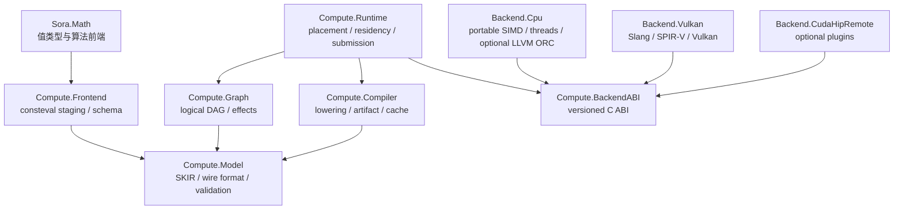

## 2. 不变量

目标架构受八条不变量约束。

1. canonical package 不序列化模板实例、函数地址、vtable、RTTI、`std::type_info` 或任意 C++ ABI 对象。
2. 数学语义、设备放置和执行机制分层。后端选择不改变运算定义与数值契约。
3. planner、虚调用、动态分配与 JIT 查询不得进入逐元素循环。
4. 设备选择按端到端成本完成，成本包含排队、传输、编译、启动、计算和同步。
5. 驻留是带版本的多副本状态，不能压缩成 host/device 二值状态。
6. 异步 operation state 持有 artifact、allocation、buffer version 和 backend module 的 lease，直到 event 完成。
7. reflection 只生成 schema、binding 和 metadata。C++26 reflection 不能读取任意函数体，计算核必须通过显式
   staging DSL、受支持算法原语或外部 kernel language 进入 portable IR。
8. 性能主张须区分冷启动、缓存命中、已驻留和含传输四种状态，并由固定硬件、固定核心和固定数据集的基线支持。

## 3. 语义前端

### 3.1 `KernelDefinition` 是语义入口

现有 `KernelDefinition<Direct, Module>` 的方向正确。它同时携带 direct evaluator 与 portable module：

```cpp
template<class Direct, PortableModule Module>
class KernelDefinition {
public:
    constexpr decltype(auto) operator()(this auto&& self, auto&&... args);
    constexpr decltype(auto) DirectEvaluator(this auto&& self) noexcept;
    constexpr decltype(auto) PortableModule(this auto&& self) noexcept;
};
```

direct 调用只访问 `Direct`，bulk API 才读取 portable module。`CompilePortable` 不应返回一个默认经过 runtime
dispatch 的函数对象，否则每次单值调用都会为尚未发生的异构计算支付成本。

### 3.2 前端分为三类

| 前端 | 生成方式 | 适用对象 |
|---|---|---|
| staged expression | operator overload + `consteval` builder | 纯函数、逐元素变换、小向量运算 |
| structured algorithm | `transform`、`reduce`、`scan`、`stencil`、`matmul` | 具有已知并行结构的批量算法 |
| external kernel | Slang 或受控 backend source | 无法由 C++ staging 表达的专家 kernel |

structured algorithm 是高性能可移植性的主要入口。任意 C++ callable 不具备可序列化语义，也无法自动证明
memory effect、同步范围和可分区性，因此不能承诺把任意 lambda 自动编译到 GPU。

### 3.3 C++26 特性的适用边界

| 特性 | 应用 | 不应用于 |
|---|---|---|
| reflection / annotation | 聚合字段、binding schema、SoA projection、调试名 | 读取函数体、推断任意控制流 |
| consteval block | schema 生成、静态图校验、固定 kernel 合成 | 依赖运行时 shape 或设备状态的决策 |
| expansion statement | 异构字段展开、反射成员展开 | 普通齐次数值循环 |
| concept | 约束 scalar carrier、layout、kernel primitive、backend capability | 跨 DLL 插件多态 |
| `std::execution` / stdexec | 组合编译、传输、提交和完成事件 | canonical IR 与插件 ABI |
| coroutine | `co_await` 用户外观 | 调度核心与资源所有权模型 |
| contract | 进程内 API 的可验证前后置条件 | 不可信 package、驱动或插件边界 |

## 4. IR 必须分层

现有 SKIR v1 是纯标量/短向量 SSA。它适合作为 `ScalarExpr`，不具备完整 kernel 语义。虽然
`ParameterDesc` 已有 `Buffer`，当前指令集没有 index domain、load、store、collective、barrier 或控制流，因而
不能仅靠添加 Vulkan lowerer 执行批量数据。

目标 IR 分为三层：

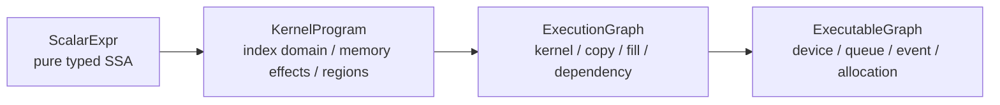

### 4.1 `ScalarExpr`

`ScalarExpr` 表达无副作用的值计算，保留现有算术、超越函数、FMA 与 `NumericalPolicy`。其主要用途是：

- direct evaluator 与 backend lowering 的共同语义来源；
- elementwise kernel 的函数体；
- reduction、scan、stencil 等结构化算法中的 combine 或 map region；
- reference evaluator 的精确测试对象。

现有 `KernelModule` 应在 wire format 下一主版本中改名为 `ScalarModule`。改名必须伴随 format major version
变更，不能让同一 magic/version 对应两种语义。

### 4.2 `KernelProgram`

`KernelProgram` 描述单次设备 dispatch 的完整语义，至少包含七部分：

| 组成 | 类型 | 语义 |
|---|---|---|
| signature | `KernelSignature` | value、buffer、rank、element type、access 与 layout |
| domain | `IndexDomain` | 1D 至 3D 逻辑索引域和 runtime symbol |
| regions | `RegionTable` | map、combine、condition 与 structured loop region |
| memory | `MemoryOpTable` | checked load/store、address space、alignment 与 alias class |
| collectives | `CollectiveTable` | reduce、scan、broadcast、subgroup 与 workgroup 语义 |
| effects | `EffectSummary` | 每个 buffer region 的 read/write/atomic 范围 |
| partition | `PartitionContract` | 是否可切分、halo、combine 与确定性约束 |

控制流采用 structured regions，而非把任意跳转直接暴露给前端。此限制使 Vulkan、CUDA、Metal 与 CPU
lowering 共享相同的 dominance、barrier convergence 和资源上界验证。

### 4.3 `ExecutionGraph`

`ExecutionGraph` 是 host 级逻辑 DAG，只允许四类核心节点：`DispatchNode`、`CopyNode`、`FillNode` 和
`ExternalNode`。barrier 由依赖、effect 与 queue assignment 推导，不作为用户手写节点。任意 host callback 会
破坏图优化和远程执行，只能通过显式 `ExternalNode` 进入，并声明同步与可迁移性约束。

编译期已知的短 pipeline 使用 `StaticGraph<NodeCapacity, EdgeCapacity>`；运行时图冻结后转换为连续节点数组与
CSR edge table。两者共享 `GraphView` 和验证器，不使用每节点虚对象或链式容器。

### 4.4 canonical wire format

wire format 使用 little-endian、定宽整数、显式 offset/count 与内容哈希。解析分两阶段：

1. `PackageReader` 校验 magic、版本、长度、对齐、容量、枚举范围和 section overlap。
2. `IrValidator` 校验类型、dominance、effect、alias、barrier convergence、资源上界和 partition contract。

解析完成前不得创建 driver object。验证器应支持资源预算，防止恶意 package 通过极端 count、深度或编译时间
耗尽目标机资源。

## 5. 内存、驻留与一致性

### 5.1 `Buffer` 与 `Allocation` 必须分离

`Buffer<T, Rank, Layout>` 是逻辑数据对象，`Allocation` 是某个 memory domain 中的一份物理存储。一个
Buffer 可同时具有 host、integrated GPU、discrete GPU 和 remote replica。Buffer 不直接暴露 backend handle。

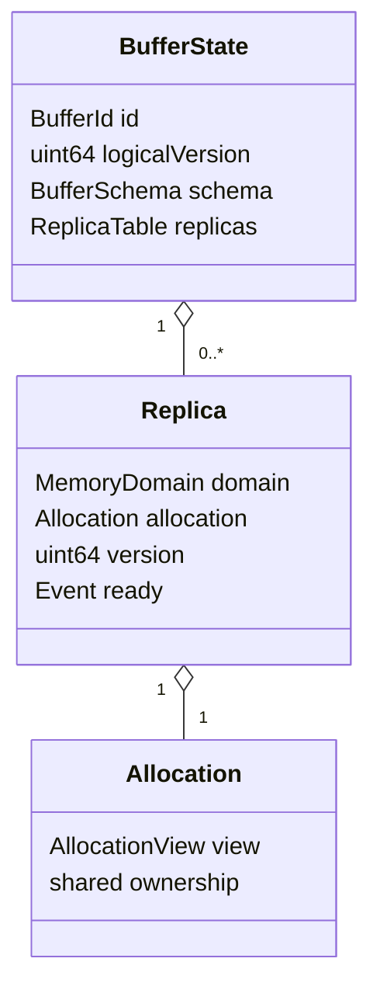

`BufferView` 表达 region、rank、extent、stride、layout 和 access，不拥有裸指针生命周期。异步提交把 view
解析为 `BufferLease`，lease 持有对应 `BufferState` 与版本，直至完成事件到达终态。

### 5.2 驻留是版本化副本关系

一次逻辑写入产生新版本 `v + 1`。新版本只在写入目标 replica 上有效；旧 replica 可继续服务已经提交且读取
旧版本的 operation，但不能满足新提交。`ResidencyTable` 因而维护集合：

```text
Replica = (memory_domain, allocation, logical_version, ready_event, byte_region)
```

这与单一 `Dirty/Clean` 状态不同。多 GPU 并发读、异步 copy 与远程副本同时存在时，单枚举无法表达合法状态。

`ResidencyManager::Prepare` 根据目标设备、所需版本和 region 选择代价最低的源副本，产生 transfer node，并将
传输完成 event 纳入 dispatch 依赖。unified memory 仍需经过此模型，只是 transfer cost 与 ownership transition
由对应 backend 给出。

### 5.3 memory domain

`MemoryDomainId` 表示一致性和可访问性域，不等同于 `DeviceId`。integrated GPU 与 CPU 可共享一个 heap，
discrete GPU 具有 device-local 与 host-visible 两类 heap，remote backend 则具有独立地址空间。planner 使用
backend 报告的访问矩阵：

```cpp
struct AccessLink {
    MemoryDomainId source;
    MemoryDomainId destination;
    uint64_t bytesPerSecond;
    uint64_t latencyNanoseconds;
    bool peerToPeer;
};
```

## 6. 编译、JIT 与 artifact

### 6.1 分层编译管线

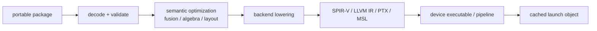

Vulkan 首选 Slang 作为受版本约束的 lowering 工具：SKIR 经结构化 emitter 生成 Slang module，再由 Slang 产生
SPIR-V，最终由 Vulkan driver 创建 pipeline。Slang IR 与 SPIR-V 都是 backend artifact，不进入 canonical package。
依赖 Slang 内部 IR 会把 portable format 绑定到编译器私有版本，不能采用。

CPU 采用三层策略：

1. scalar AOT 路径保证无 JIT 时始终可运行；数据并行 AOT 由 capability gate 选择可用 provider；
2. 线程池或 bulk scheduler 负责大批量并行；
3. 可选 LLVM ORC 插件按 CPU feature、shape、layout 和 numerical policy 生成本机代码。

当前 COCA libc++ 未提供 `<simd>` 或 `<experimental/simd>`，因此已落地 CPU backend 使用 Clang
`ext_vector_type` 作为 backend-private 128-bit lowering。它不是公共 ABI，也不改变 canonical package；标准库实现可用后由
同一 capability gate 接入 `std::simd`，不能在源码层假定标准组件已经存在。

LLVM ORC 是可选优化层，不是 portable package 的运行前提。portable 发行物在没有 LLVM 的目标机上仍可经 AOT
CPU backend 或 Vulkan backend 执行。

### 6.2 artifact key 应分类型

不同 artifact stage 具有不同失效关系。当前实现以三个强类型 key 构造统一 canonical `ArtifactKey`：

| key | 必含字段 | 不应包含 |
|---|---|---|
| `LoweringKey` | module、lowerer、options、flags | target、driver、queue、瞬时负载 |
| `ExecutableKey` | lowered、`ExecutableTargetIdentity`、shape/layout/tuning specialization | device、driver、未声明依赖的 target 维度 |
| `PipelineKey` | executable、`PipelineTargetIdentity`、builder、state、binding layout | compiler、host ABI、workload reuse count |

`TargetFingerprint` 显式包含 device/backend、host architecture、OS、binary format、byte order、ABI、address bits、
feature bits、microarchitecture identity、fixed/scalable vector width、backend ABI、runtime/compiler/driver identity 与
identity stability。它是完整运行时事实，不直接充当每个 stage 的 key；`ExecutableTarget(...)` 与 `PipelineTarget(...)`
分别投影编译产物和 driver pipeline 的兼容域。字段缺失会误复用，字段过多会使缓存无效化；强类型投影把约束集中在
构造函数，不依赖调用者手工清零无关字段。

### 6.3 两级 cache

`ArtifactCache` 保留进程内强引用 LRU，`ArtifactStore` 负责磁盘内容寻址缓存。磁盘写入采用 temporary file、
durable flush 和 atomic replace。条目使用 canonical little-endian header、完整 key words、payload 及二者的 256-bit
integrity digest。driver handle 不可序列化；缓存只保存能够重建 handle 的 backend-private bytes。

同 key 编译由 `CompilerService` 在进程内 single-flight，并由 `ArtifactStore` 的有界 stripe lease 跨进程去重。
persistent miss 后必须先取得 materialization lease，再执行第二次 disk lookup；follower 导入 leader 已发布的 bytes，
leader 才执行 JIT/create、export 与 publication。lease 超时或平台锁失败只使本次请求退化为 live create，不使计算失败。
同 key publication 仍以原子替换、winner validation 与有界重试保持幂等。按错误类别区分的短期 negative cache 仍属后续优化。

### 6.4 portable package

portable package 至少包含：

- canonical SKIR module 与 schema；
- numerical、determinism、partition 和 resource contract；
- package format 与 minimum runtime version；
- 可选 AOT artifacts 及其精确 target fingerprint；
- source map、诊断名称、section checksum 与可选签名。

目标机加载时先查找精确匹配的 AOT artifact，再查本机 cache，最后执行 JIT。任一层失败都可降级到另一个合法
backend，但不得静默放宽数值契约或 determinism。

## 7. 规划、图优化与多设备调度

### 7.1 planner 的输入不是元素数量

现有 `PlanExecution` 已使用 queue、transfer、launch、compute、sync 与 amortized compile cost，方向正确。
目标 planner 还需接收五类信息：

- 每个 buffer region 当前合法 replica 及其版本；
- device-to-device access link 与可并发 queue；
- kernel 的 shape、layout、arithmetic intensity 和资源估计；
- artifact/cache 状态与预期复用次数；
- graph dependency、critical path、memory capacity 和用户 policy。

单 kernel 的候选选择是线性扫描。一般 DAG 的异构调度属于组合优化问题，不能承诺全局最优。目标实现采用可解释的
确定性分层算法：

1. capability filter 删除不满足 feature、memory、numerical policy 的候选；
2. graph optimizer 按 effect、alias 和 numerical policy 做 fusion；
3. 线性 chain 用动态规划联合选择设备与 transfer；
4. 一般 DAG 用 HEFT 类 list scheduling 估计 critical path；
5. bounded local search 调整 placement、tiling 与 replica reuse。

每次决策保留 `CostBreakdown` 与拒绝原因，性能异常才能复现。在线校准只按采样策略更新，不在每次 dispatch 上强制
读取高开销计时器。

### 7.2 自动多设备分区需要显式证明

框架不能把任意 kernel 自动切给多个设备。`PartitionContract` 至少区分：

| 模式 | 要求 | 组合方式 |
|---|---|---|
| elementwise | 输出 region 两两不交 | 直接拼接 |
| reduction | associative；deterministic policy 另行约束 | 层次化 combine |
| stencil | 固定 halo 与边界条件 | halo exchange 后拼接 |
| scan | associative 且有 identity | local scan + prefix fixup |
| indivisible | 无可证明分区 | 单设备执行 |

浮点加法在实数上结合、在 IEEE 754 上不结合。若要求 bitwise deterministic，reduction tree、设备数与 partition
必须进入语义或 specialization identity，planner 不得任意重排。

### 7.3 graph optimization 的合法性来源

fusion、common subexpression elimination、constant folding、layout propagation 和 buffer reuse 都需要基于
`EffectSummary`、alias class 与 `NumericalPolicy`。`Fast` 可允许 reassociation，`Contract` 只允许规定的 FMA
收缩，`Strict` 保留源运算次序。优化合法性必须由 IR validator 与 pass contract 证明，不能由 backend 自行猜测。

## 8. Queue、Event 与异步接口

### 8.1 backend ABI

插件边界使用 versioned C ABI 与 opaque handle，不暴露 STL、异常、coroutine frame 或 stdexec 类型。能力按独立
callback table 分割：

```cpp
struct BackendDeviceApiV1;
struct BackendCompilerApiV1;
struct BackendMemoryApiV1;
struct BackendQueueApiV1;
struct BackendEventApiV1;
```

每张表携带 `abiVersion` 与 `structSize`，runtime 可忽略新版本尾部字段。compile、allocate 与 submit 都返回 POD
result；错误包含稳定 error code 与 backend diagnostic token。插件销毁函数为 `noexcept` C callback，RAII wrapper
在进程内接管所有权。

### 8.2 `Queue` 与 `Event`

`Queue` 是设备执行序列的 shared RAII handle；`Event` 是一次完成信号的 shared RAII handle。submit request 使用
连续数组描述 command、wait event 与 signal event，避免每 node 一次 ABI 调用。timeline event 可用时直接映射，
否则 backend 在内部适配 binary event。

event 状态只有四种公共终态：completed、failed、stopped 和 device-lost。backend 可以提供更细诊断，但 runtime
不能把 driver-specific 状态泄露进公共 API。

### 8.3 stdexec 与 coroutine

`ComputeContext::Submit(graph)` 返回 lazy sender。operation state 持有 frozen graph、artifacts、leases、queues 和
events。stop token 在提交前可阻止工作；设备已接收 command 后，若 backend 不支持取消，则 operation state 等待
资源进入安全终态，再向 receiver 报告 stopped。

coroutine 只提供：

```cpp
auto result = co_await compute.Submit(graph);
```

该 adapter 消费 sender，不另建 task runtime。以引用捕获临时 buffer 的 coroutine lambda 不进入公共示例，异步
资源由 graph lease 明确持有。

## 9. 用户接口

常见调用不出现 device、queue、pipeline 或 transfer：

```cpp
auto saxpy = CompilePortable([](auto a, auto x, auto y) { return a * x + y; });

ComputeContext compute = ComputeContext::SystemDefault();
Buffer<float> x = compute.Upload(hostX);
Buffer<float> y = compute.Upload(hostY);
Buffer<float> output = compute.CreateLike(x);

auto graph = GraphBuilder{}
                 .Transform(output, saxpy, alpha, x, y)
                 .Finish();
auto completion = compute.Submit(graph);
```

`SystemDefault` 表示自动策略，不是全局 mutable singleton。context 拥有 registry、cache、store、planner、queue pool
和 telemetry policy，可显式构造以支持测试、隔离租户或固定设备。高级用户可通过 `PlacementPolicy` 约束设备集合、
确定性、编译预算和内存预算，但默认接口不要求选择 backend。


## 14. 2026-07-21 实现校正：一致性域、可寻址位置与驻留路由

### 14.1 内存身份分为三个层次

早期实现把 `DeviceId`、heap 与 `BackendKind` 直接装入 `MemoryDomainId`。该模型不能表达同一一致性域经多个
backend handle 访问，也会把“backend 相同”误判为“地址空间相同”。当前实现改为三个互不替代的概念：

| 概念 | 身份 | 语义 |
|---|---|---|
| `MemoryDomainId` | 128 bit stable id | 互相一致的字节状态与版本传播范围 |
| `MemoryLocation` | `(domain, device, backend)` | 某个 backend allocation handle 可由哪个设备地址空间访问 |
| `Allocation` | `MemoryLocation + opaque state + RAII` | 一份物理存储及其 backend 所有权 |

`Queue` 现同时校验 allocation 的 `BackendKind` 与 `DeviceId`。同属 CPU backend、但位于另一 NUMA device 或
逻辑设备的 allocation 不得直接提交；同属 Vulkan backend、但属于另一 Vulkan device 的 allocation 亦然。peer memory、
external memory 与 unified memory 必须由 transfer/import engine 显式注册可达边，不能依赖 backend 枚举相等推断。

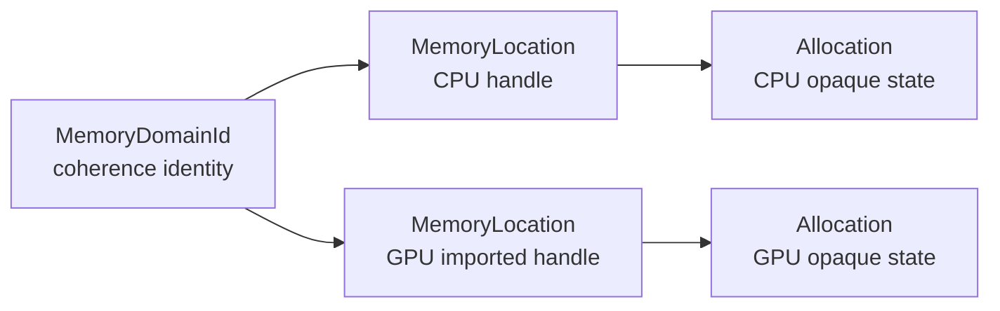

### 14.2 驻留选择是纯多源最短路

`Buffer::SnapshotResidency()` 在同一临界区复制当前 logical version 与全部 ready replica，并通过 shared RAII allocation
保留规划所需 lease。`PlanResidency` 不分配设备内存、不提交 copy、不修改 `Buffer`，只计算：

```text
BufferResidencySnapshot + ResidencyRequest + TransferLink[] -> ResidencyRoute
```

每个 `TransferLink` 由稳定 `TransferEngineId` 标识，边类型为 copy、coherent alias、host bridge 或 remote。边权为固定延迟
与按带宽换算的 payload 时间之和，全部采用饱和整数运算。规划器从所有覆盖目标 region 的当前版本副本同时出发，求到
目标 `MemoryLocation` 的最低成本路径；成本相同时依次比较 hop 数、源副本、前驱位置与 engine identity，因而选择结果不依赖
topology 枚举顺序。route 自身持有源 allocation lease，后续异步物化不会引用已经失效的 snapshot 内存。

### 14.3 当前边界与下一物理层

| 状态 | 已具备的语义 | 尚未具备的语义 |
|---|---|---|
| residency | 原子快照、当前版本副本、已驻留零跳、多跳 route、`PendingReplica` | partial-write coherence |
| transfer | engine callback、coherent import、异步 operation state、route 逐 hop 自动物化 | 跨 engine 分块流水与在线校准 |
| execution | `PhysicalSegment`、跨 queue/transfer DAG、事务式 `ExecutableGraph` 物化 | 全局 placement 与 partition 优化 |
| publication | `CompletionTransaction` 原子发布、失败回滚、析构排空 | device-loss 后既有 replica 的主动失效 |
| program | canonical package lease、immutable `PortablePackageRegistry` 与 archive trust boundary | 远程 provenance policy |
| queue | 稳定 `QueueId`、dispatch/copy/fill capability、提交前能力校验 | queue family 性能模型与在线校准 |
| service | `BackendService` 状态所有权、`BackendCodeLease` 模块租约、资源级传递 | plugin entry discovery |

`ExecutableGraph` 当前统一持有 queue batch 与 asynchronous transfer，两者均在 graph submission 时才产生 backend
副作用。图边以 device wait 或 host completion 表达同步，成功终态再由 `CompletionTransaction` 发布 replica。

`BackendService` 当前以共享控制块拥有 backend 根状态，并通过 `BackendCodeLease` 实际持有动态模块或其他可执行代码
owner。`MemoryAllocator`、`TransferEngine`、`BackendCompiler` 与 `Queue` 均保留该服务；它们产生的 `Allocation`、
`Artifact` 与 `Event` 继续传递同一租约。控制块严格执行“资源 destroy callback、service destroy callback、模块卸载”的
顺序，因而 callback 不会在插件代码或根状态失效后运行。

`PhysicalResourceCatalog` 已统一拥有并索引 queue、allocator、transfer engine 与 compiler。构造阶段排序并拒绝重复身份，
验证非 alias transfer 的目标 allocator；运行期以 `(backend, device, QueueId)` 等完整身份做无分配二分查找和确定性 queue
选择。

`PhysicalGraphPlan` 现以 owning logical payload、强类型 allocation/segment identity、显式 ready storage 与不可变资源选择结果
描述 target-specific physical DAG，并在任何 backend 副作用发生前验证资源、producer、direct data dependency 与拓扑顺序。
`PhysicalGraphPlanner` 是其前置纯变换：它把已选 `ResidencyRoute` 展开为局部索引 fragment；coherent alias 只生成同步 import
materialization，异步 hop 才生成 segment。alias allocation 继承 source producer，因此跨 alias 的下一异步 hop 会直接依赖真正的
readiness producer，而不会引入伪异步节点。规划过程只移动或保留 allocation lease，不调用 allocator、transfer 或 compiler callback。

`PhysicalGraphPlan` 构造时规范排序全部 edge，主项为 `O(E log E)`；direct dependency 以二分查找验证，单次为 `O(log E)`；
allocation producer 由一次 `O(A + S)` bitmap 扫描证明，不再存在 `O(A·S)` 的大图退化路径。

`PhysicalGraphMaterializer` 现已事务式消费 plan 与 catalog。它按 allocation identity 顺序完成 allocate/coherent import，先验证
physical binding，再请求 `DeviceExecutable`；dispatch 的三维 workgroup geometry 与 artifact kind 已在纯计划层冻结并验证。plan edge
按 synchronization domain 降为 `DeviceWait` 或 `HostCompletion`，copy、fill、transfer 与 dispatch 最终统一进入 `ExecutableGraph`。

物化过程不提交 backend 工作，也不提前修改 `Buffer`。publication 只构造成未提交的 `CompletionTransaction`；全部 segment 成功后，
transaction 才随 graph 进入提交阶段。任一步失败时，`AllocationJournal` 按创建顺序的逆序释放本轮 allocation/import，既有 resident
replica 与 logical version 保持不变。

下一阶段位于 submission composition 与 failure recovery：`SubmitSender` 用 `std::execution` 组合 segment submission、host completion、
cancellation 与最终 publication；device-loss 路径主动失效既有 replica。fault-injection 与 device-loss 验证完成后，Slang/Vulkan backend
再接入真实 driver。

## 10. 类与文件实施计划

### 10.1 保留并收紧的现有类型

| 当前类型 | 目标位置 | 调整 |
|---|---|---|
| `KernelDefinition` | `Compute/Frontend/KernelDefinition.h` | 保持 direct/portable 双路径 |
| `KernelModule` | `Compute/IR/ScalarModule.h` | 下一 major version 改名，限定纯 SSA 语义 |
| `KernelBuilder` | `Compute/Frontend/ScalarBuilder.h` | 只构造 `ScalarModule` |
| `KernelPackageReader` | `Compute/IR/WireReader.h` | 分离 wire parse 与 semantic validation |
| `ReferenceEvaluator` | `Compute/IR/ScalarEvaluator.h` | 仅作 oracle、constexpr 与 fallback |
| `DeviceDescriptor` | `Compute/Runtime/Device.h` | 加 memory domain、queue family 与 topology |
| `PlanExecution` | `Compute/Runtime/PlacementPlanner.h` | 保留单 kernel 基元，外层增加 graph planner |
| `Artifact` | `Compute/Compiler/Artifact.h` | 保持 shared RAII，key 按 stage 强类型化 |
| `ArtifactCache` | `Compute/Compiler/ArtifactCache.h` | 进程内 LRU，不承担磁盘持久化 |
| `CompilerService` | `Compute/Compiler/CompilerService.h` | 增加 stage pipeline、negative cache 与 store |

### 10.2 新增类型

| 类 | 文件 | 单一职责 |
|---|---|---|
| `KernelSignature` | `Compute/IR/KernelSignature.h` | 设备无关 binding 与 access schema |
| `KernelProgram` | `Compute/IR/KernelProgram.h` | 单 dispatch 的 index、region、memory 与 collective 语义 |
| `IrValidator` | `Compute/IR/Validation.h` | 结构、类型、effect 与资源上界校验 |
| `PartitionContract` | `Compute/IR/PartitionContract.h` | 可切分性、halo、combine 与 determinism |
| `Buffer` / `BufferView` | `Compute/Memory/Buffer.h` | 逻辑数据及 typed region view |
| `Allocation` | `Compute/Memory/Allocation.h` | backend allocation 的 shared RAII 所有权 |
| `ResidencyTable` | `Compute/Memory/ResidencyTable.h` | 版本化 replica 集合 |
| `ResidencyManager` | `Compute/Memory/ResidencyManager.h` | 选择源副本并产生 transfer |
| `StaticGraph` | `Compute/Graph/StaticGraph.h` | 编译期固定容量 DAG |
| `ExecutionGraph` | `Compute/Graph/ExecutionGraph.h` | 冻结的 runtime 逻辑 DAG |
| `GraphBuilder` | `Compute/Graph/GraphBuilder.h` | 构造、effect edge 推导与 cycle 检查 |
| `GraphOptimizer` | `Compute/Runtime/GraphOptimizer.h` | submission-scoped fusion 选择、程序派生与逻辑图替换 |
| `ExecutableGraph` | `Compute/Runtime/ExecutableGraph.h` | placement、queue、allocation 与 event 的物理计划 |
| `DeviceRegistry` | `Compute/Runtime/DeviceRegistry.h` | backend/device discovery 与 epoch 管理 |
| `PerformanceModel` | `Compute/Runtime/PerformanceModel.h` | 分桶测量、估计与 bounded calibration |
| `GraphPlanner` | `Compute/Runtime/GraphPlanner.h` | DAG placement、partition 与 queue assignment |
| `Queue` / `Event` | `Compute/Runtime/Queue.h` | backend queue/event 的 shared RAII wrapper |
| `ComputeContext` | `Compute/Execution/ComputeContext.h` | 组合运行时服务并提供 lazy sender 用户入口 |
| `ArtifactStore` | `Compute/Compiler/ArtifactStore.h` | 磁盘内容寻址、校验与原子发布 |
| `LoweringPipeline` | `Compute/Compiler/LoweringPipeline.h` | canonical IR 到 backend artifact 的分阶段编译 |
| `BackendApi` | `Compute/Backend/BackendApi.h` | compiler/memory/queue/event 的 versioned C ABI |
| `SubmitSender` | `Compute/Execution/SubmitSender.h` | stdexec submission 与资源 lifetime |

### 10.3 CMake target

```text
Sora.Compute.Model            header-only canonical model and wire format
Sora.Compute.Frontend         compile-time staging and structured algorithms
Sora.Compute.Graph            logical graph and optimizer
Sora.Compute.BackendABI       stable plugin boundary
Sora.Compute.Compiler         lowering, artifact cache and store
Sora.Compute.Runtime          placement, residency, queues and submission
Sora.Compute.Execution        stdexec composition and public submission facade
Sora.Compute.Backend.Cpu      built-in portable CPU backend
Sora.Compute.Backend.Vulkan   optional Slang/Vulkan backend plugin
```

`Sora.Math.Core` 只依赖 `Model` 与 `Frontend`。`Runtime` 不得反向依赖 Math；backend 不得 include Math 值类型。

## 11. 分阶段迁移

| 阶段 | 实现 | 验收 |
|---|---|---|
| 0 | scalar SSA、package、planner、direct baseline | 已完成；ASan/UBSan 与 direct 指令等价 |
| 1 | artifact RAII、memory LRU、concurrent compile dedup | 已完成首版；补齐 stage key 与故障注入 |
| 2 | allocation、buffer、residency、mock memory backend | 多副本版本状态机 property test，无泄漏与悬垂 |
| 3 | static/runtime graph、effect edge、cycle validation | deterministic serialization，非法图拒绝 |
| 4 | queue/event ABI、mock backend、submit sender | compile-cache-plan-transfer-submit 端到端测试 |
| 5 | CPU bulk backend、thread budget、portable SIMD lowering | 已完成首个闭环；标准 `<simd>` provider 受工具链能力门控 |
| 6 | Slang/SPIR-V/Vulkan backend | 与 reference evaluator 交叉验证，device loss 测试 |
| 7 | disk artifact store、portable package、目标机 JIT | 新机器冷编译、二次启动命中、driver upgrade 失效 |
| 8 | graph fusion、multi-device partition、autotuning | 含传输端到端收益，错误选择率与回退路径可量化 |
| 9 | LLVM ORC、CUDA/HIP/remote 可选插件 | 精确 fingerprint 与插件卸载 lease 测试 |

阶段 2 至 4 必须先用 mock backend 完成。直接接 Vulkan 会把状态机错误、ABI 错误与 driver 行为混合，无法判断
失败来自哪一层。

## 12. 性能与正确性基线

### 12.1 性能矩阵

每个 kernel family 测量以下维度：

| 维度 | 取值 |
|---|---|
| 数据规模 | L1、L2、LLC、DRAM、GPU crossover、超显存 |
| layout | AoS、SoA、strided、misaligned |
| backend | scalar、SIMD、CPU threads、Vulkan、vendor GPU |
| lifecycle | cold JIT、warm JIT、memory-cache hit、disk-cache hit |
| residency | host、device、peer device、含回读、保持驻留 |
| numerical | strict、contract、fast、deterministic reduction |

关键门槛如下：

- direct portable evaluator 与原 direct evaluator 的 paired median 比值不超过 1.01；
- cached launch 不重新运行 planner、IR validator 或 compiler；
- GPU 优势按端到端时间判定，不用 kernel-only 时间掩盖 PCIe transfer；
- 任一优化须报告吞吐、p50/p95 latency、编译时间、cache hit rate、峰值显存和能耗可得指标；
- 多设备执行只有在包含 partition、transfer 与 merge 后仍获益时才视为成功。

“SIMD 应固定比 AoS 快 3 倍”不是合法基线。速度比由算术强度、layout、编译器自动向量化、内存带宽和 benchmark
顺序共同决定。应以同一语义、同一数据、固定核心、paired case 和反汇编证据识别真实退行。

### 12.2 正确性矩阵

- property test：residency version、graph acyclicity、effect dependency、cache eviction；
- differential test：reference evaluator、CPU scalar、SIMD、Vulkan 与 JIT；
- metamorphic test：partition 后拼接、fusion 前后、cache miss/hit、不同合法 layout；
- fault injection：OOM、compiler failure、invalid payload、device lost、event failure、truncated package；
- sanitizer：ASan、UBSan、TSan 可用配置；
- numerical test：NaN、Inf、signed zero、subnormal、overflow、strict/FMA 与 reduction ordering。

## 13. 明确排除的设计

以下五种方案与目标不相容：

1. 用一个 `Backend` 虚基类同时承担 discovery、compile、allocate、submit、event 和 diagnostics。
2. 把 SPIR-V、PTX、LLVM bitcode 或 Slang IR 定义为唯一 portable IR。
3. 让 `std::execution` sender 类型进入插件 ABI 或 package format。
4. 每次 vector operation 都查询 CPU feature、planner 或 JIT cache。
5. 假设 unified memory 消除了驻留、迁移与一致性成本。

目标系统的最小完整纵向路径是：`ScalarExpr -> KernelProgram -> ExecutionGraph -> placement -> residency ->
compile/cache -> queue submit -> Event`。只有这条路径经 mock backend 验证后，Vulkan 与 LLVM backend 才有稳定的
接入面。

## 15. 2026-07-21 实现校正：运行时 invocation 与仿射 BufferView

### 15.1 BufferView 是逻辑仿射映射，不是物理指针

`BufferView` 持有逻辑 `Buffer` lease 与经过验证的 `BufferViewDesc`，不持有 allocation、device address 或 backend
handle。任一逻辑元素的分量地址统一定义为：

```text
address(i, lane) = offset + sum(i[axis] * byteStride[axis]) + lane * componentStride
```

该公式同时表达 packed AoS、一般 strided AoS 与 SoA component plane，避免为每个 backend 或 layout 创建同义 view
类型。view 在创建时证明：

- rank、active/inactive axis、scalar width 与 storage layout 相容；
- 全部乘加无 `uint64_t` 溢出，仿射 footprint 位于逻辑 Buffer 边界内；
- contiguous 与 SoA stride 满足 canonical 定义，SoA component plane 不重叠；
- 一般 strided layout 经过按 stride 排序的 mixed-radix 证明，不允许不同逻辑元素映射到重叠字节；
- invocation 以 `ResourceAccess` 引用 operation-local affine footprint；graph hazard 消费精确 coverage，无法判定时保守
  视为冲突。graph-produced residency 与 route 的后续迁移见第 35.4 节。

`KernelArgumentDesc::minimumAlignment` 的语义是首元素地址，以及 SoA 中每个 component plane 首地址的最低对齐，
不是要求每次迭代后的元素地址保持同一对齐。`BufferView::BaseAlignment()` 因而由 buffer alignment、view offset 与
SoA component stride 共同推导，不错误地把普通 float element stride 纳入 base-pointer alignment。

### 15.2 KernelInvocation 是编译期程序与运行时事实的唯一结合点

`BindKernelProgram` 先验证 canonical `KernelProgram`，再实例化 runtime extent、scalar bytes 与 BufferView。成功结果
持有：

- program semantic hash 与无零 extent 的 `DispatchDomain`；
- signature 顺序下的 owning scalar/buffer bindings；
- 从 `KernelProgram::EffectSummary()` 与实际 view footprint 推导的 `ResourceAccess[]`；
- 尚待 physical materializer 证明的 `PhysicalAliasRequirement[]`。

scalar argument 使用 canonical little-endian bytes；Bool 每 lane 只接受 `0/1`。elementwise v1 要求每个 buffer view
与 dispatch domain 逐轴同 extent，layout 满足 kernel 要求，base alignment 满足 signature 契约。

alias proof 分为两个阶段：同一逻辑 Buffer 的相交 region 可立即拒绝；不同 BufferId 仍可能共享同一个 backend
allocation，因此不同已知 alias class 的 pair 必须保留到 physical allocation 选定后再次检查。lowerer 可以生成
noalias 优化，但 runtime 只有在全部 physical requirement 被证明后才能提交该 executable。

### 15.3 当前验证

COCA clang-p2996、`-std=gnu++26 -freflection-latest`、ASan + UBSan 下，Compute 测试合计：

```text
55 cases / 448 assertions
```

最终随机回归曾捕获 `CompilerService` 的 cache-miss/in-flight race：迟到调用者可能在锁外 cache miss 后等待 service
mutex，而首个编译线程在此期间完成 cache insert 并移除 in-flight，导致迟到调用者错误启动第二次同 key 编译。当前
实现取得 service mutex、确认没有 in-flight 后再次查询 cache，再创建新的 in-flight state。完成路径不会同时持有 cache
与 service mutex，因此该 double-check 不引入锁顺序环。修复后 `RuntimeTest` 在 ASan + UBSan 下连续运行 100 轮全部
通过。

下一依赖层为 runtime sparse `GraphBuilder` 与 interval hazard index。它应直接消费
`KernelInvocation::ResourceAccesses()`，不能重新让调用方手写第二份 effect 元数据。

## 16. 2026-07-21 实现校正：Owning ExecutionGraph 与稀疏区间依赖

### 16.1 static topology 与 runtime graph 不再混为一类

`StaticExecutionGraph` 是固定容量、可常量求值的小型拓扑。它保存 node、access 与编译期派生的 dense direct edge，
用于静态 pipeline 校验；它本身没有运行时 scalar value、Buffer lease 或 external registration，因而不能直接冒充
可提交图。

runtime `ExecutionGraph` 必须按 node index 一一持有 owning `GraphOperation`：

```text
GraphOperation = KernelInvocation | CopyOperation | FillOperation | ExternalOperation
```

- `KernelInvocation` 持有 program identity、runtime scalar bytes、BufferView 与 physical alias requirements；
- `CopyOperation` 持有两个等长 `BufferSlice`，同 Buffer 重叠立即拒绝，不同 Buffer 保留 physical overlap check；
- `FillOperation` 持有 destination slice 与 1/2/4/8/16-byte canonical pattern；
- `ExternalOperation` 持有 stable operation identity、portability boundary 与 owning affine resources。

`GraphBuilder` 只接受这些 typed operation，不接受 `GraphNodeSpec + ResourceAccess[]` 的公共低级入口。node metadata 与
effect slice 全部从 payload 派生，因而图中不存在调用方维护的第二份访问语义。`ExecutionGraph` 只由 builder 的
validated move construction 产生，旧的 structure-only `ExecutionGraph::Create(GraphView)` 已删除。

### 16.2 runtime hazard 是区间 frontier，不是节点全对全冲突

`Sora.Compute.Graph` 使用每个 BufferId 独立的 disjoint interval map。每个区间状态为：

```text
HazardState = (last_writer, readers_since_writer[])
```

处理规则：

- read 依赖最后一个重叠 writer，并加入并行 reader frontier；
- write/read-write 依赖 writer 之后的全部重叠 readers；若没有 reader，才直接依赖 writer；
- region boundary 通过 split/cover/merge 维护，互不相交的 byte interval 不建立依赖；
- 同一 node 的重复/重叠 access 不生成 self-edge；
- 输出按 `(successor, predecessor)` 排序并去重，结果不依赖 map 枚举之外的非确定因素。

public `ValidateSparseGraph` 对任意 runtime GraphView 重新推导 frontier，并要求每条必要边直接存在；额外显式依赖允许，
重复边拒绝。typed `GraphBuilder::Finish` 只运行一次 interval analysis，合并显式边后直接转移 payload lease，不为同一
证明重复执行 planner。

static 与 runtime 路径共享 `ValidateGraphStructure`：canonical contiguous access slice、节点语义、Buffer region 与
topological edge identity 都只有一份定义。static 小图继续用 constexpr 穷举验证；动态 interval map 不强行进入
常量求值。

### 16.3 模块、验证与性能

新增独立 target：

```text
Sora.Compute.Core <- Sora.Compute.Graph <- Sora.Compute.Runtime <- Sora.Compute.Execution
```

Graph target 当前拥有 `HazardAnalysis.cpp` 与 `GraphBuilder.cpp`，Runtime 不再直接跳过 Graph 层依赖 Core。

COCA clang-p2996、C++26 reflection mode、ASan + UBSan 下，Compute 测试现为：

```text
127 cases / 5776 assertions
```

4096 个独立 writer interval、一个全域 reader 与一个全域 writer 只产生 4097 条 frontier edge。固定逻辑 CPU 0 的
五进程 release median 为 1K/4K/16K：`721.77 / 783.34 / 944.27 ns/access`，四倍规模的 normalized unit-cost
growth 为 `1.103x / 1.185x`。完整环境与回归规则见 `GraphPerformanceBaseline.md`。

2026-07-23 的 Compute 纵向回归覆盖二十个测试可执行目标，共 127 cases / 5776 assertions。新增验证包括 transfer segment 的
无副作用构造、device-wait 注入、host-completion 跨域同步、completion publication、program registry 并发去重、queue capability
在 backend callback 前的拒绝、资源逃逸后的严格 retirement 顺序，以及 physical route 的 0-hop、异步 hop、coherent alias 与
async-alias-async producer 继承。`PhysicalGraphMaterializer` 独立覆盖 6 cases / 275 assertions，包括 binding-before-JIT、
compile/import failure、graph-local pending Read/ReadWrite、resident writable target 拒绝、物理重叠拒绝与严格逆序 rollback。

当前链路已闭合为 `PhysicalResourceCatalog -> PhysicalGraphPlan -> PhysicalGraphMaterializer -> ExecutableGraph`。下一层只负责异步
提交编排、取消传播、device-loss 恢复与真实 backend 接入，不再重新解释物理计划。

## 17. 2026-07-23 实现校正：事务式 Materializer 与结构化提交

### 17.1 物理计划与可执行对象之间只有一个副作用边界

当前端到端路径为：


`PhysicalGraphPlan` 是经过资源、producer、direct dependency、publication 与 dispatch 条件校验的不可变值。
`PhysicalGraphMaterializer` 是同步事务式构造边界，允许执行 allocation、coherent import 与 compiler cache/JIT lookup，
但不允许提交 queue 或 transfer 工作。构造失败时，`AllocationJournal` 按创建顺序的逆序释放本轮 allocation 与 import；
compiler artifact 服从独立缓存寿命，不参与 allocation rollback。

publication 在 materialization 阶段只形成未提交的 `CompletionTransaction`。`Buffer` 的 version 与 replica table 直到全部
physical segment 终止且 transaction commit 成功后才改变。`ResidentReplica` 只允许作为 Read 输入；graph-local
`PendingReplica` 承担 Read、Write 与 ReadWrite。ReadWrite 的 input/output 必须引用同一 allocation，初始化责任由前序 copy
或 transfer 表达，materializer 不隐式复制。

同一 `PhysicalSynchronizationDomain` 的依赖降为 `DeviceWait`，跨 domain 依赖降为 `HostCompletion`。前者把 predecessor event
直接交给 successor backend，后者先在 host 侧等待 predecessor 终止，再提交 successor；任一层都不跨 backend ABI 传递
不兼容 event handle。

### 17.2 Runtime 拥有物理对象，Execution 只负责 stdexec 组合

模块依赖保持为：

```text
Sora.Compute.Core <- Sora.Compute.Graph <- Sora.Compute.Runtime <- Sora.Compute.Execution
```

`ExecutableBatch`、`ExecutableTransfer`、`PhysicalSegment` 与 `ExecutableGraph` 属于 Runtime。Execution 只保留
`SubmitSender.h`，把 Runtime 的 move-only work 组合到 scheduler，不反向拥有 queue、artifact、allocation 或 graph topology。
Graph 与 Runtime 均无对 Execution 的 include，因而 stdexec 不进入 canonical model、physical plan 或 backend ABI。

graph-level `SubmitOn` 使用三个有类型的 completion channel：全部 segment 与 publication 成功时发送 value；提交失败发送带
physical node 的 `GraphSubmissionError`；completion 或 publication 失败使用无效 node，表示错误属于已接受 graph 的整体。
提交前收到 stop 时不产生 backend 副作用；提交后收到 stop 时先排空全部已接受 segment、完成 publication finalization，
再发送 stopped。

### 17.3 Terminal 是 aggregate 不变量

`Event`、`Submission`、`TransferSubmission`、`PhysicalSubmission` 与 `GraphSubmission` 均提供
`WaitUntilTerminal()`。无限等待若收到异常的 Pending 结果，则继续等待，不提前释放资源 lease。可信 backend 若永久违反
无限等待契约，析构采用 fail-stop 阻塞语义；提前释放 artifact、allocation 或 event state 会造成不可接受的悬垂访问。

`GraphSubmission` 只有在全部已接受 segment 都到达终态后才进入 aggregate 终态。若多个 segment 失败，结果保留拓扑顺序下
的首个失败；后续 segment 仍须排空。有限超时在任一 segment 仍为 Pending 时返回 Pending，不把已知局部失败错误宣称为
整个 graph 已终止。该定义使直接调用、RAII 析构与 stdexec sender 具有同一生命周期语义。

### 17.4 复杂度、能力门控与验证

physical planning 的当前主要复杂度为：edge canonicalization `O(E log E)`，direct dependency 查询 `O(log E)`，
producer bitmap `O(A + S)`，publication conflict validation `O(P log P)`；其中 `P <= A`。旧的 publication earlier-scan
最坏为 `O(A^2)`，现已改为按 `(BufferId, allocation index)` 排序后单遍归约，并保持最早 related allocation 的确定性诊断。
Materializer 在 compiler/backend 调用之外为 `O(A + S + E)`。

COCA clang-p2996 当前支持 function parameter reflection，但不支持查询 parameter reflection entity 的 custom annotation。
项目没有生产 target 依赖此能力，因此 CMake 保留 `HAVE_PARAMETER_ANNOTATIONS` 探针并将其列为 optional capability；未来
真正消费参数注解的 target 必须在自身边界声明要求，不能把未使用的工具链能力设为全项目构建门槛。

最终验证采用 COCA clang-p2996、`-std=gnu++26 -freflection-latest`、ASan + UBSan：

```text
20 executables / 127 cases / 5776 assertions
81 Compute C++ files: clang-format --dry-run --Werror passed
Graph -> Runtime/Execution upward includes: 0
Runtime -> Execution upward includes: 0
legacy ExecutableBatch/ExecutableTransfer include paths: 0
TODO/FIXME/HACK/XXX in Compute production and tests: 0
```

## 18. 2026-07-23 实现校正：真实 CPU backend 与自适应 crossover

### 18.1 已落地边界

`Sora.Compute.Backend.Cpu` 已形成第一条真实 backend 纵向闭环：host/CPU device discovery、共享一致性域 allocator、
coherent alias、异步 copy、ordered queue/event、`KernelProgram` 编译、scalar reference execution、SIMD lowering 与
stdexec `bulk_chunked` 并行执行。Math 与 Compute 都只消费 `Sora::PAL::CpuInfo`，不再各自维护 CPUID/XGETBV 探测。

CPU backend 具有两个共享统一 ABI 的 code provider。内建 provider 执行 validated `KernelProgram` interpreter 与
backend-private SIMD lowering；可选 `LlvmCpuCodeProvider` 把同一 canonical program lowering 为 LLVM IR，经 `O3`
pipeline 生成 native object，再由 ORC LLJIT materialize 为 `CpuCodeEntry`。两条路径共享 artifact、queue、event 与 binding
语义，因此上层无须感知执行表示。LLVM provider 是性能优化层；LLVM 不可用时，内建 provider 仍保持完整正确性。

当前数值覆盖为：

| 路径 | 已支持 | 当前限制 |
|---|---|---|
| scalar | Float32/Float64 算术与函数、整数 Input/Constant、1D 至 3D logical index | 整数算术 opcode 尚未 lowering |
| SIMD | Float32 x 4、Float64 x 2，同构纯浮点 SSA | 超越函数当前逐 lane fallback；无 `<simd>` provider |
| parallel | stdexec `bulk_chunked`，固定 worker budget | 尚无 NUMA partition 与在线 autotuning |
| LLVM native | Float32/Float64、外部数学函数、三类 layout、object import/export | 要求 LLVM-C 22；仅完成 CPU lowering |
| memory | host/device allocation、coherent alias、async copy、CPU coherent `Map()` | `Map()` 不是通用 device mapping ABI |

### 18.2 服务身份与生命周期

本节对应的服务身份阶段把 Backend ABI 升至 version 2；持久化 artifact 协议随后将当前 ABI 升至 version 3，见第 19 节。
`ArtifactView`、`AllocationView`、`EventView` 与 `QueueView` 都携带 `BackendServiceId`；backend kind 和 device identity
相同但 service instance 不同的 opaque state 必须在 callback 前拒绝。
这条约束阻止一个 CPU backend 实例把另一实例的裸 state 误解释为本地对象。

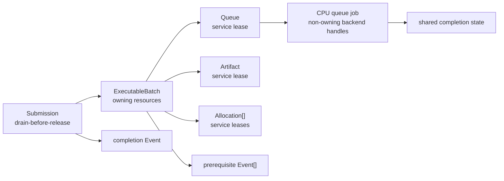

`ExecutableBatch::Submit` 把全部 owning lease 转移给 `Submission`，其析构在释放资源前排空 accepted work；
`TransferSubmission` 对 source、destination、wait events 与 completion event 执行同一规则。低级 `Queue::Submit` 只接受
non-owning ABI view，调用者必须满足“全部被引用 owner 比返回 event 活得更久”的前置条件；普通 runtime 路径不直接暴露这项
负担，而是经 owning batch/submission 使用。

CPU event handle 与 completion state 分离。队列 job 持有 `shared_ptr<CpuEventState>`，因此用户提前释放 event handle 只会从
service registry 移除 opaque handle，不会销毁仍由 job 使用的完成状态。service 析构请求 stop 后会排空已入队 job 并 join
ordered queue thread，随后才销毁 worker pool 与 backend root state。

### 18.3 CPU fingerprint 与错误单位元

`Sora::PAL::CpuInfo` 是 ISA 能力唯一真源。x86 路径把 CPUID 的硬件位与 XCR0 中 OS 已启用的寄存器状态合并，只报告当前
进程可安全执行的 SSE2/AVX/AVX2/AVX-512/FMA；`ArchitectureId()` 同时哈希 ISA、vendor、family/model/stepping、可用
feature mask 与最大 vector width，作为 JIT/cache 的 microarchitecture key。

错误值遵循统一代数：`MemoryAllocationError{}` 与 `TransferError{}` 都表示 `None`；ABI result POD 仍显式默认成
`AllocationFailed`/`TransferFailed`，确保未写 callback 结果不会被误判为成功。facade 因而可以统一使用空错误值作为成功单位元。

### 18.4 自适应并行 crossover

固定 `32K` parallel threshold 在当前 20 logical-processor 主机上是明显负优化。默认策略现在按 worker budget 解析：

```text
minimumParallelWorkItems == 0
    => 32K work items * resolved worker count
```

单 worker 将阈值解析为 `UINT64_MAX`，且执行器还有显式 `workerCount == 1` 串行守卫；即使测试或用户把阈值显式设为 1，
也不会进入 parallel 路径。非零阈值保留给受控测试和后续 autotuner，但它只改变 crossover，不改变 kernel 语义。

Release SAXPY 基线，单位为 `ns/item`：

| N | scalar serial | SIMD serial | forced SIMD parallel | adaptive |
|---:|---:|---:|---:|---:|
| 64 | 90.13 | 69.80 | 182397.85 | 65.02 |
| 4,096 | 53.72 | 25.03 | 3773.27 | 24.49 |
| 32,768 | 40.14 | 17.72 | 473.33 | 19.91 |
| 131,072 | 38.99 | 21.42 | 117.52 | 20.24 |
| 262,144 | 52.23 | 22.99 | 59.02 | 23.90 |
| 524,288 | 45.02 | 19.44 | 29.75 | 16.16 |
| 1,048,576 | 41.84 | 18.08 | 14.78 | 14.67 |

20 workers 的默认 parallel crossover 为 `655,360` work items。串行 SIMD 在中小规模约为 scalar 的
`2.2x` 至 `2.7x`；1M work items 时自适应策略进入并行并优于串行 SIMD。该数据支持“约 3x 的 SIMD 收益”作为当前机器的
经验范围，但不能升级为 layout-independent contract。

Vec3 基线进一步分离 layout 与 execution width：

| layout/path | ns/item |
|---|---:|
| AoS scalar | 70.03 |
| AoS SIMD | 33.61 |
| SoA scalar | 69.57 |
| SoA SIMD | 33.03 |

该 kernel 每次读取和写入全部三个分量，SoA 没有独立显著收益；约 `2.1x` 的改善主要来自 SIMD。只有访问分量子集、跨对象
连续扫描或与后续 kernel 保持 SoA residency 时，layout 才可能产生额外带宽收益。

### 18.5 当前验证与下一层

ASan + UBSan 的 Compute 纵向回归现覆盖 21 个 executable、131 cases、13,313 assertions；CPU backend 专项为
4 cases、7,537 assertions。PAL `CpuInfo` 另有 1 case、11 assertions，覆盖 architecture identity、logical processor
下界与 feature/vector-width 一致性。CTest 为 Compute 与 PAL component tests 分别注册 `Sora.Compute`、`Sora.PAL`
标签。Release 下 `Benchmark.Sora.Core.SOA`、`Benchmark.Sora.Math.Value`、`Benchmark.Sora.Compute.Graph` 与
`Benchmark.Sora.Compute.CpuBackend` 均已构建并执行 CPU backend 基线。

disk `ArtifactStore`、完整 `TargetFingerprint`、backend artifact import/export 与 LLVM ORC native object provider 已经落地。
独立 `DevicePipeline` ABI、cache coordination 与 queue stage contract 随后已完成，见第 21 节。下一物理层是 Vulkan backend：
经 Slang/SPIR-V lowering 接入同一 program/artifact/queue/event 边界，并实现真实 driver pipeline cache。只有设备端
correctness、cold/warm compile、resident/transfer-inclusive cost 与 device-loss 恢复都可测后，placement planner 才允许
自动把大规模 kernel 分发到 GPGPU。

### 18.6 Release 基线复测

2026-07-23 在同一 20 logical-processor、AVX2、256-bit 主机上复测：4K 以上串行 SIMD 相对 scalar 为
`1.96x` 至 `2.32x`；1M work items 时 adaptive 相对串行 SIMD 的 same-round ratio 为 `1.262x`，对应
`14.79 ns/item` 与 `18.75 ns/item`。固定并行在 524K 仍慢于串行 SIMD，在 1M 才产生收益，因此 `655,360`
的默认 crossover 方向正确。

Vec3 的 AoS scalar/SIMD 与 SoA scalar/SIMD 分别为 `70.27 / 29.92 / 66.68 / 31.28 ns/item`。AoS 与
SoA 的 SIMD speedup 分别为 `2.305x` 与 `2.137x`；本次结果继续否定“只要换成 SoA 就应额外获得约 3x”这一
layout-independent 假设。上节表格保留首次 crossover 调整后的历史样本，本节复测用于展示正常运行间波动。

### 18.7 Portable JIT 前置 blocker

当前 CPU backend 的端到端证据限于 Windows x86-64。x86 `ArchitectureId` 已含 vendor、family、model、stepping、
dispatch-safe feature 与 vector width；ARM 路径尚未采集 implementer/part/revision，也未读取 SVE runtime vector length。
因此当前 ARM identity 只能用于进程内保守 dispatch，不能作为跨机器持久化 native artifact 的充分 cache key。

`TotalPhysicalMemory()` 与 `AvailablePhysicalMemory()` 当前也只有 Windows 实现；其他平台返回 unknown。允许 target-specific
artifact 进入 disk `ArtifactStore` 或启用自动 placement 前，PAL 必须补齐 Linux/macOS/ARM 的 topology、memory
availability、OS ABI 与 runtime vector-state fingerprint，并以 capability gate 拒绝不完整 identity，而不是生成可能
误复用的持久化 artifact。`ArtifactStore` 本身可以跨平台存在；不完整 target identity 只能阻止对应条目的持久化。

这不是当前 Windows CPU execution 的 correctness 缺陷，但它是 portable distribution/JIT 的硬前置条件。现有 LLVM ORC
provider 只在 fingerprint 完整时持久化 target-specific object；Vulkan backend 也不得先于该 contract 宣称跨机器 cache
可用。

## 19. 2026-07-23 实现校正：持久化 artifact 协议与 Backend ABI v3

### 19.1 持久化资格由 target identity 决定

artifact identity 现分为 `PortableLowering`、`DeviceExecutable` 与 `DevicePipeline` 三个 stage。三个强类型 key 最终编码为
最多 32 个 `uint64_t` canonical words；进程内 equality、hash 与磁盘 exact-key validation 消费同一序列，避免内存 cache
与磁盘 cache 对同一 artifact 采用两套等价关系。

`TargetIdentityStability` 分为 `Ephemeral`、`ProcessStable` 与 `MachineStable`。target-specific key 只有在 stability 为
`MachineStable` 且 architecture、OS、ABI、runtime/compiler/driver identity 等字段完整时才允许持久化。固定与可伸缩
vector width 均使用 `uint32_t`；RISC-V VLEN 的架构上界为 65,536 bit，`uint16_t` 无法表达该边界值，因而不能充当精确
native-code compatibility key。

### 19.2 `ArtifactStore` 只保存 canonical bytes

v1 entry 的逻辑布局如下：

| 区域 | 大小 | 语义 |
|---|---:|---|
| fixed header | 92 bytes | magic、major/minor、header size、flags、kind、key count、payload size |
| key digest | 32 bytes，已计入 fixed header | canonical key 的 256-bit integrity digest |
| payload digest | 32 bytes，已计入 fixed header | backend payload 的 256-bit integrity digest |
| key words | `8 * keyWordCount` bytes | 完整 little-endian key，用于 collision validation |
| payload | `payloadSize` bytes | backend-private reconstructible bytes |

entry path 为 `root/v1/<stage>/<digest-prefix>/<digest>.sora-artifact`。加载路径依次校验 format version、字段范围、文件总长、
artifact kind、key digest、完整 key words 与 payload digest；默认 payload 上限为 1 GiB。digest 是非密码学完整性校验，
不能替代 portable package 的签名或不可信分发边界上的密码学 hash。

写入通过 `Sora.PAL.Storage` 的 same-directory atomic file publisher 完成。durable mode 在 publication 前刷新数据；同 key
竞争 writer 若提交失败，会重新验证 winner 已发布的完整 entry，并对尚未完成的 publication 做有界重试。因此写入在
线程与进程竞争下保持幂等，但不会消除重复编译。

### 19.3 Backend ABI v3 只传递可重建表示

Backend ABI v3 新增 `BackendArtifactImportRequest`、`BackendArtifactExportRequest`、`BackendArtifactBytes` 与对应 callback。
`BackendCompiler::Create` 要求 import/export callback 同时存在或同时缺失，防止单向 persistence capability。export payload
必须携带 backend destroy callback；runtime 同步复制 bytes 后立即调用该 callback，因而不会把插件 allocator 或卸载后的
代码地址保留在 cache 中。

磁盘条目禁止包含 `Artifact::state`、函数指针、C++ object representation 或 driver handle。import 只能根据 validated bytes
重新构造进程内 artifact。`CompilerService` 在任何 memory/disk lookup 前调用 `BackendCompiler::Accepts`，所以缓存命中不能
绕过 module hash、backend identity 与 compiler identity 校验。

通用 compile request 只产生 `PortableLowering` 或 `DeviceExecutable`。Backend ABI v4 已增加独立
`BackendPipelineFactory`，`DevicePipeline` 只能经该边界创建，详见第 21 节。LLVM ORC 的合理持久化边界是 native object
buffer；Vulkan executable 的合理边界是 SPIR-V，而 `vkGetPipelineCacheData` 导出的 blob 属于 driver/device 约束更强的
pipeline stage，并通过 `VkPipelineCacheCreateInfo::pInitialData` 导入。

内建 CPU provider 的 export payload 是 canonical `KernelProgram` bytes；import 会重新 decode、validate 并注册独立
`CpuArtifactHandle`。LLVM provider 则导出带 schema、完整 `ArtifactKey` 与 object hash 的 native object envelope；import
必须逐字匹配 expected key、验证边界与 hash，再经独立 ORC resource tracker materialize。两类损坏 payload 都返回
`ArtifactImportFailed` 或 `InvalidArtifact`，不会退化为执行未验证 bytes。

### 19.4 `CompilerService` 将磁盘 cache 保持为可观测优化层

当前 resolve 顺序为：

```mermaid
flowchart LR
    Validate["request validation"] --> Memory["memory cache"]
    Memory --> Dedup["per-key in-flight dedup"]
    Dedup --> Disk["ArtifactStore load"]
    Disk --> Import["backend import"]
    Import --> Compile["compile fallback"]
    Compile --> Export["backend export"]
    Export --> Store["ArtifactStore publish"]
    Store --> Insert["memory cache insert"]
```

disk load/import/export/store 失败只增加 `CompilerServiceStatistics` 中对应计数，不覆盖成功的 compilation result。统计项包括
memory hit/insert failure、disk hit/miss/load failure、compilation、artifact import/export failure 与 disk store failure。
这一规则使 cache corruption、只读目录和瞬时 I/O 错误可诊断，同时保持磁盘 cache 作为优化层而非正确性依赖。

### 19.5 验证与性能判定

本轮 ASan + UBSan 回归覆盖七个关键 executable：

| executable | cases | assertions |
|---|---:|---:|
| `ArtifactStoreTest` | 6 | 59 |
| `RuntimeTest` | 9 | 127 |
| `CpuBackendTest` | 5 | 7,547 |
| `BackendServiceTest` | 4 | 34 |
| `BackendExecutionTest` | 26 | 199 |
| `PhysicalGraphMaterializerTest` | 6 | 275 |
| `ExecutableGraphTest` | 9 | 129 |
| 合计 | 65 | 8,370 |

`ArtifactStoreTest` 另做八次独立 ASan 并发压力运行，共 48 cases / 472 assertions。十一份本轮相关 C++ 文件通过
`clang-format --dry-run --Werror`，code index 的 387 个文件保持一致。

Release benchmark 在同一 20 logical-processor、AVX2、256-bit 主机上完成一次完整运行，并追加五次独立进程采样。首次
完整运行的 1M adaptive 为 `14.68 ns/item`，serial SIMD 为 `17.98 ns/item`；pipeline round-trip/dispatch ratio 为
`0.997`。五次追加采样中，1M adaptive 中位数为 `14.72 ns/item`，pipeline ratio 中位数为 `1.011`。

追加采样的 Vec3 绝对耗时中位数为 AoS scalar/SIMD `91.75 / 41.67 ns/item`、SoA scalar/SIMD
`89.39 / 41.09 ns/item`。绝对值随进程运行明显波动，但同轮 AoS 与 SoA SIMD speedup 中位数分别为约 `2.15x` 与
`2.15x`，与既有约 `2.1x` 结构一致。因此当前证据否定 persistence 进入 dispatch 热路径，也不足以把历史
`29.92 ns/item` 当作跨运行硬阈值。性能门禁应优先比较同轮 ratio 与多进程分位数，并把固定频率、核心亲和性和系统负载
纳入可复现实验条件。

## 20. 2026-07-24 实现校正：LLVM ORC native CPU provider

### 20.1 Lowering 与执行边界

`LlvmCpuCodeProvider` 位于 `KernelProgram` 语义层和 `CpuBackend` 执行 ABI 之间。它没有引入第二套 kernel 接口；provider
identity 直接进入 `TargetFingerprint`，`BackendCompiler` 产生的 artifact 仍由普通 `ExecutionQueue` 提交。

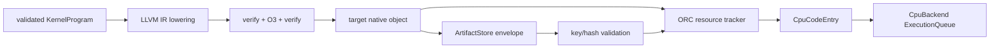

provider 在创建时动态解析 LLVM-C 22，初始化当前 architecture 的 native target，并建立一个共享 LLJIT execution
session。Sora 不产生 LLVM 链接期依赖；provider 的 code lease 保证 LLVM module 在最后一个 native artifact 销毁前保持
映射。compiler identity 覆盖 lowering schema、LLVM version、triple、CPU name/features、data layout 与优化 pipeline；
driver identity 覆盖 ORC runtime、triple、OS、binary format 与 ABI。native object cache 的等价关系因而严格强于源
program 的语义等价关系。

### 20.2 FunctionSanitizer ABI 是代码生成契约

启用 Clang function sanitizer 时，间接调用会校验函数入口前缀中的 type metadata。provider 从一个具有精确
`CpuCodeEntry` 类型的 AOT witness 读取当前工具链 ABI，再把同一 signature/type hash 写入 JIT 函数 prefix data。
此信息不是 XFG metadata，也不能通过关闭 UBSan 规避。缺少该前缀会使语义正确的机器码在 sanitizer 构建中因 ABI
不一致而失败。

### 20.3 Materialization 是带 lease 的事务

每个 `ArtifactKey` 对应一个 `Materialization`：native object、ORC resource tracker 与 resolved entry 共同生存。
cache record 记录 artifact lease 数；只有最后一个 lease 销毁后才移除 tracker 和 cache entry。import 命中已有 key 时还会
要求 object bytes 完全一致，阻止同 key 的不同机器码共享 symbol namespace。

materialization 在 provider mutex 下完成 create tracker、add object、lookup entry 与 cache insertion。任何中间步骤失败都会
移除 tracker；cache insertion 失败也不会遗留半初始化 symbol。上层 `CompilerService` 负责 per-key in-flight compile
dedup，provider 自身保证同 key materialization 的唯一提交和资源释放顺序。

### 20.4 向量化门控服从可证明条件

LLVM loop 始终保留 `llvm.loop.mustprogress`。只有 contiguous/SoA layout 且 kernel 不依赖标量 external math call 时，lowering
才附加 `llvm.loop.vectorize.enable=true`。`Tan`、`Asin`、`Acos`、`Atan`、`Atan2` 当前经 CRT scalar symbol 调用；strided
buffer 的跨 lane 访问也不满足强制向量化的充分条件。这两类 kernel 交给 LLVM cost model 决定，不再产生“loop not
vectorized”诊断。LLVM intrinsic 能表达的算术与函数、contiguous/SoA kernel 仍保留显式向量化请求。

### 20.5 当前证据与未完成边界

LLVM provider 专项在 ASan + UBSan 和 Release 下均通过 5 cases / 652 assertions，覆盖 Float64、external math、strided
layout、integer constants、artifact corruption、并发 materialization 与 provider lifetime。真实 `CpuBackend` 集成测试在
两种配置下均通过 1 case / 4,113 assertions，并验证 4,096 个 SAXPY 输出、provider identity 和
`nativeWorkItems == 4096`。完整 benchmark 的方法与数值记录于 `CpuBackendPerformanceBaseline.md`。

当前实现只生成 host CPU native object。通用 `DevicePipeline` stage 已完成，但尚无真实 Vulkan pipeline provider。以下能力仍
未完成：Vulkan/Slang/SPIR-V lowering、GPU resident allocation 与 transfer-aware placement、签名 portable package、跨平台
完整 fingerprint、Vulkan driver pipeline cache、NUMA partition 与在线 autotuning。LLVM JIT 已经是可用 CPU provider，
但尚不能代表 portable heterogeneous distribution 已经完成。

## 21. 2026-07-24 实现校正：独立 DevicePipeline stage 与 Backend ABI v4

### 21.1 Pipeline 是 executable 之后的独立物理阶段

Backend ABI v4 把 pipeline creation 从 compiler 中分离为 `BackendPipelineFactory`。当时的 `BackendCompilerApiV4` 仍只产生
`PortableLowering` 或 `DeviceExecutable`；`BackendPipelineApiV1` 是 ABI v4 内第一版独立 callback table，负责 create、import
与 export `DevicePipeline`。table 的局部版本名与全局 Backend ABI version 含义不同，不能据此把 pipeline callback 混回
compiler table。当前 Backend ABI v8 的 `BackendCompilerApiV5` 进一步声明 `ExecutableTargetDomain`。

`PipelineKey` 由五个正交身份组成：上游 executable 的 stage-tagged semantic identity、精确 `PipelineTargetIdentity`、pipeline
builder identity、pipeline state 与 binding layout。queue delay、瞬时负载、当前复用次数和 native handle 不进入 key。
`ArtifactView` 现在显式携带 `ArtifactKind` 与由 canonical key 导出的 identity；queue 则在创建时声明 dispatch 接受
`DeviceExecutable` 还是 `DevicePipeline`。因此 `PortableLowering`、错误 stage 或异服务 native state 均在 backend callback
之前被拒绝。

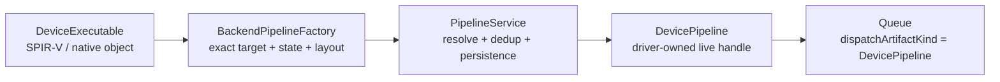

### 21.2 持久化身份与活对象身份必须分离

`ArtifactKey` 表达可序列化的 stage semantic identity，磁盘 `ArtifactStore` 只消费该 key 与 backend-private reconstructible
bytes。进程内 native handle 的等价关系更强，定义为 `LiveArtifactKey = ArtifactKey × BackendServiceId`。即使两次 backend
初始化具有相同 device、driver 与 artifact key，不同 driver context/service 也不能共享 `void*`；它们只能从同一持久化 bytes
分别 import 出各自的 live object。

`ArtifactResolutionCoordinator<Error>` 抽取了 `CompilerService` 与 `PipelineService` 的共同事务：memory lookup、per-live-key
in-flight dedup、disk load/import、create fallback、export/store 与 memory insert。共享的是协调机制，不是 stage API；compiler
与 pipeline 仍保留各自 request、error、producer validation 和统计命名。cache I/O 失败只进入统计，不覆盖已经成功的 create。

### 21.3 Producer 与生命周期校验

`ArtifactKey::ProducerIdentity()` 对三个 stage 分别返回 lowerer、compiler 与 pipeline-builder identity。compiler export 只接受
自身产生的 lowering/executable；pipeline export 还必须逐项匹配 kind、backend、device、builder 与 service。该校验阻止同
service 下的错误 stage、另一 device 或另一 factory 进入 native callback。

pipeline artifact 强持有 `BackendService`，从而同时固定 backend state 与插件 code lease。pipeline 本身不强持有 executable；
这符合 Vulkan 在 pipeline 创建后允许销毁 shader module 的生命周期模型。创建 callback 执行期间由 `PipelineService::Resolve`
调用栈强持有 executable，callback 返回前不会悬垂。

### 21.4 验证、性能与下一边界

ABI v4 基础切片在 ASan + UBSan 和 Release 下均完成 24 个 Compute executable、149 cases、18,605 assertions 的回归；最终
producer/stage 收紧后，`PipelineServiceTest` 在两种配置下均通过 7 cases / 131 assertions。专项覆盖 exact key、错误 key
事务回滚、跨 backend/device/service/factory 拒绝、并发去重、持久化损坏回退、生命周期顺序与 pipeline queue dispatch。

重建 Release benchmark 后执行三个独立进程。1M SAXPY 的 adaptive 中位数为 `14.92 ns/item`，相对串行 SIMD 的 paired ratio
中位数为 `1.301x`；Vec3 AoS/SoA SIMD speedup 中位数为 `2.247x/2.264x`，SoA SIMD/AoS SIMD 中位数为 `1.008x`；pipeline
round-trip/dispatch paired ratio 中位数为 `1.004`。这些结果未显示 ABI v4 或 cache coordination 进入 CPU dispatch 热路径。

### 21.5 物理物化层按 queue 合同自动选择最终 artifact

`PhysicalResourceCatalog` 现已拥有 `BackendPipelineFactory`。compiler 的目录 key 为
`BackendServiceId × BackendKind × compiler identity`，pipeline factory 的目录 key 为
`BackendServiceId × BackendKind × DeviceId × factory identity`。因此，相同 semantic identity 在两个 driver context 中可以共存，
但 queue 只能取得同一 backend service 下的 compiler 与 factory，native handle 不会跨 context 复用。

`PlannedDispatch` 不再重复声明最终 artifact kind。编译阶段恒产生 `DeviceExecutable`；queue 的 `dispatchArtifactKind` 是最终提交
合同。pipeline queue 还要求 `PlannedPipeline{factory, state}`，普通 executable queue 则拒绝该字段。binding-layout identity 由
kernel argument ABI schema 自动导出，覆盖 argument order、kind、access、value type、rank、layout、minimum alignment 与 scalar
packing rule。allocation、extent、stride、launch geometry 和 alias proof 不进入该 identity，避免动态 invocation 造成 pipeline cache
过度特化。

`PhysicalGraphMaterializer` 通过 `ArtifactResolutionServices{CompilerService&, PipelineService&}` 显式取得两级 resolver。
物化顺序为 physical binding validation、`DeviceExecutable` resolve、按 queue 合同可选的 `DevicePipeline` resolve、batch
construction。pipeline failure 使用独立的 `PipelineResolutionFailed` stage；此前创建的 allocation 按逆序释放，临时
executable lease 同步销毁。batch 只持有 queue 最终消费的 artifact，符合 Vulkan pipeline 创建后可销毁 shader module 的
生命周期模型。

本轮 ASan + UBSan 与 Release 各通过 11 个直接及扩展 executable，共 90 cases / 9,354 assertions。三进程 Release benchmark 的
1M adaptive 中位数为 `14.79 ns/item`，相对串行 SIMD 的 paired speedup 中位数为 `1.292x`；Vec3 AoS/SoA SIMD speedup 中位数为
`2.259x/2.203x`；pipeline round-trip/dispatch 中位数为 `1.003`。结果未显示本轮目录查找、schema identity 或二阶段物化进入
CPU steady-state 热循环。

下一阶段闭合真实 GPU 物理路径，范围限定为三个部分：

1. 实现 Slang 到 SPIR-V 的 `DeviceExecutable` provider，以及 Vulkan `VkPipeline` create/import/export 与 driver cache blob。
2. 接入 timeline event、GPU allocation/residency 与 device-loss invalidation，保证失败恢复不复用失效 live artifact。
3. 分别建立 cold/warm compile、resident dispatch、transfer-inclusive graph 与 device-loss recovery 性能基线，再据此启用
   placement cost model。

当前系统可以声明 pipeline stage 与物理物化合同已完成，仍不能声明 Vulkan backend、GPGPU placement 或 portable heterogeneous
distribution 已完成。

## 22. 2026-07-25 实现校正：不可变 runtime epoch 与有界 fresh-attempt recovery

### 22.1 设备恢复以 epoch 替换为原子单位

`RuntimeEpoch` 把一个时刻可参与放置的 `PhysicalResourceCatalog`、device descriptor 与观测 snapshot 固定为不可变值。
`RuntimeRecoveryCoordinator` 只发布 `shared_ptr<const RuntimeEpoch>`；读路径取得一个稳定 epoch，不会观察到部分重建的目录。
当前 COCA libc++ 声明但未实现 `atomic<shared_ptr<T>>`，因此实现按 feature test 选择标准特化或 `shared_ptr` 原子自由函数。
该差异只属于标准库适配，不改变 acquire/release publication 语义。

恢复事务遵循四步偏序：

1. `RuntimeInvalidationRegistry` 先发布 failed service tombstone，并从 cache 与 residency table 移除其可见对象。
2. coordinator 选举唯一 reconstruction leader；同 service waiter 共享该 flight 的精确成功值或失败值。
3. provider 构造 `old.sequence + 1`，replacement 必须排除 failed service，错误 sequence 与残留 service 均拒绝发布。
4. coordinator 原子发布完整 replacement；backend object 在 registry、cache 与 buffer lock 之外销毁。

tombstone 是持久状态，不是一次清理事件。失效事务完成后到达的 artifact insertion、replica publication 与 completion
publication 仍会被拒绝，因此并发中的旧工作不能在新 epoch 发布后复活 retired service 的 native object。

### 22.2 重试单位必须是新的物理图

`ExecutableGraph` 是 owning affine value，`SubmitOn` 会消费它。对已经构造的 sender 做 generic retry 会重新连接一个持有
moved-from graph 的 sender，因而不具备合法语义。`RecoveringSubmitOn` 把 attempt factory 提升为重试接口，每轮重新执行
placement、physical planning、materialization 与 submission；前一轮只留下不可变 epoch、attempt index 和结构化 submission
failure。

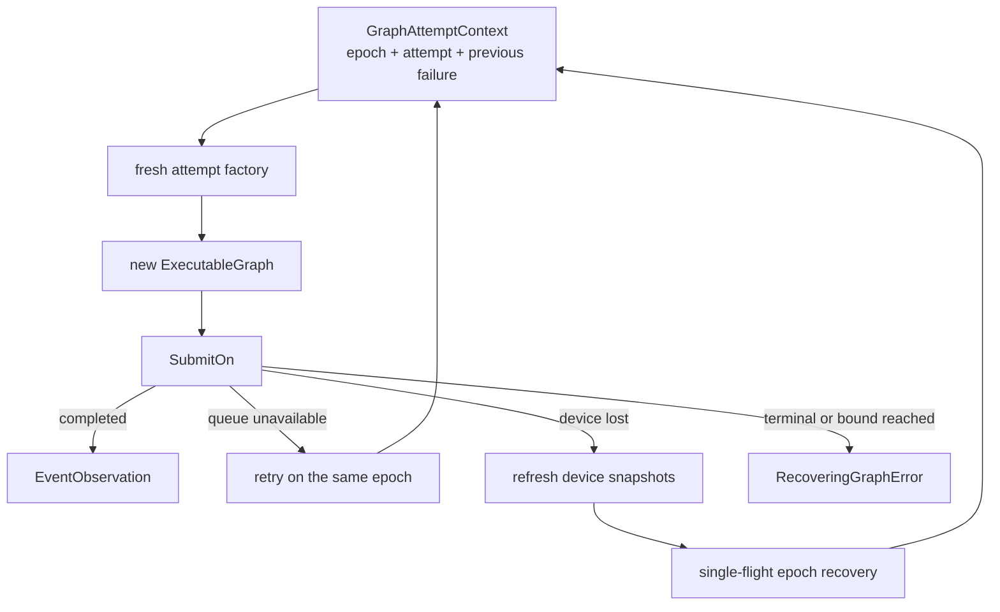

`exec::repeat_until` 只负责结构化的有界循环。`maximumAttempts` 的有效范围为 `[1, 16]`；queue unavailable 可在同一
epoch 上重新放置到另一设备，device loss 则必须先刷新 snapshot，并在确认 generation failure 后进入 coordinator。stop
request 仍沿 stopped channel 传播，不伪装成领域错误。

每轮 factory 之前均刷新 epoch snapshot。该 preflight 顺序处理两类此前未闭合的状态：设备在 sender 启动前已经丢失；上一
provider 失败后 current 仍指向包含 retired service 的旧 epoch。两种情况下都先完成 recovery 或返回 typed error，不允许
factory 在已退休 service 上继续物化。成功 refresh 得到的最新 device records 通过 `GraphAttemptContext::devices` 传入
factory；epoch 保留代际身份，attempt snapshot 表达本轮可用性，temporary unavailable 等普通状态变化不会被旧 snapshot 遮蔽。

### 22.3 单一错误代数保留领域失败与执行基础设施失败

`RecoveringGraphError<AttemptError>` 精确区分七类终止原因：invalid policy、attempt build failure、terminal submission
failure、runtime recovery failure、runtime observation failure、retry limit exhaustion 与 orchestration failure。observation
failure 表达当前 policy 禁止恢复或 snapshot 错误不可恢复；orchestration failure 保存原始 `exception_ptr`。

该 orchestration error 不是用户 factory 的异常。`GraphAttemptFactory` 与 `RuntimeEpochRecoveryProvider` 均由 concept 强制为
`noexcept`；但 `exec::repeat_until` 在底层 scheduler sender 的 `connect` 不能静态证明为 `noexcept` 时，必须保留
`set_error(exception_ptr)`。尾部 `let_error` 把这一基础设施通道归一化为 `GraphOrchestrationFailure`，故公共 sender 最终只有
一个领域 error type，同时没有丢失异常身份或引入类型擦除。

### 22.4 正确性与性能证据

`BackendExecutionTest` 的 Release 与 ASan + UBSan 配置均通过 30 cases / 339 assertions；恢复子集为 4 cases / 140
assertions。device-loss 用例建立两个真实 service/device：首次物理图在 failed service 上返回 `DeviceLost`，provider 发布只含
survivor 的 sequence 2，第二次 factory 观察 replacement 与上一 submission failure，并以 survivor 的 queue、artifact 与
allocation 重新物化。错误分支测试还证明首次 provider 失败后，下一 sender 在 factory 前重新恢复并切换到 survivor。
`RuntimeRecoveryCoordinatorTest` 在两种配置下均通过 5 cases / 139 assertions，覆盖 single-flight、
invalidation-before-provider、多 service 串行恢复与非法 replacement 拒绝。Windows ASan 不支持 LSan，本轮 leak detection 显式
关闭；ASan 与 UBSan 没有报告错误。

同一 Vulkan device 上重建 Release benchmark 后执行五个独立进程，结果如下。负变化表示耗时或相对开销降低；进程间频率与
系统负载未固定，因此这些数值只能排除可见退行，不能把改善归因于恢复实现。

| metric | previous median | current median | change |
|---|---:|---:|---:|
| cold service materialization | `610.778 ms/service` | `450.365 ms/service` | `-26.264%` |
| resident dispatch | `0.173411 ns/element` | `0.153288 ns/element` | `-11.604%` |
| transfer round trip | `1.538253 ns/element` | `1.152486 ns/element` | `-25.078%` |
| full round trip | `1.620817 ns/element` | `1.200956 ns/element` | `-25.904%` |
| round-trip/resident paired ratio | `9.764518x` | `7.796675x` | `-20.153%` |

recovery checks 只位于 cache insertion、completion publication 与 epoch control plane，不进入 resident per-element loop。本轮
数据与这一复杂度边界一致。

### 22.5 当前完成边界

现在可以声明 service-local invalidation、single-flight epoch reconstruction 与 fresh-attempt sender recovery 已完成。尚未完成的
是三项上层闭合：统一 public submit API 自动构造 placement/planning/materialization factory；device-loss recovery latency 与
大量并发 waiter 的独立性能基线；portable package 到目标机器后的 backend discovery、kernel recompilation 与跨设备 autotuning。
这些能力必须继续建立在 epoch 和 fresh-attempt 边界上，不能把可变 device health 混入 artifact identity，也不能重试已经消费的
物理图。

## 23. 2026-07-25 实现校正：统一提交边界与恢复控制面基线

### 23.1 `ComputeContext` 位于 Execution 层

统一用户入口现已具备一条完整的编排路径：

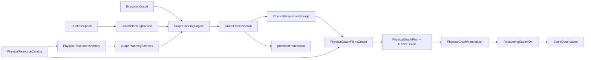

`ComputeContext<Planner, RecoveryProvider>` 位于 `Sora.Compute.Execution`，原因是该类型同时组合 Runtime 服务与 stdexec sender。
若把它放入 Runtime，则 Runtime 必须反向依赖 Execution，破坏既有偏序
`Sora.Compute.Graph -> Sora.Compute.Runtime -> Sora.Compute.Execution`。context 共享状态拥有 `PortablePackageRegistry`、
`ArtifactCache`、`CompilerService`、`PipelineService`、`RuntimeRecoveryCoordinator`、planner 与 recovery provider；sender
按值冻结 `ExecutionGraph`，并以 `shared_ptr` 保持 context state，因此 facade 先于异步操作析构不会形成悬垂。

`GraphAttemptContext` 是 execution-side fresh attempt 输入，持有 immutable epoch、同索引的 static device bindings 与最新 snapshots、
上次提交错误和 attempt index。`ComputeContext` 不把该类型直接交给 planner，而是投影为 `GraphPlanningContext`：epoch 只留下
sequence，`RuntimeDeviceBinding[]` 与 `DeviceSnapshot[]` 则继续作为相互对应的只读 span。
`GraphPlanningServices` 暴露 `const ProgramCatalogSnapshot&`、`const PhysicalResourceInventory&`、
`const ArtifactAvailabilitySnapshot&` 与 `const PerformanceSnapshot&`。inventory 是 catalog 的确定性纯值投影，不含 callback、
native state、allocator、compiler facade 或 queue handle；artifact snapshot 只含排序后的 service-scoped exact key，不持有 artifact
lease、LRU 状态或 cache mutex；performance snapshot 则是一个 planning attempt 共享的校准代际。因此 planner 只能读取纯值事实，
无权分配、编译、传输和提交。

`RuntimeEpoch` 将变化频率不同的事实分开存储。`RuntimeDeviceBinding` 保存 service、immutable descriptor 与完整
`TargetFingerprint`；`DeviceSnapshot` 只保存 health、generation 与 observation sequence。两个数组长度相等、顺序稳定，索引 `i`
始终描述同一物理设备。`RefreshDeviceSnapshots()` 只返回新的 `vector<DeviceSnapshot>`，不复制 target 或 descriptor。后续 candidate
synthesis 必须在请求边界按索引联结两类事实，再叠加 artifact availability 与 calibration；不得重新引入 combined device record。

`GraphPlanningEngine` 用 concept 约束 `noexcept` 调用及 `expected<GraphPlanSelection, E>` 形状。selection 将尚未获得运行时权柄的 plan
storage 与选择该 storage 的预测 makespan 绑定；`ComputeContext` 随后调用 `PhysicalGraphPlan::Create(selection.storage, catalog)`，完成 catalog 一致性验证并捕获
`DeviceLease`。若 planner 直接返回 `PhysicalGraphPlan`，则纯规划阶段必须查询 catalog 并取得 lease，纯函数边界与设备代际权限将发生
矛盾。当前两阶段构造消除了这一矛盾。planner 的线程安全仍是语义契约，C++ concept 无法证明多个 invocation 之间不存在数据竞争。

这里没有使用 reflection、consteval block 或 coroutine。设备健康、placement candidate 与恢复代际均为运行时事实，强行前移只会把动态
状态伪装成静态元数据。stdexec 用于 lazy submission 与 stop/error/value completion，concept 用于静态协议约束；二者位于各自能够提供
可证明收益的层次。

### 23.2 提交不变量与错误代数

`ComputeContext::Submit(scheduler, graph[, policy])` 在每次 fresh attempt 中依次执行四项操作：

1. 向 `RuntimeInvalidationRegistry` 注册 logical graph 持有的全部 buffer。
2. 用纯值 planning context 与 inventory 调用 planner，获得 `GraphPlanSelection`。
3. 由 context 根据 catalog 验证 `selection.storage`、捕获 `DeviceLease`，再注册 plan allocation 对应的 logical buffer。
4. 事务式物化物理图，再交给 `RecoveringSubmitOn` 提交或恢复后重建。

该顺序保证 device-loss tombstone 在线性化注册之后覆盖 planner 新建的 buffer，避免晚到 replica 复活 retired service。准备阶段错误为
五个互斥分支：`GraphResourceRegistrationFailure`、`GraphPlanningInputFailure`、`GraphPlanningFailure<E>`、
`GraphPlanValidationFailure` 与 `GraphMaterializationFailure`；外层沿用
`RecoveringGraphError<GraphPreparationError<E>>`，用户无需接触 attempt factory，仍能保留失败阶段与底层诊断。

当前 facade 只建立统一编排协议，尚未声称自动异构 placement 已完成。具体的 whole-graph cost-based `GraphPlanner` 仍须把
`ExecutionGraph`、同索引 device bindings/snapshots、artifact availability、resident/transfer cost 与 calibration 合成为
`PhysicalGraphPlanStorage`。
在该 planner 完成前，`CreateComputeContext` 需要显式注入 planner 与 recovery provider，`SystemDefault()` 不得伪造为已实现接口。

### 23.3 恢复控制面性能基线

`Benchmark.Sora.Compute.Recovery` 分离测量健康路径、无竞争恢复与 single-flight waiter 广播。并发基线使用同构控制组：一个持续运行的
leader 加 N−1 个 condition-variable waiter；每个进程内部取九轮交错样本的中位数与 paired ratio，再对五个独立进程取中位数。

| metric | five-process median | interpretation |
|---|---:|---|
| current epoch load | `34.730 ns/operation` | acquire load 与 shared ownership |
| healthy snapshot refresh | `89.450 ns/operation` | 两个 device observer 的同步刷新，只复制动态 telemetry |
| uncontended device recovery | `1.100 us/recovery` | invalidation、replacement validation 与 epoch publication |
| 8-waiter parked recovery burst | `162.500 us/recovery` | 所有 waiter 返回的 wall time |
| 8-waiter pure wake control | `116.400 us/burst` | 同构调度与 CV 广播成本 |
| 8-waiter recovery/wake paired ratio | `1.376x` | coordinator 增量约 `46.1 us/burst` |
| 32-waiter parked recovery burst | `362.800 us/recovery` | 超过主机物理并发度后的 wall time |
| 32-waiter pure wake control | `353.900 us/burst` | 调度成本占主导 |
| 32-waiter recovery/wake paired ratio | `0.994x` | 与纯唤醒在测量噪声内等价 |

此前约 `15..31 ms` 的结果来自 benchmark 计时线程自身进入 `latch::wait` 后的 Windows 调度量级，并非 coordinator 延迟；测量者改为
原子计数观察后，该系统误差消失。恢复不进入 resident dispatch 或 per-element loop，因此这些微秒级数据只约束 device-loss 控制面，
不能用于推断正常计算核吞吐。

静态/动态设备状态拆分由性能基线直接约束。拆分前的 healthy refresh 基线为 `95.638 ns/operation`；把 target 与 snapshot 合并进
每次刷新的 record 后，两版实现分别退化到 `104.980 ns/operation` 与 `118.360 ns/operation`。该模型在每次 observation 时复制静态
target identity，违反变化频率分层，因此被拒绝。最终以 `RuntimeDeviceBinding[]` 保存静态身份、以 `DeviceSnapshot[]` 保存动态遥测，
五进程中位数降至 `89.450 ns/operation`，相对原基线改善约 `6.47%`。这不是局部 micro-optimization，而是 planner 输入模型必须保持的
架构不变量。

### 23.4 验证与剩余边界

Release 与 ASan + UBSan 的完整 `Sora.Compute` label 回归均通过 `202 / 202`。本切片的五组定向测试为
`56 cases / 1271 assertions`：`PhysicalResourceCatalogTest` 为 `4 / 104`，`RuntimeEpochTest` 为 `5 / 92`，
`RuntimeRecoveryCoordinatorTest` 为 `5 / 139`，`BackendExecutionTest` 为 `30 / 339`，
`PhysicalGraphMaterializerTest` 为 `12 / 597`。sanitizer recovery benchmark smoke 同步通过，未报告内存错误或 UB。

本阶段完成了原第 22.5 节所列前两项：统一 public submit API 与独立 recovery control-plane baseline。剩余主线是三层：实现 concrete
whole-graph planner，补齐 portable package/backend discovery/target-machine recompilation，建立跨 CPU/GPU 的 cost model 与 bounded
autotuning。portable distribution 只有在目标机重新发现 backend、以完整 `TargetFingerprint` 重编译并用实测 transfer-inclusive cost
重新选择 placement 后，才能声称“移动到其他电脑后自动优化”。

## 24. 2026-07-25 实现：有界性能模型与 resident dispatch candidate synthesis

### 24.1 校准身份与不可变快照

`PerformanceModel` 现将 kernel 与 transfer calibration 建模为两类正交事实。`KernelCalibrationKey` 完整包含 kernel semantic identity、
`TargetFingerprint`、`SpecializationKey` 与 `QueueId`；work-item magnitude 只选择该 identity 内部的 logarithmic bucket，不污染身份。
`TransferCalibrationKey` 则包含 service、transfer engine 与有向 source/destination memory location，保持测量值与
`PhysicalTransferDescriptor` 拓扑身份分离。

模型不在 dispatch 中读取时钟。backend 或 sampling policy 只把外部测得的 observation 提交给 serialized writer；每个 bucket 仅保留
有界聚合值与 sample count，不保存无界原始样本。kernel throughput 与 compilation cost 使用独立样本计数，缺失的 compilation
measurement 不会作为零值稀释后续校准。writer 以 copy-on-write 产生新的 `PerformanceSnapshot`，再通过 atomic shared-pointer publication
发布。planner 获取 snapshot 后只进行 allocation-free binary lookup，不取得 writer mutex，也不接触 backend callback。
旧 snapshot 的内容在后续更新和 key eviction 后仍保持不变，因此一个 planning invocation 可在统一校准代际上完成。

### 24.2 候选生成边界

`SynthesizeDispatchCandidates` 纯联结同索引 `RuntimeDeviceBinding[]` / `DeviceSnapshot[]`、确定性 resource inventory、request-local
artifact projection 与 immutable performance snapshot。它先验证 target 和 descriptor 的 device、backend、features、architecture
一致性，再过滤 device health/memory/features 与 dispatch-capable queue；缺少校准的 queue 不会被伪造默认吞吐。artifact projection
拒绝 invalid enum 与 duplicate key，避免输入顺序改变 availability 语义。

非驻留 workload 必须提供与 `KernelCalibrationKey` 精确匹配的 `CandidateTransferState`。若只声明 host-to-device 或
device-to-host bytes 而没有 projection，candidate synthesis 返回 `TransferModelRequired`；缺少某一候选的精确 projection 时只删除该
候选，不能用 device descriptor、峰值总线规格或任意常数补全。

`ProjectCalibratedTransferTopology` 把 `PhysicalTransferDescriptor` 与 service、engine、directed source/destination 四元组对应的
transfer calibration bucket 联结为 payload-specific `TransferLink[]`，未校准物理边不进入规划拓扑。`PlanResidency` 随后从当前版本
replica 求最低成本 route；`ProjectCandidateTransferCost` 验证 hop 连续性、source coverage、destination 与整数溢出，再对多 binding route
求和。already-resident route 的贡献严格为 `0 bytes / 0 ns`，避免把逻辑 region 大小误计为物理传输。

`PlacementCandidate` 与 `ExecutionPlan` 现携带 `QueueId` 和完整 target；等成本 tie-break 在 device 后继续按 queue identity 确定，plan
validation 同时检查 service/device/queue/backend/target。该变化为后续 linear-chain DP 与 HEFT DAG scheduling 提供稳定物理候选身份。

### 24.3 性能与验证

`Benchmark.Sora.Compute.PerformanceModel` 使用九轮交错样本，每个进程至少测量 50 ms；五个独立 Release 进程的中位数为：

| metric | five-process median | execution level |
|---|---:|---|
| performance snapshot load | `35.942 ns/operation` | planning snapshot acquisition |
| calibrated key lookup | `98.405 ns/operation` | allocation-free planning lookup |

snapshot load 与同机 `RuntimeEpoch` acquire load 的 `34.730 ns/operation` 同量级。calibration lookup 位于 fresh planning attempt，不进入
resident submission 或 per-element loop，因此不能把其约 `98 ns` 成本解释为 kernel dispatch overhead。

`Benchmark.Sora.Compute.PlanningInputs` 采用相同五进程、九轮交错协议，固定 64 个 live artifact、1 条 calibrated transfer edge 与
1 个 transfer-inclusive candidate。五进程中位数为：

| metric | five-process median | execution level |
|---|---:|---|
| 64-key artifact availability snapshot | `5432.689 ns/operation` | fresh attempt，复制并排序 exact keys |
| calibrated transfer topology projection | `64.315 ns/operation` | 1 条物理边与 calibration bucket 的联结 |
| transfer-inclusive candidate synthesis | `221.403 ns/operation` | 1 个 device、queue 与 exact transfer projection |

artifact snapshot 的成本包含 64 个完整 `ArtifactKey` 的复制与确定性排序，属于 `O(n log n)` fresh-attempt 控制面工作；另外两项均低于
`0.25 us`。三项都不进入 resident submission 或 per-element loop。

`ComputeContext` 现拥有 bounded `PerformanceModel`，每次 attempt 在调用 planner 前冻结 artifact availability 并取得一个 immutable
performance snapshot。Release 与 ASan + UBSan 聚焦验证均通过 `75 cases / 1352 assertions`；两套完整 `Sora.Compute` label 回归均为
`208 / 208`，未报告内存错误或 UB。

本阶段仍未实现 concrete graph-level candidate enumeration、binding destination-memory policy、linear-chain DP、HEFT、bounded local
search/autotuning，以及目标机 backend rediscovery 与 portable package 重编译。这些能力完成前，`SystemDefault()` 仍不能诚实提供自动
whole-graph placement 或 portable heterogeneous distribution。

## 25. 2026-07-26 实现：单节点 residency-aware candidate enumeration

### 25.1 枚举层固定 logical state 与 physical choice 的边界

`EnumerateDispatchCandidates` 消费一个已验证 `ExecutionGraph`、一个 logical dispatch node，以及同一 fresh attempt 冻结的
`GraphPlanningContext` / `GraphPlanningServices`。该函数不调用 backend，不分配 physical memory，不编译 artifact，也不提交 queue；
输出只含 logical buffer leases、residency route、selected memory descriptor 与 calibrated queue placement。

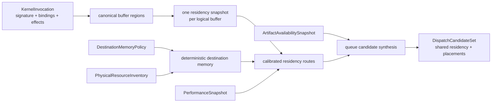

同一 buffer 的重叠或相邻 region 先作半开区间并集。每个 distinct logical buffer 只取一次 residency snapshot，同一 device 的
多个 dispatch queue 共享一个 `DispatchResidencyProjection`，placement 只保存稳定 local index。该结构避免为每条 queue 重复复制
owning allocation leases，也为后续 graph-state DP 保留显式状态坐标。

该阶段在前序 node 写入、当前 node 读取相交 region 时拒绝枚举。此处拒绝不是功能降级，而是当时的状态边界：`Buffer` snapshot
只表示规划开始前的版本，不能冒充前序 logical node 完成后才产生的版本。后续阶段已经以 `GraphResidencyState` 把 graph-local
logical value 表示为 symbolic state transition，并由 linear-chain DP 或 DAG scheduler 传播；当前行为以第 26、38、39 节为准。

### 25.2 DestinationMemoryPolicy 与精确 transfer cost

`DestinationMemoryPolicy` 分为 hard constraints 与 deterministic preferences。service、device、backend、required location 和 required
properties 决定可接受集合；ordered preferred locations、preferred-property 缺失数与稳定 `MemoryLocation` identity 构成字典序。
重复 preference 属于无效请求，避免输入顺序产生歧义。

每个 readable canonical region 先以空 topology 查询 already-resident route，保持严格 `0 bytes / 0 ns`。非驻留 region 再按实际
payload size 投影 calibrated topology，未校准 edge 不进入 route graph。多 route 的 bytes 与 nanoseconds 使用溢出检查后求和；
`requiredDeviceMemoryBytes` 表示 touched-region 并集总量，`largestAllocationBytes` 单独约束最大 allocation，二者不再混同。

### 25.3 Pipeline artifact 是尚未完成的独立规划维度

枚举器目前只能构造 exact `DeviceExecutable` key。若 queue 的最终 dispatch contract 是 `DevicePipeline`，则还需要 pipeline builder、
pipeline state 与 binding-layout identity，并需要独立的 create/import cost calibration。把 executable cache hit 当作 pipeline cache hit 会
低估 Vulkan 候选，因此当前枚举器与低层 candidate synthesis 均排除
`dispatchArtifactKind == DevicePipeline` 的 queue。

该限制使本阶段结果保持正确，但真实 Vulkan placement 尚未接入自动枚举。下一实现层必须把 executable availability、pipeline
availability 与 pipeline materialization cost 分别建模，再允许 pipeline queue 参与竞争。

### 25.4 性能与验证

`Benchmark.Sora.Compute.PlanningInputs` 改用逐 case 独立 repetition calibration。五个独立 Release 进程、每项九个样本的中位数为：

| metric | five-process median |
|---|---:|
| 64-key artifact availability snapshot | `6247.754 ns/operation` |
| calibrated transfer topology projection | `77.996 ns/operation` |
| transfer-inclusive candidate synthesis | `621.943 ns/operation` |
| complete dispatch candidate enumeration | `2163.397 ns/operation` |

完整枚举约为 `2.16 us`，包括 program resolve、binding/region 归并、residency snapshot、destination selection、route、artifact lookup
与 candidate synthesis。该成本属于 fresh planning 控制面，不进入 steady-state submission 或逐元素 kernel。详细协议与回归判据见
`PlanningPerformanceBaseline.md`。

定向 Release 验证覆盖 exact route、resident zero-cost、uncalibrated exclusion、总内存与最大 allocation 分离、重复 preference、
produced-residency refusal、多 queue 共享、memory preference order、同 `BufferId` 不同 ownership，以及 transfer duration overflow。

最终 Release 与 ASan + UBSan 的完整 `Sora.Compute` label 回归均通过 `214 / 214`，未报告内存错误或 UB。
`DispatchCandidateEnumerationTest` 为 `5 cases / 166 assertions`，`ResidencyPlannerTest` 为
`5 cases / 60 assertions`；两组定向测试在 Release 下均通过。

### 25.5 后续偏序

当前实现完成的是单 logical dispatch node 的候选枚举。后续依赖关系固定为：symbolic produced-residency 与 pipeline-cost projection
在前，linear-chain DP 次之，HEFT DAG scheduling 再次，bounded local search/autotuning 最后。目标机 backend rediscovery、portable
package validation 与按完整 `TargetFingerprint` 重编译/JIT 属于分发层，不能由本阶段接口代称。

## 26. 2026-07-26 实现：service-scoped physical identity 与 symbolic residency 封闭

### 26.1 physical identity 必须包含 backend service

跨 GPU、跨进程 backend 或远端传输会使 `QueueId`、`MemoryLocation` 与 `TransferEngineId` 只具备 service-local 语义。
因此 physical resource 的最小身份不能退化为 local id。当前索引统一为：

| resource | exact identity |
|---|---|
| queue | `(service, backend, device, queue)` |
| allocator | `(service, location)` |
| transfer engine | `(destination service, engine)` |

`PlannedQueue`、`PlannedAllocation` 与 `PlannedTransfer` 均显式携带 `BackendServiceId`。plan validation、device lease capture 与
materialization 只按上述 exact identity 查找资源，不允许用相同 local id 的另一 backend generation 补位。

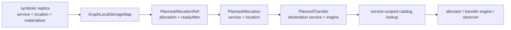

transfer engine 还必须声明 `sourceService`，否则 destination service 无法验证 source allocation 的所有权，也无法持有源设备
generation 的 lease。该字段改变 callback table 布局，因此 Compute backend ABI 升至 5，类型名同步改为
`TransferEngineApiV5`。继续沿用 ABI 4 会让旧插件按错误偏移读取回调表，并使持久化 artifact identity 与真实运行时契约不一致。

### 26.2 symbolic state 到 physical storage 的映射是显式边界

`GraphLocalStorageMap` 保存完整 `GraphLocalResidencySource -> PlannedAllocationRef` 对应关系。key 包含 buffer、coverage、version、
logical producer、service、location 与 materializer，不能仅按 buffer 或 producer 做模糊匹配。容器按 key 排序并连续存储，插入时
拒绝无效或重复 binding，查询以二分完成；binding 的无异常移动性质由编译期约束固定，从而保持插入的强保证。

`PlanPhysicalResidency(GraphResidencyRoute, prefix, graphLocal)` 把 ready source 保留为 `ReadyStorageRef`，把 symbolic source 精确
解析为 prefix 中的 `PlannedAllocationRef`。新 allocation 与 segment 从 prefix size 开始编号，producer dependency 直接连接既有
physical segment。prefix 中的 allocation id、readyAfter 范围、buffer、version、coverage、service 与 location 任一不一致，均返回
`InvalidGraphLocalBinding`；找不到 exact key 则返回 `MissingGraphLocalBinding`。route 拓扑本身不连续才返回 `InvalidRoute`，两类错误
不混用。

### 26.3 性能边界与阶段结论

`Benchmark.Sora.Compute.GraphResidency` 的五进程中位数为：1024-entry symbolic segment lookup `20.073700 ns`，
1024-entry produced storage lookup `89.630127 ns`，单 hop symbolic route 到 append-ready physical fragment
`460.740662 ns`。第三项包含 fragment 内部小向量分配，故可作为当前 graph-state expansion 的端到端控制面基线。

按当前 CMake target graph 直接执行全部 Compute 测试，Release 与 ASan + UBSan 均通过
`32 targets / 228 cases / 45,362 assertions`，未报告内存错误或 UB。`PhysicalGraphPlannerTest` 在补充失败插入、service mismatch
与越界 producer 检查后为 `5 cases / 142 assertions`。

symbolic residency 阶段至此完成从逻辑版本、service-scoped replica、exact physical binding 到 materializable plan fragment 的闭合。
下一阶段只实现 linear-chain DP：状态由每个 logical node 的候选 placement 与 produced residency 构成，转移代价使用已校准的
compute、transfer、compile 与 pipeline materialization 成本。HEFT、bounded local search 与 portable JIT 继续保持后继关系，
不得先引入一个与现有 candidate/physical-plan 边界脱节的通用 DP 核。

## 27. 2026-07-26 实现：封闭 linear dispatch chain 的精确动态规划

### 27.1 接受域是可证明的封闭图类

`LinearChainPlanner` 只接受非空、dispatch-only 的有序图，边集必须精确等于 `{i - 1 -> i | 1 <= i < N}`。每个 dispatch
至少写一个 buffer；每个 buffer argument 必须是唯一的 whole-buffer `Read` 或 `Write` binding。以下输入不会退化到近似规划，
而是以稳定错误码拒绝：

| rejected input | reason |
|---|---|
| 缺边、额外边或一般 DAG | destination coordinate 不再足以刻画前沿等价类 |
| copy、fill、external node | 尚未定义与 dispatch placement 同构的候选及成本语义 |
| partial buffer region | 活跃版本集合必须提升为 region lattice，当前状态压缩不再精确 |
| `ReadWrite` binding | 输入版本与输出版本在同一 argument 上耦合 |
| 同一 dispatch 的重复 buffer binding | alias、访问序与 publication 语义尚未进入状态 |
| 无 buffer output 的 dispatch | 无法建立下一层 produced-residency 状态 |

标量参数与几何参数仍由 `KernelInvocation` 保留，不参与 residency 状态。该接受域是精确性证明的前提，不是暂时绕过
异常输入的兼容策略。

### 27.2 DP 状态、转移与确定性

一次 planning attempt 先调用 `FreezeGraphResidency`，冻结所有 live buffer 的 baseline version 与 ready replica。后续候选枚举、
状态复制和物理 lowering 均引用这一快照，不再读取可并发变化的 live residency。`GraphResidencyState` 采用共享 immutable baseline
与独立 produced-state mutation；复制前沿状态不复制 baseline，提交一个候选也不会污染兄弟状态。

第 `i` 层状态可写为 `S_i = (R_i, C_i, p_i, q_i)`。其中 `R_i` 是提交第 `i` 个 dispatch 后的完整 canonical symbolic
residency，`C_i` 是累计纳秒成本，`p_i` 是前驱状态，`q_i` 是已选 dispatch。frontier 只在两个状态共享同一 frozen baseline 且
`R_i` 完全相等时合并；末端 `(service, memory location)` 不是充分 key。节点提交后按最后读者删除后继不可观察 buffer，并在本封闭
图类内删除早于当前节点的 produced value。完整反例与证明见第 41 节。

转移从每个 `S_{i-1}` 调用 `EnumerateDispatchCandidates`，其输入包含该状态的 residency。每个 placement 再交给
`PlanExecution` 计算 calibrated additive cost，成本已覆盖 compute、transfer、executable cold materialization 与 pipeline cold
materialization。选择后以 `CommitDispatchResidencySelection` 产生下一状态。规划过程不执行 backend callback，不编译、不分配
physical memory，也不提交任务。

等成本转移依次比较 predecessor index 与 stable placement identity；stable identity 包含 service、target/specialization、queue 与
可选 pipeline key。最终层比较累计成本与 stable placement identity。因此相同 canonical 输入产生可复现计划。

```mermaid
flowchart LR
    Snapshot["frozen graph residency"] --> F0["frontier i - 1<br/>canonical residency states"]
    F0 --> Enum["EnumerateDispatchCandidates<br/>state-specific routes and placements"]
    Enum --> Cost["PlanExecution<br/>additive calibrated cost"]
    Cost --> Commit["CommitDispatchResidencySelection"]
    Commit --> Merge["merge by complete residency equivalence<br/>stable minimum"]
    Merge --> Fi["frontier i"]
    Fi --> Replay["backtrack selected path"]
    Replay --> Lower["PlanPhysicalResidency + dispatch lowering"]
    Lower --> Plan["PhysicalGraphPlanStorage"]
```

### 27.3 replay 与 physical lowering 保持纯规划边界

DP 完成后只回溯所选路径，不保留失败分支的 physical storage。lowering 从同一 frozen baseline 重新解释每个输入 route：ready
source 保留既有 storage，produced source 经 exact `GraphLocalStorageMap` 解析，跨 location route 交给 `PlanPhysicalResidency` 生成
allocation、transfer segment 与 dependency。每个 dispatch 生成显式 output allocation；只有某 buffer 的最后一个 writer 生成
whole-write publication，且该 publication 受 `DestinationPublication::Publish` 策略约束。链顺序、produced-input producer 与
transfer producer 均转化为 physical dependency，最终 plan 仍须通过
`PhysicalGraphPlan::Create` 的完整结构验证。

该 lowering 只构造 `PhysicalGraphPlanStorage`。callback、runtime compilation、真实 allocation 与 submission 仍属于
materialization/submission 层，因而候选探索没有外部副作用，也不需要回滚 backend 状态。

### 27.4 复杂度与性能基线

设 `F_i` 为第 `i` 层前沿，`C_i(s)` 为状态 `s` 下枚举出的 placement 集。转移次数精确为
`sum_i sum_{s in F_(i-1)} |C_i(s)|`。若每层至多有 `F` 个完整 residency 状态，每状态至多产生 `C` 个 placement，则转移为
`O(NFC)`，当前线性等价类查找使最坏合并成本为 `O(NF^2C)`。policy 用硬容量约束 `F`，超限失败而不裁剪。设全图 resource
access 数为 `A`，last-reader index 的构造为 `O(A log A)`；其余 physical lowering 与实际生成的 allocation、segment、edge、
publication 总量线性。

`Benchmark.Sora.Compute.LinearChainPlanning` 测量完整纯规划调用，包括 residency freeze、candidate enumeration、DP、回溯与
physical lowering，不包含 materialization 和 submission。Release 五个独立进程的中位数为：

| graph / exact residency frontier | five-process median |
|---|---:|
| 1 node / 1 destination | `8.655 us/plan` |
| 8 nodes / 1 destination | `63.400 us/plan` |
| 8 nodes / 2 destinations | `129.316 us/plan` |
| 32 nodes / 2 destinations | `632.254 us/plan` |
| 3-node residency-sensitive chain / 2 destinations | `70.067 us/plan` |

Release 与 ASan + UBSan 的完整 `Sora.Compute` label 回归均通过 `395 / 395`。定向结果为
`LinearChainPlannerTest: 10 cases / 393 assertions` 与 `GraphResidencyTest: 14 / 400`；所有成功计划均经
`PhysicalGraphPlan::Create` 验证。旧 destination-only revision 的基线与当前结果不可直接比较，完整 A/B 解释见第 41 节。

本阶段只完成 exact linear-chain DP。一般 DAG 的 HEFT、HEFT 结果上的 bounded local search/autotuning、目标机 backend
rediscovery、portable package validation 与按完整 `TargetFingerprint` 触发的 runtime JIT 仍是后继阶段，不得以当前 planner
接口代称这些能力。

## 28. 2026-07-26 实现：一般 dispatch DAG 的确定性 HEFT

### 28.1 静态 rank 与动态 placement 分属两个状态层

`HeftPlanner` 接受 `ValidateDispatchGraph` 定义的 dispatch-only、whole-buffer 一般 DAG，不再要求边集构成线性链。规划分为
静态 rank 与动态 placement 两层。静态层调用 `EnumerateDispatchResourceCandidates`，只枚举 device、queue、memory、artifact
与 calibrated execution cost，不读取随前序选择变化的 produced residency。动态层按 rank 顺序调用
`EnumerateDispatchCandidates`，以已提交的 symbolic residency 计算 exact route 与 placement EFT。

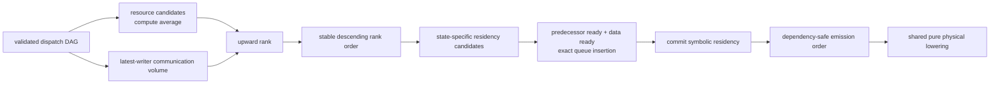

节点 `v` 的 upward rank 为
`rank_u(v) = average_execution(v) + max_(v,w)(average_communication(v,w) + rank_u(w))`。计算均值只统计满足
`PlacementPolicy` 的 resource candidate。通信均值只统计存在 calibrated route 的 source/destination coordinate pair；同一
coordinate 的通信成本严格为零，不可达 pair 不以有限惩罚伪装为可行路径。若一个非零数据依赖不存在任何可达 pair，则 rank
估计失败。该定义是可行域上的条件均值，与经典 HEFT 假设完全连通处理器图的无条件均值不同。

### 28.2 EFT 必须同时满足逻辑偏序、数据就绪与 queue 日历

候选 placement 的 earliest start time 取三项最大值：所有逻辑前驱的 finish time、输入数据的 ready time、校准模型给出的
queue availability。逻辑前驱项不能只由数据 route 间接表达；纯控制边同样规定 happens-before。queue 日历按完整
`(service, backend, device, queue)` 身份区分，并在已有 interval 间执行 insertion-based gap search，因而同一 queue 的已调度
dispatch 不会重叠，不同 queue 之间也不会生成虚假依赖。

produced replica 的 ready time 分为两类。dispatch output 在 producer finish 时就绪；跨 location materialization 在 route 的最后
一个 hop finish 时就绪，并以 consumer 作为 replica materializer。后续高编号节点可以复用已由低 rank、高编号 reader 提前物化的
replica，因此 residency candidate 必须随已提交调度状态重新枚举，不能由静态 rank 阶段缓存为最终 placement。

调度结束后，emission order 在逻辑 DAG 上加入 produced replica materializer 到 consumer 的边与同一 exact queue 相邻 interval
的边。transfer calendar 中相邻 interval 则被转换为 hop 级 `DispatchTransferConstraint`，与 selection 一并交给
`LowerDispatchGraph`。lowering 精确解析 `(consumer, buffer, raw hop index)`，添加物理 transfer segment 偏序；若新边在既有 segment
序列中反向但不成环，则执行稳定拓扑重排，并一致重映射 segment、allocation、publication、storage source 与 physical edge。
没有 constraint 或全部新边已经正向时保留 fast path。所有成功结果最终由 `PhysicalGraphPlan::Create` 验证。

### 28.3 复杂度已消除按边回扫历史节点与二次 ready scan

设节点数为 `N`、边数为 `E`、resource access 数为 `A`、不同 buffer 数为 `B`。communication volume 先排序 buffer identity，
再单遍维护 latest writer，并以二分定位 dependency edge；复杂度为 `O(A log A + A log B + R log E)`，其中 `R` 是 read access
数。旧的逐边回扫历史节点会产生近似 `O(E N A)` 成本，已从实现中删除。

rank 排序为 `O(N log N)`，节点计算成本严格为正，故 descending upward rank 自动满足 DAG 拓扑偏序，不需要每轮扫描 ready set。
动态 placement 成本由 state-specific candidate enumeration、queue gap search 与 transfer gap search 主导。若候选 `p` 所属 queue
已有 `K_p` 个 interval，则 queue gap search 与最终 vector insertion 均为 `O(K_p)`。transfer-engine 身份严格为
`(destination service, engine)`，避免把不同 service 下数值相同的 `TransferEngineId` 错误串行化。每条 route 按原始 hop 顺序调度：
异步 hop 在对应 engine 的 committed calendar 与本候选 pending calendar 的有序并集中查找最早 gap，多 hop 严格以前一 hop finish
作为下一 hop ready；`CoherentAlias` 不占异步 engine interval，但其同步延迟仍推进 route-ready time。

候选 transfer calendar 是局部 delta，落选 placement 不得污染全局日历，只有胜者提交。每条 route 同时重新累加 hop duration，并与
`estimatedNanoseconds` 校验，阻止 topology projection 与 scheduler 对 route cost 产生静默语义分裂。若 exact engine `e` 已提交
`T_e` 个 interval、当前候选在该 engine 已产生 `P_e` 个 interval，则一次 gap search 为 `O(T_e + P_e)`，有序插入为线性成本；总
成本按实际候选、route hop 与 engine occupancy 求和，未隐藏为常数。

### 28.4 性能与验证

`Benchmark.Sora.Compute.HeftPlanning` 与 exact-chain benchmark 共用同一 fixture，因而图、device inventory、calibration、residency
与 physical-plan validation 完全一致。五个独立 Release 进程的中位数为：

| graph / destination coordinates | five-process median |
|---|---:|
| 1 node / 1 destination | `10.708459 us/plan` |
| 8 nodes / 1 destination | `73.568652 us/plan` |
| 8 nodes / 2 destinations | `95.932617 us/plan` |
| 32 nodes / 2 destinations | `502.358594 us/plan` |
| 8 independent nodes / 1 shared transfer engine | `81.233301 us/plan` |
| 8 independent nodes / 8 distinct transfer engines | `84.347852 us/plan` |

后两项保持 graph、dispatch 数和 transfer 数一致，只改变 source location 与 engine identity，用于正交约束 contention calendar 的
规划成本。distinct-engine case 更高来自更多 route/source identity、更多 calendar 与更大的物理 topology；该 benchmark 测量 planner
CPU time，不测设备执行 makespan，因此不能由该差值推出共享 engine 执行更快。五进程结果用于数量级基线而非普通 CI 硬阈值；回归
判断仍要求同 revision 对照、至少五个独立进程、超过 15% 的中位数变化且至少四个进程方向一致。

resource/exact candidate 分层最初使 exact 路径重复构造 canonical buffer groups。TU-private prepared-buffer 复用消除了该重复；
同会话 A/B 中，`dispatch_candidate_enumeration` 中位数由 `1.810 us` 降至 `1.514 us`，改善 `16.4%`，且未扩张公共 API。

HEFT 定向测试为 `16 cases / 723 assertions`，在原有 fork/join、critical rank、queue scheduling、动态 replica、稳定 tie-break、
错误传播和溢出覆盖之外，新增 shared exact engine 串行化、不同 service 同 ID engine 并行、multi-hop 串联、确定性 transfer edge、
候选事务隔离与 lowering 稳定重排/非法 hop 拒绝。exact linear-chain 定向测试为 `8 cases / 282 assertions`。两组测试在 Release 与
ASan + UBSan 下均通过，所有成功计划均再次通过 `PhysicalGraphPlan::Create`；最终 Release 的完整 `Sora.Compute` label 为
`256 / 256`。

### 28.5 当前边界与后续偏序

transfer calendar 已消除“共享 engine 可重叠”的模型错误，但 HEFT 基线仍是确定性启发式：route 内 hop 顺序由拓扑给定，候选按
当前局部状态取最早可行 gap，因此不承诺全局最优 makespan。第 28.6 节加入有界 placement local search，但该搜索仍不改变 route
内部 hop 序列，也不穷举任意多节点联合交换。后续工作按
`calibration-driven autotuning -> backend rediscovery -> portable package validation -> runtime JIT` 推进，依次解决预算自动选择、
目标机物理能力重发现、可移植包契约验证与设备特化 kernel 编译；不可用提高静态 cost 的经验系数替代任何一层。

### 28.6 有界局部搜索只搜索稳定 placement，不缓存状态依赖 route

搜索变量是节点的稳定 `PlacementCandidate` 与 destination memory。exact residency route、physical segment 和 transfer edge 均依赖
前序 placement 形成的动态 residency，不能成为可复用搜索变量。每个邻居从同一冻结 `GraphResidencyState` 重建，重新执行
state-specific candidate enumeration、replica propagation、queue/transfer calendar、emission ordering 与 physical lowering。
因此，邻居计划按构造保持可行性，不会把前一候选产生的 route 或 calendar 泄漏到后一候选。

算法采用确定性 best-improvement。每个 pass 按当前 finish time 降序访问节点，稳定 tie 由 `GraphNodeId` 解除；已接受 directive
持续存在，每次只增加、替换或移除一个 directive。候选必须严格缩短 makespan，且改善量不少于
`minimumImprovementNanoseconds`。一个 pass 结束后只提交本轮最优邻居；无改善时提前终止。`maximumPasses` 与
`maximumNeighborEvaluations` 是硬上界，二者必须同时启用或同时关闭。

alternatives 必须在 directive 过滤前按 `PlacementPolicy` 完整收集。否则节点接受一次移动后只剩当前 placement 与“取消 directive”
两个方向，后续 pass 无法直接转向第三个 placement，局部邻域会随搜索历史错误收缩。实现现已先验证并记录全部可行
placement/destination decision，再应用 directive 选择；默认禁用路径不收集 alternatives，也不构造 decision。

`HeftPlanner::Plan` 返回 `HeftPlanningResult`，其中标准 `GraphPlanSelection` 与 `HeftPlanningStatistics` 分离。现有 `operator()` 仍满足
`GraphPlanningEngine`，返回 selection；调用者不承担额外接口分支。最终 makespan 只存于 selection，统计量记录 baseline makespan、实际
evaluation 数与 accepted move 数。`HeftPlanningResult::Improved()` 跨 selection 与 statistics 比较，因而不存在两份 optimized makespan 漂移的状态。

设一次完整 schedule 重建成本为 `C_schedule`、节点数为 `N`、evaluation 上界为 `L`、pass 上界为 `P`。搜索时间上界为
`O((L + 1) C_schedule + P N log N)`；邻居顺序求值并立即释放，空间不乘以 `L`。当前实现没有使用反射、consteval block、
`std::execution` 或 coroutine：搜索输入在运行期形成，核心是确定性的纯值状态转移；这些特性不会降低该算法复杂度，反而会扩大
编译依赖或引入异步生命周期。`stdexec` 保留在上层 submission/recovery composition，反射与 annotation 保留给 schema 和静态元数据。

静态 feasible-domain execution/communication average 与 upward rank 已独立到 `HeftRanking.cpp`；动态 topology、calendar、
local search、emission 与 lowering 保留在 `HeftPlanner.cpp`。跨 TU 边界每次 planning 只调用一次，不进入候选热循环。拆分后六项
默认基线相对拆分前变化处于 `-3.5%` 到 `+5.0%`，没有可重复性能退行。

Release 五进程基线中，默认 `8 nodes / 2 destinations` 为 `95.932617 us/plan`；1 与 8 次 evaluation 分别为
`157.979297 us/plan` 和 `558.173438 us/plan`，摊销增量为 `57.309961 us/evaluation` 与
`58.006079 us/evaluation`。benchmark 在计时前验证实际 evaluation 数严格等于预算。HEFT Release 与 ASan + UBSan 均通过
`16 cases / 723 assertions`，完整 Release `Sora.Compute` label 为 `256 / 256`。

## 29. 2026-07-26 实现校正：完整 backend rediscovery 与 epoch identity diff

### 29.1 discovery provider 贡献完整拥有的值，而非增量修改全局目录

`RuntimeDiscoveryProvider` 每次返回一个完整、拥有资源 lease 的 `RuntimeDiscoveryContribution`。贡献包含稳定
`RuntimeProviderId`、`PhysicalResourceCatalogStorage` 与静态 device/target bindings；`RuntimeDiscoverySnapshot::Create`
先按 provider identity 规范化全部贡献，再合并并只构造一次 `PhysicalResourceCatalog`。任一 provider、catalog 或 epoch
观察失败时，不会泄漏部分目录或部分 epoch。

内建 backend 通过 `RuntimeBackendBundle` concept 编译期适配。CPU 与 Vulkan facade 的 observer、queue、allocator、transfer、
compiler 和可选 pipeline resource 直接复制其 owning lease，不引入虚调用或 runtime type erasure。provider set 在调用点静态
组成，但 provider 枚举的设备、driver 与系统状态仍是运行时事实；因此这里不使用 reflection、consteval block 或 coroutine。
反射与 annotation 仍用于 package/schema 静态元数据，`std::execution` 仍用于 submission/recovery 的异步组合。

```mermaid
flowchart LR
    Providers["compile-time provider set"] --> Contributions["owning contributions"]
    Contributions --> Canonicalize["provider canonicalization"]
    Canonicalize --> Catalog["single catalog validation"]
    Catalog --> Observe["complete device observation"]
    Observe --> Candidate["unpublished RuntimeEpoch"]
    Candidate --> Diff["identity and coordinate diff"]
    Diff --> Retire["retire every removed service"]
    Retire --> Publish["atomic epoch publication"]
```

该接口只属于进程内内建 backend 边界。动态插件不能跨 DLL 传递 `std::vector`、`std::expected` 或 C++ facade；后续插件层
必须提供版本化 POD enumeration ABI，由 host 校验并提升为 `RuntimeDiscoveryContribution`。把两层混合会把 allocator、异常模型
和标准库 ABI 泄漏到插件边界，是架构错误。

### 29.2 epoch diff 同时区分 service instance identity 与物理 coordinate

`DiffRuntimeEpochs` 先按 `BackendServiceId` 生成 retained、removed 与 added service 集合，再按
`(BackendKind, DeviceId)` 识别同一物理坐标上的 service replacement。若同一 service identity 在两个 epoch 中绑定到不同
descriptor 或 `TargetFingerprint`，返回 `ServiceIdentityConflict`；service instance identity 不允许在生命周期内变义。
replacement 另行记录完整 target 是否变化，为下一阶段 artifact rejection/recompile 提供精确触发事实。

实现排序 `RuntimeDeviceBinding` 指针，不复制体积较大的 fingerprint；复杂度为
`O(N log N + M log M)`，额外空间为 `O(N + M)`。这是设备重建 control plane 成本，不进入 resident dispatch 或逐元素 kernel。

### 29.3 recovery 的发布顺序保持单调失效与原子 epoch 可见性

完整 rediscovery 可能重建所有 backend service，因此只退休触发 device loss 的 service 不再充分。恢复现在按以下顺序执行：

1. 永久退休触发故障的 service；
2. provider 构造完整 replacement epoch；
3. 计算旧/新 epoch diff，并验证 service identity 未变义；
4. 预先分配 replacement 的 `shared_ptr` publication control block；
5. 永久退休 diff 中其余 removed services；
6. 在 single-flight publication 临界区原子替换 current epoch。

service retirement 是单调且不可回滚的安全事实；失效传播失败时旧 epoch publication 保持不变，但已经确认退休的 service
不会复活。预分配 publication control block 消除了“所有旧 service 已退休后，仅因 publication allocation OOM 而无法发布”
这一额外失败窗口。cache insertion、buffer residency publication 与 code lease 均继续以 retired service 集合拒绝迟到结果。

### 29.4 验证、性能与当前边界

`RuntimeDiscoveryTest` 覆盖 `7 cases / 99 assertions`，包括真实 CPU backend 的资源 inventory、provider 失败短路、catalog/epoch
事务失败、identity diff、完整 service retirement 和 diff conflict publication rejection。Release 定向与 ASan + UBSan 定向均
通过；完整 Release 与完整 ASan + UBSan `Sora.Compute` label 均为 `263 / 263`。

五进程样本中位数为：current epoch load `43.867111 ns/op`、healthy snapshot refresh `109.766006 ns/op`、1-device full
replacement diff `319.395065 ns/op`、8-device full replacement diff `441.309738 ns/op`、uncontended recovery
`2.4 us/recovery`。diff benchmark 独立成 case family，不与 allocation-free epoch load 交错校准。采样期间主机噪声较高，历史
load/refresh 曾为 `34.730 / 89.450 ns`；这两条生产路径没有加入新逻辑，因此当前数据只建立数量级基线，不能据此判定回归。

首批 rediscovery 仍有两个明确边界：内建 Vulkan `Create` 当前选择单一设备，不是完整多 GPU enumerator；provider provenance
保存在 discovery snapshot 中，尚未进入 published epoch。后者是否需要持久化，应由插件诊断、package provenance 与审计需求
共同决定，不能提前污染执行期 identity。

后续偏序现收敛为 `portable package validation -> stage-specific key lookup -> runtime recompile/JIT orchestration`。package 加载
必须按 artifact stage 的 canonical identity 与 rediscovered target 投影做精确比较；不匹配只能查本机 cache 或重新编译，禁止
未由 compiler compatibility domain 声明的“近似兼容”复用。完成签名 package 与版本化插件 POD ABI 之前，系统仍不能声明
portable heterogeneous distribution 已闭合。

## 30. 2026-07-26 实现校正：validated portable package 与 exact-target JIT 回退

### 30.1 运行时投影与外部分发格式是两个边界

`ProgramPackage::Load(bytes, KernelProgramLimits)` 从外部 bytes 构造 owning program。加载过程依次执行 byte/count budget 校验、
wire decode、结构校验与 `KernelProgram` 语义校验；任一步失败均不产生可注册对象。容量属于 portable validation policy，不再由 CPU 或
Vulkan backend 的固定 decoder 模板实参决定。`length_error` 与不可表示容量映射为 `CapacityExceeded`，异常不越过 `noexcept` 边界。

`PortablePackage` 是已验证的运行时投影，由一个 `ProgramPackage` 与一个 immutable `PackagedArtifactSet` 组成。该类型不定义外层
section table、minimum runtime version、checksum、source map 或 signature encoding，因此不能直接充当不可信输入的 wire reader。后续签名
package loader 负责验证这些外层字段，再把合法 sections 提升为当前运行时投影；运行时编译和 artifact resolution 不应反向依赖外部格式。

### 30.2 artifact set 验证完整 stage DAG

artifact set 构造时按 `(ArtifactKind, ArtifactKey::Words())` 规范化，拒绝空 payload、重复 key、非持久化 target、派生 identity 冲突与孤立
artifact。合法依赖关系只有三类：lowering 指向根 program；executable 指向根 program 或包内 lowering identity；pipeline 指向包内
executable identity，并与其 backend 一致。executable 与 pipeline 分别携带 `ExecutableTargetIdentity` 和
`PipelineTargetIdentity`；pipeline 可以在同 backend 的另一精确设备上消费可移植 executable，而不能绕过上游 semantic identity。

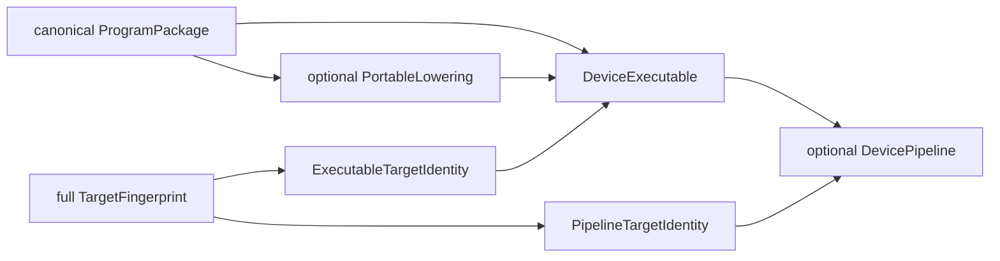

若 artifact 数量为 `A`，构造复杂度为 `O(A log A)`，额外空间为 `O(A)`；exact-key 查找为 `O(log A)`。上述成本只发生在 package
加载与首次 materialization 控制面，不进入 memory-cache hit、queue submission 或逐元素 kernel。

### 30.3 resolution 偏序已包含 package seed

`ArtifactResolutionCoordinator` 的可见偏序现为：

```text
live memory cache -> exact packaged artifact -> exact disk artifact -> compile/JIT -> export/store
```

package lookup 位于 memory miss 与 per-live-key single-flight 之后。package target 不匹配只产生 miss；backend 拒绝 payload 时记录
`packageArtifactImportFailures`，随后继续 disk lookup 或 compile/JIT。package hit、miss 与 import failure 分别计数，不能与 disk hit 或
compilation 合并。既有 `CompilerService::Resolve` 调用接口保持不变，service 从同一 `PortablePackageRegistry` immutable snapshot 解析
program 与 exact artifact seed，避免 planning、compiler 与 pipeline 观察不同 generation。

### 30.4 验证、性能与未完成边界

本节记录 phase 30 的历史验证：`PortablePackageTest` 为 `3 cases / 28 assertions`，旧 program registry 测试为
`5 cases / 42 assertions`，`RuntimeTest` 为 `15 cases / 198 assertions`。测试覆盖 canonical DAG、重复/孤立/非持久化 artifact、pipeline
target 冲突、package 优先于损坏 disk entry、另一 target 的确定性 miss，以及 package import failure 后的 JIT 回退。

八 artifact set 的历史五进程中位数为 exact hit `91.135597 ns/operation`、target mismatch `60.539532 ns/operation`。miss 较快源于
`lower_bound` 终止位置与无需构造返回 span；该差异不表示 mismatch 路径优于 hit，因为真实 hit 随后还须执行 backend import。

本节所列 signed archive 与 multi-package registry 缺口已由第 31 节替代；动态 backend discovery 的版本化 POD 插件 ABI 仍未完成。

## 31. 2026-07-28 实现校正：portable archive、detached trust 与 backend-independent validation

### 31.1 canonical content identity 与 trust evidence 相互正交

外部分发边界现分为四层：canonical sectioned archive、detached trust envelope、validated runtime projection、immutable registry。
签名不参与 package content identity。密钥轮换、撤销策略变化或增加另一种签名方案均不改变 program/artifact bytes，也不使本机 JIT cache
失效。Sora 未实现自有密码算法；`PortablePackageSignatureVerifier` concept 把具体密码库或平台 trust provider 作为编译期适配点，验证调用
没有 type erasure、虚调用或热路径状态。

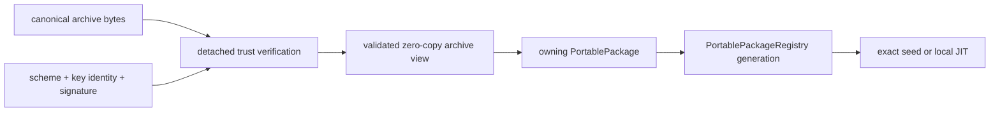

archive v1 使用固定 header、section descriptor 与 artifact record prefix。固定 POD schema 由 `Sora/Core/Wire.h` 的 reflection 驱动：
`consteval` 校验字段类型与布局，`template for` 展开字段编码，wire bytes 不依赖 C++ object padding。运行时解析仍显式处理 section 顺序、
8-byte alignment、zero padding、范围溢出、checksum 与 artifact-key reconstruction；这些不变量依赖外部 bytes，不能由 reflection 前移。

### 31.2 portable validation budget 不再等同于任一 backend lowering capacity

旧 `Materialize<A, S, I>()` 把固定 decoder 容量泄漏给 package 使用者，也把 CPU/Vulkan 当前共同的 `32/32/256` 上限误写成跨设备
协议约束。当前公共接口为 `Materialize()`；`KernelProgramLimits` 独立限制 program bytes、arguments、scalar parameters 与 instructions。
validator 在任何 allocation 前先证明声明的 wire extent 存在，然后只保留 argument descriptors、scalar parameters、input bindings 与 SSA result
types。其额外空间为 `O(A + P + I)`，但不构造执行期动态 IR，也不进入 dispatch 热路径。
validator 与固定 decoder 复用同一指令不变量：非 `Input/Constant` 指令的 unused immediate 必须为零，窄常量不得携带有效位宽之外的
高位。由此，同一执行语义不能借助无效载荷产生不同的 program hash 或 artifact-cache identity。

CPU、LLVM ORC 与 Vulkan backend 继续在各自 compile/import 边界解码固定容量 `KernelProgram`。backend 拒绝超出自身能力的 program 只使该
candidate 不可执行；portable archive 本身仍可由能力更强的后端或未来协议 lowering 消费。测试中的 33-argument program 已证明归档层接受
范围严格大于当前 backend argument capacity，同时更严格的 `KernelProgramLimits` 会在 archive 创建或加载阶段确定性拒绝该 program。

### 31.3 ComputeContext 是用户无感分发入口，错误域保持可分解

`ComputeContext::RegisterTrustedPackageArchive` 只接受由本地策略或外层 transport 明确信任的 bytes；
`RegisterVerifiedPackageArchive` 先调用 detached verifier，再解析 archive。两条路径均在完整 materialization 成功后调用
`PortablePackageRegistry::Register`，因此 archive failure 不修改 registry generation，publication failure 也不暴露半注册 package。
返回错误是 `variant<PortablePackageArchiveError, PortablePackageRegistryError>`，调用者可以区分 trust/format/budget failure 与 registry
collision/capacity failure。

注册成功后，planning、compiler 与 pipeline 从同一 immutable registry generation 观察 program 和 artifact seeds。exact
`TargetFingerprint` 命中时导入 AOT bytes；target mismatch、backend import rejection 或 seed miss 均继续本机 disk cache 与 compile/JIT，
接口使用者不承担设备选择或重编译分支。

### 31.4 性能与当前证据

archive validation、签名验证、artifact DAG validation 与 payload ownership 只处于 package 加载控制面。resident registry snapshot load、
exact lookup、queue submission 与逐元素 kernel 未增加 archive 判断。当前五个独立 Release 进程得到以下中位数：

| operation | five-process median |
|---|---:|
| archive open trusted | `9.242908 us/operation` |
| archive materialize | `4.382141 us/operation` |
| registry snapshot load | `66.670513 ns/operation` |
| package-local exact hit | `130.107880 ns/operation` |
| frozen registry exact hit | `155.359459 ns/operation` |
| registry exact hit | `215.212631 ns/operation` |
| target mismatch | `89.893246 ns/operation` |

archive 定向 Release 验证为 `6 cases / 121 assertions`，registry 为 `9 cases / 371 assertions`，包含 archive registration 的
materializer/context 验证为 `14 cases / 773 assertions`。这些样本建立当前 revision 的数量级基线；lookup 与第 30 节历史样本跨日期、跨系统负载，
不能直接作回归归因。性能退行判定仍要求同 revision A/B、至少五个独立进程、median 变化超过 `15%` 且至少四个进程方向一致。

### 31.5 尚未完成的分发边界

detached verifier concept 已冻结 trust 接口，但具体 Ed25519/ECDSA/X.509 provider、key revocation 与组织级 policy 不属于数学/计算 runtime，
必须由独立安全组件实现。版本化 backend plugin POD ABI、跨进程 compile lease 与远程 package provenance 仍未完成。
因此当前实现已经闭合 canonical archive 到本机 exact-AOT/JIT 的入口，尚未完成跨组织 trust deployment 与任意第三方 backend 插件分发。

## 32. 2026-07-28 实现校正：完整 Vulkan 设备集合与同构 provider projection

### 32.1 物理设备 identity 与 driver context identity 必须分层

`VulkanBackend::CreateAll` 现枚举本机全部兼容 Vulkan physical device，并以 canonical `DeviceId` 顺序构造 backend
service。Vulkan loader 可能通过多个 ICD 暴露同一物理设备；这些记录具有相同 `deviceUUID`，但 driver context、API version、
capability 与 pipeline-cache identity 可能不同。它们不能被伪装成多块 GPU，也不能因为重复 `DeviceId` 让整个 provider 失败。

枚举因此先按物理 `DeviceId` 分组，再在组内按以下稳定 key 选择一个 context：Vulkan API version、可用 Sora feature
数量、dedicated compute queue、maximum workgroup invocations、device-local memory、完整 driver identity。最后的 driver identity
只承担确定性 tie-break，不把 hash 数值解释为性能。零 UUID 不再退化为 `vendorId/deviceId`，因为该组合无法区分同型号多卡，
也不足以支持 `MachineStable` artifact identity。

设备事实查询采用三值语义：兼容设备返回完整 facts；API/feature 不满足或 UUID 不可信时返回空值；分配失败及发现过程异常返回
`VulkanBackendError`。物理设备枚举错误单独归入 `PhysicalDeviceEnumerationFailed`，不再误报为
`NoCompatibleDevice`。因此 `CreateAll` 只有在完整枚举和全部 service 构造成功后才返回集合，资源故障不会静默缩减设备目录。

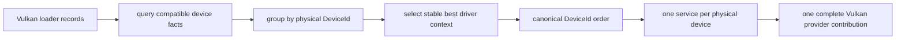

### 32.2 平台资源共享，设备执行状态保持隔离

一个 `CreateAll` transaction 共享一个 `VulkanPlatformState`，其中只拥有 `VkInstance` 与 `VolkInstanceTable`；全部设备
service 还共享一个有界 `SlangCompilerPool`。每块设备仍独立拥有 `VkDevice`、device dispatch table、pipeline cache、VMA
allocator、timeline queue/event state、compiler/pipeline facade、`BackendServiceId` 与完整 `TargetFingerprint`。

析构偏序为：每个 service 先停止 compiler lease、等待 device idle、释放 execution/pipeline/device；最后一个 service 释放共享
platform 后才销毁 `VkInstance`。集合中任一设备构造失败时，已构造 service 逆向析构，完整 provider contribution 不会部分发布。
该共享只发生在 discovery/materialization 控制面，不改变 queue submission 或逐元素 kernel 热路径。

### 32.3 同构 backend set 使用 concept 投影，不引入 runtime type erasure

`RuntimeBackendRange` 在编译期约束 homogeneous forward range 的 element 满足 `RuntimeBackendBundle`；
`RuntimePipelineBackendBundle` 进一步表达独立 pipeline stage。`MakeRuntimeDiscoveryContribution(provider, range)` 对每个
backend 投影 observer、queue、allocator、transfer、compiler、可选 pipeline 与 device/target binding，并按已知设备数和 transfer
总量精确 reserve。这里使用 concept 是因为问题本身是静态结构合同；reflection、annotation、coroutine 与 stdexec 不会减少该层
复杂度或成本，因此没有被强行引入。

本机真实验证发现两个唯一 Vulkan physical device。两者均完成 Slang/SPIR-V executable 与 Vulkan pipeline materialization，
随后共同构造包含 `2 observers / 2 queues / 4 allocators / 4 transfer engines / 2 compilers / 2 pipeline factories` 的
immutable runtime epoch。

### 32.4 性能与验证

Runtime discovery projection 的 Release 五进程中位数：

| backend count | median | process minimum | process maximum |
|---:|---:|---:|---:|
| 1 | `423.545 ns/contribution` | `406.959` | `504.315` |
| 8 | `1610.657 ns/contribution` | `1582.889` | `1825.555` |

8 倍 backend 数量对应约 `3.923x` 同轮成本，且该操作只发生在 discovery/recovery。Vulkan 完整冷物化同时包含 service、
SPIR-V executable 与 pipeline：单设备五进程中位数为 `477.399 ms/service`，双设备集合为 `868.708 ms/set`，即
`434.354 ms/device`。按进程计算的集合摊销/单设备中位倍率约 `0.869`，五个进程中四个方向更快；该结果建立基线，
但其变异度不足以单独证明稳定的优化幅度。

验证结果：Release 与 ASan + UBSan 的完整 `Sora.Compute` label 均通过 `286 / 286`；`RuntimeDiscoveryTest` 为
`8 cases / 114 assertions`，`VulkanBackendTest` 为 `15 / 24,756`。真实双设备集合用例验证 identity 排序、去重、共享
platform 生命周期、每设备 JIT/pipeline materialization、完整 contribution 与 epoch 构造。

### 32.5 当前多 GPU 边界

第 32 节完成时，具有数据依赖的跨 service 路由仍缺少通用 host bridge；该限制已由第 33 节的实现取代。CPU 与 Vulkan
service 现在可以通过显式、已校准的 host-staging route 互联，但 Vulkan peer/external-memory route、partition/merge
primitive 与 topology-aware placement 仍未完成，因此不能把任意大 kernel 自动切分到多 GPU。

用户无感的 built-in runtime factory 仍应位于依赖 Runtime、CPU backend 与可选 Vulkan backend 的更高 integration target；
Runtime 核心不能反向依赖具体 backend。版本化 plugin enumeration ABI 与跨进程 compile lease 仍是独立后继边界。

## 33. 2026-07-28 实现校正：通用 inter-service host bridge 与有界校准

### 33.1 host memory capability 是精确 authority，不是裸映射函数

`HostMemoryAccessor` 精确绑定一个 `BackendServiceId + MemoryLocation`，只接受同时具有 `HostVisible` 与 `HostCoherent`
属性的 allocation。owning `Allocation` overload 负责常规调用；non-owning `AllocationView` overload 只供已经持有 allocation
lease 的 Runtime bridge 使用。返回 span 借用 backend 的持久映射，不延长 allocation 生命周期，也不把 map/unmap 状态泄漏到
planner。

facade 在 callback 前校验 service、location、properties 与 range，在 callback 后校验 ABI version、error domain 以及结果不变量。
失败结果必须同时满足 `address == nullptr && sizeBytes == 0`；成功结果必须返回精确长度的非空映射。CPU 与 Vulkan backend
还会把 view 的 location、physical-memory identity、properties、memory offset、size 与 alignment 同 backend-private handle 完整比较，
因此调用者不能通过保留合法 state pointer 再伪造 allocation metadata。

### 33.2 discovery 合成机制边，backend 不互相持有

所有 provider contribution 合并完成后，Runtime 对不同 service 的 coherent host accessor 生成全部有向边，边数为
`n * (n - 1)`。`TransferEngineId` 由 source/destination service 与 location 确定性派生；bridge callback state 通过独立
`BackendCallbackStateLease` 同时持有两端 accessor，但两个 backend service 不持有 bridge engine，因此不存在 service 引用环。

```mermaid
flowchart LR
    AD["service A device"] -->|backend download/import| AH["service A coherent host"]
    AH -->|Runtime HostBridge memcpy| BH["service B coherent host"]
    BH -->|backend upload/import| BD["service B device"]
    Discovery["merged Runtime discovery"] --> Synthesis["directed bridge synthesis"]
    Synthesis --> Model["bounded calibration"]
    Model --> Planner["calibrated transfer topology"]
```

bridge callback 是同步 host copy：物理区间相交时使用 `memmove`，否则使用 `memcpy`，完成后返回 process-resident completed
event。callback 显式拒绝 backend waits；跨 completion domain 的依赖由 `ExecutableGraph` 的 `HostCompletion` 路径先排空，
不会把一个 backend 的 event handle 传给另一个 backend。

### 33.3 calibration 在 epoch publication 前有界完成

`HostTransferCalibrationConfig` 固定四个严格递增的 payload bucket，warmup 上限为 8，measured sample 上限为 31，单次
payload 上限为 1 GiB。校准开始前先证明 host bridge 数量不超过 `PerformanceModel::maximumTransferKeys`，否则在 allocation、
时钟读取和 backend callback 之前返回 `InsufficientModelCapacity`，避免顺序插入驱逐早期 bridge。

每个 payload 先执行 warmup，再取多次测量的中位数；固定 latency 取全部 bucket median 的最小值减一，payload duration
取 `median - latency` 的正饱和值。每次测量后比较 source/destination bytes，只有全部验证通过的 observation 才进入
`PerformanceModel`。planner 不按 backend kind 或设备类型推断可达性，只消费已校准 edge。

`ComputeContext` 在 initial epoch 返回用户前执行校准；recovery provider 构造 replacement epoch 后、atomic publication 前再次
校准。任一失败都会阻止对应 epoch 发布，用户接口不需要显式发现、连接或测量 host bridge。

### 33.4 性能与验证

Release benchmark 采用五个独立进程；下表给出进程中位数：

| payload / metric | direct | HostBridge facade | paired ratio |
|---|---:|---:|---:|
| 4 KiB latency | `32.423 ns/transfer` | `281.812 ns/transfer` | `8.543x` |
| 16 MiB throughput | `6.298 GiB/s` | `6.287 GiB/s` | `0.979x` time ratio |

4 KiB 的配对固定 facade 成本约为 `247 ns`，主要来自 validated facade 与 shared event ownership。16 MiB 没有可测吞吐
退行，进程间变化大于 direct/facade 中位差。小传输的后续优化边界应是 graph-level batching/coalescing；在没有剖析证据前，
不为减少数百纳秒而引入第二套同步 completion representation。

Release 与 ASan + UBSan 的完整 `Sora.Compute` label 均通过 `292 / 292` 个 test case。定向结果为：
`HostTransferBridgeTest` `6 cases / 98 assertions`，`RuntimeDiscoveryTest` `8 / 115`，
`PhysicalGraphMaterializerTest` `14 / 773`，`VulkanBackendTest` `15 / 24,773`。真实 Vulkan 多设备用例验证了跨 GPU
host staging copy；CPU/Vulkan 反例验证了伪造 allocation identity 在 backend callback 内被拒绝。

## 34. 2026-07-28 实现：目标机自动发现与 system compute context

### 34.1 自动入口属于 integration 层

`CreateSystemComputeContext()` 是零参数的用户入口。它依次构造 CPU backend、优选 LLVM ORC native provider、枚举全部兼容
Vulkan physical device，随后复用 `RuntimeDiscoverySnapshot`、`HeftPlanner` 与 `ComputeContext` 建立隔离的 runtime。该函数不返回
全局 mutable singleton；每次调用均拥有独立的 package registry、artifact cache、performance model、recovery coordinator 与
backend service 集合。

依赖方向由新的 `Sora.Compute.System` target 固定：

```mermaid
flowchart TD
    User["CreateSystemComputeContext()"] --> System["Sora.Compute.System<br/>integration policy"]
    System --> Execution["Sora.Compute.Execution<br/>ComputeContext + stdexec submit"]
    System --> Cpu["CPU backend<br/>scalar + SIMD + structured bulk"]
    System --> Llvm["LLVM ORC provider<br/>target-native JIT"]
    System --> Vulkan["optional Vulkan backend<br/>all compatible devices"]
    Execution --> Runtime["Sora.Compute.Runtime<br/>discovery + HEFT + recovery"]
    Cpu --> Core["Sora.Compute.Core"]
    Vulkan --> Runtime
```

Runtime 核心仍不依赖 CPU、LLVM 或 Vulkan concrete type。`SystemRuntimeFactory` 保留一份不可变、拥有其数据的
`SystemRuntimeConfig`，因此 recovery 可以在旧 service 失效后重新探测当前物理设备与平台状态。新 epoch 使用新的 service
identity 和重新生成的 `TargetFingerprint`；portable package 只保留 backend-independent program，target-specific artifact 仍由
compiler/pipeline service 按精确 target 解析或重新编译。

### 34.2 降级策略区分环境缺失与程序错误

CPU backend 是 system runtime 的必备后端。`SystemCpuCodePolicy` 分为 `InterpreterOnly`、`PreferNativeJit` 与
`RequireNativeJit`；默认策略只对 LLVM module 不可用、API 不兼容、target 不支持三类环境事实降级。OOM、编译器初始化失败等
错误不会被伪装为正常的 interpreter fallback。

Vulkan 策略分为 `Disabled`、`Opportunistic` 与 `Required`。默认 `Opportunistic` 允许 loader、driver、device 或 Slang 初始化
失败时继续使用 CPU，但不吞掉非法配置与 OOM。`RuntimeProviderError` 以稳定的 `domain/code/detail` 保存 concrete provider
诊断，`RuntimeRecoveryError` 再保留完整 `RuntimeDiscoveryError`。错误信息只存在于 discovery/recovery 控制面，不增加 planner、
submission 或逐元素 kernel 的成本。

### 34.3 性能基线与验证

`Benchmark.Sora.Compute.SystemRuntime` 固定 `CPU + InterpreterOnly + VulkanDisabled`，从而只测 integration 层自身的构造成本。
LLVM ORC 与 Vulkan 冷启动继续使用各自独立基线，避免把 backend 初始化时间错误归入 system factory。Release 五个独立进程的
中位数如下：

| metric | five-process median | execution level |
|---|---:|---|
| CPU-only complete epoch discovery | `219.623 us/epoch` | initial discovery / recovery |
| CPU-only complete context construction | `229.718 us/context` | isolated context creation |
| context / discovery paired ratio | `1.018x` | control-plane incremental cost |

默认零参数 smoke test 在本机完成 LLVM 与双 Vulkan 自动装配，并为全部跨 service host bridge 校准，Release 用时 `1.83 s`，
ASan + UBSan 用时 `5.94 s`。该冷启动包含此前测得约 `868.708 ms` 的双 Vulkan service 物化，不能解释为 submit overhead。

最终验证中，Release 与 ASan + UBSan 的完整 `Sora.Compute` label 均通过 `299 / 299`。`SystemComputeContextTest` 为
`7 cases / 35 assertions`，覆盖 CPU-only discovery、全默认 native discovery、fresh service recovery、非法 policy、非法
opportunistic Vulkan 配置与 context 错误域。

### 34.4 本阶段没有实现 kernel partition（历史状态）

自动发现多块 GPU、建立跨 service route 与选择 whole-graph placement，不等价于把一个 kernel 自动切分到多设备。现有
`PartitionContract` 只证明 elementwise axis 可切分，尚未表达 shard domain、halo、boundary condition、merge algebra、
deterministic reduction tree 与部分失败语义。下一阶段必须先实现 backend-independent partition/merge graph rewrite，再让 HEFT
比较单设备执行与 `partition + transfer + merge` 的完整代价；在这些证明义务完成前，system context 只调度语义完整的 graph node。

本节记录 2026-07-28 的边界，后续 resident elementwise partition 已由第 35 节推进。该推进没有消除 halo、reduction、精确 shard
transfer 与一般 DAG rewrite 的证明义务。

## 35. Transfer-inclusive elementwise partition 与首个物理展开切片

当前实现已完成一个受严格边界约束的纵向切片：单个 elementwise dispatch 可以比较最佳 whole-dispatch placement 与多设备
strict cover。每个 shard 的输入由 frozen graph residency 重新规划，因而 transfer latency、route topology、coherent alias 与共享
transfer engine contention 均进入 makespan。多设备方案胜出后，runtime 将一个逻辑节点展开为多个 `PlannedDispatch`，并在全部
shard 完成后联合发布输出。该能力尚未接入 HEFT、linear-chain planner 或零参数 `ComputeContext`，因此不能表述为一般 DAG 的
自动多设备执行。

### 35.1 Shard domain 是后端无关的一等语义

`DispatchSlice` 以 global logical origin、local extents 与精确 work-item count 表达一个非空子域。`ElementwisePartitionPlan`
可沿 `PartitionContract::splittableAxisMask` 允许的任意非退化轴建立 strict cover：各 shard 两两不交、次序确定、并集等于完整
`DispatchDomain`。`BufferView::SubView` 保留精确 affine descriptor；canonical Contiguous/SoA 切片若不再满足原布局保证，会自动提升为
`Strided`，而不会伪装成连续视图。CPU、LLVM ORC 与 Vulkan backend 均接收 local binding 和 global dispatch origin，kernel 因此观察
完整全局索引，不需要 backend-private side channel。

`PlannedDispatch`、`BackendCommand` 与三个执行后端共用同一组几何量：

| quantity | semantics |
|---|---|
| `dispatchOrigin` | shard 在全局 index space 中的起点 |
| `dispatchExtents` | 本次物理 dispatch 的局部范围 |
| `globalExtents` | 原逻辑 dispatch 的完整范围 |
| `workgroupCount` | 由 shard extents 与 canonical local size 推导的启动几何 |

### 35.2 Automatic planner 分离精确 compute seed 与有界 transfer-aware 搜索

`PlanAutomaticDispatch` 始终保留包含 whole-input transfer 的最佳单设备 counterfactual。低层 overload 只处理调用者提供的
`PlacementCandidate`，其容量模型仍要求多设备候选为 zero-transfer placement；该 overload 是纯 resident 研究接口，也是完整
planner 的 compute seed。runtime overload 则消费 `KernelInvocation`、`DispatchCandidateSet`、`GraphPlanningServices` 与 frozen
`GraphResidencyState`，不得把 whole-buffer transfer cost 按 shard 比例缩放。

给定完成时间 `T` 与候选切分轴 `a`，candidate `i` 的整数轴容量定义为

```text
capacity_i(T) = max { n | fixed_i + ceil(n * axis_unit_work * 1e9 / rate_i) <= T }.
```

同一物理设备只保留容量最大的 queue variant，随后取至多 `maximumDevices` 个设备的最大容量。若这些容量之和覆盖 axis extent，
则 `T` 可行。compute-only overload 对 `T` 做整数二分，因而在给定 zero-transfer candidates 中得到全局最小 compute makespan；
它不依赖“最佳二设备组合必为最佳三设备组合子集”这一错误假设。容量判定使用 128 位乘积比较，不触发 Windows 上的 128 位除法
runtime helper。

完整 planner 把搜索状态显式建模为 placement set、整数 shard extents 与对应 exact execution。对每个 cover 均执行四项精确计算：
`BufferView::SubView` 生成 exact affine shard coverage；`ProjectDispatchSliceResidency` 从 frozen state 按 destination 重新规划 route；
共享 transfer timeline 按 `(BackendServiceId, TransferEngineId)` 排他调度非 alias hop；每个 shard 的 dispatch 从自身 input-ready time
起算。coherent alias 保留校准延迟但不占 transfer engine，route 内 hop 保持串行。

搜索从 compute-optimal cover 出发，确定性地交错两个坐标邻域。device-set 邻域依次枚举替换一个设备、在 `maximumDevices` 内增加一个
设备、删除一个设备且保留至少两个 shard；每个集合都重新运行受该物理设备集合约束的 exact integer-capacity planner，同一设备的多个
queue variant 只贡献一个非空 shard。boundary 邻域以 power-of-two 步长移动相邻边界。暂未优于当前方案的 device-set seed 保留为
speculative state，并在后续 device-set 搜索步中继续接受自身 makespan 严格下降的 boundary proposal；这避免遗漏“新增设备只有重新
分配整数边界后才有收益”的组合。

runtime 的初始 compute cover 只要求是至少两个物理设备构成的可行 strict cover，不再复用 compute-only overload 的 crossover
接受门槛。后者比较的是 zero-transfer 多设备与 zero-transfer 单设备，不能证明 transfer-aware 搜索无收益：最快单设备若承担巨大
whole-input transfer，较慢但 resident 的多设备组合仍可能具有更短的 end-to-end makespan。初始 cover 是否最终采用，只能由 exact
transfer-aware baseline comparison 决定。

`PartitionContract` 决定语义合法轴，`AutomaticPartitionPolicy::allowedAxisMask` 只能进一步收窄；compute-only planner 穷举全部候选轴并
以 total makespan 最小化，等价时选择编号更小的轴。transfer-inclusive planner 为每个候选轴建立独立搜索状态，每个轴先消费一次
exact seed evaluation，再按轴 round-robin 交错 device-set 与 boundary refinement。`maximumPartitionEvaluations` 是所有轴的初始 cover、
device-set seed、speculative boundary 与当前方案 boundary 共用的唯一硬总预算，不存在隐藏的 per-axis 比例。预算小于候选轴数时返回
`InsufficientSearchBudget`；调用者必须提高预算或显式收窄 `allowedAxisMask`，runtime 不会静默偏向低编号轴。

状态只有在 end-to-end total makespan 严格下降时才提交，因此不会在等价 cover 间振荡；固定候选顺序、轴顺序、邻域顺序和
strict-improvement 规则共同给出确定性 tie-breaking。该过程是跨轴的 bounded coordinate descent，不枚举多个设备与多个非相邻边界的
笛卡尔积，因而不声称 transfer-aware 全局最优。最终方案还须计入 partition overhead、publication cost 与
`minimumImprovementPermille`，只有严格优于 whole-dispatch baseline 才会被选择。

### 35.3 物理展开与联合发布

`LowerAutomaticDispatchGraph` 消费同一次枚举产生的 `DispatchCandidateSet` 与 automatic decision。该函数完成六项纯变换：

1. 将 `ExecutionPlan::candidateIndex` 映射回精确 placement 与 residency projection，并重验 service、device、generation、target 与
   kernel identity。
2. 复验 shard-owned residency projection 的 destination、binding publication、coherent-alias policy 与 exact coverage。
3. 对每条 route 调用 `PlanPhysicalResidency`；多 route input 由 direct-fill 或 `DispatchInputAssembly` 汇入唯一完整 binding。
4. 为每个输出 shard 建立保留 exact affine coverage 的 partial `PlannedAllocation`，非连续 footprint 不压缩为 bounding interval。
5. 将同一输出的 partial allocation 组成唯一 `PartitionedWrite` group；`PhysicalGraphPlan::Create` 再验证 partition index、producer、
   version precondition 与相对 buffer logical coverage 的精确并集。
6. 把 scheduled transfer-engine 次序转换为 physical edges，稳定拓扑排序后由 `ExecutableGraph` 等待全部 segment 到达终态，再以一个
   `CompletionTransaction` 原子发布新逻辑版本。

`KernelInvocation` 保留程序声明的 `PartitionContract`，因此 physical lowering 不信任可独立构造的
`PartitionedDispatchExecution`。扩展前用 allocation-free 的 `ElementwisePartitionPlan::ValidateStrictCover`
重新证明 axis、顺序、互斥性、完整覆盖与全局坐标均满足原 kernel contract；伪造或失配的 cover 返回
`InvalidRequest`。候选解析会复制 residency projection，相关分配全部位于 `bad_alloc` 边界内并稳定映射为
`OutOfMemory`，不会从公开 `noexcept` API 进入 `terminate`。

lowering 不信任 decision 中携带的预测时间。它从 exact routes 重建 `RouteTransferSchedule`，并逐项复验 transfer list、transfer
makespan、shard input-ready time 与 finish time；伪造 timing 或 route provenance 会返回 `InvalidRequest`。同一逻辑节点的 shard 可位于
不同 completion domain。它们无需伪造 queue-local 依赖；graph-level completion 聚合负责等待全部 segment，联合 publication 不会在
部分完成时提前可见。

### 35.4 Exact affine coverage 已贯通整值 produced-residency 闭包

布局种类构成保证偏序而非互斥标签：`Strided` 表示一般 affine addressing，Contiguous 与 `StructureOfArrays` 分别提供更强的 canonical
AoS 与分量平面保证。`LayoutSatisfies(actual, required)` 是 invocation、slice projection、physical binding 与 backend validation 的唯一
兼容关系；声明 `Strided` 的通用 kernel 可接受三种非标量布局，声明 Contiguous 或 SoA 的专化 kernel 只接受对应强保证。非法枚举值
不属于该偏序。这个方向保证专化 kernel 不会把非前缀 shard 按错误的连续地址公式执行，同时让 stride-aware kernel 无需复制或重排数据。

逻辑 index 可切分不推出字节足迹可由单个 `ByteRegion` 切分。一维带间隙的 strided view 与多平面 SoA view 均以
`AffineByteFootprint` 保存 rank、extents、byte strides、component stride、lane count 与 scalar byte width，不按元素展开。
`ByteCoverageView` 统一连续区间与 borrowed affine footprint；所有状态仍保留 bounding interval 作为有序索引和快速拒绝条件，
但 containment、overlap、exact union、route identity 与 publication validity 均以真实 coverage 为准。

迁移后的 graph-local 状态满足四条不变量：

1. `GraphResidencySegment`、`GraphLocalResidencySource`、write 与 replica addition 均持有可选 affine footprint，
   `Coverage()` 是唯一集合语义入口。
2. `GraphResidencyState::Apply` 先验证每个 write 位于 buffer logical coverage，再在共同逻辑域内证明 sibling affine subview
   两两不交，并用有界 exact-union proof 验证其并集。完整整值 cover 原子替换旧状态；失败保持原状态不变。
3. 连续 partial write 继续按区间分裂与覆盖。无法精确表达的 sparse partial overlay 返回
   `IndeterminateCoverage` 或 `CapacityExceeded`，不会把 bounding interval 写入状态。
4. affine replica addition 仅在新增 coverage 与一个 produced value 精确相等时成立；partial transferred affine subview
   不会被发布为完整 replica。

candidate enumeration 保留同一集合语义。`PlanReadableAffine` 接受三类封闭情形：一个 produced value 包含请求；多个 produced
affine subview 的并集精确等于请求；produced subview 与 frozen baseline complement 联合覆盖请求。第三类先在 affine 逻辑坐标中
计算 axis-aligned box difference，再以 `ExactCoverageUnion` 复证 produced 与 complement 的并集；每片 complement 复用 ready
residency planner。`CommitDispatchResidencySelection` 将 route footprint 原样写入 produced write 与 replica addition。
`GraphLocalStorageMap` 的排序键包含 exact optional footprint，因此两个 bounding interval 相同而占用字节不同的稀疏值不会共享
物理绑定。lowering 在建立 assembly 前按 `(bounding region, exact footprint)` 规范化 parts，使 Copy 的 target address 单调递增；
排序只位于 graph planning 控制面，不进入 materializer 或 queue submission 热路径。

该闭包已经支撑 SoA/strided 输出 shard 的 exact `PlannedAllocation`、`PartitionedWrite` 联合发布与同一 produced segment 内的
partial transferred replica reuse。affine difference 不枚举逻辑元素，不分配堆内存；全局 graph-residency segment 数超过 256，
或 canonical Copy projection 超过 256 时返回类型化 `CapacityExceeded`。尚未完成的是任意 non-affine sparse coverage
subtraction，以及一个逻辑请求跨多个 allocation offset 的一般 piecewise logical-to-physical mapping。上述能力涉及更一般的
集合代数、物理段顺序和 hazard 映射，不能由扩大 fixed capacity 或增加 SoA 分支替代。

### 35.5 当前能力边界

| capability | status | exact boundary |
|---|---|---|
| scalar/SIMD/AoS/SoA backend execution | complete | CPU fallback、LLVM ORC 与 Vulkan 共用 program/artifact/binding ABI |
| explicit shard execution | complete | CPU、LLVM ORC、Vulkan 保留 global logical index |
| transfer-aware automatic cost decision | complete in bounded domain | 任意 contract-legal axis、跨轴共享预算、device-set/boundary 联合搜索 |
| transfer-inclusive single-node expansion | complete | exact shard routes、assembly/direct-fill、联合 `PartitionedWrite` |
| compressed affine footprint | complete | exact occupancy、bounded canonical projection、无逐元素元数据 |
| graph-produced affine residency | complete in closed domain | 支持整值替换、精确 replica 与单 segment partial replica split/reuse |
| affine baseline/produced overlay | complete in closed domain | bounded box difference、exact-union 复证、至多 256 fragments |
| non-affine sparse difference | not implemented | 无共同 affine 逻辑坐标的 coverage subtraction 被拒绝 |
| general piecewise physical mapping | not implemented | 一个逻辑请求跨多个 allocation offset 的 hazard/route 映射尚未建模 |
| automatic DAG rewrite | not implemented | HEFT 与 linear-chain 仍保持一个逻辑节点对应一个物理 dispatch |
| halo/reduction/scan | not implemented | 需要 boundary、merge algebra 与 deterministic tree contract |

### 35.6 性能与验证

Release 同轮基线为：

| metric | value |
|---|---:|
| balanced strict cover | `259.965 ns/cover` |
| whole-domain physical binding | `414.223 ns/domain` |
| 16-shard physical binding | `6.735 us/domain` |
| normalized per-shard binding ratio | `1.019x` |
| best single-device planning | `34.527 ns/decision` |
| compute-only automatic two-device planning | `3.933 us/decision` |
| compute-only rank-3 multi-axis planning | `2.803 us/decision` |
| two-route contended transfer schedule | `447.453 ns/schedule` |
| transfer-inclusive automatic planning, budget 1 | `8.834 us/decision` |
| transfer-inclusive automatic planning, budget 16 | `59.727 us/decision` |
| contiguous affine footprint projection | `5.051 ns/projection` |
| padded four-plane SoA projection | `40.413 ns/projection` |
| sparse footprint capacity rejection | `30.231 ns/rejection` |
| symbolic segment lookup, 1024 segments | `18.551 ns/lookup` |
| produced physical lookup, 1024 bindings | `66.765 ns/lookup` |
| two-shard million-element affine lookup | `4.612 ns/lookup` |
| two-shard affine transactional apply | `489.611 ns/apply` |
| symbolic route physical expansion | `410.102 ns/expansion` |
| million-element affine half complement | `71.482..87.241 ns/difference` |

旧的 greedy subset search 在两设备基线约为 `16.9 us/decision`，且不能保证 compute-only 全局最优。当前 exact capacity seed 在加入
非嵌套最优子集反例后仍将控制面成本降低约 `4.3x`。跨轴共享搜索下，budget 16 相对 budget 1 的五进程中位数为 `6.715x`；
每次 evaluation 均重新执行 exact coverage、route projection 与 engine scheduling，因此该比例不能与纯算术 boundary move 的成本
混同。相对上一轮 `8.488 / 56.166 us` 探索样本，当前两项分别高约 `4.1% / 6.3%`，低于 15% 分段审查阈值。本表采用五个独立顺序
进程的中位数；本轮没有固定功耗策略和核心，因此不构成发布级 A/B。

Release 与 ASan + UBSan 的完整 `Sora.Compute` label 均通过 `390 / 390`，零失败；45 个 Compute 测试目标均在对应配置下重新构建。
本阶段的定向结果为：dispatch partition `4 cases / 65 assertions`、automatic planning `6 / 41`、automatic expansion `14 / 637`、
CPU backend `10 / 7970`、LLVM integration `3 / 4221`、Vulkan backend `18 / 24902`。既有 route scheduling、
physical graph planner `8 / 177`，HEFT `17 / 776`。新增反例覆盖 forged binding、forged route、forged timing、equal-tail batch 输入
乱序、显式 hop-to-segment provenance、replacement/addition/removal device-set 搜索、自动选轴、非零轴 global origin 与真正 strided
column shard；两套 planner 现共用 exact transfer timeline，不再重复维护 earliest-gap 与 interval insertion。

final remote hop 已能借助 transfer scatter/gather ABI 直接写入唯一 assembly allocation。后续顺序由依赖关系决定：先闭合一般
piecewise logical-to-physical mapping，再把单节点 expansion 提升为一般 DAG rewrite，并让 HEFT 比较 expanded plan 与保留的
单设备 counterfactual。halo、reduction 与 scan 必须在相应代数 contract 完成后进入该路径。

## 36. 2026-07-30 实现：dispatch-input direct-fill 与显式 event conjunction

多 route 的只读 binding 现在只建立一个 `DispatchInputAssembly` allocation。每条 route 的最后一个异步 hop 直接写入该 allocation
内与自身 exact coverage 对应的不相交区域；resident route 与 final coherent alias route 仍以 queue-local Copy 写入同一 allocation。
dispatch 始终只绑定这一个完整 assembly，不观察 route 数量，也不持有 partial source 的身份。

```mermaid
flowchart LR
    T0["remote transfer 0<br/>AssemblyPart coverage A"] --> J["assembly<br/>signal-only event conjunction"]
    T1["remote transfer 1<br/>AssemblyPart coverage B"] --> J
    L["optional local Copy<br/>coverage C"] --> J
    J --> D["dispatch<br/>one complete assembly binding"]
```

### 36.1 producer 语义按完整性分层

`PlannedTransferTarget` 区分两类产物：`CompleteAllocation` transfer 产生可独立消费和发布的完整 allocation；`AssemblyPart`
transfer 只填充既有 assembly 的一个 exact coverage。后者不进入 `SegmentProduces` 或 `MarkSegmentOutputs`，也不得发布为完整
replica。`PlannedAssembly` 是 assembly allocation 的唯一完整 producer。

每个 prefilled part 保存真实 `transferProducer`，并要求 producer 到 assembly 存在直接 edge。计划验证同时证明四项不变量：

1. part 的 source 与 transfer producer 满足严格异或，分别表示 local Copy 与 direct-fill；
2. producer 必须早于 assembly，且对应 `PlannedTransfer` 的 target、destination 与 coverage 精确匹配；
3. 所有 part 两两不交，其 exact union 等于 assembly coverage；
4. dispatch 只依赖 assembly，不把多个 predecessor 压缩为任意一个 `readyAfter`。

拓扑规范化会同时重映射 storage readiness、publication producer 与 `transferProducer`。因此 stable topological reorder 不改变
direct-fill 的 producer 身份。

### 36.2 signal-only submission 是 queue ABI 的合法基元

all-prefilled assembly 没有 Copy command，但仍须产生一个 completion event，表示全部 transfer event 的 conjunction。backend ABI 7
允许 `commandCount == 0`，同时拒绝零 command request 携带孤立 binding 或 scalar 数据。`ExecutableBatchStorage::signalOnly`
把这一语义显式化，防止普通空 batch 混入执行图。

CPU queue 直接等待 predecessor 后产生 completion event。Vulkan queue 对同一 timeline semaphore 的 waits 取最大 timeline value，
提交零 command-buffer 的 signal operation；该路径不创建 command pool、descriptor pool 或 metadata buffer。event 销毁仍先等待自身
timeline value，再释放可能存在的 submission resources。all-prefilled assembly 因而可选择不支持 Copy 的 dispatch-only queue。

### 36.3 lowering 不再制造末跳临时 allocation

`PlanPhysicalResidencyPrefill` 只重定向 route 的最后一个异步 hop。中间异步 hop 与 coherent alias 保持普通 allocation 语义；final
coherent alias 不进入 prefill。该约束保留了 route 拓扑与跨 service 生命周期，同时消除每条 remote route 的最终临时 destination
allocation 及其后续 assembly Copy。

两条 remote route 的结构变化如下：

| metric | legacy temporary + Copy | direct-fill |
|---|---:|---:|
| total physical allocations | 3 | 1 |
| final assembly retained allocations | 3 | 1 |
| final assembly commands | 2 | 0 |
| predecessor waits | 0 | 2 |
| final assembly queue submits | 1 | 1 |
| total physical submissions | 3 | 3 |

submission 数没有减少。结构收益来自减少两次 allocation、两条 Copy command 及相应资源所有权；多个 transfer 仍可并行执行，最终由
显式 join 汇合。

### 36.4 assembly control-plane 性能基线

`Benchmark.Sora.Compute.Assembly` 测量 `ExecutableBatch::Create`、ABI validation、queue submit、completion event ownership 与回收。
该 benchmark 使用完成即返回的 mock backend，不执行物理数据复制，因此结果只表示 assembly control-plane 成本，不能解释为内存带宽。

五个独立 Release 进程、每项九轮交错样本的进程中位数为：

| case | retained allocations | commands | waits | median |
|---|---:|---:|---:|---:|
| local / legacy two-copy | 3 | 2 | 0 | `621.276 ns/assembly` |
| mixed prefill + Copy | 2 | 1 | 1 | `620.268 ns/assembly` |
| all-prefilled signal-only | 1 | 0 | 2 | `491.300 ns/assembly` |

all-prefilled 相对 legacy two-copy 的同轮配对比中位数为 `0.808568`，control-plane 成本降低 `19.14%`。mixed case 与 local
case 同量级，说明减少一条 command 的收益被一个 event lease 的验证与所有权成本抵消；这不改变 mixed path 省去物理 Copy 的数据面收益。

Release 与 ASan + UBSan 的完整 `Sora.Compute` label 均通过 `358 / 358`。覆盖范围包括 planner 不创建末跳 allocation、两个 remote
producer 无人为串行 edge、缺失 producer edge、coverage mismatch、overlap、mixed assembly、dispatch 单一 binding、CPU signal-only
以及 Vulkan timeline signal-only submission。

## 37. 2026-07-30 实现：partial affine transferred replica 的精确分裂与复用

graph-local residency 现在对闭合 affine 域支持 transferred subcoverage 的持久化复用。设现有 produced segment 的精确 coverage
为 `S`，本次 transfer 请求为 `R`，且可证明 `R` 严格包含于 `S`。commit 不再丢弃该 symbolic subcoverage，而是执行

```text
S -> (S \ R) + R
```

`S \ R` 的每个 residual fragment 保留原 replica 集合；`R` 同样保留原 replica，并增加 transfer 的目标设备 replica。后续对
同一 `R` 的 consumer 因而直接命中 `AlreadyResident`，其 transfer cost 为零，且不改变公开 candidate/commit 接口。

### 37.1 状态替换以集合证明为提交条件

`GraphResidencyState::AddReplica` 只接受一个 produced segment 可证明包含 `R` 的情形。它先用
`AffineCoverageComplement<2 * kMaximumBufferRank>` 计算 residual boxes，再证明三项不变量：`R` 位于 `S` 内；全部 replacement
两两不交；replacement 的 exact union 等于 `S`。证明完成后才替换 candidate state，失败由 `Apply()` 的 copy-on-write 事务边界
保持原状态不变。

这里有两个不同的容量边界。graph-residency state 仍限制为全局 256 segments，防止控制面状态无界增长；单次 rank-`r`
axis-aligned box difference 至多产生 `2r` 个 residual boxes，因此局部 scratch 精确收紧为 `2 * kMaximumBufferRank`，不再为每次
partial replica commit 零初始化 256 个 `IndexBox`。non-affine subtraction 返回 `IndeterminateCoverage`；分裂后的全局 segment
总数超过 256 返回 `CapacityExceeded`，两者都不发布部分状态。

### 37.2 物理传输计费边界保持不变

symbolic residency 已按 exact affine coverage 分裂，但当前 transfer ABI 仍复制连续 byte interval。因此 transfer cost 使用 affine
footprint 的 bounding byte interval，而不是 occupied bytes。例如测试中的半区 SoA/strided 请求传输成本仍为 `1020 B`，不是
`512 B`。在 general piecewise logical-to-physical mapping 或后端 gather/scatter transfer 成为正式物理语义前，按 occupied bytes
计费会系统性低估实际传输，不能作为 planner 输入。

### 37.3 性能基线与回归

`Benchmark.Sora.Compute.GraphResidency` 增加 exact/partial 成对分支；两者复制相同 whole-affine branch 并执行 transactional
`Apply()`，其配对比主要隔离 affine difference、集合证明与状态重建成本。五个独立 Release 进程的中位数为：

| metric | median |
|---|---:|
| symbolic segment lookup, 1024 | `18.745303 ns` |
| produced storage lookup, 1024 | `67.537785 ns` |
| affine partition lookup | `5.176950 ns` |
| affine partition apply | `515.317535 ns` |
| exact affine replica branch | `389.190674 ns` |
| partial affine replica branch | `968.542480 ns` |
| partial / exact paired ratio | `2.404076x` |
| physical route expansion | `467.151642 ns` |

局部 scratch 从 256 fragments 收紧到 `2 * rank` 后，partial branch 从 `5318.267822 ns` 降至 `968.542480 ns`，约改善
`5.49x`；相对 exact branch 的配对比从 `14.063542x` 降至 `2.404076x`。该成本位于发生首次 partial transfer 时的 graph planning
控制面，后续命中 replica 的 consumer 不再承担数据传输。

Release 与 ASan + UBSan 的完整 `Sora.Compute` label 均通过 `362 / 362`。新增测试覆盖 residual replica 保留、请求 fragment 增加
目标 replica、exact-union 重建、sibling disjointness、non-affine 拒绝、256-segment overflow、事务失败状态保持，以及第二个
consumer 对 partial replica 的零传输复用。

当前未完成边界没有被本切片放宽：general piecewise logical-to-physical mapping、transfer-inclusive partition、automatic DAG
rewrite，以及 halo/reduction/scan 的 boundary 与 merge algebra 仍需独立设计。尤其是跨多个 allocation offset 的一个逻辑请求，
不能由本次单 produced segment 分裂路径表达。

## 38. 2026-07-30 实现：closed affine piecewise logical-to-physical mapping

`GraphLocalStorageMap` 现在覆盖两类物理来源：独立的 `LogicalValue` allocation，以及先前
`DispatchInputAssembly` 中由 direct-fill transfer 写入的 exact affine part。两类来源使用同一
`GraphLocalResidencySource` 键；键包含 buffer、coverage、`byteFootprint`、version、logical producer、materializer、
service 与 location。具有相同 bounding interval 但不同稀疏占用的 affine source 因而不会发生别名。

该能力不引入新的 piecewise container。有限分片关系已经由多个 `GraphLocalStorageBinding` 表达；缺失的是 assembly part 的
物理 provenance 证明，以及 direct-fill 后把符号 part 绑定到 assembly allocation 的时机。lowering 先建立 transfer 与
assembly segment，再把每个 transferred produced part 绑定为 `{assembly allocation, assembly readyAfter}`，从而保证绑定引用
的是完整、已就绪的物理对象。

### 38.1 assembly-backed binding 必须通过结构证明

`ResolveRouteSource` 仅在以下条件全部成立时接受 assembly-backed produced binding：

1. allocation 的 purpose 为 `DispatchInputAssembly`，version 为零，`readyAfter` 指向该 assembly；
2. assembly 的 logical node 等于 symbolic materializer，destination 等于 binding 的 allocation；
3. assembly 中恰有一个 part 与 symbolic coverage 精确相同，该 part 没有 local source，并持有有效
   `transferProducer`；
4. transfer producer 到 assembly 存在直接 edge；
5. producer segment 是 `AssemblyPart` transfer，且 node、buffer、version、coverage 与 destination 全部匹配；
6. assembly allocation 的 coverage 包含 symbolic coverage，service 与 location 也与 symbolic replica 相同。

这组条件把“某个 allocation 恰好覆盖这些字节”提升为“这些字节确由声明的 graph producer 写入该 allocation”。前者只能
证明空间相容，后者同时证明数据来源与 readiness，因而可安全供后继节点复用。assembly 自身继续保持 `version == 0`，因为
一个 assembly 可以联合 baseline part 与多个 produced version；把单一逻辑版本写入 assembly 会制造错误语义。

### 38.2 partial binding 的 publication 边界

`ValidateDispatchGraph` 接受位于 logical buffer coverage 内的 exact affine subview。HEFT 与 linear-chain planner 因而可以
规划 partial input 和 partial graph-local output；两者的正向测试同时验证了 coverage 等价与
`PhysicalGraphPlan::Create`。duplicate buffer binding 与 `ReadWrite` 仍被拒绝。

partial final write 不得使用 `DestinationPublication::Publish`。whole-value publication 会执行 `WholeWrite` 版本迁移，而
partial coverage 无法证明整个 logical value 已产生；lowering 因此返回 `UnsupportedBinding`，不把 partial allocation
错误标记为 `WholeWrite`。多 shard 的完整发布仍由显式 `PartitionedWrite` group 表达。

### 38.3 provenance 证明的性能基线

`Benchmark.Sora.Compute.GraphResidency` 以一百万级 affine domain 测量 logical allocation resolve 与 assembly-part resolve。
五个独立 Release 进程的中位数如下：

| metric | median |
|---|---:|
| logical produced storage resolve | `272.057343 ns` |
| assembly-part produced storage resolve | `397.287750 ns` |
| assembly-part / logical paired ratio | `1.477050x` |

assembly path 增加约 `125 ns`，来源是扫描 assembly parts、检查直接 edge 与核对 transfer provenance。该成本只依赖 prefix
中的有限 part 与 edge 数量，不随 affine domain 的元素数增长。planner 控制面保留这一证明成本，避免把未经验证的
assembly allocation 引入数据面。

Release 与 ASan + UBSan 的完整 `Sora.Compute` label 均通过 `364 / 364`。覆盖范围包括三节点 affine DAG 的跨 assembly
复用、两个 exact affine source 映射到同一 assembly allocation、缺失 transfer edge、错误 version、错误 assembly
producer、partial publication 拒绝，以及 HEFT/linear-chain 对 graph-local partial binding 的正向规划。

本切片闭合的是有限 closed-affine 域的 piecewise mapping。任意 non-affine sparse mapping、transfer-inclusive partition、
一般 DAG 自动重写，以及 halo/reduction/scan algebra 仍属于后续阶段。

## 39. 2026-07-30 实现：baseline 与 produced value 的统一 graph-local residency

冻结的 `BufferResidencySnapshot` 只描述规划开始前已经存在的物理副本。旧实现把 transferred replica 写回限定为
produced source；baseline route 完成传输后，目标位置只存在于本次 physical fragment，后续 consumer 仍从冻结 snapshot
重新规划同一条传输。该行为同时破坏驻留语义与 HEFT 代价模型：物理计划产生了可复用 allocation，逻辑规划状态却无法指称它。

本次重构把 symbolic source 提升为 `GraphLocalResidencySource`。该类型同时表示 baseline value 与 graph-produced value，
`producer` 的定义域为 `optional<GraphNodeId>`：`nullopt` 表示冻结 baseline，非空值表示图内逻辑 producer。
`GraphLocalResidencyReplica` 只保留 service、location 与 materializer；逻辑来源与物化节点由此正交，未引入 baseline/produced
两套 storage map 或 lowering 分支。

```mermaid
flowchart LR
    B["ResidentReplica<br/>frozen baseline"] -->|"first transfer"| G["GraphLocalResidencySource<br/>producer = nullopt"]
    P["graph-produced value"] -->|"write or transfer"| H["GraphLocalResidencySource<br/>producer = node"]
    G --> M["GraphLocalStorageMap"]
    H --> M
    M --> R["later route resolve<br/>same planned allocation"]
```

### 39.1 segment 表示 latest logical value 的 graph-local overlay

`GraphResidencySegment` 表示一个 exact coverage 上新增的 graph-local replicas，不复制 frozen physical replicas。
baseline segment 必须满足 `version == snapshot.version`，且 `producer == nullopt`；produced segment 必须携带有效 producer，
replica materializer 不得早于该 producer。`GraphResidencyState::Apply` 按以下偏序处理一次原子更新：

1. replica addition 先在 candidate state 中插入或分裂 exact coverage；
2. 同批 write 随后覆盖相交 coverage，baseline overlay 因而不会越过 `ReadWrite` 或 write 的版本边界；
3. 任一 coverage、version、producer 或容量证明失败时，candidate state 整体丢弃；
4. `DiscardProducedBefore` 只删除具有 producer 的 segment，baseline overlay 不参与 produced-value liveness 回收。

连续 coverage 沿用 interval split 与 canonical merge。affine coverage 沿用 bounded complement 和 exact-union 复证；baseline
首次 materialization 仅在请求 coverage 与全部现有 graph-local segments 可证不交时插入。由此，具有相同 bounding interval
但不同 `byteFootprint` 的 sparse value 仍保持不同身份。

### 39.2 candidate、HEFT 与 physical lowering 共享同一 symbolic identity

`CommitDispatchResidencySelection` 现在记录所有具有实际 transfer 的 input route。ready physical source 产生
`producer == nullopt` 的 addition；graph-local source 保留原 producer。already-resident route 不产生冗余状态更新。

HEFT 的 `ReplicaReady` 同样使用 `GraphLocalResidencySource`。source identity 包含 `byteFootprint`，避免把 bounding region
相同而占用字节不同的 affine source 合并。首次 baseline transfer 的完成时刻进入 ready-time 表，后续 consumer 可复用该
replica；emission order 再增加 materializer 到 consumer 的结构依赖，保证物理计划先产生 allocation。

`GraphLocalStorageMap` 把 baseline 与 produced symbolic source 映射到同一类 `PlannedAllocationRef`。普通 transfer 直接绑定
其 destination；direct-fill route 在 assembly 建立后绑定 `{assembly allocation, assembly readyAfter}`。第二个 consumer
解析 symbolic route 时，仍须通过 allocation purpose、version、coverage、service、location 与 assembly provenance 的完整验证。

### 39.3 验证边界

新增反例覆盖四条性质：baseline replica 的部分写覆盖与事务失败；两个独立 consumer 只发生一次 peer transfer；第二个
dispatch 绑定第一次 transfer 的同一 planned allocation；HEFT 即使先调度较高 node id 的 reader，仍只产生一次 transfer，
并在 emission order 中保留 materializer 依赖。该能力不改变 transfer-inclusive partition 的边界。partition planner 仍缺少
逐 shard exact route、固定 latency 与 service-scoped transfer-engine contention 模型，因此不得按 shard 比例缩放 whole-transfer
cost。

### 39.4 graph-local residency 控制面基线

`Benchmark.Sora.Compute.GraphResidency` 新增 baseline replica branch，并把 lookup/resolve 指标统一改为 graph-local 术语。五个
串行独立 Release 进程、每 case 九轮交错采样的跨进程中位数如下；采样期间没有并行编译任务：

| metric | median |
|---|---:|
| symbolic segment lookup, 1024 | `19.272900 ns` |
| graph-local storage lookup, 1024 | `71.146107 ns` |
| affine partition lookup | `5.109847 ns` |
| affine partition apply | `565.830231 ns` |
| exact affine replica branch | `412.831497 ns` |
| partial affine replica branch | `1000.474548 ns` |
| partial / exact paired ratio | `2.465991x` |
| baseline replica branch | `204.239655 ns` |
| physical route expansion | `470.951080 ns` |
| logical graph-local resolve | `196.813583 ns` |
| assembly-part graph-local resolve | `342.546844 ns` |
| assembly-part / logical paired ratio | `1.718034x` |

baseline branch 测量的是 transfer 完成后把目标 replica 写入 graph-local symbolic state 的事务成本，不包含物理传输；因此它不能
与 PCIe、peer-memory 或 host copy 的带宽/延迟指标比较。`GraphResidencySegment` 仍为 `272 B`，统一 source variant 没有增加 segment
尺寸。与 closed-affine 前一阶段的 `272.057343 / 397.287750 ns` 相比，logical/assembly resolve 均未发生性能退行；但两阶段输入与
代码 revision 不同，只能作为数量级检查，发布级回归仍须同 revision A/B。

Release 与 ASan + UBSan 配置均重新编译全部 44 个 Compute 测试目标，并通过完整 `Sora.Compute` label：`367 / 367`，零失败、
零 sanitizer 诊断。

## 40. 2026-07-30 实现：一般 dispatch DAG 的 partition lowering 与装配可行性

一般 DAG 的物理执行选择现为 closed sum type：一个 logical dispatch 对应一个 whole shard，或对应一个至少含两个 shard 的
strict partition。partition 的 slices 必须通过 `ElementwisePartitionPlan::ValidateStrictCover`；每个 shard 只改变 slice、placement、
residency 与 geometry，logical binding schema 保持不变。该模型没有保留 whole-only 字段或 automatic lowering 的兼容分支。

logical completion 从单一 `PhysicalPlanSegmentId` 提升为 completion set。每个 successor dispatch 依赖 predecessor logical node 的
全部 physical completions，因此 partitioned producer、partitioned consumer、fork 与 join 共享同一偏序规则。queue order 仍按
physical shard 建立，publication 则把同一 logical write 的 shards 归入一个 `PartitionedWrite` group。

```mermaid
flowchart LR
    LP["logical producer"] --> P0["physical shard 0"]
    LP --> P1["physical shard 1"]
    P0 --> C["successor dispatch"]
    P1 --> C
    C --> J["logical completion"]
```

### 40.1 input assembly 是三值物理需求

planner-private `Detail::InputAssemblyRequirement` 把 route cover 的物理需求分成三个互斥值：

| requirement | route 结构 | queue 条件 |
|---|---|---|
| `None` | 每个 readable binding 至多一个 route | 不产生 assembly |
| `SignalOnly` | 多 route，且每一片均由最后一个异步 copy hop direct-fill | 任一同目标 queue 可形成 event conjunction |
| `Copy` | 多 route，且至少一片已 resident 或以 coherent alias 到达 | 同 service/backend/device 必须存在 Copy-capable queue |

candidate enumeration、slice projection 与 physical lowering 共用该代数。whole candidate 在 exact routes 生成后检查目标设备的
assembly capability；不可执行的 placement 不进入成本比较。`ProjectDispatchSliceResidency` 对相同缺口返回
`InputAssemblyUnavailable`。全远程 direct-fill 不要求 Copy capability，独立 copy-only queue 可以承担本地 assembly，且不会被
误枚举为 dispatch placement。

### 40.2 lowering 在状态 replay 前证明 binding 与 route closure

shared lowering 不再把 planner 产生的 selection 当作未经检验的结构体集合。每个 logical binding 必须精确等于 invocation 的 whole
`BufferView`；每个 shard binding 必须精确等于相同 view 在 `DispatchSlice` 上的 `SubView`。校验覆盖 argument、access、buffer
identity、ownership、region、affine footprint 与 alignment。

每个 readable binding 的 routes 还必须形成 exact cover。单 route 使用 O(1) coverage equivalence；多 route 使用容量为 256 的
`ExactCoverageUnion`。未被 binding 消费的 route、缺片、重复覆盖和伪造 slice coverage 均在 residency replay 与 allocation 构造前
返回 `InvalidSelection`。由此，candidate cost identity、logical coverage 与最终 physical binding 描述同一个对象。

transfer constraint 直接消费 `PhysicalGraphPlanner` 返回的 `PhysicalRouteTransfer{hop, segment}`。lowering 不从 fragment 内 segment
连续性反推 hop identity，因而后续插入 barrier、host bridge 或其他物理节点不会改变既有 transfer order 的语义。

### 40.3 验证与性能边界

Release 与 ASan + UBSan 均显式重建全部 45 个 Compute 测试目标，并通过完整 `Sora.Compute` label：`384 / 384`。定向
`DispatchCandidateEnumerationTest` 为 `25 cases / 1042 assertions`。新增反例覆盖无 Copy-capable queue 的本地多片 assembly、
copy-only 辅助 queue、伪造 shard binding 与不完整 route cover；既有 direct-fill、partitioned producer/consumer 与 fork/join
completion closure 继续通过 `PhysicalGraphPlan::Create`。

`Benchmark.Sora.Compute.DispatchGraphLowering` 的正式数量级基线仍为 `11.366 us/lowering`，场景含两个 logical nodes、三个 physical
dispatches、graph-local shard assembly、residency replay 与 dependency canonicalization。新增 selection proof 属于 planning
control plane，不进入 kernel、transfer 或 submission 数据面。发布级回归判断必须在固定核心、功耗策略与主机负载下做同 revision
A/B；不得通过删除 binding/route proof 降低该指标。

当前 partition search 是有预算的确定性启发式，不声称设备集合与整数边界的全局最优。non-affine sparse mapping，以及
halo、reduction、scan 的 boundary/merge algebra 仍未进入本闭包；这些计算需要独立的交换、结合、顺序稳定性与确定性约束，不能
退化为 elementwise strict cover。

## 41. 2026-07-30 修正：linear-chain frontier 的完整 Bellman 状态

旧 linear-chain planner 以末端 `(service, memory location)` 作为 frontier 等价类。该 key 不是 Bellman 充分状态：两条前缀即使
终止于同一 destination，也可能保留不同的 baseline transferred replica；后继重新读取该 buffer 时，两条路径的 transfer cost
不同。按 destination 合并会删除当前稍贵但后继更优的前缀，因此不能维持全局最优性。

反例由三个节点构成：`node0` 读取 baseline `X` 并写 `Y`，`node1` 读取 `Y` 并写 `Z`，`node2` 重新读取 `X` 与 `Z`。两条前缀在
`node1` 后均终止于设备 B，但只有全 B 路径保留 `X@B`。精确 planner 必须选择 `B -> B -> B`；destination-only frontier 会在
`node1` 错误删除该路径。

### 41.1 等价关系与最小充分状态

`GraphResidencyState::SamePlanningState` 现在只在两个条件同时成立时返回 true：状态共享同一个非空 frozen baseline，且 canonical
`graphLocal_` overlay 完全相等。相同数值但来自两次独立 freeze 的状态保守地视为不同，因为 live buffer ownership 与 snapshot
identity 不属于可跨 attempt 替换的值语义。planner 只合并满足该关系的状态，并在等成本时按 predecessor 与 stable placement
identity 确定选择。

```mermaid
flowchart LR
    B["one frozen baseline"] --> P0["prefix state A"]
    B --> P1["prefix state B"]
    P0 --> C0["canonical graph-local overlay A"]
    P1 --> C1["canonical graph-local overlay B"]
    C0 -->|"equal only if complete state matches"| M["exact frontier merge"]
    C1 --> M
    M --> N["state-specific successor enumeration"]
```

完整状态不会无界静默增长。`LinearChainPlanningPolicy::maximumFrontierStates` 默认为 4096；零容量是 `InvalidPolicy`，任一层超限返回
`CapacityExceeded`。planner 不允许 beam pruning 或 destination-only fallback，因为二者都会把 exact planner 改成未声明的近似算法。

### 41.2 liveness 只删除后继不可观察状态

planner 预计算每个 buffer 的最后读者，并在每个节点提交后调用 `DiscardReadDeadBuffers`。没有未来 reader 的整个 overlay 可删除；仍有
未来 reader 的 baseline 与 produced replica 必须保留。`DiscardProducedBefore(node)` 的更强回收在本封闭图类内仍然成立：canonical
hazard frontier 要求跨层读取更早 producer 产生直接跳跃边，而 exact-chain 只接受 `{i - 1 -> i}`，所以通过验证的链不可能在越过
当前节点后重新观察更早 produced value。若未来放宽为一般 DAG，该规则不能复用，必须使用 DAG live set。

`GraphResidencyState::Apply` 继续提供事务强保证。planner 已经复制出私有分支状态后，改用 `Transition(...) &&` 与 rvalue
`CommitDispatchResidencySelection` 原地推进 consumed state，从而消除第二次 rollback 深拷贝。lvalue API 保留强保证，两条路径共享
唯一的 `BuildDispatchResidencyUpdate`，不维护两套 transition 语义。

### 41.3 性能、验证与 C++26 边界

五个独立 Release 进程的当前精确状态基线为：

| graph / exact residency frontier | median |
|---|---:|
| 1 node / 1 destination | `8.655 us/plan` |
| 8 nodes / 1 destination | `63.400 us/plan` |
| 8 nodes / 2 destinations | `129.316 us/plan` |
| 32 nodes / 2 destinations | `632.254 us/plan` |
| 3-node residency-sensitive chain / 2 destinations | `70.067 us/plan` |

未做最后读者 liveness、consuming transition 与 update-builder 统一时，同 revision 完整状态版本为
`10.771 / 77.890 / 276.674 / 1342.056 us/plan`；当前双设备 8/32 节点分别降低约 `53.3% / 52.9%`。更早的
`6.900 / 48.238 / 117.853 / 521.670 us/plan` 来自 destination-only 的不同 revision，只能作为历史数量级，不能据此判定精确实现退行。

Release 与 ASan + UBSan 均显式重建全部 45 个 Compute 测试目标，并通过完整 `Sora.Compute` label：`395 / 395`。定向结果为
`GraphResidencyTest: 14 cases / 400 assertions` 与 `LinearChainPlannerTest: 10 / 393`。格式、120 列、Doxygen 与遗留术语扫描均通过。

本阶段没有强行引入 reflection、consteval block、`std::execution` 或 coroutine。frontier 搜索依赖运行时设备、校准、健康状态与
frozen residency，不能前移到 translation phase；把状态模板化只会增加编译时间和代码体积。C++26 在该层的正确用途仍是强值类型、
concept 约束、`std::expected`、ranges 与 RAII；reflection/annotation 属于 kernel schema，stdexec 属于 submission/recovery 组合，
二者都不能替代运行时 Bellman 状态。

## 42. 2026-07-30 实现：portable package admission provenance 与 immutable trust generation

旧 trust path 在 detached signature 验证成功后只保留“通过”这一布尔事实。该信息不足以支撑长期审计：registry 无法回答哪个
authority 依据哪一版 policy 接受了 package，也无法区分同一 canonical package 由本地可信调用、受信 archive transport 或外部签名
主体进入系统。修正后的模型把 package content identity 与 admission provenance 建模为两个正交维度；前者决定 program/artifact
内容是否完全相同，后者描述该内容通过哪条 trust path 被接受。

```mermaid
flowchart LR
    A["canonical archive bytes"] --> V["PortablePackageSignatureVerifier"]
    S["detached signature bytes<br/>borrowed, verification-only"] --> V
    V -->|"expected trust grant"| G["authority + subject<br/>scheme + policy revision"]
    A --> D["structural decode + materialize"]
    G --> P["PortablePackageProvenance"]
    D --> R["PortablePackageRegistry"]
    P --> R
    R --> I["immutable admission generation"]
    I --> L["lease / exact artifact seed"]
```

### 42.1 verifier 返回 grant，而不是丢失身份的 success bit

`PortablePackageSignatureVerifier` 是精确的 C++ concept。provider 必须以 `noexcept` 的
`Verify(PortablePackageVerificationRequest)` 返回
`std::expected<PortablePackageTrustGrant, PortablePackageTrustError>`。request 对 archive bytes 与 detached evidence 只做借用；成功
grant 是固定大小值，包含 scheme、authority、subject 与 policy revision。framework 复验 grant 完整性，并要求 grant scheme 与输入
signature scheme 相等，防止错误或恶意 provider 把一种 evidence 记为另一种认证机制。

`PortablePackageProvenance` 是三个互斥 admission kind 的规范和：

| kind | identity 约束 | 语义 |
|---|---|---|
| `Direct` | scheme 为零，authority/subject 为固定 local marker，revision 为零 | 当前可信进程直接注册 |
| `TrustedArchive` | scheme 为零，authority/subject 为固定 transport marker，revision 为零 | enclosing transport 或 local policy 已建立信任 |
| `DetachedSignature` | scheme 非零，authority/subject 均为有效 semantic hash | verifier 返回的外部认证主体 |

保留的是验证结果，不是验证材料。signature bytes 与 provider-specific key identity 可能较大、敏感、生命周期短，也不应成为 registry
内存放大因子；它们在 `OpenVerified` 返回后即不再被 framework 引用。需要不可抵赖的完整签名日志时，应由 trust provider 写入专用
审计存储，而不是把任意 provider payload 混入 compute package registry。

### 42.2 provenance enrichment 是 COW generation，不复制 package payload

每个 `ProgramRecord` 指向一个 immutable lease generation。generation 内含共享的 `PortablePackage` owner 与规范排序的 provenance
vector。相同 package、相同 provenance 的重复注册直接返回现有 generation，不发布 snapshot；相同 package 的新 provenance 只复制
provenance vector，建立新 generation 并以一次 snapshot publication 替换对应 record。program bytes 与 artifact payload owner 始终共享，
不会因多 authority admission 重复持有大块 AOT binary。

旧 snapshot、旧 lease 与旧 artifact seed 继续持有旧 generation，因此它们看到注册当时的审计集合；新 `Resolve` 与 `FindArtifact`
只看到新 generation。该语义与 MVCC 相同：审计状态随 registry generation 单调演化，但读者不会在一次操作中观察到 provenance 的
中途变化。`Erase` 与 `Clear` 只发布新 registry generation，已发出的 lease 仍能证明其 package 与当时的 admission set。

lease 只持有一个 generation `shared_ptr`。若分别持有 package 与 provenance 两个 `shared_ptr`，每次 exact artifact hit 都会增加两次
原子引用计数；单 handle 设计把热读路径保持为一次引用计数操作，额外间接层只用于控制面 package access。`maximumProvenanceRecords`
独立限制当前 snapshot 的 provenance 总数；无效 provenance 与容量溢出分别返回 `InvalidProvenance` 和
`ProvenanceCapacityExceeded`，失败不发布半代状态。

### 42.3 性能、验证与当前 policy 边界

五个独立 Release 进程、每 case 九轮交错样本的探索中位数如下。采样时另一个工作树存在单线程后台编译，因此这些数值只建立当前
主机负载下的数量级，不替代固定核心、固定功耗与同 revision A/B：

| metric | median |
|---|---:|
| immutable snapshot load | `36.353 ns/operation` |
| package-local exact hit | `60.351 ns/operation` |
| frozen snapshot exact artifact hit | `75.978 ns/operation` |
| registry exact artifact hit | `107.017 ns/operation` |
| register/erase base cycle | `2619.839 ns/operation` |
| exact duplicate register cycle | `3662.122 ns/operation` |
| new-provenance COW enrichment cycle | `4114.874 ns/operation` |
| enrichment / exact duplicate paired ratio | `1.125822x` |

两个 admission cycle 都包含同一 program 的首次注册、第二次注册和 erase；差异只在第二次注册是 exact duplicate 还是新增 provenance，
所以约 `12.6%` 的 paired 增量属于 provenance vector + generation + snapshot COW，而不是 package payload 复制。既有正式 package-local
exact hit 基线为 `91.136 ns`；当前探索值未显示回归，但因 revision 与主机状态不同，不能据此声称同 revision 性能提升。

Release 与组合 ASan + UBSan 均显式重建全部 45 个 Compute 测试目标，并通过完整 `Sora.Compute` label：`396 / 396`，零失败、零
sanitizer 诊断。定向结果为 `PortablePackageArchiveTest: 6 cases / 131 assertions`、
`PortablePackageRegistryTest: 10 / 427`、`PhysicalGraphMaterializerTest: 19 / 1025`。反例覆盖 malformed/invalid/mismatched grant、
canonical direct/trusted markers、幂等 duplicate、COW enrichment、旧 generation lease、artifact seed provenance、erase 后审计、独立容量与
事务失败。

本层没有使用 reflection、consteval block、stdexec 或 coroutine。trust decision、policy revision 与 package arrival 都是运行时事实；
反射不能验证密码学证据，sender/receiver 也不改变 admission identity。C++26 的有效贡献是 concept 形式的 provider contract、
`std::expected` 错误通道、ranges 上的 canonical ordering 以及 RAII generation lifetime。registry 当前记录 policy identity，但不内置
全局 revocation-list 分发；主体撤销应由 trust policy refresh 触发明确的 package `Erase`，未来若需要按 authority/subject 批量撤销，
必须新增带原子 publication 与“最后一条有效 admission 被移除”语义的独立事务，而不能静默改写历史 lease。该边界现由第 43 节闭合。

## 43. 2026-07-30 实现：detached admission 的原子 authority/subject 撤销

第 42 节记录了每次成功 admission 的身份，但按 program 逐个 `Erase` 无法表达组织级 policy refresh。逐项删除还会发布多个中间
generation，使并发 reader 观察到仅撤销一部分 package 的状态。当前实现以
`PortablePackageAdmissionRevocation` 表示一个规范撤销谓词，并由
`PortablePackageRegistry::RevokeAdmissions` 在 writer mutex 下发布一次完整结果。

### 43.1 撤销谓词按认证域、主体层级与 policy revision 定义

撤销谓词包含 signature scheme、authority、scope、可选 subject identity 与 `throughPolicyRevision`。`Authority` scope 要求 subject
为空，匹配该认证域下全部 subject；`Subject` scope 要求完整 subject，只匹配一个认证主体。两类 scope 均只作用于
`DetachedSignature` provenance，且只删除 `policyRevision <= throughPolicyRevision` 的记录。`Direct` 与 `TrustedArchive` 代表本进程
或外层 transport 的独立信任事实，不能由外部签名主体撤销。

`throughPolicyRevision` 使 policy refresh 可以撤销旧判定而保留已由更高 revision 重新认证的 admission。scheme 同样进入匹配，
防止不同密码协议中数值相同的 authority/subject hash 发生跨域撤销。无效 scope、零 scheme、空 authority 或非规范 subject 在获取
writer lock 前返回 `InvalidRevocation`，不会发布 generation。

### 43.2 最后一条 admission 决定 package 是否继续可解析

事务先遍历 immutable current snapshot 计算精确效果。零匹配返回全零 result，并保留原 snapshot identity。存在匹配时，每个 package
只有两种状态转移：

```mermaid
flowchart LR
    C["current package generation"] --> F["remove matching detached provenance"]
    F -->|"remaining provenance is non-empty"| G["new generation<br/>shared package owner"]
    F -->|"remaining provenance is empty"| E["erase package and artifact indices"]
    G --> P["single snapshot publication"]
    E --> P
    C --> H["old snapshot / lease remains historical"]
```

仍有有效 admission 的 package 只复制排序后的 provenance vector，并共享原 `PortablePackage` owner；program 与 artifact payload
不复制。失去最后 admission 的 package 连同当前 generation 的 artifact index 和 owned-byte accounting 一并删除。旧 snapshot、旧
lease 与旧 artifact seed 继续拥有旧 generation，因此审计历史不被追溯改写。新 `Resolve`、`FindArtifact` 与 planning snapshot 在一次
acquire 后只观察撤销前或撤销后的完整状态。

`ComputeContext::RevokePackageAdmissions` 是集成层入口。该操作只清理当前 registry generation，不保存第二份全局 deny list；未来
archive verification 是否继续拒绝相同主体，由产生 grant 的 trust policy 负责。把 deny list 同时复制到 compute runtime 会产生两个
可分叉的安全真相，且无法覆盖 provider 自身的 key rotation、证书链和组织策略。

### 43.3 性能、验证与 C++26 边界

`Benchmark.Sora.Compute.PortablePackage` 新增 admission revocation cycle。每轮先以 verified provenance 注册 program，再执行一次
subject revocation；普通 update cycle 则注册后按 program erase。固定逻辑 CPU 2、High priority、五个独立 Release 进程、每 case 九轮
交错样本的中位数为：

| metric | fixed-core median |
|---|---:|
| immutable snapshot load | `38.367 ns/operation` |
| package-local exact hit | `57.609 ns/operation` |
| frozen exact artifact hit | `75.366 ns/operation` |
| registry exact artifact hit | `110.359 ns/operation` |
| register/erase base cycle | `2921.997 ns/operation` |
| exact duplicate cycle | `3951.288 ns/operation` |
| provenance enrichment cycle | `4460.248 ns/operation` |
| admission revocation cycle | `3030.328 ns/operation` |
| revocation / erase paired ratio | `1.035021x` |

registry exact hit 相对第 42 节未固定核心的 `107.017 ns` 高 `3.12%`，低于 15% 审查阈值；更重要的是，本次实现没有修改
`Snapshot`、`Resolve` 或 `FindArtifact` 的运行路径。撤销相对普通 erase 的固定核心增量为 `3.50%`，其成本包含 provenance 扫描、
program-index remap 与一次 snapshot publication，仍属于 package policy refresh 控制面。

Release 与组合 ASan + UBSan 均显式重建全部 45 个 Compute 测试目标，并通过完整 `Sora.Compute` label：`398 / 398`，零失败、零
sanitizer 诊断。定向结果为 `PortablePackageRegistryTest: 12 cases / 753 assertions`、
`PhysicalGraphMaterializerTest: 19 / 1031`。覆盖范围包括 invalid revocation、subject revision bound、authority scope、最后 admission
删除、payload owner 复用、旧 lease/snapshot、幂等 no-op、`ComputeContext` 入口，以及 reader 与 enrichment/revocation writer 并发时的
generation coherence。

本层仍不使用 reflection、consteval block、stdexec 或 coroutine。撤销输入和 registry 内容均为运行时事实；反射不能产生 trust
policy，异步组合也不改变原子 publication 的语义。C++26 的合适工具是强值类型、constexpr canonical predicate、`std::expected`、
concept 已约束的 verifier，以及 RAII immutable ownership。跨进程 policy 分发、具体密码 provider 与版本化第三方 backend plugin ABI
仍是独立边界。

## 44. 2026-07-30 实现：版本化动态 backend plugin POD ABI 与事务式 discovery

静态链接的 CPU/Vulkan provider 足以验证统一资源目录，却不能完成 portable 分发：目标机可能具有打包时未知的驱动、加速器和厂商
runtime。动态扩展边界现由 `BackendPluginAbi.h` 定义。一个插件只导出 C linkage 根符号
`SoraComputeBackendPluginNegotiate`；宿主通过版本区间选择 plugin root ABI，并独立声明既有 backend callback-table ABI 版本。两层版本不可
合并，因为前者约束 provider 枚举协议，后者约束 queue、allocator、compiler、pipeline 等实际执行回调。

### 44.1 跨模块边界只传递固定布局值

plugin ABI 只包含显式宽度整数、枚举、标准布局且 trivially-copyable 的记录、裸指针与 `noexcept` 函数指针。STL container、异常、RTTI、
allocator、`shared_ptr` 和 backend facade 均不跨 DLL。根协商返回一个 provider identity、opaque root state、destroy callback 与 enumeration
callback；具体服务以 `BackendPluginServiceBundleV1` 表示，每个 bundle 对应一个 service/device binding，并携带 queue、allocator、host
accessor、transfer engine、compiler 和可选 pipeline factory 数组。

该设计保留两种扩展方向。新增 backend 实现只增加动态 provider，不改变 planner、materializer 或 submission 接口；plugin ABI 自身演进时，
旧宿主仍按协商后的已知 struct prefix 读取。静态反射不参与跨模块布局生成。反射产物依赖编译器 revision，且不能替代明确的版本号、
`structSize` 与布局断言。

### 44.2 两阶段枚举是一项所有权事务

枚举先以空 storage 查询 bundle 数量，再以精确 capacity 填充宿主拥有的顶层数组。只有 result 合法、code 为 `Success` 且 written count
严格等于查询值时，service 与 queue payload 才转移所有权；`Incomplete`、provider failure、错误 count 和 malformed result 均不发生转移。
plugin 拥有的嵌套数组及其中的 callback-table value 从成功 fill 返回后保持 immutable，直至下一次 enumeration 开始或 root 销毁。宿主在
这一有效期内完成 facade 投影。

```mermaid
flowchart LR
    Q["query bundle count"] --> F["fill exact host storage"]
    F --> V{"valid Success and exact written count?"}
    V -->|"no"| E["typed provider failure<br/>no ownership transfer"]
    V -->|"yes"| G["install linear rollback guard"]
    G --> P["validate identities and reserve all storage"]
    P --> A["adopt service and queue payloads"]
    A --> C["owning RuntimeDiscoveryContribution"]
    C --> R["catalog and epoch validation"]
```

`RuntimeBackendPlugin::Control` 以同一 mutex 包围 query、fill 与投影，因而两个共享 plugin handle 不能让后一次 enumeration 提前失效前一次
借用数组。该锁只属于 rediscovery 控制面，不进入 compile、transfer、queue submission 或 kernel 数据面。成功 fill 后立即安装线性 rollback
guard；任何 bundle、facade、identity、capacity 或 allocation 失败都会析构尚未消费的 service/queue payload，已消费 payload 则由局部 facade
负责。所有 reserve 在 facade 构造前完成，避免部分构造后再因普通 vector 增长失败。

### 44.3 executable code lease 独立于 plugin root lifetime

模块句柄不能只由 `RuntimeBackendPlugin` 根对象持有。discovery contribution 可能在根对象销毁后进入 snapshot 和 epoch，其 queue、observer、
allocator、compiler 与 pipeline 仍会调用 DLL 中的函数。`BackendCodeLease` 因而作为独立共享 owner 进入每个 `BackendService`；service 又被所有
facade 持有。销毁顺序固定为 native facade state、service state、最终 code lease，任何 callback 执行时模块均保持 mapped。

真实 DLL fixture 已覆盖该顺序：显式 `ModulePtr` 与 plugin root 均先销毁，随后 contribution 构造 epoch 并调用 DLL observer；最终 epoch
释放后，queue、service 与 code owner 各析构一次。该模型也适用于未来 CUDA/HIP/Level Zero/厂商 NPU provider，且不要求 runtime 核心链接
对应 SDK。

### 44.4 安全边界、性能与 C++26 适用范围

动态 backend plugin 是进程内 trusted native code。POD 校验可以拒绝版本、长度、枚举值、identity 和 callback-table 不变量错误，却不能防止
任意指针、越界写、死循环或恶意机器码。非可信 provider 必须移入独立进程，以 IPC 传递 canonical descriptor、package 与 command；不能把
ABI validation 误写成内存隔离。

固定逻辑 CPU 11、High priority、五个独立 Release 进程的探索中位数为：built-in 单 backend 投影 `457.331 ns`、八 backend 投影
`1715.530 ns`、八/一 paired ratio `3.749559x`、resident plugin 单 service 投影 `703.926 ns`。cold 路径每个进程只执行一次真实
DLL load、negotiate 与 project，中位数为 `701100 ns`，样本范围 `665700..713700 ns`。CPU 2 当时受其他负载持续占用，因此该组数字不能
与旧 CPU 2 基线直接比较，也不构成发布级 A/B。

定向验证为 `BackendPluginTest: 6 cases / 65 assertions`，覆盖 POD layout、两阶段枚举、invalid service/queue adoption、失败 rollback、重复
service/device、opaque provider diagnostic、缺失根符号与真实 DLL code lease。Release 与组合 ASan + UBSan 均显式重建 45 个 Compute
test executable 和一个 plugin DLL fixture，并通过完整 `Sora.Compute` label：`404 / 404`，零 sanitizer 诊断。reflection、consteval block、
stdexec 和 coroutine 均未进入 ABI：动态设备集合与驱动状态是运行时事实，结构化异步也不改变跨模块所有权。C++26 的有效作用限于宿主
内部 concept、`std::expected`、constexpr validation 和 RAII lifetime。

## 45. 2026-07-30 实现：native plugin admission、immutable catalog 与自动重发现

plugin POD ABI 解决跨 DLL 的协商、枚举与所有权问题，但不回答三个宿主问题：哪个 module image 获准执行，当前进程允许哪些
provider 参与发现，以及 provider 集合变化后 recovery 应观察哪个版本。`BackendPluginAdmission`、`BackendPluginCatalog` 与
`SystemRuntimeFactory` 分别承担这三项职责。

### 45.1 provider、image 与 path 是三个正交坐标

`RuntimeProviderId` 是逻辑服务身份，`BackendPluginImageIdentity` 是 trust provider 确认的 256-bit module-image 身份，规范化 path
只用于诊断。catalog 禁止同一 generation 出现重复 provider 或重复 image，却不以 path 推导任何身份。文件名、符号链接、加载器搜索路径
和部署目录均不能替代内容身份。

catalog 不接收 path 后自行验证并加载。该接口会在 verification 与 module load 之间形成 TOCTOU 窗口。trust provider 必须先取得并
验证准确的 `PAL::ModulePtr`，再把同一 handle 与 admission 一并交给 catalog。catalog 保存已经成立的信任事实，不复制操作系统签名、
证书链、撤销源或组织级 deny list。`Direct` 只适用于进程内可信代码；外部 verifier 使用带 scheme、authority 与 policy revision 的
`VerifiedImage`。非可信 native code 仍须迁入独立进程。

### 45.2 catalog 采用 serialized writer 与 immutable reader generation

writer 在锁外完成 module negotiation，在锁内复制当前 snapshot、验证冲突并发布一个新 generation。reader 只做一次 acquire load，随后
在固定 generation 上按 canonical provider order 查找或枚举。旧 snapshot 继续持有 plugin root、module 与 callback code lease，catalog
本身销毁后仍可完成旧 generation 的 discovery。

`Register`、`Replace` 与 `Retire` 均为强事务。任一 admission、ABI、capacity、identity 或 allocation 失败都不发布 partial generation。
替换与退役使用 `{provider, image, revision}` 作为精确 CAS token。revision 取该 entry 发布时的 catalog generation，因此同一 provider
即使退役后重新注册相同 image，旧 token 仍然失效；其他 provider 的发布只会扩大 revision 间隔，不会错误地使当前 entry token 失效。
该结构消除了 compare-by-image 的 ABA。

```mermaid
flowchart LR
    V["trust provider verifies exact ModulePtr"] --> A["BackendPluginAdmission"]
    A --> N["ABI negotiation outside writer lock"]
    N --> C{"catalog transaction valid?"}
    C -->|"no"| F["typed error; generation unchanged"]
    C -->|"yes"| P["publish immutable generation"]
    P --> S["SystemRuntimeFactory acquires one snapshot"]
    S --> D["CPU + optional Vulkan + all plugin contributions"]
    D --> E["publish one complete RuntimeEpoch"]
```

### 45.3 discovery 与 recovery 观察完整的单一代际

每次 `SystemRuntimeFactory::Discover` 先 acquire 一次 plugin snapshot，再构造 CPU、可选 Vulkan 和该 generation 的全部 plugin
contribution。所有 contribution 只调用一次 `RuntimeDiscoverySnapshot::Create`；任一 provider 失败时，factory 返回带 provider index
的 typed error，不发布缺少部分 provider 的 epoch。`RuntimeRecoveryCoordinator` 复用同一 factory，因此 device loss 后会重新读取当前
catalog generation。plugin 注册、替换或退役对 API 使用者无感，却只在下一次完整 discovery/recovery 生效。

### 45.4 性能与验证边界

固定逻辑 CPU、High priority、五个独立 Release 进程的 resident 路径中，catalog snapshot + plugin projection 相对直接 resident
plugin projection 的 paired ratio 中位数为 `1.037509x`。该约 `3.8%` 增量对应一次 atomic shared snapshot acquire 与一次有序查找，
只存在于 rediscovery 控制面。五进程 cold 中位数为直接 load + negotiate + project `2.0630 ms`，load + negotiate + register
`2.2370 ms`；两组样本范围高度重叠，不能据此解释 catalog 的 cold 增量。

Release 与组合 ASan + UBSan 均显式重建全部 45 个 Compute test executable 和真实 plugin DLL fixture，并通过完整
`Sora.Compute` label：`408 / 408`。`BackendPluginCatalogTest` 为 `4 cases / 79 assertions`，覆盖 admission canonical form、duplicate
rejection、same-image replacement 的 stale-token 拒绝、旧 generation code lifetime、system discovery、retirement 与 recovery
重新枚举。该层不使用 reflection、consteval block、stdexec 或 coroutine；其输入是运行时信任事实与动态设备状态，适合的 C++26
机制是强值类型、`std::expected`、constexpr predicate、RAII code lease 和原子 immutable publication。

## 46. 2026-07-30 实现：transfer-aware automatic partition 接入默认 HEFT DAG planner

standalone automatic partition 只能比较一个逻辑 dispatch 的 whole 与 strict cover；它不知道该节点在 DAG 中的 predecessor completion、
已占用 queue interval、已提交 transfer-engine reservation 或 graph-local replica readiness。默认 HEFT 现通过私有
`AutomaticPartitionSchedulerRef` 把 bounded partition search 接入当前 schedule state，使 whole 与 partitioned execution 在同一绝对
timeline 上竞争。该 reference 由 concept 约束、非拥有且 trivially copyable，不把 HEFT 内部 calendar 类型泄漏到公共 API。

```mermaid
flowchart LR
    C["exact whole candidates"] --> W["best whole finish on current DAG timelines"]
    W --> G{"amortized benefit gate"}
    G -->|"skip"| S["commit whole selection"]
    G -->|"search"| P["bounded axis, device-set and boundary proposals"]
    P --> R["exact shard residency projection"]
    R --> T["source-ready plus committed transfer reservations"]
    T --> Q["committed plus speculative queue calendars"]
    Q --> B{"partition sufficiently improves?"}
    B -->|"no"| S
    B -->|"yes"| X["commit strict shard cover atomically"]
    X --> L["shared physical DAG lowering"]
    S --> L
```

### 46.1 route、queue 与 residency 使用同一绝对时间语义

每个 shard 的 transfer 起点由 exact route source replica readiness 决定，随后与已提交的 service-scoped engine reservation 合并。
transfer 完成时间、predecessor logical completion、snapshot queue delay 和当前 speculative queue interval 共同决定 shard start；节点完成
时间为全部 shard finish、partition overhead 与 publication tail 的闭包。`ScheduledRouteTransfer` 保留 physical dispatch index，因而同一
逻辑节点的不同 shard 不会在 lowering 时丢失 hop provenance。

partitioned producer 会把每个 shard 的 output replica 写入 graph-local residency，whole consumer 则从这些 exact pieces 证明装配可行性；
whole producer 到 partitioned consumer、partitioned fork/join 和 device loss 后重规划使用同一状态机。`RouteTransferScheduling` 同时接受
committed half-open reservations 与逐 route source-ready time，因此先前节点已经占用的 peer engine 会直接改变后续 partition 决策。

### 46.2 不可行后继通过纯规划事务回溯，而不是提交后补救

局部最优 partition 可能把输出留在后继无法装配的异构位置。HEFT 不在 materialization 或 submission 阶段补救，而是从冻结的
`GraphResidencyState` baseline 重放整个 schedule；当 whole 节点无候选时，找到最近完成且影响它的 partitioned ancestor，临时禁止该
ancestor 的 partition 并重新规划。每次 attempt 都从同一 baseline 开始，因此失败不会泄漏 queue interval、transfer reservation、replica
或 residency write。尝试次数由 graph node count 有界；若全部相关 ancestor 均被禁用后仍不可行，才返回原始 typed failure。

### 46.3 pipeline materialization 与搜索成本都参与收益摊销

whole 和每个 physical shard 都通过同一 `PlanExecution` 计入 executable compilation、pipeline materialization、launch、queue 与 compute
成本。新增双设备 pipeline 测试证明：`expectedReuseCount == 1` 时，次设备 `30 us` 的冷 pipeline cost 使 planner 保留单设备 whole；
复用次数提高到 `10` 后，同一图自动选择两个带 pipeline 的 shard。planner 没有把 pipeline cost 漏掉，也没有错误地只向整个 partition
计费一次。

该接入阶段的 HEFT policy 使用 `8` 次 partition evaluation 总预算和 `50,000 ns` 最低可摊销收益门槛。五个独立 Release 进程中，单节点默认 gate
中位数为 `18.384 us/plan`，强制搜索为 `64.785 us/plan`，paired ratio 为 `0.237712x`；8 与 32 节点强制搜索分别为 whole-only 的
`4.376163x` 与 `4.158148x`。因此无条件默认搜索在控制面上不可接受，收益门槛属于 planner correctness policy，而不是可选微优化。
HEFT 只按真实 DAG whole elapsed time 执行一次该 gate；进入私有 search 后会清零 standalone 门槛，避免局部 baseline 忽略已提交 queue
或 transfer reservation 所造成的可规避等待。

### 46.4 C++26 适用边界与验证

该层使用 concepts、`std::expected`、variant、constexpr policy 与非拥有 span；没有使用 reflection、annotation、consteval block、
coroutine 或 `std::execution`。设备集合、健康状态、residency、queue occupancy、transfer reservation 与 calibration 都是运行时事实，
把 HEFT 决策前移到 consteval 会改变问题语义。reflection 与 annotation 仍适合 kernel schema 和静态 metadata，stdexec 仍适合计划完成后的
materialization/submission/recovery 组合，但都不应进入同步 cost-search 内核。

Release 与组合 ASan + UBSan 均显式重建全部 `47` 个 Compute test executable，并通过完整 `Sora.Compute` label：`416 / 416`。
定向 HEFT 为 `24 cases / 1181 assertions`；覆盖自动双设备 partition、determinism、device loss、whole/partitioned 双向依赖、fork/join
completion closure、exact peer-transfer contention、partition overhead、已提交 engine reservation、不可行后继事务回溯，以及 pipeline
materialization 的低复用拒绝与高复用接受，并证明动态 queue contention 的真实 whole timeline 不会被内部局部 gate 错误覆盖。格式检查
确认相关代码无超过 120 列、无尾随空白和债务标记。

## 47. 2026-07-30 实现：进程本地 calibration 自适应解析 HEFT 搜索预算

固定 `8` 次 evaluation 只能同时满足冷启动和小图控制面，无法表达跨机器、跨 backend、跨 route 规模的真实搜索成本。默认 HEFT 现把
`64` 作为用户可配置的硬上限，再由进程本地实测 calibration 为每个节点解析实际预算。冷启动仍使用 `8` 次 evaluation 和
`50,000 ns` 收益门槛；同一 shape 获得至少 `4` 个样本后，resolver 转入 calibrated mode。

### 47.1 shape 分离搜索维度与 exact route 规模

`AutomaticPartitionPlanningShape` 使用三个正交坐标：合法候选轴数量、queue placement 数量级、一次 evaluation 可能投影的 input route
数量级。route 计数取单 shard 最大输入 route 数乘 policy 允许的 distinct device 数；同一 device 的多条 queue 不会虚增 shard 数。
placement 与 route 均进入以二进制数量级为边界的固定桶，零 route 单独表示 compute-only evaluation。

该定义避免两类错误合并。单 route 与十六 route 的 transfer-inclusive search 不再共享样本；同一 device 的 queue frontier 扩展仍只影响
placement 维度，不会伪装成更多物理 shard。全部坐标在编译期有界，当前 calibration 一共包含 `392` 个 cell。

### 47.2 单原子 cell 同时保留均值、离散度与样本数

每个 cell 是一个 `std::atomic<uint64_t>`，布局为 `24-bit mean + 24-bit mean absolute deviation + 16-bit samples`。时间以
`256 ns` 向上量化，单项统计最多表示约 `4.29 s/evaluation`；样本权重在 `64` 后保持有界，使新机器状态能够逐步替换旧状态。
observation 不分配、不查时钟、不调用 backend，只执行一次 CAS 更新。

resolver 使用下式得到经验保护成本：

```text
guarded_cost = mean + 2 * mean_absolute_deviation
reusable_whole_bound = saturating_multiply(whole_elapsed, expected_reuse_count)
budget = min(hard_limit,
             reusable_whole_bound / scale_up(guarded_cost, minimum_planning_return_permille))
```

`guarded_cost` 用于吸收进程内测量波动，但不是概率意义上的置信上界。`reusable_whole_bound` 假设搜索可以消除全部 whole elapsed time，
因此也是收益上界。resolver 只证明给定预算未超过配置的 planning-return 比率，不能保证搜索一定找到 profitable partition。最终接受仍要求
partition makespan 严格下降，并满足 `minimumImprovementPermille`。

### 47.3 snapshot、所有权与诊断语义

`HeftPlanner::Plan` 在一次顶层调用开始时冻结全部 calibration cell。失败重放和 placement local-search 邻居共享该 snapshot，因而同一
planning invocation 的 policy resolution 不受并发 observation 影响。搜索结束后的计时才写回 live calibration；没有 calibration model
时不读取时钟。

`SystemComputeContext` 默认创建并持有 calibration，用户也可以注入共享模型，使多个 context 复用同一进程内经验。该共享不改变 planner
接口。`partitionSearches`、`partitionEvaluationBudget`、`partitionEvaluations` 与 `acceptedPartitions` 统计所有实际 planner effort，
包括失败事务重放和 local-search 邻居中的搜索，而非只统计最终 schedule 保留的工作。

### 47.4 性能、C++26 边界与验证

calibration 微基线为 snapshot `53.247 ns`、lookup `2.195 ns`、observation `24.884 ns`。route 维度使 cell 数从 `112` 增至
`392`，snapshot 按容量线性增长；每次 HEFT invocation 只冻结一次，因此该成本仍远低于微秒级规划。lookup 基本不变，在线 observation
只位于已执行 partition search 的控制面。

五个独立 Release 进程中，固定 8 次 search、默认 gate 与 warm adaptive search 的中位数分别为 `70.808 us/plan`、
`17.563 us/plan` 与 `256.253 us/plan`。seeded `8 us/evaluation`、`expectedReuseCount == 1000` 的 adaptive case 在五个进程中均解析并
消费 `47` 次 evaluation；adaptive/fixed paired ratio 中位数为 `3.831358x`。该数据验证预算解析路径，不构成固定核心和固定功耗策略下的
发布级 A/B。

该层使用 constexpr 值语义、固定容量 array、原子 telemetry 与 `std::expected` planner 边界。reflection、annotation、consteval block、
coroutine 和 `std::execution` 均不适合动态计时、设备集合与 DAG calendar。Release 与组合 ASan + UBSan 均显式重建全部 Compute test
targets，并通过完整 `Sora.Compute` label：`420 / 420`。定向 HEFT 为 `27 cases / 1256 assertions`，system context 为
`8 cases / 38 assertions`，零 sanitizer 诊断。

## 48. 2026-07-30 实现：ComputeContext-owned persistent artifact resolution

此前 `ArtifactStore`、`CompilerService` 与 `PipelineService` 已各自具备持久化能力，但用户入口 `ComputeContext` 没有拥有
store。结果是 package exact miss 后只能在进程内 memory cache 与 JIT/create 之间闭环；context 销毁后，本机生成的 executable
与 pipeline bytes 同时丢失。现在 `ComputeContextConfig::artifactStore` 显式选择一个持久 namespace，context state 以严格生命周期
顺序拥有 package registry、memory cache、可选 store、compiler 与 pipeline service。

```mermaid
flowchart LR
    Request["exact ArtifactKey"] --> Memory["context memory cache"]
    Memory -->|"miss"| Package["validated package seed"]
    Package -->|"miss or rejected import"| Disk["optional persistent store"]
    Disk -->|"miss or invalid bytes"| Create["backend JIT or pipeline creation"]
    Create --> Export["backend export"]
    Export --> Publish["validated atomic store publication"]
    Publish --> Memory
```

### 48.1 package 与 disk 是正交可选层

`CompilerService`、`PipelineService` 及共享的 `ArtifactResolutionCoordinator` 现接受可空 `ArtifactStore*`，但 package registry
始终存在。没有 store 时保持 `memory -> package -> create`；配置 store 后扩展为
`memory -> package -> disk -> create -> export/store`。这不是把持久化责任泄漏给 planner 或 backend：planner 仍只携带
`ArtifactKey` 与 service capability，backend 仍只负责 import、create 与 export 可重建 bytes。

store 只在 `key.PersistentCacheable()` 且 backend 声明支持 persistence 时参与解析。package 或 disk 中的 bytes 若不能由当前
backend import，不会被当成 live artifact；解析继续落到下一合法层。disk I/O、export 或 publication 失败属于可观测 cache
优化失败，不使已经成功创建的 artifact 失效。

### 48.2 context 所有权封闭生命周期与错误域

`ArtifactStore` 的声明顺序位于 compiler 与 pipeline service 之前，因而析构时两个 observer 先销毁，store 后销毁，不存在悬垂
service reference。`ComputeContext::Create` 在构造共享 state 前验证并创建 store；失败返回
`ComputeContextErrorCode::ArtifactStoreInitializationFailed`，并保留精确 `ArtifactStoreError`。`SystemComputeContext` 继续以
`ContextCreationFailed` 包裹该领域错误，不压平为 runtime discovery 或普通 invalid-configuration 失败。

### 48.3 当前证据与未完成边界

端到端测试把 memory cache capacity 设为零，并顺序创建两个相互独立的 context。cold context 对 executable 执行一次 compile、
export 与 store，对 pipeline 执行一次 create、export 与 store；cold context 销毁后，warm context 分别执行一次 disk import，且
compile、pipeline create 与两类 export 均为零。这证明复用来自持久层，而不是进程内 live-artifact 假命中。

Release 全量 `Sora.Compute` 为 `422 / 422`；组合 ASan + UBSan 全量 `Sora.Compute` 为 `422 / 422`，零 sanitizer 诊断。
`PhysicalGraphMaterializerTest` 定向覆盖 `20 cases / 1121 assertions`，system context 定向覆盖 store 初始化错误的完整嵌套错误域。

第 48 阶段当时只闭合显式 context 配置。自动 cache-root policy 与有界磁盘生命周期现由第 49 节实现；剩余边界有三项：

1. 同 key 只在单个 service 进程内 single-flight；多个进程仍可能重复 JIT。跨进程 compile lease 需要独立协议。
2. 多个进程共享 namespace 时，容量治理按固定 publication cadence 最终收敛，尚未构成严格的全局瞬时硬上限。
3. executable 与 pipeline 的 stage-specific target projection 已由第 51 节完成；剩余工作是 archive namespace migration、
   pressure lifecycle 与签名分发协议，不再回退到完整 fingerprint 共用模型。

## 49. 2026-07-30 实现：system artifact cache policy 与有界磁盘生命周期

零配置 `CreateSystemComputeContext()` 现默认启用 `Opportunistic` artifact persistence。system integration 层只负责解析平台
cache root 与可用性策略，`ArtifactStore` 负责 canonical payload、容量计量和淘汰，`ComputeContext` 只解释 store 初始化失败。
planner、backend ABI、stdexec submission 与 kernel 数据面均不依赖文件系统治理。

```mermaid
flowchart TD
    Explicit{"explicit ArtifactStoreConfig?"}
    Explicit -->|"yes"| Direct["use explicit store and ignore automatic policy"]
    Explicit -->|"no"| Mode{"Disabled / Opportunistic / Required"}
    Mode -->|"Disabled"| Memory["memory and package layers only"]
    Mode -->|"enabled"| Root["resolve absolute platform cache root"]
    Root --> Create["ArtifactStore::Create and exact reconciliation"]
    Create -->|"success"| Persistent["memory -> package -> disk -> create"]
    Create -->|"IoError under Opportunistic"| Memory
    Create -->|"other error or Required"| Failure["typed context creation failure"]
```

### 49.1 自动策略只处理平台事实，显式配置具有严格优先级

环境变量 `SORA_COMPUTE_ARTIFACT_CACHE_DIR` 直接指定最终 artifact namespace；相对路径属于
`ArtifactStoreErrorCode::InvalidConfiguration`。未设置 override 时，Windows 使用 `LOCALAPPDATA`，macOS 使用
`HOME/Library/Caches`，POSIX 优先使用 `XDG_CACHE_HOME`，否则使用 `HOME/.cache`；平台变量均不可用时退化到
`temp_directory_path()`。平台 base 解析成功后固定追加 `Sora/Compute/Artifacts`。

`Disabled` 不读取环境变量，也不要求无关的 retention budget 有效。`Opportunistic` 只在 `IoError` 时降级为无磁盘 store；
`InvalidConfiguration` 与 `OutOfMemory` 保留为精确构造失败。`Required` 不允许任何降级。若调用者提供
`ComputeContextConfig::artifactStore`，system automatic policy 完全不参与解析或验证，因而不存在两个配置源竞争同一所有权边界。

### 49.2 publication 采用常数时间记账，精确治理按条件触发

`ArtifactStoreConfig` 同时约束单 payload、namespace 总字节数与条目数。`Create()` 先执行一次完整 reconciliation；普通
`Store()` 在原子 publication 后只探测目标文件原尺寸，并在 store-local mutex 下更新估计值。以下三个条件任一成立时，才扫描
`v1` namespace：估计值越过预算、累计 256 次 publication、累计 publication bytes 达到 64 MiB。调用者也可显式执行
`Maintain()` 获得精确统计。

淘汰顺序为 `(publication_time, canonical_path)` 的稳定全序，优先删除最早 publication；当前刚发布的 entry 在本次 maintenance
中受保护。`Load()` 不更新时间戳，因此 cache hit 不引入写 I/O，也不污染 warm lookup 热路径。该策略不是经典 LRU，而是
oldest-publication-first retention；命名必须保持这一语义。

单个 `ArtifactStore` 实例内，mutex 保证 reconciliation 与 publication accounting 的一致性。多个进程共享 namespace 时，原子
publication 保证 entry 完整性，周期 reconciliation 最终观察外部 publication；缺少跨进程 maintenance lease 时，两个进程仍可能
同时扫描或短暂越过总预算。因此当前契约是 eventual bounded retention，不是全局线性化容量事务。

### 49.3 性能证据否决逐 publication 全目录扫描

五个独立 Release 进程的探索中位数如下。benchmark 分离 warm exact load、显式 exact maintenance、摊销 publication 与旧式
eager reconciliation，避免把磁盘 lookup 与治理扫描混为同一指标。

| metric | five-process median |
|---|---:|
| exact maintenance, 64 entries | `9.412875 ms` |
| exact maintenance, 256 entries | `28.863600 ms` |
| 256 / 64 maintenance ratio | `2.969560x` |
| warm exact load, 256 entries | `170.141406 us` |
| amortized publication, 256 entries | `5.242825 ms` |
| eager reconciliation per publication | `32.534400 ms` |
| eager / amortized paired ratio | `6.579049x` |

逐 publication 扫描使控制面成本随 namespace 规模进入每次写入路径，256-entry paired ratio 已达到 `6.58x`，因此该方案被否决。
当前数据仍是未固定核心与功耗策略的探索基线，只支持“摊销策略显著低于 eager scan”这一同协议结论，不构成发布级延迟承诺。

### 49.4 C++26 适用边界与验证

该层使用 concepts、`std::expected`、constexpr policy 与 RAII ownership；没有引入 reflection、annotation、consteval block、
coroutine 或 `std::execution`。cache root、目录内容、并发 publication 与磁盘错误均是运行时事实，编译期代码生成不能消除这些状态。
stdexec 仍属于 materialization/submission 组合层，反射仍属于 kernel schema 与静态 metadata 层；把二者引入 retention 内核只会增加
错误的层间依赖。

Release 与组合 ASan + UBSan 均显式重建全部 47 个 Compute test executable，并通过完整 `Sora.Compute` label：`427 / 427`。
定向 `ArtifactStoreTest` 为 `7 cases / 99 assertions`，`SystemComputeContextTest` 为 `13 / 66`；PAL target 迁移后的
`EnvironmentTest` 为 `3 / 44`。覆盖范围包括预算、确定性淘汰、外部 publication 最终 reconciliation、平台 root、三种 mode、
显式配置优先级及精确错误保真。

第 49 节当时的下一纵切是跨进程 compile/maintenance lease；该纵切现由第 50 节完成。stage-specific fingerprint 则由
第 51 节完成。余下工作是 archive namespace migration、pressure lifecycle 与签名分发协议；这些问题分别约束磁盘治理和
信任边界，不应回流到 cache identity。

## 50. 2026-07-30 实现：跨进程 artifact materialization 与 maintenance lease

第 49 节留下的两个并发缺口已经关闭：同 key JIT/create 在共享 namespace 上跨进程 single-flight，完整目录治理也由独立
maintenance lease 串行化。协议只进入 persistent miss、显式治理和条件触发治理，不进入 memory/package/disk hit、queue
submission 或 kernel 数据面。

```mermaid
flowchart LR
    Miss["validated disk miss"] --> Lease["acquire bounded materialization stripe"]
    Lease --> Recheck["mandatory second disk lookup"]
    Recheck -->|"published by another process"| Import["backend import"]
    Recheck -->|"still missing or changed bytes rejected"| Create["JIT or pipeline create"]
    Create --> Export["export reconstructible bytes"]
    Export --> Publish["atomic publication while lease remains owned"]
    Lease -->|"timeout or native failure"| Fallback["live create without persistence guarantee"]
```

### 50.1 PAL 文件锁只表达跨进程所有权

`PAL::InterprocessFileLock` 是 move-only RAII owner。Windows 使用同步 file handle 与
`LockFileEx(LOCKFILE_EXCLUSIVE_LOCK | LOCKFILE_FAIL_IMMEDIATELY)`；共享模式允许 read/write，但禁止 delete，避免持有期间替换
目录项。Linux 与 macOS 使用 `flock(LOCK_EX | LOCK_NB)`，并按 POSIX `File::Open` 契约允许全部 share。锁文件不删除，
否则旧 inode 与新 inode 会把竞争者分裂为两个互不相识的锁域。handle close、正常进程退出、`TerminateProcess` 与
`SIGKILL` 均由内核释放所有权。

该抽象不暴露 native handle，不承担等待、超时或调度策略。等待属于 `ArtifactStore`，JIT/create 编排属于
`ArtifactResolutionCoordinator`，三层边界分别对应原语、持久化协议与 artifact 生命周期。

### 50.2 有界 stripe 把文件系统状态限制为常数

`materializationLeaseStripes` 默认为 4096，必须是二的幂，硬上限为 65536。canonical key digest 经四路混合后映射到
`stripe & (stripe_count - 1)`，因此锁文件数量与历史 artifact key 数无关。stripe collision 只会降低互不相关 key 的并行度，
不会改变正确性；4096 个 stripe 下，活跃 miss 数远小于 stripe 数时，额外串行化概率可忽略。

materialization lease 默认超时五分钟，以 1 ms 间隔轮询。成功返回值记录本次 acquisition 是否观察过 contention；超时返回
`LeaseTimeout`，native open/lock 失败映射为精确 store failure。coordinator 对两者分别计数，但都继续 live create，从而保持
持久化层是可观测优化而非计算正确性的必要条件。

### 50.3 第二次 lookup 是去重协议的线性化判据

首次 disk miss 发生在 lease 之外，只用于避免 warm hit 打开锁文件。取得 lease 后必须重新执行完整 `Load()` 与 backend import。
若 follower 看到 leader 的 publication，则直接返回 imported artifact；只有第二次 lookup 仍无可用 bytes 时，当前 owner 才能
create。lease 一直持有到 export/store 完成，因此同一 stripe 上的后继 acquisition 不会观察半完成 publication。

backend-invalid bytes 可能在首次 lookup 已经被拒绝。coordinator 保存其 size 与 `ArtifactDigest`，第二次 lookup 若仍是同一
字节序列，则不重复调用 backend import；bytes 发生变化时才重新验证。该规则消除无意义的重复解析，又允许另一个进程修复
损坏或过期 artifact。

### 50.4 maintenance 使用正交锁域

完整治理使用 `.coordination/maintenance.lock`，不占用 materialization stripe。显式 `Maintain()` 遇到竞争返回
`LeaseContended`；publication 后自动触发的治理遇到竞争则无阻塞延后，并保留本地 reconciliation cadence，使后续 publication
继续尝试。该策略消除多进程并行扫描，但容量契约仍是最终有界而非全局线性化硬上限：未取得 maintenance lease 的进程可能已
完成原子 publication，下一次成功治理才会统一观察并淘汰。

### 50.5 性能与验证

本机固定逻辑 CPU 2、High priority、平衡电源方案，五个独立 Release 进程的中位数如下。

| metric | five-process median | path |
|---|---:|---|
| uncontended materialization lease | `414.573 us` | persistent miss only |
| contended release-to-acquire handoff | `678.300 us` | follower wait path |
| warm exact load, 256 entries | `162.313 us` | no lease open |
| amortized publication, 256 entries | `4.843 ms` | atomic store and accounting |
| exact maintenance, 64 entries | `9.068 ms` | complete scan |
| exact maintenance, 256 entries | `26.516 ms` | complete scan |
| eager / amortized publication ratio | `6.592x` | same-process paired ratio |

整机测前负载约 34%，数据只构成探索基线。相对第 49 节样本，warm load、publication 与两档 maintenance 均未观察到退行。
约 0.415 ms 的无争用 lease 成本只位于 cold persistent miss，当前不进入 warm hit 或 steady-state execution；若后续 tracing
证明该固定成本占 JIT/create 延迟的显著比例，再评估有界 native-handle cache 与显式 unlock，不能在缺少端到端证据时扩大 PAL
资源状态。

Release 与组合 ASan + UBSan 均通过 `Sora.Compute 431 / 431` 和 `Sora.PAL 50 / 50`。定向测试覆盖同路径互斥、独立路径、
强制进程终止后重获、stripe 上界、lease timeout、maintenance contention、两个独立 store/cache/service 的同 key 去重及
timeout 后 live-create 降级。该层使用 RAII、concept 与 `std::expected`；reflection、consteval block、stdexec 与 coroutine
不能前移文件系统和进程状态，强行引入会破坏层次。

stage-specific fingerprint 已由第 51 节完成。下一纵切是 namespace schema/pressure lifecycle 与签名分发协议；它们分别处理
格式迁移、长期磁盘治理和不可信分发边界，均不应回流到 materialization lease 原语。

## 51. 2026-07-31 实现：stage-specific artifact identity 与 compiler compatibility domain

### 51.1 完整运行时事实与产物兼容域分离

`TargetFingerprint` 保留设备发现得到的完整事实，供 placement、pipeline creation、失效与诊断使用。artifact key 不再直接复制
该值，而是按 stage 投影为两种不等价的关系：`ExecutableTargetIdentity` 描述编译产物字节的兼容域，
`PipelineTargetIdentity` 描述 driver pipeline bytes 的精确兼容域。这一分解把可复用性从 backend 枚举特判提升为 compiler 声明。

`ExecutableTargetDomain` 是两个独立依赖轴的四值代数：

| domain | device architecture | host platform | 典型产物 |
|---|---:|---:|---|
| `BackendPortable` | 否 | 否 | SPIR-V、backend portable IR |
| `DeviceArchitecture` | 是 | 否 | 设备 ISA 或 feature-specific object |
| `HostPlatform` | 否 | 是 | 依赖 object format、OS 与 ABI 的 host artifact |
| `TargetNative` | 是 | 是 | CPU native object |

`BackendPortable` 因而忽略 device、architecture、feature、vector width、driver 与 host platform；`DeviceArchitecture` 只保留设备
ISA 维度；`HostPlatform` 只保留 host architecture、OS、binary format、byte order、ABI 与 address width；`TargetNative` 取二者并集。
backend、runtime identity、compiler identity、backend ABI 与 identity stability 仍属于全部 executable key 的公共约束。

```mermaid
flowchart LR
    Full["TargetFingerprint<br/>complete runtime facts"] --> Domain{"ExecutableTargetDomain"}
    Domain --> Portable["BackendPortable<br/>backend + compiler + runtime"]
    Domain --> Device["DeviceArchitecture<br/>portable fields + device ISA"]
    Domain --> Host["HostPlatform<br/>portable fields + host ABI"]
    Domain --> Native["TargetNative<br/>device ISA + host ABI"]
    Full --> Pipeline["PipelineTargetIdentity<br/>device + architecture + driver"]
```

### 51.2 compiler 声明产物格式，backend 类型不再推导兼容性

Backend ABI v8 把 compiler callback table 升为 `BackendCompilerApiV5`，并增加不可变的 `executableDomain`。CPU backend 声明
`TargetNative`；Vulkan Slang compiler 声明 `BackendPortable`。`BackendCompiler` 在 compile、import 与 export 三条入口验证 request 或
artifact key 的 domain，错误值不会进入 backend callback。`PhysicalResourceCatalog` 把该字段投影到
`PhysicalCompilerDescriptor`，`PhysicalGraphPlan` 再验证 compiler 与 dispatch target 的 domain 相等。

domain 属于 compiler 产物格式，不属于物理 backend。当前 `RuntimeDeviceBinding` 仍为一个物理设备携带单一的
`compilerIdentity/executableDomain` 选择；现有 candidate enumeration 因而不会在同一设备上同时产生 PTX 与 cubin 两个 compiler variant。
本切片只消除了 artifact-key 模型对该扩展的阻碍，没有实现多 compiler 编排。

后续切片应在 candidate enumeration 中组合每组 device facts 与全部 service/backend-compatible
`PhysicalCompilerDescriptor`，把 compiler identity、domain、持久化能力与实测 compile/import 成本纳入候选身份和 cost model，再由所选组合
构造 `TargetFingerprint`。如此才能让 PTX、cubin、Metal、HIP 或远程 compiler 按实际输出并列竞争；新增 backend 仍不需要修改
`ExecutableTargetIdentity` 的投影逻辑。

### 51.3 executable 复用与 pipeline 精确失效形成严格分层

Vulkan SPIR-V executable 可跨 device、architecture 与 driver 复用，但每个目标设备仍生成独立 `PipelineKey`。live handle 的设备归属
由 `ArtifactPayload::device` 与 `ArtifactView::device` 表达，不再污染可序列化 artifact identity。于是 portable package 可以携带一个
SPIR-V executable，并在目标机的多个兼容 Vulkan 设备上分别 import 和创建 pipeline；pipeline cache 仍因 device、architecture 或
driver 变化而失效。

canonical executable key 现为 26 个 `uint64_t` words，其中 executable target 占 18 words；pipeline key 为 18 words，pipeline
target 占 10 words。portable-package archive major version 升为 2，decoder 逐字段重建强类型 key，并要求重新编码后的 canonical words
与输入完全相等。旧 schema 不做宽松猜测，必须经显式迁移工具转换。

该层没有引入 reflection、consteval block、stdexec 或 coroutine。compatibility domain 是四个固定值，普通 constexpr 投影即可完全
消除运行时分支；反射不能替代外部 archive schema，stdexec 与 coroutine 也不参与 identity 构造。强行引入这些设施只会增加编译成本
和 ABI 表面积。

### 51.4 固定核性能与验证证据

`Benchmark.Sora.Compute.PortablePackage` 在 12th Gen Intel Core i7-12700H、Windows 平衡电源方案下固定逻辑 CPU 2，并把进程优先级设为
High。五个独立 Release 进程各自执行九轮交错样本；runner 在每次进程启动前和退出后检查 `ninja/clang-cl/clang++`，本组五次采样均无
并行编译负载，stderr 均为空。

| metric | fixed-core median | five-process range |
|---|---:|---:|
| immutable snapshot load | `37.049389 ns/operation` | `36.504889..37.545586 ns` |
| package-local exact hit | `52.307892 ns/operation` | `51.885033..65.105152 ns` |
| package-local target mismatch | `39.234304 ns/operation` | `39.100075..55.807686 ns` |
| frozen exact artifact hit | `64.611816 ns/operation` | `64.011765..79.762840 ns` |
| registry exact artifact hit | `100.641823 ns/operation` | `97.923660..107.208633 ns` |
| registry target mismatch | `39.367723 ns/operation` | `39.207172..55.743790 ns` |
| register/erase cycle | `2841.461182 ns/operation` | `2792.208862..2857.992554 ns` |
| exact duplicate cycle | `3899.267578 ns/operation` | `3862.408447..3910.363770 ns` |
| provenance enrichment cycle | `4408.532715 ns/operation` | `4372.308350..4466.015625 ns` |
| admission revocation cycle | `2903.872681 ns/operation` | `2854.263306..2924.603271 ns` |
| trusted archive open | `3996.362305 ns/operation` | `3979.510498..4011.920166 ns` |
| archive materialize | `2212.808228 ns/operation` | `2211.965942..2218.041992 ns` |

相对 2026-07-30 同机固定核基线，可直接比较的八项指标之中，中位数比值范围为 `0.857306x..0.988405x`；没有一项超过旧基线，
也没有触发 15% 退行审查阈值。provenance enrichment/duplicate 与 revocation/erase 的配对比值中位数分别为 `1.135842x` 与
`1.022885x`。target mismatch 与 archive 两组是 schema v2 和 stage-specific key 的新基线。受主机瞬时状态影响，较低绝对值只支持
“未观察到退行”，不构成性能提升的因果证据。

Release 显式重建 47 个 `Test.Sora.Compute.*` executable 与 `Sora.Compute.BackendPluginFixture`，完整 `Sora.Compute` label 通过
`432 / 432`。组合 ASan + UBSan 配置重建同一组目标，`Sora.Compute` 通过 `432 / 432`，`Sora.PAL` 通过 `50 / 50`，无 sanitizer
诊断。identity 相关 13 个 C++ 文件另行通过 clang-format、120 列、尾随空白与 `git diff --check` 门禁。

## 52. 2026-07-31 实现：同设备多 compiler 候选编排

### 52.1 物理目标事实与编译产物选择正交

第 51 节记录的单 compiler 限制已消除。`RuntimeTargetFacts` 只保存设备、backend、host platform、ABI、feature、driver 与 runtime
identity 等 discovery 事实；`RuntimeDeviceBinding::target` 持有该值，不再把某个默认 compiler 固化进 epoch。`TargetFingerprint`
仍是 executable、pipeline、calibration 与 physical plan 使用的精确编译目标，但只由
`ComposeTarget(RuntimeTargetFacts, compilerIdentity, executableDomain)` 在候选边界构造。

这一分解对应两个不同的客观实体：物理设备在一次 runtime epoch 中只有一组已发现事实，同一设备却可以有多个能生成不同产物的
compiler。把二者存成一个值会错误地把“发现了什么设备”与“选择哪条编译路径”绑定，并使 portable IR 与 target-native binary
无法在同一设备上竞争。

```mermaid
flowchart LR
    Discovery["Runtime discovery"] --> Facts["RuntimeTargetFacts"]
    Inventory["PhysicalResourceInventory"] --> Compilers["compatible compiler range"]
    Facts --> Compose["ComposeTarget"]
    Compilers --> Compose
    Compose --> Exact["TargetFingerprint"]
    Exact --> Calibration["exact calibration key"]
    Exact --> Executable["executable artifact key"]
    Exact --> Pipeline["pipeline artifact key"]
    Exact --> Plan["physical plan"]
```

### 52.2 候选空间是显式且确定的笛卡尔积

`PhysicalResourceInventory::CompilersFor(service, backend)` 与 `QueuesFor(service, backend, device)` 返回 canonical contiguous span。
`SynthesizeDispatchCandidates` 和 graph-level `EnumerateDispatchCandidates` 现在都按以下坐标枚举：

```text
physical device x compatible compiler x dispatch queue x pipeline configuration
```

compiler variant 只扩展 executable/pipeline 与 calibration identity，不复制物理设备、memory destination 或 frozen residency 事实。
同一设备上的多个 compiler 因而共享相同的 residency projection 与 transfer topology；transfer cost 随 exact
`KernelCalibrationKey` 投影，使调用者不能把一个 compiler 的校准证据误用于另一个 compiler。没有有效 calibration、artifact
materialization 成本证据或 pipeline configuration 的组合在候选阶段被删除。

当前 provider 契约要求注册到一个 `(service, backend)` 的 compiler 接受该 service 下全部合法 target，具体 ISA 与 feature 由 compile
request 的 `TargetFingerprint` 指定。CPU 与 Vulkan provider 满足该契约。未来若出现只覆盖部分 device architecture 或 feature 子集的
compiler，必须在 `PhysicalCompilerDescriptor` 增加可冻结、可比较的 applicability profile，并在 `CompilersFor` 之后做纯能力过滤；不能
把 backend compile 失败当成候选兼容性探测，因为那会把昂贵副作用和不可预测错误引入 planner。

`PlanExecution` 的等成本平局序覆盖 service、device、backend、queue 等 physical coordinate，随后比较完整 executable artifact key
与可选 pipeline artifact key。因此 compiler 注册顺序、候选输入顺序和 hash/container 遍历顺序均不会改变选择结果。

### 52.3 代价语义与下一阶段边界

现有 `PerformanceSnapshot` 已按含 exact `TargetFingerprint` 的 calibration key 区分 compiler 的吞吐、launch、compilation 与
synchronization 成本，planner 因而可以在低复用时选择已就绪 portable artifact，在高复用时选择执行更快但需要 materialization
的 native artifact。当前尚未独立建模 compiler 的持久化能力、compile 与 import 两种冷路径成本，以及跨机器分发后的 durable-hit
概率；这些是 artifact provenance/admission 与 cache policy 的下一阶段输入，不应重新塞回 `RuntimeTargetFacts`。

候选输入的去重证明目前为 `O(A^2 + T^2)`，候选查询为线性 span lookup。artifact、transfer 和 pipeline variant 的典型基数很小，
双 compiler 探索样本也未显示超线性放大，因此暂不引入排序输入契约或额外索引所有权。若后续真实 backend 的 variant 数量使该路径
超过性能门槛，应在 request 内建立一次 canonical read-only index，并保持现有无序输入语义与精确错误诊断，而不是把排序责任泄漏给
用户接口。

本阶段同样没有使用 reflection、consteval block、stdexec 或 coroutine。compiler availability、driver、artifact readiness、
calibration 与 queue health 都是运行时事实；这些 C++26 设施分别适用于静态 schema/code generation 和异步 submission 组合，不能
前移本次候选联结。当前实现使用强值类型、concept、`constexpr` 投影、`std::expected`、ranges 与 owning RAII，运行时没有虚派发或
类型擦除新增成本。

### 52.4 正确性证据

反例覆盖同一 GPU 上 `BackendPortable` 与 `TargetNative` compiler 并存、不同 executable availability、低复用与高复用选择翻转、
compiler 逆序注册、候选逆序输入等成本平局，以及两个 compiler 共享 residency projection 与 transfer cost。定向 Release 结果为
`PhysicalResourceCatalogTest 9 cases / 227 assertions` 与 `DispatchCandidateEnumerationTest 26 / 1078`。

Release 显式重建全部 Compute 测试目标与 plugin fixture，完整 `Sora.Compute` label 通过 `434 / 434`。组合 ASan + UBSan 配置重建
同一组目标并通过 `434 / 434`，无 sanitizer 诊断。正式固定核性能 A/B 记录于 `PlanningPerformanceBaseline.md`。

### 52.5 固定核性能证据

重构前后 `Benchmark.Sora.Compute.PlanningInputs` 均静态包含各自 Sora 实现。逻辑 CPU 2、High priority、Windows 平衡电源方案下，
旧版与新版各运行五个交错独立进程；每个进程前后均无 `ninja/clang-cl/clang++`。六项同语义指标的新/旧中位数比值为
`0.855290x..0.988169x`，未观察到性能退行。

新基线中，单 compiler synthesis 与完整 enumeration 分别为 `523.315 ns` 与 `1006.207 ns`；双 compiler 对应为 `862.125 ns` 与
`1537.134 ns`，比值为 `1.647428x` 与 `1.527651x`。候选数从一增至二，但总成本没有翻倍，这与“设备和 residency 工作只做一次、
compiler identity 分支扩展”的架构预期一致。完整五进程范围和六项 A/B 位于 `PlanningPerformanceBaseline.md`。

## 53. 2026-07-31 实现：artifact resolution 预测、观测与自适应校准

### 53.1 resolver 事实与 planner 预测属于不同代数

resolver 的成功结果是互斥事实：`Live`、`PackageImport`、`PersistentImport`、`PersistentProduction` 与
`TransientProduction`。planner 在副作用发生前只能持有预测，其中 persistent store 表示“先 lookup/import，miss 或 invalid 后
production fallback”的复合过程，不能伪装成某个确定 resolver path。为此，规划层使用四值
`ArtifactResolutionMode`：`Live`、`PackageImport`、`Persistent` 与 `TransientProduction`。

`ArtifactResolutionForecast` 分别保存 import 与 production 的期望成本。`Persistent` 允许两项同时非零；其余模式保持单一非零
分量，`Live` 的两项均为零。`CostBreakdown` 进一步区分 executable import/compilation 与 pipeline import/creation，使冷启动成本
可诊断且能按 `expectedReuseCount` 独立摊销。该模型不会把当前磁盘可用性写入 artifact identity，也不会把历史命中率当成当前
availability 事实。

```mermaid
flowchart LR
    Resolver["resolver successful outcome"] --> Observation["ArtifactResolutionObservation"]
    Observation --> Model["PerformanceModel<br/>ArtifactKey x outcome"]
    Model --> Persistent["persistent expected contributions"]
    Availability["frozen artifact availability"] --> Mode["ArtifactResolutionMode"]
    Persistent --> Forecast["ArtifactResolutionForecast"]
    Mode --> Forecast
    Forecast --> Planner["PlanExecution"]
```

### 53.2 persistent 校准同时适应延迟与命中分布

`PerformanceModel` 按 `ArtifactKey × ArtifactResolutionPath` 保存独立的 bounded latency estimate。persistent import 与
production 另有两项 outcome weight；`EstimatePersistentResolution` 返回

```text
import contribution     = mean(import latency) * import weight / total weight
production contribution = mean(production latency) * production weight / total weight
```

两项相加才是 persistent lookup with fallback 的期望解析成本。延迟均值的 `sampleCount` 与 outcome weight 分离，因为二者回答不同
问题：前者估计条件延迟，后者估计路径概率。outcome 总权重达到 `maximumSamplesPerBucket` 后先将两项减半，再记录新结果；概率因而
能够适应 package 安装、cache pressure、driver 更新和目标机器变化。上限为 1 时，该模型严格退化为 latest-sample estimate，不会
出现总权重归零或历史概率永久冻结。

snapshot 采用 serialized writer 与 atomic immutable publication。planner 只取得一次 owning snapshot，并在无锁、无分配、无时钟
读取的路径上做二分查找。cold resolver 成功后才记录 observation；memory-cache hit 和 in-flight waiter 均不重复计时或更新模型。

### 53.3 权限判断按实际副作用闭包

`Live` 不需要 import 或 production 权限；`PackageImport` 只要求 `allowArtifactImport`；`TransientProduction` 按 stage 要求
`allowRuntimeCompilation` 或 `allowRuntimePipelineCreation`。`Persistent` 同时要求 import 与对应 production 权限，因为一次 disk
lookup 无法在执行前保证命中，任何合法候选都必须允许其 fallback。即使历史 production weight 暂为零，也不能用统计值削弱权限
边界。

候选 synthesis 按 exact executable/pipeline key 联结 calibration。缺少相应观测的冷模式不会获得虚构默认成本，也不会借用其他
compiler、target 或 stage 的数据。两个物理资源完全相同、仅 artifact forecast 不同的 compiler 候选会随 forecast 交换而翻转选择；
该性质由 `constexpr PlanExecution` 与 `static_assert` 固化。

### 53.4 publication 先于 telemetry，observer 不参与协调临界区

首次成功解析的顺序固定为：测量 cold path，插入 memory cache，在 mutex 内发布 in-flight result 并移除 key，通知 waiters，最后调用
observer。旧顺序若先调用 observer，observer 对同 key 的重入会等待自身尚未完成的 in-flight state，形成确定性死锁。当前顺序使
重入调用命中 memory cache，也使 waiter 不等待 `PerformanceModel` 的 copy-on-write publication。

`ComputeContext::State` 的成员顺序为 package registry、memory cache、可选 store、`PerformanceModel`、compiler service、pipeline
service。析构顺序与之相反，两个 resolver 先于其非拥有 observer 指向的 model 析构，因此 observer 生命周期闭合。telemetry 更新失败
只丢弃样本，不改变已经完成的 artifact resolution。

### 53.5 正确性边界与后续工作

Release 与组合 ASan + UBSan 均显式重建 47 个 Compute test executable，并通过完整 `Sora.Compute 439 / 439`。组合 sanitizer 的
实际编译参数包含 `-O0`、`-g`、`-fno-omit-frame-pointer`、`-fsanitize=address`、`-fsanitize=undefined` 与
`-fno-sanitize-recover=all`。定向结果为 `PerformanceModelTest 6 cases / 55 assertions`、`RuntimeTest 19 / 259`、
`KernelIRTest 11 / 37`、`DispatchCandidateEnumerationTest 27 / 1241`、`PhysicalResourceCatalogTest 9 / 228` 与
`PipelineServiceTest 8 / 144`。反例覆盖 bounded outcome 适应、容量 1 退化、同 key observer 重入、waiter 去重、权限 gating 与仅按
artifact forecast 翻转 compiler 选择。

同一 revision 的正式 PlanningInputs A/B 使用 i7-12700H、Windows 平衡电源方案、逻辑 CPU 2、High priority，以及旧/新各五个
交错独立进程。runner 以 100 ms 粒度排除编译、测试与其他 benchmark。六项可比指标的新/旧中位数比值为
`0.895993x..1.067936x`；唯一变慢项是 transfer-inclusive synthesis，增量 `6.79%`，低于 15% 审查阈值。当前版单/双 compiler
synthesis 为 `557.399 / 961.697 ns`，比值 `1.725330x`；完整 enumeration 为 `1043.060 / 1602.829 ns`，比值
`1.536660x`。两项均低于候选数翻倍对应的 `2x` 上界，完整范围位于 `PlanningPerformanceBaseline.md`。

新增 `artifact_resolution_lookup` 与 `artifact_resolution_observation` benchmark 已存在，但本轮没有记录绝对数值。两次正式运行均在
测量期间检测到共享机器重新启动 GeometricSolver2 编译，并由 runner 自动中止；受污染样本不得进入架构结论。该缺口只影响冷控制面
绝对量级的文档完整度，不影响 `439 / 439` 正确性证据、memory-cache 热路径性质或 PlanningInputs 回归判断。

本纵切完成的是 portable artifact 从 package/store/JIT 到 planner cost model 的闭合，不是异构计算框架的终点。尚未完成的主要边界
包括 GPU kernel fusion 与跨 node 编译、设备间全局 memory pressure 联合优化、remote compiler/worker admission、编译队列与 execution
scheduler 的结构化并发组合，以及真实 4/8 compiler variant 的 scaling 策略。reflection 与 consteval block 适合 kernel schema、
layout transformation 和静态 code generation；stdexec 适合异步 compilation/transfer/submission composition。本阶段处理运行时
artifact 事实与 cold-path telemetry，强行引入这些设施不会前移信息，只会扩大编译成本和状态空间。

## 54. 2026-07-31 实现：Vulkan 设备计时与 observed kernel calibration

### 54.1 execution duration 是设备事实，不是 host wait 延迟

`EventObservation::executionNanoseconds` 只表示本次 batch 中实际 backend command 的执行时间。commandless event join 只建立同步
关系，不执行计算或传输命令，因此 CPU 与 Vulkan 均报告零。CPU backend 在 worker 内围绕 `ExecuteCommands` 使用 steady clock；
Vulkan backend 只发布 timestamp query 的设备时间，不用 `vkWaitSemaphores` 的 host wall duration 替代。

`QueueView::reportsExecutionNanoseconds` 与 `PhysicalQueueDescriptor::reportsExecutionNanoseconds` 表示该队列具有提供设备执行时间的
能力。它不保证每次 submission 必有非零样本：无 timestamp 能力、query pool 的非致命观测资源失败或驱动暂时无法返回结果时，
submission 仍可成功并报告零。`PerformanceModel` 只接受 Completed 且 duration 非零的 observation，因此缺测不会成为伪校准。

### 54.2 query pool 由 execution service 分块拥有

Vulkan execution service 按 256 个 submission slot 分块增长 query pool，每个 slot 固定占用 start/end 两个 timestamp query。event
持有 move-only RAII lease；事件销毁先等待 timeline terminal state，再销毁 command/descriptor resources 并回收 slot，因此查询不会在
设备仍写入时被复用。query pool 的创建、主机结果读取与 free-list 修改由同一 mutex 串行化，不在每次 submission 创建独立 pool。

command buffer 依次记录 query reset、`TOP_OF_PIPE` start、实际 commands 与 barrier、`BOTTOM_OF_PIPE` end。timeline semaphore 完成后
调用不带 `VK_QUERY_RESULT_WAIT_BIT` 的 `vkGetQueryPoolResults`。低有效位计数器按模 `2^timestampValidBits` 求差，再乘
`timestampPeriod` 并向上取整为纳秒；64 位和低位 wrap 均由 `constexpr` 反例静态验证。device lost 仍进入公共 terminal error；其他
观测失败只丢弃 duration，不把已经成功的 submission 改写为失败。

### 54.3 telemetry publication 是并发 one-shot

`PhysicalSubmission` 可以被多个等待者并发 `Query` 或 `Wait`。其 telemetry 状态使用 move-aware `atomic_bool`，第一个观察到 Completed
且非零 duration 的调用通过 compare-exchange 获得发布权，其他调用只返回同一 event observation。由此同一 physical submission 最多
产生一个 `KernelPerformanceObservation`，不会重复增加 sample weight，也不存在原先普通 `mutable bool` 的数据竞争。

```mermaid
flowchart LR
    Queue["CPU/Vulkan queue"] --> Event["Completed EventObservation"]
    Event --> Gate["nonzero duration + valid descriptor"]
    Gate --> Once["atomic one-shot publication"]
    Once --> Model["PerformanceModel::Update"]
    Model --> Snapshot["immutable observed estimate"]
    Snapshot --> Planner["future placement decisions"]
```

### 54.4 backend ABI 10 固定能力字段表示

本切片把 global compute backend ABI 提升到 10。`BackendQueuePayload::reportsExecutionNanoseconds` 是结构尾部的显式 `uint8_t`，只
接受 canonical `0/1`；进程内 `QueueView` 再投影为 `bool`。该布局避免把 C++ `bool` 表示带过 DLL 边界，也保持已知 prefix 加可扩展
tail 的演进方向。计时能力属于运行时物理队列事实，不进入 executable、pipeline 或 portable package identity。

### 54.5 C++26 特性选择

timestamp wrap 与单位换算的纯函数使用 `constexpr` 与 `static_assert`；ABI 和 backend opt-in 使用强类型、RAII、`std::expected` 与
concept 已约束的既有接口。reflection、annotation 与 consteval block 不能生成驱动运行时能力，coroutine/stdexec 也不能改善 query
slot 的所有权和 Vulkan host synchronization，因此没有进入该层。stdexec 继续位于更高层 submission composition；设备计时保持为
backend event 的零额外类型擦除事实。

### 54.6 正确性与性能证据

定向测试覆盖 commandless join 零时长、CPU/Vulkan queue capability、catalog 投影、Vulkan SAXPY 非零设备 duration、四个并发
submission 的独立计时、`Vulkan Event -> PhysicalSubmission -> PerformanceModel` 单样本 observed estimate，以及 16 个并发观察者下
exactly-once telemetry。完整 Release 与组合 ASan + UBSan 均通过 `Sora.Compute 446 / 446`；sanitizer 配置显式重建全部
`47` 个 Compute test executable，未报告内存错误或 UB。

`Benchmark.Sora.Compute.VulkanBackend` 现在分别报告 resident host round trip、cached completed-event query、GPU device execution 与
host/device ratio。当前 timestamp-capable 设备的五进程中位数为 `0.198948 ns/element`、`36.154795 ns/query`、
`47,200 ns/dispatch` 与 `4.346094x`；完整范围和回归判据记录于 `PlanningPerformanceBaseline.md`。

## 55. 2026-07-31 实现：workload-aware cold-start roofline prior

### 55.1 demand 是 portable kernel 的语义事实，不是 backend 猜测

`KernelResourceDemand` 是每个逻辑 work item 的 device-independent 资源向量，分别记录 integer、Float16/32、Float64、
special-function、logical memory 与 synchronization demand。`KernelProgram::ResourceDemand()` 直接遍历 canonical argument
signature 与 scalar IR：buffer access 贡献元素字节数，instruction 按 opcode multiplicity 与 vector lane 数贡献算术需求。
所有聚合使用饱和算术，因此极端合法 IR 不会把大 demand 回绕为小 workload。

该向量属于 kernel 语义层，而不是某个 CPU/GPU lowering 的实现统计。它随 canonical program 一起在 `constexpr` 路径中导出，
不依赖运行时设备，也不把 SIMD width、warp occupancy、cache hierarchy 或 compiler heuristic 错写进 portable identity。

### 55.2 invocation 只补充静态程序无法知道的实际布局

program signature 声明 buffer 的逻辑访问模式与允许布局，但只有 `KernelInvocation` 绑定后才知道实际 view 是否为 strided。
binding validation 在确认类型、rank、layout、alignment 与 extent 后，把实际 strided buffer 对应的读写字节加入 demand 的 strided
subset；总 logical traffic 保持不变。因此 refinement 表示“同一批逻辑字节采用较差访存效率”，而不是再次增加一份流量。

该边界避免两个错误：把仅允许 strided 的 signature 误当成每次调用都 strided，以及把 strided subset 同 total 相加导致双重计费。
空 demand 或 strided subset 超过 total 的记录不是保守估计，而是非法 workload，synthesis 与 planner 均直接拒绝。

### 55.3 cold-start prior 使用多资源 roofline，而不是 DeviceKind 常数排名

`PerformancePriorModel::ForecastKernel` 对每种资源计算

```text
throughput(resource) = device_service_rate(resource) * compute_units / demand(resource)
forecast throughput  = min(all nonzero resource throughputs)
```

memory 维度先把 contiguous bytes 与按效率折算的 strided bytes 合并，再参与最小值。launch 与 synchronization latency 保持为
正交固定成本，不混入 steady-state throughput。由此同一 CPU/GPU 集合面对 memory-bound copy 与 FP-heavy kernel 可以产生相反排序，
而不是用设备类别或 compute-unit count 预先决定胜者。

默认 service rate 仍是低置信度保守先验，不声称精确描述 cache、occupancy、instruction mix 或 thermal state。它的职责是在全新机器、
全新 exact target 尚无观测时提供可解释的首个候选集；真实 execution telemetry 一旦形成 exact
`KernelCalibrationKey` estimate，candidate synthesis 对该候选使用 observed evidence，prior 不参与混合，也不会覆盖实测事实。

### 55.4 artifact 与 kernel prior 共享完整 policy 有效性

kernel、artifact 与 persistent forecast 都先检查 `enabled` 和整体 `PerformancePriorPolicy::Valid()`。任一 device 或 backend prior 非法时，
模型不会发布部分看似可用的预测，避免同一 policy 在 kernel 路径被拒绝、在 artifact 路径却继续影响 planner。

persistent hit/miss contribution 与 strided efficiency 均使用无溢出的精确整数缩放。常见小值保留单次乘除快速路径；只有乘法可能
越过 `uint64_t` 时才分解商余。等价 memory bytes 在数学结果超过表示域时饱和到 `UINT64_MAX`，不会先饱和中间乘积再除效率而低估
500 倍；persistent 纳秒值乘 permille 也不会在合法极值 policy 上回绕。

### 55.5 C++26 特性选择服从信息边界

program demand、policy validation、roofline forecast 与 planner 均为 `constexpr` 纯值函数，测试用 `consteval` builder 与
`STATIC_REQUIRE` 固化关键映射和极值反例。这里没有引入 reflection 或 annotation：opcode 的资源语义是需要人工审查的封闭代数，
不能从结构成员名可靠推导；反射只会隐藏这项语义决定。stdexec/coroutine 适用于更高层 compilation、transfer 与 submission 的异步
组合，不属于无状态 cost function。该选择保持运行期无分配、无虚调用、无锁，并允许编译器对常量 program/policy 完全求值。

### 55.6 正确性、性能与冻结边界

回归覆盖真实 stride-8 copy binding、memory-bound/FP-heavy 候选排序翻转、CPU exact observation 覆盖 GPU prior、disabled/invalid
policy 的三类 forecast、空与非法 demand 拒绝，以及 `UINT64_MAX` strided/persistent 算术。当前源码显式重建 47 个 Compute test
executable 后，Release 与组合 ASan + UBSan 均通过 `448 / 448`；定向结果为 `PerformanceModelTest 7 cases / 81 assertions`、
`KernelInvocationTest 7 / 96` 与 `PhysicalResourceCatalogTest 10 / 262`。

最终 PlanningInputs 复测继续固定逻辑 CPU 2 与 High priority，五个独立进程的八项中位数为
`4738.446 / 61.903 / 580.579 / 991.353 / 1053.485 / 1638.889 / 810.284 / 1432.376 ns`。相对上一组正式当前版本，
变化范围为 `1.008573x..1.035121x`，全部低于 15% 复审阈值；结果位于
`C:\tmp\sora-planning-workload-prior-closure-20260731-140533`。

本切片可以冻结为 `KernelProgram demand -> KernelInvocation refinement -> roofline prior -> candidate synthesis`。它不表示最终性能模型
完成：后续仍需引入设备/编译器可学习的 occupancy、cache locality、vectorization/fusion、contention 与 energy 特征，并保持 exact
observed calibration 对先验的严格覆盖。上述特征应在有可测证据时逐层加入，不应把不可验证的硬件猜测塞回 portable IR。

## 56. 2026-07-31 实现：submission-scoped graph fusion 与派生程序目录

### 56.1 派生程序属于提交事务，不属于全局信任状态

融合程序由已准入的父程序和本次逻辑图共同导出。若把融合结果注册为全局 `Direct` package，则派生程序获得独立于父程序的准入
身份：父签名撤销后，旧融合结果仍可继续解析；并发撤销与 publication 之间还会形成检查与使用不同步的窗口。该模型不满足信任
关系的单调性。

当前实现以 `ProgramCatalogSnapshot` 表示一次提交可见的程序空间。catalog 持有冻结的
`shared_ptr<const PortablePackageRegistrySnapshot>`，并附加一个可选的 generated program。planner 先解析 generated program，再委托给
admitted snapshot；artifact seed 只来自 admitted snapshot。融合结果由 `PhysicalGraphPlan` 按值保留，后续 materialization 与 JIT 无需
修改 compiler 或 pipeline service 的全局目录。

```mermaid
flowchart LR
    Registry["frozen admitted registry snapshot"] --> Catalog["ProgramCatalogSnapshot"]
    Parents["admitted parent programs"] --> Optimizer["GraphOptimizer"]
    Graph["submission ExecutionGraph"] --> Optimizer
    Optimizer --> Derived["bounded generated ProgramPackages"]
    Derived --> Catalog
    Catalog --> Planner["GraphPlanningServices"]
    Planner --> Plan["PhysicalGraphPlan owns program bytes"]
    Plan --> Materializer["materialization / import / JIT"]
```

catalog 的 generated 容量由 `ProgramCatalogLimits` 显式限定。程序数与 canonical bytes 均有独立上界；重复加入同一 program 为幂等操作，
不同 program identity 按 hash 有序存储。多程序 publication 是强事务：全部 program 通过 identity、容量与字节预算校验后才产生新 snapshot，
任一失败均保留原 catalog。planner 的解析接口仍为不可变值语义，不增加虚调用与锁。

### 56.2 图优化是规划前的强事务

`ComputeContext::Submit` 保持 lazy sender 语义。sender 构造阶段不执行优化；首次启动后，context 从 registry 冻结 base catalog，并把
`ExecutionGraph` 与 `ProgramCatalogSnapshot` 一并交给 `OptimizeExecutionGraph`。优化结果是
`GraphOptimizationResult{graph, programs, report}`，图与程序目录不能独立更新。

融合失败属于非致命优化失败，原图与原 catalog 保持可规划。recovery retry 复用已经准备的图和 catalog，只重做依赖新 epoch 的物理
规划、物化与提交；同一逻辑提交只计一次 optimization attempt。`RecoveringSubmitOn` 为 move-only single-shot sender，所有权 token 位于
最终 `let_value`，不进入会复制 child sender 的 `repeat_until`。

### 56.3 盈利判据由 launch、traffic 与编译摊销组成

两个 elementwise dispatch 的融合收益估计为

```text
benefit = launch_latency + saved_intermediate_bytes / memory_bandwidth
amortized_compile = compilation_latency / expected_reuse_count
fuse iff benefit > amortized_compile
```

中间缓冲区的一次写入和一次读取均计入 `intermediateBytesSaved`。所有乘加、速率换算和向上取整沿用饱和整数成本函数，极端合法输入
不会回绕为较小成本。policy 非法时保留原图并报告 `InvalidPolicy`；`enabled == false` 在 opportunity discovery 前返回，因此禁用路径不
分配结构分析容器。

### 56.4 控制面成本低于默认收益量级

`Benchmark.Sora.Compute.GraphOptimizer` 使用 9 组交错独立样本，编译参数为 `-O3 -march=haswell`。三类图均含两个 dispatch：disabled
使用可融合链但在发现前退出，enabled no-op 使用无依赖的两个 dispatch，profitable fusion 使用 1,048,576 个 Float32 元素的相邻链。

| 指标 | 当前值 |
|---|---:|
| disabled | `596.269 ns/graph` |
| enabled no-op | `620.612 ns/graph` |
| no-op discovery 增量 | `24.342 ns/graph` |
| profitable fusion | `5,500.305 ns/graph` |
| launch 数量 | `2 -> 1` |
| intermediate traffic saved | `8,388,608 bytes` |
| estimated benefit | `424,431 ns/submission` |
| amortized compilation under reuse 64 | `7,813 ns/submission` |
| minimum profitable reuse | `2 submissions` |

默认策略的 no-op 增量约为 disabled 的 `4.6%`，绝对增量为 24 ns；盈利融合控制面约为估算单次收益的 `1.3%`。默认
`expectedReuseCount == 64` 高于严格不等式导出的最小复用次数 2，因此当前证据支持默认启用。若后续 kernel 编译时间、带宽模型或图规模
改变，应以同一 benchmark 协议重新判定，不把默认值视为不可修改的常量。

### 56.5 C++26 特性服从信息与成本边界

`GraphPlanningEngine` concept 继续约束 planner 的 `noexcept expected` 协议，stdexec 继续表达 lazy submission、停止传播与 recovery
组合。profitability policy、report 和 statistics 为 trivially-copyable 值类型；kernel 与图的静态 schema 仍由既有 consteval builder、
reflection wire schema 和 compile-time validation 生成。

本层没有新增 reflection、annotation、consteval block 或 coroutine。融合机会、父程序准入状态、运行时图结构与 expected reuse 均为提交
时事实，静态反射无法前移这些信息；coroutine 也不能改善 immutable catalog 的所有权。强行引入上述机制只会增加实例化与状态机成本，
不会减少运行时工作。

### 56.6 当前切片的验证与冻结边界

当前源码显式重建 53 个 Compute test executable。Release 与组合 ASan + UBSan 均通过
`479 cases / 53,268 assertions`；98 个 Compute source/test sanitizer 编译条目全部包含 `-fsanitize=address`、
`-fsanitize=undefined`、`-fno-sanitize-recover=all`、`-std=gnu++26` 与 `-freflection-latest`。catalog 容量、父准入撤销、lazy
start、盈利与非盈利路径、planner 可见性、recovery 复用和 move-only sender 均有定向回归。

关键性能三进程中位数为：Vec3 SoA SIMD/AoS scalar `1.973x`，particle adapted/SoA sample-loop `2.876x`，大规模 SAXPY adaptive
`14.771 ns/element`，LLVM JIT `0.581 ns/element`，pipeline round-trip/dispatch `0.992x`。上述结果没有越过既有 15% 回归阈值，Vec3
比例仍高于 `1.8x` 门槛。

本切片可冻结为 `frozen admission -> submission catalog -> graph fusion -> physical planning -> materialization/JIT`。GPU
专用融合规则、跨设备 memory pressure、remote worker admission 与结构化异步编译编排属于后续里程碑，不应反向扩大全局 registry 的
信任权限。

## 57. 2026-07-31 扩展：maximal feasible region 与唯一程序成本选择

### 57.1 结构链与可编译区域是两个不同层次

机会发现层只输出 canonical node identifier 相邻、intermediate 具有唯一写者和唯一读者的 elementwise edge。相邻约束使每条结构链对应一个
连续 node-id 区间，`ReplaceRegions` 因而可以按区间替换而不删除无关节点。该约束是替换正确性的前提；未来若允许非相邻 fusion，region 必须
改为显式 node set，不能沿用区间语义。

结构链不等于一个可编译 kernel。optimizer 从链首开始线性追加节点；domain、policy、intermediate 或 compiler capacity 不兼容时，当前
maximal feasible region 结束，失败 edge 被跳过，并从后继 edge 继续扫描。非法 producer/consumer 属于图与机会发现层之间的不变量破坏，
allocation failure 属于 OOM，两者均保留原图并报告 `Failed`。该分类保证晚出现的 capacity boundary 不会丢弃已经形成的 profitable prefix。

### 57.2 成本单位是唯一 program identity

一个 maximal region 产生一个 `FusionRegionCandidate`。多个独立 region 可能生成相同 canonical program；若按 region 重复收取 JIT 成本，
收益模型会系统性低估程序复用。当前选择器先按 program hash 排序 candidate index，再以一个扁平 index 数组和连续 group range 表示等价类。
相同 hash 的 bytes 必须完全相等，否则报告 identity collision。

设 program group 为 `G`，单次提交的判据为

```text
group_benefit(G) = sum(region_benefit(r) for r in selected(G))
activation_cost(G) = compilation_latency / expected_reuse_count
select G iff group_benefit(G) > activation_cost(G)
```

activation cost 每个唯一 program 只收取一次；后续同 identity region 只增加其 launch 与 traffic 收益。已存在于 submission catalog 的 identity
不消耗新的 publication slot 或 byte budget，但仍保留一次 backend activation cost，因为 program 可解析不等于当前目标已经存在 executable
artifact。若后续 artifact service 提供 exact live-hit 证明，该成本应由 artifact resolution model 覆盖，而不能由 catalog existence 推断为零。

### 57.3 选择器是有界确定性启发式，不是精确 knapsack

program、region 与 byte 三类预算共同约束选择。一般路径按边际净收益密度选择 activation action；密度相同则比较净收益与 program hash，结果
不依赖注册顺序。该算法是有界确定性启发式，不承诺全局 knapsack 最优。全局精确选择需要把每个 program 的一次激活成本与其 region 前缀建模为
带组启动代价的组合优化问题；在当前默认 `maximumFusionRegions == 64` 的控制面预算下，求精确解没有实测收益依据。

预算不足属于合法决策，report 返回 `SkippedBudget`，`ComputeContext` 单独累计 `skippedBudget`。publication 先校验全部新 identity，再生成新
catalog；图替换也在独立 `GraphBuilder` 中完成。catalog 或 graph 任一阶段失败，调用者仍获得原图与原 catalog，二者不会形成半提交状态。

### 57.4 扁平分组与单候选快路径恢复 pair 基线

第一版一般选择器为每个 program group 持有独立 candidate vector，pair 也进入 group selection；控制面由冻结记录约 `6.9 us/graph` 上升至
`10.8 us/graph`。当前实现包含三项结构优化：单 candidate 绕过分组与密度选择；所有 group 共享一个按 hash 排序的 candidate-index 数组；
`ReplaceRegions` 仅在首次遇到未折叠的外部 edge 时分配 projected-edge storage。最后一项保留多区域的 `O(E log E)` canonical deduplication，
同时消除 pair 与整链全部 edge 折叠为 self-edge 时的空容器分配。

正式样本使用 Release `-O3 -march=haswell` benchmark。PowerShell host 固定到逻辑 CPU 2，priority 为 High；先丢弃一个预热进程，再运行五个
独立进程。每个样本前后均确认不存在 Ninja、`clang++` 或 `clang-cl`，出现并发构建的样本立即丢弃。五进程中位数如下。

| graph | control-plane median | normalized increment |
|---|---:|---:|
| disabled pair | `0.689 us/graph` | baseline |
| enabled no-op | `0.702 us/graph` | `0.012 us/graph` paired median |
| profitable pair | `7.070 us/graph` | `6.388 us/graph` |
| maximal chain, 8 dispatches | `25.951 us/graph` | `3.159 us/input dispatch` |
| 4 independent regions | `26.391 us/graph` | `6.423 us/input region` |
| region budget, 2 of 4 | `30.533 us/graph` | budgeted selection included |

pair 净增量相对冻结记录约 `6.2 us` 增加约 `3.0%`，低于 15% 审查门槛。pair、8-dispatch chain 与 4-region graph 的控制面成本分别约为
预测提交收益的 `1.5%`、`0.87%` 与 `1.55%`。因此当前收益模型足以摊销 optimizer；若 program 数、region 上限或 graph edge 数量显著增加，
后续基准应分别扩展 identity cardinality 与 surviving-edge density，不能只增加 dispatch 数。

### 57.5 C++26 机制服从信息可得性

本扩展没有新增 reflection、annotation、consteval block 或 coroutine。program equivalence、catalog budget、trust snapshot、expected reuse 与运行时
graph topology 都是提交时事实，静态反射无法把它们前移到 translation phase。既有 consteval kernel builder 继续生成静态 kernel schema，
stdexec 继续承担 lazy preparation、stopped/error propagation 与 recovery composition；运行时选择器保持普通值类型、连续容器与
`noexcept std::expected` 边界。该分工避免把语言特性变成装饰性抽象，也没有牺牲编译期已有的 schema 校验能力。

本扩展可冻结为 `structural chain -> maximal feasible partition -> unique-program activation -> budgeted transactional publication -> graph
replacement`。GPU 专用 fusion、跨设备联合代价与 remote execution 仍属于后续里程碑，不进入本次收束边界。

## 58. 2026-08-01 扩展：物理计划与选择证据形成同一协议值

### 58.1 storage 不能独立表达规划结果

`PhysicalGraphPlanStorage` 只描述 allocation、segment 与 dependency，不包含产生该拓扑时使用的执行、传输、artifact materialization 与
queue contention 代价。HEFT 在 schedule 中计算最终 makespan，LinearChain 在获胜 frontier state 中计算精确累计代价；旧协议却在 lowering
之后只返回 storage，两个 planner 均丢弃了已经获得的物理目标证据。后续若比较原图与融合图，只能从 storage 重新估算，估算结果既不等价于
planner 目标，也无法恢复搜索时的 calendar 与 residency 状态。

标准协议值现定义为：

```cpp
struct GraphPlanSelection {
    PhysicalGraphPlanStorage storage{};
    uint64_t predictedMakespanNanoseconds = 0;
};
```

`GraphPlanningEngine` 只接受 success value 严格等于 `GraphPlanSelection` 的 expected-like 结果，不保留从旧 storage 返回类型隐式升级的兼容入口。
该约束使“一个物理计划及其选择证据”成为不可拆分的值。`ComputeContext` 目前消费 `selection.storage` 完成验证和物化；objective 暂不参与提交，
但已经可供上层 portfolio 做同一物理模型下的选择。

### 58.2 objective 必须来自获胜状态，不得从 lowered storage 反推

HEFT 在 local search、emission ordering 与 lowering 完成后，把最终 schedule 的 `makespanNanoseconds` 写入 selection。HEFT 专属统计只保留 baseline
makespan 与搜索工作量，最终 makespan 不再重复存储。LinearChain 在移动 frontier layers 和执行 lowering 之前保存获胜 state 的
`cumulativeNanoseconds`，selection 因而保持动态规划的精确加性目标。

定向测试建立两类证据：LinearChain 的已知双节点路径严格返回 `35 ns`，该值由两段 compute、两次 launch、两次 artifact production 与一次
host-to-device transfer 组成；HEFT 的无搜索、接受 move、重复规划、多 pass 与阈值拒绝路径均验证最终 objective 与 baseline/改进关系。测试没有
遍历 physical segment 重算代价，因而直接约束证据来源。

### 58.3 graph portfolio 的正确偏序是冻结事实后比较多个 selection

目标架构不应在 physical placement 之前永久提交 fusion。原图、融合图及后续 device-specific transform 应形成有界 planning portfolio，每个
variant 在同一组冻结 runtime facts 上独立规划，再按标准 objective 选择：

```mermaid
flowchart LR
    Logical["logical graph"] --> Portfolio["bounded graph variants"]
    Portfolio --> Original["original"]
    Portfolio --> Fused["fused regions"]
    Portfolio --> Specialized["device-specific transform"]
    Frozen["frozen devices, artifacts, performance, calibration"] --> Original
    Frozen --> Fused
    Frozen --> Specialized
    Original --> O["GraphPlanSelection"]
    Fused --> F["GraphPlanSelection"]
    Specialized --> S["GraphPlanSelection"]
    O --> Choose["deterministic physical objective"]
    F --> Choose
    S --> Choose
    Choose --> Validate["PhysicalGraphPlan::Create"]
```

该 portfolio 尚未实现。第 59 节已经解决 calibration 顺序污染：全部 variant 可读取同一 frozen snapshot，并把 observation 延迟到比较结束
后再发布。剩余阻塞条件只有整图显存可行性。candidate synthesis 当前只检查单 dispatch 的
`availableMemoryBytes >= requiredDeviceMemoryBytes`，无法证明整图峰值显存可行。portfolio objective 之前必须按设备跟踪 allocation
live range 与 peak resident bytes；简单累加 workload bytes 同样不正确，因为不同 allocation 的生命周期可以重叠或互斥。

### 58.4 C++26 特性仍服从信息边界

本扩展使用 concept 约束 expected-like planner 协议，使用普通 move-only/value storage 传递运行时结果。objective 依赖设备健康、artifact
availability、calibration、residency 与 graph topology，reflection、annotation 和 consteval block 无法把这些事实前移到 translation phase；
coroutine 也不改变选择证据的所有权。stdexec 继续位于 submission/recovery composition 层。该边界保留 C++26 静态 schema 的收益，同时避免为
运行时组合优化引入无信息增益的模板实例化或异步状态机。

### 58.5 选择证据协议没有引入可重复的控制面性能退化

正式 A/B 以 `f09dbd4` 为 parent，在同一 Release `-O3 -march=haswell` 构建上比较 parent/current。每个 planner 与
revision 先丢弃一个完整预热进程，再运行五个独立进程；每轮按 parent/current 与 current/parent 交替顺序配对。进程固定到
逻辑 CPU 2（affinity mask `4`）并使用 High priority，runner 每 50 ms 检查 Ninja、`clang++`、`clang-cl` 与构建型 CMake；
本次 20 个正式样本均未与编译重叠。表中 ratio 为 current 五进程中位数除以 parent 五进程中位数，`slower` 是五个配对轮次中
current 较慢的轮数。

| planner / graph | parent | current | ratio | slower |
|---|---:|---:|---:|---:|
| LinearChain 1 / 1 | `8.307788 us` | `8.256958 us` | `0.993882x` | 1 / 5 |
| LinearChain 8 / 1 | `62.410840 us` | `61.945313 us` | `0.992541x` | 1 / 5 |
| LinearChain 8 / 2 | `120.009766 us` | `122.230078 us` | `1.018501x` | 4 / 5 |
| LinearChain 32 / 2 | `607.246094 us` | `613.717969 us` | `1.010658x` | 2 / 5 |
| LinearChain residency-sensitive 3 / 2 | `64.773828 us` | `65.423730 us` | `1.010033x` | 3 / 5 |
| HEFT whole 1 / 1 | `13.789136 us` | `14.004639 us` | `1.015628x` | 5 / 5 |
| HEFT whole 8 / 1 | `86.645508 us` | `87.645703 us` | `1.011544x` | 4 / 5 |
| HEFT whole 8 / 2 | `110.051953 us` | `111.178906 us` | `1.010240x` | 4 / 5 |
| HEFT whole 32 / 2 | `566.060938 us` | `575.775000 us` | `1.017161x` | 4 / 5 |
| HEFT forced automatic 1 / 2 | `59.247852 us` | `59.596387 us` | `1.005883x` | 4 / 5 |
| HEFT forced automatic 8 / 2 | `461.349219 us` | `462.120313 us` | `1.001671x` | 3 / 5 |
| HEFT forced automatic 32 / 2 | `2197.412500 us` | `2202.696875 us` | `1.002405x` | 3 / 5 |
| HEFT rejected partition 1 / 2 | `50.812109 us` | `51.122461 us` | `1.006108x` | 4 / 5 |
| HEFT amortization gate 1 / 2 | `16.260327 us` | `16.455249 us` | `1.011988x` | 5 / 5 |
| HEFT independent 8 / shared engine | `112.458594 us` | `112.088281 us` | `0.996707x` | 3 / 5 |
| HEFT independent 8 / distinct engines | `116.081836 us` | `115.828711 us` | `0.997819x` | 3 / 5 |
| HEFT local search / 1 evaluation | `169.267969 us` | `171.471680 us` | `1.013019x` | 5 / 5 |
| HEFT local search / 8 evaluations | `553.403125 us` | `561.381250 us` | `1.014416x` | 4 / 5 |
| HEFT adaptive reuse 1000 | `225.567187 us` | `218.180859 us` | `0.967254x` | 1 / 5 |

全部 planner 墙钟指标落在 `0.967254x..1.018501x`。若按既有 gate 仅把“中位数退化超过 15% 且至少四个配对轮次
同向”认定为可重复回归，则本次没有触发项；最坏中位数增量为 `1.8501%`。`GraphPlanSelection` 在当前 ABI 下为 80 bytes，
新增 objective 只随 move-only 结果越过一次 planner 边界，测量也没有显示与该值传递相关的尺度增长。

## 59. 2026-08-01 实现：graph portfolio 共享冻结 calibration 并延迟发布 observation

### 59.1 batch 表示一次比较事务的 calibration 视图

`AutomaticPartitionPlanningCalibrationBatch` 同时拥有一个 frozen `AutomaticPartitionPlanningSnapshot` 和一列按记录顺序排列的
`AutomaticPartitionPlanningObservation`。`Estimate` 始终读取 frozen snapshot；`Record` 只写 request-local 连续缓冲区，不更新进程共享
模型。于是多个 graph variant 的目标值都以同一组经验事实为条件，评价顺序不再进入 planner objective。

observation 属于可选 telemetry。`Record` 在 vector 增长失败时捕获 `std::bad_alloc`，以饱和计数记录 dropped observation，物理规划仍可
成功。`PublishTo` 按确定顺序发布全部有效 observation，然后清空逻辑大小与 dropped count，但保留 vector capacity；再次调用不会重复
发布。`Discard` 提供同样的 exactly-once 终止边界而不更新模型，benchmark 和被取消的 portfolio 可以复用已分配容量。

### 59.2 HEFT 明确区分即时发布与延迟发布

`HeftPlanner` 保留原有默认接口。默认 `Plan` 在顶层调用开始时冻结 shared calibration，搜索结束后立即向该模型发布 observation；未配置模型
时不分配 deferred buffer。新增 overload 接收 batch，忽略 planner 构造时携带的 shared model，只读取 `FrozenSnapshot()`，并把全部新
observation 写入 batch。两条路径在 translation unit 内共享 `PlanningCalibrationAccess`，schedule、local search、lowering 与 objective
计算没有重复实现。

该分层把 planner 与 portfolio 的职责分开。planner 产生一个 selection 和一组 observation；portfolio 决定何时以及向哪个模型提交
observation。后者属于请求级事务策略，不应进入 HEFT 的 DAG 调度算法。

### 59.3 顺序与并行 portfolio 具有不同的 batch 所有权

顺序评价可复用一个 batch：每个 variant 读取同一 frozen snapshot，observation 依次追加，全部 selection 比较完成后统一
`PublishTo`。并行评价不能并发写同一个 batch；每个 variant 必须从共同 snapshot 构造独立 batch，待全部任务完成后再按 canonical variant
顺序发布。该规则使 publication 顺序确定，同时不在 planner 热路径引入锁。

```mermaid
flowchart LR
    Model["process calibration"] --> Freeze["one frozen snapshot"]
    Freeze --> Original["original graph batch"]
    Freeze --> Fused["fused graph batch"]
    Freeze --> Specialized["device-specific batch"]
    Original --> Compare["compare GraphPlanSelection"]
    Fused --> Compare
    Specialized --> Compare
    Original --> Publish["canonical deferred publication"]
    Fused --> Publish
    Specialized --> Publish
    Compare --> Publish
    Publish --> Model
```

### 59.4 C++26 特性服从运行时信息边界

calibration sample、clock timing 与 graph variant 都是运行时事实。reflection、annotation、consteval block 与 expansion statement 无法
前移这些信息；stdexec 和 coroutine 只应在 portfolio 并行执行与结构化 join 层出现。当前切片使用普通值类型、`std::span`、
`std::expected`、RAII 与 `noexcept` 边界，避免为顺序 HEFT 路径增加异步状态机或无信息增益的模板实例化。

### 59.5 正确性与性能证据

Release 与组合 ASan + UBSan 均显式重建 50 个 Compute test executable，随后通过 `Sora.Compute 475 / 475`。定向
`HeftPlannerTest` 为 `28 cases / 1664 assertions`。测试覆盖 frozen snapshot、invalid observation、deferred visibility、
exactly-once publish、discard、两次 HEFT variant 的相同 budget/objective，以及显式 batch overload 不写 planner shared model。

默认 HEFT 路径以 `925be79` 为 parent，在逻辑 CPU 2、High priority 和全程构建负载监测下完成五轮交错 A/B。14 项
current/parent 中位数为 `0.989479x..1.013273x`，最慢项 `chain_8_destination_2_local_search_8` 为 `1.013273x`，远低于 15%
回归阈值。新增 deferred case 的五进程绝对中位数为 `207.571 us/plan`，范围 `199.738..207.984 us/plan`；相对 immediate
adaptive 的逐进程 paired ratio 中位数为 `0.946953x`，范围 `0.891632x..0.984296x`。当前证据表明 request-local 延迟记录没有
引入控制面回归。paired case 同时包含 shared model 的持续更新与 deferred snapshot 的冻结语义，不能把约 `5.3%` 的差异单独归因于
atomic publication。

本切片只消除了 calibration 顺序污染。graph portfolio 仍须先建立 per-device graph-wide peak live allocation memory 模型，随后才能
安全比较 original、fused 与 device-specific selection 并提交获胜计划。
