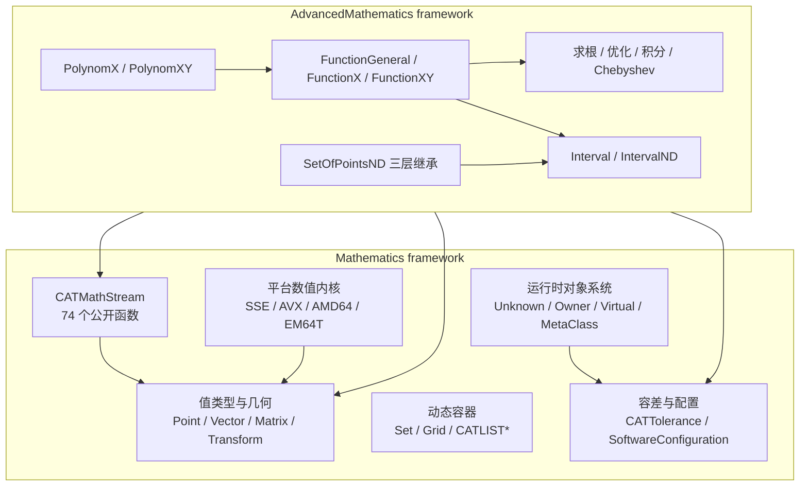
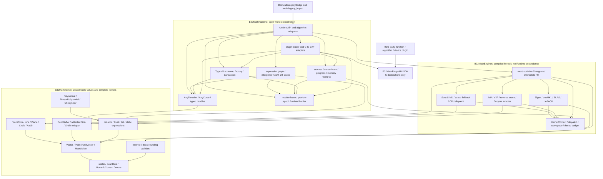

# B32 Mathematics / AdvancedMathematics C++26 架构评审与重写计划

- 日期：2026-07-18
- 审查对象：`E:\repos\B32\Mathematics`、`E:\repos\B32\AdvancedMathematics`
- 工具链：COCA clang-p2996，Clang 21，`-std=gnu++26 -freflection-latest`

## 1. 结论

这两个目录保存的是 CATIA/CNext framework 的公开接口、Imake 构建描述和 Windows 二进制清单，
不是完整源码仓库。两者共同构成一套成熟但高度 ABI 固化的数值与几何基础设施：
`Mathematics` 提供低维线性代数、仿射几何、容差、容器、运行时元类和持久化；
`AdvancedMathematics` 提供区间、函数对象、多项式、点集以及求根、优化、积分等算法入口。

现有设计不能通过局部语法现代化达到 C++26 工程标准。根本问题有五类：

1. 数学不变量没有进入类型系统。`Direction` 继承可变 `Vector`，单位长度可被基类接口破坏；
   区间允许任意上下界，空集只由 `min > max` 约定表达。
2. 对象层次承担了过多正交职责。函数对象同时负责求值、求导、区间传播、求根、优化、积分、
   Chebyshev 逼近、组合、克隆、运行时类型识别与序列化。
3. 所有权、错误与并发语义不明确。公开接口大量使用裸指针、输出参数、`NULL`、HRESULT、异常宏、
   内嵌迭代器和手写引用计数；部分文档明确承认 const 被移除后会产生共享修改。
4. 构建与性能架构按平台分叉。SSE/AVX/AMD64/EM64T 汇编模块和操作系统条件散落于 40 份 Imakefile，
   缺少统一的 ISA 后端、特性检测与可重复基准。
5. 代码库没有可见测试、基准、示例与实现体，当前快照无法证明算法复杂度、线程安全、异常安全和数值稳定性。

正确的重写方向是建立“静态数值核 + 运行时对象层 + 稳定模块边界”三层架构。固定维度值类型、闭世界表达式和
单一后端内核使用模板、`constexpr`、concept 与编译期反射；用户定义函数、参数曲线、持久化对象、异构集合、
执行器和设备后端属于开放世界，必须保留运行时多态。运行时多态不得进入逐元素循环，但可以在一次曲线求值、
一批函数求值或一次线性代数 kernel 提交的粒度发生。求根、优化、积分与序列化从函数对象中移出，成为独立算法；
算法同时提供静态 callable 入口和受控类型擦除入口，不能以“零虚调用”为由删除工业软件需要的动态扩展能力。

### 1.1 本次复核修正的关键判断

| 原判断 | 修订后判断 | 理由 |
|---|---|---|
| 动态多态只保留在插件、持久化和跨模块边界 | 函数、曲线、表达式图、执行器、设备后端和实体身份均可能运行时开放 | B32 明文支持 user function；工业模型类型不在编译期闭合 |
| 删除函数继承树后只保留 concept | 静态 concept 与 runtime capability erasure 并存 | concept 不能承载持久化恢复和用户插件对象 |
| 固定维度循环一律使用 `template for` | 齐次小循环由优化器/Eigen 展开；异构或反射展开才用 `template for` | 模板展开可能增加编译时间与指令缓存压力 |
| 动态矩阵只以 `mdspan` 进入库 | `mdspan` 表达 view，动态 owning matrix 与 workspace 仍是必要类型 | view 不拥有返回值、缓存和分解工作区 |
| 同一 PointBuffer 可同时提供 AoS/SoA 最优访问 | 可零复制提供两种 stride view，但只有物理主布局单位步长 | 二维存储不可能让两个正交方向同时连续 |
| 单一稠密 `Jet<T,N,Order>` 覆盖自动微分 | 小维度前向 Jet、JVP/VJP、稀疏与 reverse arena 分工 | 高维高阶 Jet 的存储与实例化呈组合增长 |
| scalar function 必须无虚调用 | 静态入口无间接调用；运行时入口每批允许一次类型擦除调用 | 单点插件路径不能内联，批量摊销才是正确优化单位 |
| 两个产物最终可经 object library + LTO 合并 | Kernel、Runtime、Plugin ABI 三个发布边界；LTO 仅限边界内部 | 合并会扩大 ABI、加载、重编译和插件部署成本 |

## 2. 审查边界与证据等级

| 项目 | Mathematics | AdvancedMathematics |
|---|---:|---:|
| 文件 | 185 | 43 |
| 公开头文件 | 120 | 18 |
| 公开头文件行数 | 15,244 | 5,770 |
| Imakefile | 30 | 10 |
| Doxygen 可解析类 | 59 | 13 |
| 公开 include 边 | 436 | 76 |
| `@deprecated` 标记 | 195 | 0 |
| `#define` | 433 | 71 |
| `NULL` 文本使用 | 46 | 41 |
| `constexpr` / `consteval` / `noexcept` / template | 0 | 0 |
| 可见 `.cpp`、测试、基准、示例 | 0 | 0 |

证据分三级：

- A 级：可由公开声明、inline 实现、Imakefile 或 module.data 直接证明。
- B 级：可由接口形状和文档推导，但仍需实现体验证。
- C 级：实现体缺失，当前不能评价。算法复杂度、数值稳定性、锁粒度和异常安全多数属于 C 级。

本报告对 A 级问题给出确定结论，对 B 级问题给出验证门槛，不对 C 级问题作推测性定罪。

## 3. 架构评分

评分以 2026 年新建 C++26 数值内核为参照，不以代码产生年代为参照。

| 维度 | Mathematics | AdvancedMathematics | 依据 |
|---|---:|---:|---|
| 模块边界 | 2.5/5 | 2/5 | 三个 DLL 的链接方向清楚，但 source module 与发布模块混杂 |
| 内聚性 | 2.5/5 | 1/5 | 基础值类型尚集中；函数类聚合七类算法和持久化 |
| 耦合控制 | 1.5/5 | 1.5/5 | 346 条内部 include 边，6 组直接头文件环，Advanced 广泛依赖核心宏与容差 |
| 数学建模 | 2.5/5 | 2/5 | Point/Vector 区分正确；Direction、Interval、PointSet 的不变量表达不足 |
| API 语义 | 1.5/5 | 1/5 | 裸数组、输出参数、隐式所有权、HRESULT/enum/异常并存 |
| 运行时性能架构 | 2.5/5 | 2.5/5 | 有 SBO、SSE/AVX 与汇编优化，但缺少统一数据布局和 ISA 后端 |
| 数值正确性可审计性 | 2/5 | 1.5/5 | 容差丰富；区间运算无可见向外舍入，算法实现缺失 |
| 现代 C++ | 1/5 | 1/5 | 无 concept、template、constexpr、RAII 容器、span、expected、mdspan |
| 构建与可移植性 | 1/5 | 1/5 | Imake + 历史平台分支；COCA 最小编译受外部平台配置阻断 |
| 测试准备度 | 1/5 | 1/5 | 当前快照没有测试和基准 |
| 文档质量 | 2.5/5 | 2/5 | API 文档丰富，但 Doxygen 产生 1,230 条警告，旧标签与失配参数较多 |

现有设计仍有三项应保留的工程经验：Point 与 Vector 的仿射语义区分、Polynomial 的 6/36 系数
小对象优化、核心数学/持久化/高级算法的单向二进制依赖。重写应保留这些意图，删除实现债务。

## 4. 现状拓扑



发布级链接没有环：`CATAdvancedMathematics.dll` 单向依赖 `CATMathematics.dll` 和
`CATMathStream.dll`。公开头存在六组直接环：

- `CATMathLine.h:33` 与 `CATMathPlane.h:15`。
- `CATMathPoint2D.h:16` 与 `CATMathVector2D.h:16`。
- 四组 `CATMathAbstract*.h` 宏别名与真实 `Grid/Set` 头的反向包含。

## 5. 关键问题

### 5.1 P0：Direction 继承 Vector 破坏单位向量不变量

`CATMathDirection.h:21` 公开继承 `CATMathVector`，而基类暴露 `SetCoord`、`SetX`、`SetY`、`SetZ`
和 `Normalize`。派生类重新定义的 setter 会归一化，但经 `CATMathVector&` 调用基类 setter 时，
调用者可以把任意非单位向量写入 Direction。2D 版本在 `CATMathDirection2D.h:20` 重复同一结构。

这是 Liskov substitution 失败，不是命名问题。目标类型 `UnitVector<T,N>` 必须组合 `Vector<T,N>`，
构造仅通过 `try_normalize` 或已证明单位长度的内部工厂；零向量返回 `std::expected` 错误，不能静默变为 x 轴。

### 5.2 P0：区间类型没有封闭不变量与可证明的包含性

`CATMathInterval.h:599` 直接接受任意 `low/high`，`IsEmpty` 仅检查 `min > max`；`SetMin/SetMax`
可独立制造任意状态。`Width` 对空区间返回负值。算术在普通浮点舍入模式下直接计算端点，
未见 directed rounding 或 `nextafter` 扩张，因此结果不能作为严格 interval enclosure 使用。

目标 `Interval<T,RoundingPolicy>` 使用私有端点、唯一 canonical empty、checked factory 和显式 `whole()`。
`EnclosingRounding` 保证向外舍入；若旧算法只需快速估计，则另设 `FastBounds`，二者类型不同，不能由全局开关切换。

### 5.3 P0：const 与共享所有权语义被有意破坏

`CATCGMValueClassImplHolder.h:41-47` 明确说明 const 是“white lie”，复制后修改一个 holder 会影响另一个；
`SetImpl` 又接受 `const*` 并在内部移除 const。该语义使 const-correctness、线程安全和局部推理同时失效。

目标只允许三种明确模型：纯值、`std::unique_ptr<Impl>` 独占值、`std::shared_ptr<const Impl>` 不可变共享。
需要 copy-on-write 时建立具名 `Cow<T>`，写入路径原子地 detach，不能伪装成普通值类。

### 5.4 P0：手写元类初始化存在并发竞争

`CATCGMVirtualMacros.h:32-35` 用函数局部静态裸指针加 `if (p == NULL) p = new ...` 延迟初始化。
指针的零初始化是线程安全的，后续检查与赋值不是；并发首次调用可发生数据竞争、重复分配和泄漏。

旧式运行时元类不应继续承担静态类型信息、对象构造、持久化和插件发现四种职责。静态字段与 schema 元数据由
P2996 反射生成；进程内开放对象使用显式 `TypeId`、capability descriptor 和 registry；跨 DLL 或跨编译器插件使用
版本化 C ABI vtable 与 opaque handle，不能直接输出编译器相关的 C++ 虚表。需要运行时常量时使用 `constinit`
值对象。由模型文件或插件在运行时创建的对象仍需要动态类型身份、查询与销毁协议，删除旧元类不等于删除该需求。

### 5.5 P0：函数层次违反单一职责与接口隔离

`CATMathFunctionX` 有 33 个公开函数，`CATMathFunctionXY` 有 46 个；两者同时包含值/一至三阶导数、
区间求值、批量求值、求根、Newton、最值、积分、Chebyshev 逼近、组合、克隆和类型识别。
`CATMathFoundationX/XY` 又要求每个叶类实现 Duplicate、DeepDuplicate 和组件枚举。

`CATMathFunctionX.h:248-254` 明文要求定义 user `CATMathFunctionX` 时实现 `Duplicate`，因此函数类型集合是公开
扩展点，而非库内部闭合集合。原继承树职责分配错误，但将其只替换为 concept 会丢失用户派生函数、运行时组合与
持久化恢复能力。正确迁移必须先保留 adapter，再把求值能力和算法职责分开。

目标分为六层：

1. `ScalarFunction<F,T,N>` 仅表达可调用性。
2. 静态 callable 可按 carrier 实例化为 scalar、SIMD、Dual/Jet；小输入维度的前向微分共享中间量。
3. `FunctionCapabilities` 描述 value、batch、JVP、VJP、区间包围和高阶导数是否可用，不强迫所有实现支持同一阶数。
4. `FunctionRef` 与 `AnyFunction` 分别提供同步非拥有和拥有类型擦除；进程内对象每批求值一次间接调用。插件对象
   还允许一次固定成本的 C ABI adapter 调用，不能把两层边界的实际成本记成一次。
5. 运行时表达式图允许解释执行、AOT/JIT 编译和缓存；普通静态 callable 不经过图解释器。
6. `solve_roots`、`minimize`、`integrate`、`range_bound`、`chebyshev_approximate` 是独立算法，分别接受静态或
   类型擦除函数。反射不能检查函数体，插件函数若不提供导数、JVP/VJP 或可微 IR，就不能自动获得精确微分。

### 5.6 P1：点集继承按存储复用组织，不符合数学子类型关系

`SetOfPointsND → SetOfPointsNDTwoTangents → SetOfPointsNDWithVectors` 把“端点切向量”和
“每点向量属性”组织为继承链。所有增删、反转、拆分操作都必须虚重写以维护平行数组，LSP 依赖实现纪律。
基类还在 `_Iterator` 中保存遍历位置，容器不能重入遍历，也不能并发只读遍历。

目标 `Polyline<T,N,Attributes...>` 用组合表达 `PointColumn`、`EndpointTangents`、`VectorColumn`、
`VertexMetadata`。迭代状态属于 iterator/range，不属于容器。同质坐标区以 `mdspan` 的
`layout_right`/`layout_left`/`layout_stride` 暴露逻辑二维 view；异构属性用同步 column 与 proxy/zip view，不能把
`mdspan` 描述成任意异构 SoA 的通用载体。

### 5.7 P1：CATMathStream 是类型耦合的 God class

`CATMathStream` 有 74 个公开函数，既管理文件、内存、iostream、CATStream 和 endian header，
又为 Point、Vector、Matrix、Transform、Plane、Axis、Config 逐类增加 Read/Write 方法，最后通过
`GetImpl(): void*` 暴露内部实现。新增一个数学类型必须修改 IO 核心，违反开闭原则。

目标分为 `BinaryReader`、`BinaryWriter`、`ChunkReader`、`ChunkWriter`、静态 `serialize(T)` 和运行时
`SerializerRegistry`。底层只认识 bytes、标量、span 和 version；闭世界值类型的 schema 由 annotation 或外部
serializer 声明，插件对象通过 stable `TypeId + SchemaVersion + factory` 恢复。仅靠静态反射无法反序列化编译时
未知的派生对象，也不能替代对象生命周期和插件卸载协议。

反射只能生成字段级 codec 和 schema 校验，不能把对象表示直接写入文件。padding、指针、Eigen 内部布局、端序和
编译器 ABI 都不得进入 wire format；数值数组必须显式记录标量编码、extents、layout 与版本。

### 5.8 P1：错误模型不统一且失败宏在 handler 返回时产生 UB

算法返回 `CATMathDiagnostic`，几何接口返回 HRESULT，部分路径抛 CAT 异常，空指针宏同时调用函数并返回默认值。
`DEFINE_USE_COUNTED_GET_IMPL_METHODS` 的失败分支把 `*pImpl` 作为默认返回值；若 `CATCGMnull` 返回，
随后解引用 null。正确性依赖隐藏控制流约定。

目标错误分层如下：

- 调用者可恢复的数值失败：`std::expected<Result, MathError>`。
- 不满足 API 前置条件：C++26 contract；当前 COCA 未实现 P2900，必须先升级工具链，不能用宏模拟。
- 内存耗尽和系统故障：标准异常或终止策略，由部署层统一决定。
- 算法停止原因：强类型 `SolverStatus`，附迭代次数、残差、条件数等证据。

### 5.9 P1：公共 API 含长期未清理的兼容层

`Mathematics` 有 195 个 `@deprecated`，其中 Line 22 个、Transformation 20 个、Plane 16 个。
四个 `CATMathAbstract*` 头用宏把旧名替换成具体类；28 个 CATLIST 头用代码生成模拟泛型容器；
Function type id 由 42 个宏常量表达。兼容接口已成为主要 API 表面积。

目标核心库不保留旧 ABI，也没有 deprecated 声明、兼容宏或旧类型别名。迁移期若必须承接旧 DLL 或客户插件，另设
`B32MathLegacyBridge`：它单向依赖旧 SDK 与新 Runtime，把旧虚接口批量适配到 capability API，不得被新核心头反向
包含。历史文件读取则由独立 `legacy_import` 工具完成。Bridge 与 importer 都是可删除的迁移产物，不属于目标 ABI。

### 5.10 P1：构建系统记录了优化意图，没有形成可组合性能架构

Imakefile 按 Windows/AIX/IRIX/SunOS/iOS/Linux 分支，并区分 CATLinearAlgebra32/64/64A/64I/Avx。
这种设计能获得局部峰值性能，但 ISA、数据布局、算法语义和发布单元彼此纠缠。

目标采用两级后端。编译期 carrier/backend 负责 pack、mask、load/store、FMA 和数学原语；运行时
`KernelDispatchTable` 按 CPU ISA、设备、精度和确定性策略选择已编译 kernel。ISA 查询在 context 初始化时缓存，
但分派次数是“每个 kernel family 或执行 context 一次”，不是整个进程只有一次。间接调用必须位于批量 kernel
边界，禁止位于每个 lane、系数或点的内循环。当前实现优先复用经过验证的 Sora SIMD、Eigen 与 oneMKL，
不再建立一套同义 pack 类型。进程内 C++ batch API 可暴露 span/mdspan、layout 和执行策略；跨模块 C ABI 只能暴露
固定宽度标量、指针、长度、stride、memory-space tag 和版本化 descriptor，不能出现标准库类型。

## 6. C++26 能力与 COCA 实测

| 能力 | 标准状态 | 当前 COCA 实测 | 决策 |
|---|---|---|---|
| P2996 `^^` / splice | C++26 | 前端可用；Windows 默认未搜索 libc++ `<meta>` | 修复 profile 后用于 schema 与元数据 |
| P1306 `template for` | C++26 | 可用 | 反射成员、异构属性和逐索引类型生成；不强制用于齐次小循环 |
| P3289 consteval block | 扩展/COCA | 可用 | 编译期 schema、不变量和表生成 |
| pack indexing | C++26 | 可用 | 维度包、属性包和 derivative pack |
| `std::expected` / `std::mdspan` | C++23 | MSVC STL 与 COCA libc++ 均可用 | 错误与多维 view 的基础 |
| `std::inplace_vector` | C++26 | 显式使用 COCA libc++ 后可用 | 仅用于有真实最大容量的对象 |
| contracts P2900 | C++26 | 当前前端不可用 | Phase 0 工具链门槛，不写宏替代 |
| `std::function_ref` | C++26 | 当前 libc++ 不可用 | 同步非拥有回调用本地等价类型；异步接口禁止引用擦除 |
| P2300 `std::execution` | C++26 | 标准库不可用；工程已有 vendored stdexec | 内部可用 stdexec，公共 ABI 不暴露实现类型 |
| 标准 `<simd>` | C++26 | 当前 libc++ 仅有 TS 头；工程已有 Sora SIMD | 复用现有实现，保持 carrier/backend 边界 |
| `<linalg>` / `std::hive` | C++26 | 当前 libc++ 不可用 | 不作为初版依赖 |
| Eigen + oneMKL | 外部库 | Eigen 传递启用 MKL LP64，GEMM/LU/VML 已验证 | 动态稠密线性代数与批量初等函数的生产后端 |

Windows 默认 profile 实际使用 MSVC STL；`-stdlib=libc++` 在该 target 上被忽略。加入
`-nostdinc++ -isystem T:\toolchains\coca-toolchain-p2996\include\c++\v1` 后 `<meta>` 与
`<inplace_vector>` 编译通过。Phase 0 应修复 COCA CMake profile，而不是把此参数复制到每个 target。

项目现有文档中的 contracts 写法 `[[pre: ...]]` 不是最终 C++26 语法。P2900R14 使用
`pre(expr)`、`post(result: expr)` 和 `contract_assert(expr)`；当前编译器仍不能接受该语法。

### 6.1 运行时多态是开放世界需求，不是历史债务的同义词

工业软件内核同时包含闭世界数值结构和开放世界模型对象。前者应静态化，后者不能通过 concept 消除。应按集合是否
闭合、是否跨 ABI、是否异步和派发粒度选择机制：

| 场景 | 类型集合 | 机制 | 性能约束 |
|---|---|---|---|
| 固定维度向量、矩阵、静态多项式、编译期表达式 | 编译时闭合 | concept、模板、普通值类型 | 完全内联；不得含 vptr 或隐藏分配 |
| 少量已知算法状态或内建曲线种类 | 发布时闭合 | `std::variant` + visitation | 可内联分支；控制 variant 规模 |
| 用户 callable、运行时组合函数、异构曲线集合 | 进程内开放 | SBO 类型擦除 `AnyFunction`/`AnyCurve` | 每次批量求值一次间接调用 |
| 同步观察回调 | 生命周期由调用栈保证 | `FunctionRef`/`CurveRef` 等非拥有擦除 | 禁止保存；不可进入异步 sender |
| 异步任务、取消、进度、完成回调 | 生命周期跨调用栈 | owning sender/receiver 或 move-only callable | 分配由 operation state/arena 管理 |
| CPU ISA、GPU、远程计算和厂商 BLAS 后端 | 部署时开放 | context 内缓存的函数表或 backend handle | 每次 kernel 提交一次派发 |
| 第三方求解器、拟合器和领域算法 | 部署时开放 | coarse-grained algorithm provider + capability descriptor | 每次完整算法调用一次派发；内迭代由 provider 静态优化 |
| 插件、脚本对象、持久化未知类型 | 跨模块开放 | versioned C ABI vtable、opaque handle、stable `TypeId` | ABI 可演进；销毁由创建模块执行 |
| 拓扑/模型实体身份与事务 | 运行时有身份 | typed handle + repository/service interface | 数值值类型不得继承实体基类 |

由此得到四条约束：

1. C++ 虚函数可以用于同一工具链、同一发布单元内的稳定接口，但不自动构成跨编译器 ABI。
2. 类型擦除对象必须区分 non-owning、owning 和 shared immutable 三种寿命；异步路径不能保存 `function_ref`。
3. 动态派发的正确优化单位是批次。进程内擦除通常每批一次间接调用；插件路径可再增加一次 ABI thunk，但两者都必须
   是与元素数无关的 O(1) 固定成本。把固定派发摊销到数十至数百万个点，比复制模板实例化更可控。
4. 运行时对象只暴露 capability，不伪造能力。没有 JVP/VJP 的插件函数只能使用无导数算法或显式数值差分策略。

## 7. 需求等价边界

重写必须保持以下能力，不保持旧 C++ ABI、旧宏名、手写 RTTI、Imake module 名和旧二进制流格式。

| 能力域 | 必须保持的可观察行为 | 不属于需求的旧机制 |
|---|---|---|
| 低维代数 | 2D/3D，float/double，点/向量/矩阵运算、逆、特征问题 | 每精度复制一组类、友元泛滥 |
| 仿射与参数几何 | Axis、Line、Plane、Circle、Arc、AABB、Transform、异构参数曲线求值 | 值原语继承实体基类、数组构造器、HRESULT 输出参数 |
| 容差 | 相对、角度、长度、模型尺度及大/小尺度策略 | 全局 default、Owner 继承、40 个可变缓存字段 |
| 区间 | 空集、交并、初等函数、ND box、周期区间 | 可独立写上下界、无类型区分的 fast/certified 模式 |
| 集合与网格 | 点/向量集合、动态增长、周期、拆分、切向量/属性、grid | 容器内置 iterator、继承复用平行数组 |
| 函数 | 静态与运行时函数，值/批量/JVP/VJP/区间能力、运行时组合、插件扩展 | `IsA`、type-id 宏、Duplicate/DeepDuplicate 裸指针 |
| 多项式 | 一元/二元、导数、积分、平移缩放、Horner/Chebyshev、静态小对象优化 | 手工 `_coeff`/`_CoeffAlloc` 和宏容量 |
| 数值算法 | 求根、Newton、最值、积分、逼近及诊断 | 算法作为函数对象虚成员 |
| 持久化 | 新 schema、未知插件类型、端序、边界检查、损坏输入诊断 | 类型耦合 God class；历史格式由隔离 importer 读取 |
| 运行控制 | 进度、取消、事务、执行器、设备/ISA 后端、feature/config | 裸回调、共享可变配置、逐元素虚调用 |

## 8. 目标架构

下图箭头表示编译或链接依赖，方向为“消费者指向提供者”。它刻意不画运行时数据流，因二者混画会掩盖
`Runtime` 与 `Engines` 之间潜在的源代码依赖环。



分发与链接边界分为三类：

1. `B32MathKernel` 是头文件/静态模板 SDK，承载小值类型与需要跨调用点内联的算法，不形成稳定动态 ABI。
2. `B32MathRuntime` 是同一工具链下的共享运行库，承载 Runtime 源模块，并私有链接默认的
   `B32MathEngines` object/static libraries。Engines 只依赖 Kernel，不能包含 Runtime 头。
3. `B32MathPluginABI` 是独立的纯 C SDK，只发布版本化 descriptor、opaque handle 和调用约定。loader、registry、
   C-to-C++ adapter 均属于 Runtime；插件对象与插件分配的内存必须由创建模块销毁。

`B32MathEngines` 是源代码与链接时优化边界，不必固定为第四个动态库。默认 CPU/Eigen/oneMKL engine 私有链接进
Runtime；GPU、远程计算和需独立升级的厂商后端经 Plugin ABI 部署。取舍依据是许可证、冷启动、设备驱动隔离、
故障域和独立更新需求，而非是否使用运行时多态。

Plugin ABI 的每个 descriptor 都包含 `abi_version` 与 `struct_size`，新增能力只能尾部扩展并经版本协商启用。边界上
禁止 STL 类型、C++ 异常、RTTI 和跨模块释放；输入输出使用调用者提供的 buffer，插件自有对象与内存由插件 release
入口回收。并发等级、取消语义和错误状态属于 descriptor 契约，不能依赖宿主与插件碰巧采用相同编译器选项。

LTO 只在各发布单元内部使用。不能为了内联把插件 ABI、运行时 registry 和模板值类型合并成一个二进制；这种合并会
放大重编译、代码体积、加载时间和 ABI 变更范围，也会破坏第三方算法与设备后端的独立部署。

## 9. 目标类型与范式

### 9.1 值类型

- `Vector<T,N>`：`std::array<T,N>` 存储，trivially copyable；算术由最小代数 concept 约束。
- `Point<T,N>`：仅定义 Point-Point→Vector、Point±Vector→Point；禁止 Point+Point。
- `UnitVector<T,N>`：组合 Vector；`try_normalize` 构造，公开接口不暴露可破坏不变量的 setter。
- `Matrix<T,R,C,Layout>`：固定尺寸采用 Eigen fixed-size 类型或与之零复制互操作的 trivial wrapper，不重写成熟
  乘法、分解和向量化内核。
- `MatrixView<T,Extents,Layout>`：以 `mdspan` 表达非拥有矩阵；`DynamicMatrix<T,Layout>` 表达拥有存储。
  `mdspan` 不能替代返回值、缓存和分解工作区所需的所有权。
- `DynamicMatrix` 只表示 host-accessible owning storage，并显式接受 memory resource。GPU/远程内存使用
  `DeviceBufferHandle` 与带 memory-space 的 backend view，不把不可解引用的设备地址伪装成普通 `T*`/`mdspan`。
- `AffineTransform<T,N>`：Matrix + translation；rotation/reflection/scaling 使用具名 factory。
- `Dual<T,N>` / `Jet<T,N,Order>`：只服务小输入维度和低阶前向微分；高维梯度、稀疏 Jacobian 与多输出反向传播
  使用 JVP/VJP、稀疏结构或 arena-backed reverse graph，不能实例化组合爆炸的稠密高阶 Jet。
- `FunctionHandle`、`CurveHandle`、`EntityId`：是运行时身份值，不携带数值对象内容；Point、Vector、Matrix 等值类型
  不继承运行时实体基类。

### 9.2 数据布局

- 小值类型保持 AoS，`Vector<double,3>` 占三个 double，不添加 vptr、引用计数或运行时标签。
- 批量点采用 `PointBuffer<T,N,Layout>`。point-major 使单点坐标连续，coordinate-major 使同一坐标跨点连续；
  两者可用 stride view 零复制互访，但只有物理主布局具备单位步长，不能宣称两条路径同时 SIMD 最优。
- `Polyline<T,N,Attributes...>` 将点、切向量、每点向量和拓扑元数据组织为同步 column；异构成员 SoA 由反射
  生成 owned columns 与 proxy/zip view，`mdspan` 只负责各同质 column 的多维索引。
- 固定次数和静态多项式使用 `std::array`；动态次数使用单个 `std::vector` 或 execution context 提供的
  `pmr::memory_resource`。临时工作区从调用方显式传入或按 context 复用，热循环不得隐式分配。
- SIMD 对齐属于 owning storage 和 load/store contract，不属于 Point/Vector 的公共对象大小；不得为三个 double
  强制填充第四个元素，除非独立 packed storage 的实测收益覆盖带宽与缓存损失。

### 9.3 编译期与运行时边界

- `template for` 用于每个索引产生不同类型、需要 splice 或必须逐项常量求值的展开。齐次 2D/3D/4D 算术优先写
  固定边界普通循环或调用 Eigen，由优化器决定展开；强制模板展开会增加实例化与代码体积，不保证生成更快机器码。
- 编译期已知系数、schema 与反射生成类型使用 consteval block；运行时输入不得为追求形式上的“编译期优先”而
  转换成模板参数或重新编译。
- 反射用于字段枚举、schema、enum-string 和编译期校验，不用于替代数值算法或检查函数体。
- 静态 callable 的热路径通过 concept 分派；运行时函数和曲线通过 capability vtable 分派。两条入口最终调用同一
  数值 kernel，但不要求二者具有相同调用机制。
- `KernelContext` 是 Engines 的同步资源视图，承载 workspace、ISA/backend dispatch、线程预算、NUMA 与确定性策略；
  `ExecutionContext` 属于 Runtime，组合 `KernelContext`、scheduler、取消、进度和 operation lifetime。静态 kernel
  不得依赖 Runtime 类型。
- carrier 层共享数学语义，不强求 scalar、SIMD、constexpr、MKL 和 GPU 使用同一函数体。编译期可走 constexpr
  多项式，运行时标量走 `<cmath>`/SVML，批量路径走 SIMD/VML；必须以误差模型定义语义等价范围。
- runtime ISA/device dispatch 在 context 或 kernel family 首次使用时缓存；显式 `V`、`Unroll` 和 `PreferredAbi`
  仍是可测试策略参数，默认值来自目标 CPU 基准，不能被写成所有平台上的常数真理。
- 对常用标量、维度、layout 和 derivative mode 做显式实例化；模板实例数、文本段大小、链接时间和指令缓存失效率
  进入性能预算。零虚调用不等于零成本，代码膨胀同样是运行时成本。

### 9.4 运行时函数、曲线与插件对象

运行时函数的核心不是传统深继承树，而是稳定、可分裂的 capability vtable。概念结构如下：

```cpp
struct FunctionVTable {
    FunctionCapabilities (*capabilities)(const void*) noexcept;
    MathStatus (*evaluate)(const void*, ScalarInput, ScalarOutput) noexcept;
    MathStatus (*evaluate_batch)(const void*, BatchInput, BatchOutput, ExecutionContext&) noexcept;
    MathStatus (*jvp)(const void*, JvpInput, JvpOutput, ExecutionContext&) noexcept;
    MathStatus (*vjp)(const void*, VjpInput, VjpOutput, ExecutionContext&) noexcept;
    MathStatus (*evaluate_interval)(const void*, IntervalInput, IntervalOutput, ExecutionContext&) noexcept;
    void (*move_inline)(void* source, void* destination) noexcept;
    void (*destroy)(void*, std::pmr::memory_resource&) noexcept;
};
```

该结构表达七项工业约束：

1. capability 查询是常量时间，除了 value/batch/JVP/VJP/interval 外还声明并发等级：reentrant、serialized 或
   clone-per-worker。算法在迭代前选择路径，不能每次迭代反复探测。
2. value、batch、JVP、VJP 和 interval evaluation 相互独立；空槽位表示不支持，不以数值差分静默伪装精确导数。
3. `FunctionRef` 只保存 `const void* + vtable*`，仅用于同步借用；`AnyFunction` 管理 SBO/heap ownership，默认
   move-only。SBO 只接纳满足容量、对齐和 nothrow-move 约束的 target，其他 target 进入 heap；共享使用具名
   `SharedFunction` immutable wrapper，复制要求显式 clone capability。heap 路径只移动 owning pointer，
   `move_inline` 仅用于合格的 SBO target。
4. 异步 batch 调用由 operation state 拥有函数对象、buffer 和 cancellation token，禁止捕获短生命周期引用。
5. `AnyCurve` 采用同一结构，capability 包含 parameter domain、position、derivatives、bounds、periodicity 与
   optional inverse/closest-point acceleration；Circle/NURBS 等具体值类型仍可走静态 concept 入口。
6. 插件 ABI 不能直接导出此 C++ struct 的实现类型。外部边界使用固定宽度整数、C ABI 函数表、版本和结构体大小；
   Runtime 在模块内把它适配成 `AnyFunction`/`AnyCurve`。
7. 每个插件 wrapper、在途 operation state、JIT artifact 与 registry factory 都持有 `ModuleLease`。卸载先撤销
   factory 和新提交，再等待在途调用与 lease 归零；不能只从 registry 删除 vtable 指针后立即卸载 DLL。

运行时表达式图是合法需求。模型文件、可视化编程和脚本会在运行时组合 sum/product/compose；此类图可以解释执行，
也可以按结构哈希进行 AOT/JIT 编译与缓存。静态表达式模板服务源码中闭合的表达式，不能替代运行时图。
编译缓存键至少包含规范化图、标量语义、fast-math/确定性策略、目标 ISA/device、backend 版本和插件 provider epoch；
任何一项变化都必须使 artifact 失效。

### 9.5 性能模型与后端选择

| 路径 | 允许的派发 | 主要成本 | 验收方式 |
|---|---|---|---|
| 固定小向量/矩阵 | 无间接调用 | 指令数、寄存器压力、代码体积 | 汇编、llvm-mca、微基准 |
| 静态 callable scalar | 完全内联 | `<cmath>`/分支/舍入语义 | 与直接函数基线比较 |
| erased callable scalar | 每次求值一次间接调用 | 分支预测与不可内联 | 单点延迟单独记账，不伪称零成本 |
| erased callable batch | 每批一次间接调用 | 内存带宽、SIMD 利用率、tail | 按点摊销成本与批大小曲线 |
| plugin callable batch | 每批一次擦除调用及至多一次 ABI thunk | 模块边界、descriptor 转换 | 与进程内擦除路径分别计量 |
| 运行时表达式图 | 节点解释或编译后入口 | 指针追踪、临时值、编译缓存 | interpreter/AOT/JIT 分别基准 |
| 动态稠密线性代数 | Eigen 到 oneMKL/BLAS/LAPACK | 尺寸阈值、layout 转换、线程策略 | 按尺寸/线程/NUMA 建性能面 |
| GPU/远程 kernel | 每次提交一次 backend 派发 | 传输、排队、同步 | 端到端延迟与吞吐，不只测 kernel |

Eigen 负责表达式模板、固定尺寸代码生成和动态矩阵接口；oneMKL 负责足够大对象的 GEMM、LAPACK 与 VML。
小固定矩阵不得为调用 BLAS 发生堆分配或 layout 转换。MKL 的动态 DLL、ISA dispatcher 与 VML payload 增加磁盘和
按需代码页占用，因此“零内存损失”只可用于值对象布局和未选择路径，不能用于整个进程。后端切换阈值必须按
Haswell、Zen、AVX-512 及目标服务器分别测量，不能由库名推导性能收益。

`KernelContext` 拥有每次同步 kernel 的并发预算、NUMA placement 和确定性策略，Runtime 的 `ExecutionContext`
组合并约束它。Eigen 自身线程、oneMKL local thread count、stdexec scheduler 与宿主任务系统必须共用该预算，
禁止嵌套线程池造成 oversubscription；线程数也是性能面的维度，不能依赖 oneMKL 全局默认值。

## 10. 类级迁移计划

### 10.1 运行时、所有权、错误、配置与 IO

| 现有类 | 处理 | 目标 | Phase |
|---|---|---|---:|
| `CATCGMUnknown` | 拆除全能基类 | 值对象用 RAII；实体/插件用 typed handle + capability interface | 6 |
| `CATCGMExclusive` | 删除侵入 owner 链 | 模块内 `unique_ptr`；跨边界 opaque owning handle | 6 |
| `CATCGMOwner` | 删除 | owning container，关系由组合表达 | 6 |
| `CATCGMVirtual` | 拆分公共基类 | concept、`AnyFunction`/`AnyCurve`、entity handle 分别承担职责 | 4/6 |
| `CATCGMVirtualMetaClass` | 删除旧实现 | P2996 静态元数据 + runtime descriptor + stable `TypeId` | 6 |
| `CATCGMVirtualItf` | 删除 | 边界 adapter；不让 COM 进入数学内核 | 7 |
| `CATICGMVirtual` | 删除 | 同上 | 7 |
| `CATCGMReferenceClassImplHolder` | 删除 | `shared_ptr<const Impl>` 或具名 reference type | 1 |
| `CATCGMValueClassImplHolder` | 删除 | 纯值、`unique_ptr` deep-copy 或具名 `Cow<T>` | 1 |
| `CATCGMHashTableBase` | 删除 void/基类表 | typed hash-table concept | 3 |
| `CATCGMHashTable` | 按调用点替换 | `flat_map`、dense hash 或 sorted vector，由访问模式决定 | 3 |
| `CATCGMProgressBar` | 拆分 | operation state 拥有 `ProgressSink` 与 `std::stop_token` | 6 |
| `CATGeometricModelTransaction` | 保留 RAII 意图 | `ScopedTransaction`，不可复制、显式 commit/rollback | 6 |
| `CATCGMInputError` | 删除异常层次 | `MathError::invalid_input` | 1 |
| `CATCGMInternalError` | 删除异常层次 | `InvariantViolation`/contract violation | 1 |
| `CATMathInputError` | 删除宏声明类 | `std::expected<T,MathError>` | 1 |
| `CATMathStream` | 完全拆分 | `BinaryReader`、`BinaryWriter`、`ChunkGuard`、serializer CPO | 6 |
| `CATSoftwareConfiguration` | 改为不可变值 | `FeatureSet` + `AlgorithmPolicy` | 6 |
| `CATSoftwareConfiguration::ModificationData` | 提升为独立 record | `FeatureRevision` | 6 |
| `CATSoftwareModification` | 改为普通 record | `FeatureRevision`/`ReleaseId` | 6 |
| `CATTolerance` | 删除 owner/virtual/default | 不可变 `NumericContext<T>` + `ScalePolicy` | 2 |

### 10.2 低维代数与几何

| 现有类 | 目标类型 | 关键决定 | Phase |
|---|---|---|---:|
| `CATMathPoint` | `Point<double,3>` | 保留仿射语义，数组 API 改为 `span`/索引 | 1 |
| `CATMathPoint2D` | `Point<double,2>` | 与 3D 共用模板 | 1 |
| `CATMathPointf` | `Point<float,3>` | 删除重复实现 | 1 |
| `CATMathPoint2Df` | `Point<float,2>` | 删除重复实现 | 1 |
| `CATMathVector` | `Vector<double,3>` | `constexpr`、trivial、无 vptr | 1 |
| `CATMathVector2D` | `Vector<double,2>` | 删除 Point2D include 环 | 1 |
| `CATMathVectorf` | `Vector<float,3>` | 与 double 共享模板 | 1 |
| `CATMathVector2Df` | `Vector<float,2>` | 与 double 共享模板 | 1 |
| `CATMathDirection` | `UnitVector<double,3>` | 不继承 Vector；checked construction | 1 |
| `CATMathDirection2D` | `UnitVector<double,2>` | 同上 | 1 |
| `CATMathDirectionf` | `UnitVector<float,3>` | 同上 | 1 |
| `CATMathDirection2Df` | `UnitVector<float,2>` | 同上 | 1 |
| `CATMathComplex` | `std::complex<double>` + free algorithms | 不再维护自定义标量类 | 1 |
| `CATMathComplexf` | `std::complex<float>` + free algorithms | 同上 | 1 |
| `CATMath2x2Matrix` | `Matrix<double,2,2>` | `inverse` 返回 expected，特征结果为 record | 1 |
| `CATMath3x3Matrix` | `Matrix<double,3,3>` | 与 Eigen fixed-size 核零复制互操作并按汇编验收 | 1 |
| `CATMathTransformation1D` | `AffineTransform<double,1>` | 具名 factory，删除 coefficient 数量参数 | 2 |
| `CATMathTransformation2D` | `AffineTransform<double,2>` | apply 返回值；失败只发生在 factory/inverse | 2 |
| `CATMathTransformation` | `AffineTransform<double,3>` | 统一 composition 约定与 matrix layout | 2 |
| `CATMathAxis` | `Frame<double,3>` | 原点 + 正交基，不允许退化 frame | 2 |
| `CATMathAxis2D` | `Frame<double,2>` | 同上 | 2 |
| `CATMathBox` | `Aabb<double,3>` | canonical empty，批量扩张 free algorithm | 2 |
| `CATMathBox2D` | `Aabb<double,2>` | 与 3D 共模板 | 2 |
| `CATMathLine` | `Line<double,3>` | Point + UnitVector；删除 Plane include 环 | 2 |
| `CATMathLine2D` | `Line<double,2>` | 同上 | 2 |
| `CATMathPlane` | `Plane<double,3>` | Unit normal + signed offset/origin | 2 |
| `CATMathCircle` | `Circle<double,3>` | 值类型满足 curve concept，可擦除为 `AnyCurve` | 2/4 |
| `CATMathCircleArc2D` | `CircularArc<double,2>` | 角域使用显式 interval | 2 |
| `CATMathCurve` | 删除职责混杂的虚基类 | `ParametricCurve` + non-owning `CurveRef` + owning `AnyCurve` | 4 |

### 10.3 集合、网格和列表

| 现有类/族 | 目标 | Phase |
|---|---|---:|
| `CATMathExtendableSet` | 删除；capacity 属于容器实现，不属于多态基类 | 3 |
| `CATMathGrid` | `GridStorage<T,Rank,Layout>` + `mdspan` | 3 |
| `CATMathGridOfPoints` | `Grid<Point<T,N>,Rank>` 或 coordinate-major view | 3 |
| `CATMathGridOfVectors` | `Grid<Vector<T,N>,Rank>` | 3 |
| `CATMathSetOf3DObjects` | 删除继承中间层 | 3 |
| `CATMathSetOfPoints` | `PointBuffer<double,3,Layout>` | 3 |
| `CATMathSetOfVectors` | `VectorBuffer<double,3,Layout>` | 3 |
| `CATMathSetOfLongs` | `std::vector<int32_t>` + ranges；若要求唯一性则用 `flat_set` | 3 |
| `CATMathAbstractGridOfPoints` | 删除宏别名 | 7 |
| `CATMathAbstractGridOfVectors` | 删除宏别名 | 7 |
| `CATMathAbstractSetOfPoints` | 删除宏别名 | 7 |
| `CATMathAbstractSetOfVectors` | 删除宏别名 | 7 |
| `CATListPtrCATMathBox` | `std::vector<Aabb<double,3>>` 或 `span` | 3 |
| `CATLISTP_*` 16 个指针列表 | 按所有权改为 `vector<T*>` view、handle vector 或 owning vector | 3 |
| `CATLISTV_*` 7 个值列表 | `std::vector<T>`/`std::span<T>` | 3 |
| `CATListPtrCATCGMVirtualItf` | `span<const EntityHandle>` 或 registry query range | 6 |

指针列表不能机械替换为 `vector<unique_ptr<T>>`。每个调用点必须先判定 owning、observer、stable-handle
三种语义；这项判定属于 Phase 0 ownership inventory 的验收项。

### 10.4 AdvancedMathematics 十三个类

| 现有类 | 处理与目标 | Phase |
|---|---|---:|
| `CATMathInterval` | `Interval<T,EnclosingRounding>`；canonical empty/whole，外向舍入 | 3 |
| `CATMathInterval2D` | `Box<T,2,RoundingPolicy>` | 3 |
| `CATMathIntervalND` | `DynamicBox<T>`；去掉 `_Coord` + `_OptCoord[12]` 手写 SBO | 3 |
| `CATMathFunctionGeneral` | 拆为 static concept、capability descriptor、type erasure 和 schema | 4/6 |
| `CATMathFunctionX` | `ScalarFunction<T,1>` + `AnyFunction<T,1>`；算法独立 | 4 |
| `CATMathFunctionXY` | `ScalarFunction<T,2>` + `AnyFunction<T,2>`；batch/JVP/VJP 可选 | 4 |
| `CATMathFoundationX` | 静态 callable adapter；旧插件经 ABI adapter 进入 capability vtable | 4/7 |
| `CATMathFoundationXY` | 同上；不要求所有实现提供完整二阶导数集合 | 4/7 |
| `CATMathPolynomX` | `Polynomial<T,Degree>`；静态 degree 用 array，动态 degree 用 vector | 4 |
| `CATMathPolynomXY` | `TensorPolynomial<T,Extents...>`；系数用 mdspan，统一 Horner/Jet 核 | 4 |
| `CATMathSetOfPointsND` | `Polyline<T,N,PointMetadata>`；移除内置 iterator | 3 |
| `CATMathSetOfPointsNDTwoTangents` | `Polyline<T,N,EndpointTangents>` 组合属性 | 3 |
| `CATMathSetOfPointsNDWithVectors` | `Polyline<T,N,VectorColumn,EndpointTangents>` 组合属性 | 3 |

### 10.5 文件级 API

| 现有 API | 处理 | Phase |
|---|---|---:|
| `CATMath.h` 50 个 min/max/abs/sign/square/swap 重载 | 删除；标准算法 + constrained free functions | 1 |
| `CATMathConstant.h` / `CATMathLimits.h` | `inline constexpr` 常量、`numeric_limits`、quantity 类型 | 1 |
| `CATMathDef.h` Option 宏 | `enum class DerivativeOrder` 与 typed evaluation request | 4 |
| `CATMathSincos.h` | `value_and_derivative`/backend `sin_cos` primitive | 1 |
| `CATMathematicType.h` | 删除宏 RTTI；静态 concept 与 runtime `TypeId` 分工 | 6 |
| `CATMathFunctionXType.h` / `XYType.h` | 删除宏常量；stable `TypeId` + capability registry | 6 |
| `CATMathDiagnostic.h` | `enum class MathErrorCode` + structured error payload | 1 |
| `CATMathStreamVersionDef.h` | `SchemaVersion` strong type；版本迁移表由 consteval 校验 | 6 |
| `CATVerificationMode.h` | `enum class VerificationMode`，禁止隐式整数转换 | 1 |
| `CATMathTransfoType.h` / `AdvancedBoxType.h` | scoped enum 或由具体类型消除标签 | 2 |

## 11. 分阶段实施方案

### Phase 0：可验证基线与工具链

交付物：

- 取得 PrivateInterfaces、ProtectedInterfaces、`.cpp/.c/.asm`、旧测试、数据集和可运行旧 DLL。
- 从全部公开 API 建立 capability manifest；每项记录输入域、输出、错误、容差、所有权和序列化行为。
- 修正 COCA Windows profile，使 libc++ 路径由 toolchain file 统一注入；为反射、inplace_vector、contracts、
  SIMD、P2300 建立 configure-time compile probe。
- 建立 CMake 4.2 + Ninja 工程、独立 sanitizer 配置、clang-tidy、Doxygen、基准和覆盖率任务。ASan/UBSan 在
  Windows 与 Linux 验证；TSan 使用受支持的 Linux profile，不能把 Windows 前端能识别选项误当成运行时可用。
- 建立 differential harness：同一输入同时调用旧 DLL 与新 API，记录数值误差、诊断和性能。
- 从调用点识别开放世界对象：用户函数、参数曲线、插件类型、持久化未知类型、设备 backend、进度与取消回调；
  为每类对象记录所有权、ABI、线程、卸载和 capability 需求。
- 建立工作负载矩阵：单点/批量、静态/擦除/图、AoS/SoA、标量/SIMD/MKL/GPU、冷启动/稳态、NUMA 与并发度。

退出条件：公开能力 100% 进入 manifest；所有 owning pointer 和多态调用点已分类；基准覆盖正常、退化、极尺度、
NaN/Inf、奇异和不收敛输入；当前旧库能在受控 profile 下重现，或明确记录无法重现的二进制边界。

### Phase 1：标量、错误、Vector/Point/Matrix/UnitVector

实施类：所有 Point、Vector、Direction、Complex、2x2/3x3 Matrix，`MatrixView`、`DynamicMatrix`、`KernelContext`、
workspace 与 Eigen/oneMKL dense-linear-algebra adapter；三类错误；CATMath 文件级函数。

退出条件：

- Point/Vector/UnitVector 无堆分配、无 vptr 且 trivially copyable；`sizeof(Vector<T,N>) == N*sizeof(T)`。
  固定 Eigen Matrix 无堆分配，copy/layout 性质按实际 Eigen 版本做 compile probe，不把未保证的 triviality 写入契约。
- 2D/3D/4D 算术与直接标量/Eigen 基线生成等价机器码；是否使用 `template for` 不作为验收项。
- 单位向量不变量由类型保证；零向量构造产生 typed error。
- 固定矩阵无隐藏分配；动态矩阵的 GEMM、LU/QR/SVD 与 Eigen/oneMKL oracle 差分通过，layout 转换显式可见。
- `KernelContext` 的线程预算、workspace、ISA dispatch 与确定性策略无进程级可变默认；oneMKL 不产生嵌套并行。
- 汇编和 benchmark 证明标量路径不慢于旧类型；性能结论不得只依据源码形状。

### Phase 2：NumericContext、仿射变换与几何原语

实施类：CATTolerance、Transform 1D/2D/3D、Axis、Box、Line、Plane、Circle、Arc，以及静态 curve concept。

退出条件：容差对象不可变且无全局默认；所有 frame/plane/line factory 检查退化输入；变换组合约定、坐标系方向
和 matrix layout 有性质测试；六组头文件环全部消失。运行时 `AnyCurve` 延后至 Phase 4，值原语不依赖 runtime 层。

### Phase 3：区间、点列、网格与数据布局

实施类：Interval/Interval2D/IntervalND、所有 Set/Grid、CATLIST、PointSetND 三层。

退出条件：

- interval 运算对 MPFR/高精度随机样本满足 containment property；empty/whole/NaN 行为有形式化表。
- `PointBuffer` 对 point-major 与 coordinate-major 提供 stride-correct view；基准明确主布局和转置访问的性能差异。
- Polyline 属性增删、反转、拆分保持列长度相等；这些不变量由 contract 与性质测试覆盖。
- 容器没有内部 iterator；两个并发只读遍历互不影响。

### Phase 4：函数代数、多项式与求值内核

实施类：FunctionGeneral/X/XY、FoundationX/XY、PolynomX/XY、Curve runtime adapter、运行时表达式图，以及
`B32MathPluginABI` v1 的 function/curve descriptor、最小 loader 和 `ModuleLease`。

退出条件：

- 静态泛型 kernel 可实例化为 scalar、SIMD 和小维度 Dual/Jet；非泛型插件通过 capability vtable 提供
  value/batch/JVP/VJP，不假设模板虚函数存在。
- value + derivatives 在 capability 允许时共享中间量；前向、JVP、VJP、显式解析导数与旧 Eval 家族分别差分。
- 静态 degree 多项式无堆分配；动态 degree 至多一次系数分配；二元系数布局有明确 extents。
- 源码中的 compose/sum/product/derivative 返回静态表达式；运行时组合生成 graph 或 `AnyFunction`，两者都有
  owning/non-owning 寿命测试和批量求值入口。
- 高维导数不得实例化稠密高阶 Jet；反向模式的 tape/arena 峰值内存、清理和线程隔离进入验收指标。
- 插件 function/curve 的加载、调用、停止接收新任务和延迟卸载路径通过并发测试；全部 wrapper 与 operation state
  释放 lease 前不得卸载模块。
- Duplicate、DeepDuplicate、`Create*Del` 和 type-id 宏从新 API 消失。

### Phase 5：求根、优化、积分、插值与逼近

把 FunctionX/XY 中的 Solve、Minimize、Maximize、Integrate、GaussLegendre、Chebyshev 和
ComputeOptimalImage 移到独立算法模块。每个算法只约束实际需要的结构，例如 Newton 要求一阶导，区间 Newton
额外要求 enclosing interval evaluation。每个算法提供静态 callable fast path 和 runtime capability path；算法在
迭代开始前完成 capability 与 backend 选择，不在迭代内重复查询。第三方 algorithm provider 只在完整算法调用边界
派发，provider 内部迭代不得回调逐元素虚接口。

退出条件：每个结果包含 status、残差、迭代次数和误差界；奇异、病态、越界和不收敛可区分；旧数据集
differential test 通过；随机病态矩阵与多重根进入回归集；静态、擦除单点和擦除批量的成本分别达到预算。

### Phase 6：持久化、运行时注册、配置、进度与事务

实施类：CATMathStream、SoftwareConfiguration/Modification、ProgressBar、Transaction、全部 Virtual/Meta 类，
以及组合 `KernelContext` 的异步 `ExecutionContext`、runtime registry、持久化 factory 和 algorithm/backend provider
扩展。

退出条件：反射 schema 在编译期验证字段名、stable id、版本单调性和迁移完备性；reader 对长度、端序、溢出、
递归深度和未知类型做边界检查；未知插件对象可诊断地延迟加载或拒绝；卸载后无悬空 vtable/handle；fuzz 不产生
crash/UB；数学值类型不 include IO、registry 或 plugin 头。

### Phase 7：切换与删除

删除全部 deprecated API、CATLIST 生成头、Abstract 宏别名、Imakefile、旧平台宏、`B32MathLegacyBridge` 和旧 DLL
适配层。
如需读取历史模型，只保留独立命令行 `legacy_import`，它将旧格式一次性转换为新 schema，
不把旧 ABI 传播到核心库。

退出条件：新代码库中没有职责混杂的 `CATCGM*` 全能基类、裸 owning pointer、`NULL`、HRESULT、SFINAE、
宏元编程和散落的平台 ISA 分支；运行时多态均归入 capability erasure、typed handle 或 versioned plugin ABI；
全量 ASan/UBSan/TSan、fuzz、性质测试、差分测试与 benchmark 通过。

## 12. 验证矩阵

| 层 | 验证方式 | 核心断言 |
|---|---|---|
| 编译期 | `static_assert`、consteval tests | 维度、layout、concept、schema、单位和不变量 |
| 代数性质 | property-based tests | 线性、仿射、单位向量、变换组合、容器同步列 |
| 数值 oracle | MPFR、成熟 BLAS/LAPACK/Eigen、解析解 | 舍入包含、条件数、残差、导数、积分误差 |
| 旧库差分 | 旧 DLL + golden corpus | 有效输入语义等价；无效输入差异有明确理由 |
| 动态安全 | ASan/UBSan、Linux TSan、fuzz 独立配置 | 零泄漏/越界/UB/竞争；取消和插件卸载无悬空调用 |
| 性能 | benchmark、IR/汇编、采样与硬件计数器 | 延迟、吞吐、代码体积、带宽、分配、dispatch 与 ISA 预算 |
| ABI | C ABI conformance、ABI N/N+1 与 legacy bridge 矩阵 | 结构大小、版本协商、能力缺失、跨模块销毁和卸载 |
| 文档 | Doxygen warnings-as-errors | 每个公共 concept/type/algorithm 有契约和复杂度 |

性能验收必须按路径制定：

- `Vector/Matrix/AffineTransform`：与手写标量基线同等或更少指令。
- static scalar function：与直接调用等价；erased scalar 记录一次间接调用的真实延迟，不要求伪零成本。
- erased batch function/curve：进程内每批一次间接调用；插件路径允许再有一次 ABI thunk。两条路径分别给出批大小到
  摊销成本的完整曲线。
- runtime graph：interpreter、AOT/JIT 首次编译和缓存命中三条路径分别计量。
- static polynomial：零分配；dynamic polynomial：构造期一次分配，求值零分配。
- point batch：主布局路径连续访存；转置 stride 路径不得被误标为同等带宽。SIMD tail 必须域安全。
- dense linear algebra：固定小矩阵无外部调用开销；动态尺寸按阈值进入 Eigen/oneMKL，禁止隐式 layout copy。
- reverse AD：记录 tape/arena 峰值、节点吞吐、线程隔离与重复求值缓存，不只比较算术次数。
- backend dispatch：CPU ISA/device 选择按 context 缓存；每批 dispatch 成本与模板代码体积同时受预算约束。
- serialization：线性复杂度、边界检查无二次扫描、损坏输入不产生部分对象泄漏。

## 13. 风险与待补证据

1. 当前目录缺失实现体。任何关于求根器阶数、积分算法、矩阵内核复杂度和锁策略的结论都需完整源码复核。
2. 旧容差的 40 个字段包含长期调参知识。不能只按字段名重写；Phase 0 必须恢复其公式与适用尺度。
3. 当前快照不能确定旧 interval 是否只承担启发式 bounds。新设计需从调用点区分 certified enclosure 与 fast estimate，
   否则会在正确性和性能之间制造隐式折中。
4. 旧 stream 版本跨度大。默认不保留 wire compatibility；若产品要求历史文件在线读取，
   必须把 legacy importer 提升为独立需求，不能把兼容分支重新放回核心类型。
5. 当前 COCA 标准库缺 contracts、`std::simd`、`std::execution`、`std::function_ref` 和 linalg；工程已有 Sora SIMD
   与 stdexec，但二者不是标准库能力。目标架构必须经 feature gate 选择标准组件或本地适配器，公共 ABI 不暴露替代
   实现的具体类型。
6. 当前快照不能证明哪些 `CATMathFunction*`、Curve 和 Virtual 派生类由客户插件实现。未完成运行时类型与插件清单前，
   不得删除对应扩展点；先建立 ABI adapter，再决定哪些集合可闭世界化。
7. 静态 carrier、维度、layout、微分阶数与 backend 的笛卡尔积会造成模板实例化爆炸。Phase 0 必须设定文本段大小、
   编译时间和显式实例化预算，不能只以运行时无虚调用评价架构。
8. Eigen/oneMKL、Sora SIMD、Enzyme 与 stdexec 都是独立演进的外部后端。必须有版本锁定、许可证、运行库部署、
   数值模式和回退测试；外部库可用不等于所有尺寸或所有 CPU 都获得性能收益。

## 14. 最终判断

`Mathematics` 的核心数学对象可以作为需求语料，但不应作为新架构骨架；`AdvancedMathematics` 把算法、持久化、
克隆和类型识别塞进函数继承树的做法应整体拆除。函数、曲线和插件的运行时开放性必须保留，只是从深继承改为
capability type erasure、typed handle 与 versioned plugin ABI。重写的最小正确单位不是“逐头文件替换”，而是按
不变量重建值类型，按访问模式重建数据布局，按开放世界程度选择多态机制，再用差分测试证明需求保持。

优先级为：先恢复可验证基线、运行时扩展清单与工具链，再重建值类型和容差，继而处理区间与数据布局，最后迁移
函数、算法、执行层和持久化。若在没有旧实现、插件清单、测试和容差公式的条件下直接重写，项目会得到语法现代、
静态路径很快，但运行时能力残缺且语义不可证的新库。

## 15. 参考基线

- WG21 P2996R13：静态反射。
- WG21 P1306R5：expansion statements。
- WG21 P2900R14：contracts。
- WG21 P1928R15：data-parallel types。
- WG21 P1673R13：`<linalg>`。
- WG21 P0843R14：`std::inplace_vector`。
- WG21 P2300：`std::execution` senders/receivers。
- WG21 P0792：`std::function_ref`。
- ISO/IEC 60559 与 IEEE 1788：浮点和区间算术语义。
- ISO C++ Core Guidelines：所有权、RAII、接口与并发基线。
- Enzyme：函数体级自动微分的 IR 后端；C++26 反射不能检查函数体。
- Eigen 与 Intel oneMKL：固定/动态稠密线性代数、BLAS/LAPACK/VML 后端及 LP64 ABI 约束。
